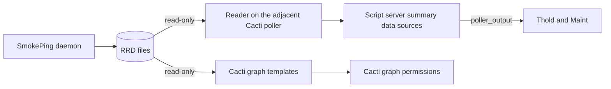

# plugin_smokeping

A proposed Cacti 1.2 plugin that brings SmokePing latency and loss measurements into Cacti as ordinary devices, data sources, and graphs. Smoke graphs then sit next to the device they belong to, under Cacti's permissions, and Thold and Maint can alert on and suppress them.

> **Status: proposal.** This repository contains no plugin code yet. It holds the design, its decision records, and the requirements tracked as issues and milestones. Nothing below describes shipped behavior.

## Why

SmokePing measures latency distribution and packet loss well, and its smoke graphs show variation that an average-only graph hides. Run alongside Cacti, it leaves three gaps:

- **Separate access control.** SmokePing's CGI knows nothing about Cacti users, groups, or device permissions.
- **No device context.** Latency and interface counters for the same device live in different tools.
- **No path into Cacti alerting.** Thold and Maint work on Cacti data sources and devices, so SmokePing alerts are configured and suppressed separately.

The plugin closes these gaps by representing each SmokePing target as Cacti objects that point at SmokePing's existing RRD files, plus a small set of polled summary values. It reuses Cacti's graphing, permissions, remote data collectors, Thold, and Maint rather than building parallel versions of them.

## Planned scope

| Phase | Scope | Milestones |
|---|---|---|
| 0, research | Compatibility matrix, upstream behavior confirmation, graph fidelity spike | [M1](https://github.com/somethingwithproof/plugin_smokeping/milestone/1) |
| 1, observe | Inventory import, Cacti devices, smoke and summary graphs, Thold alerting, Maint suppression, health page | [M2](https://github.com/somethingwithproof/plugin_smokeping/milestone/2), [M3](https://github.com/somethingwithproof/plugin_smokeping/milestone/3), [M4](https://github.com/somethingwithproof/plugin_smokeping/milestone/4) |
| 2, managed | Cacti-owned configuration namespace, ICMP and TCP probe profiles, revisions, validation, reload, rollback | [M5](https://github.com/somethingwithproof/plugin_smokeping/milestone/5) |
| 3, remote | SmokePing on Cacti remote data collectors, slaves as measurement locations | [M6](https://github.com/somethingwithproof/plugin_smokeping/milestone/6) |

Out of scope: a plugin-owned alerting engine, a reporting engine, a custom daemon or network protocol, managed HTTP/DNS/service checks (servcheck covers them), and writing to SmokePing's RRD files.

## Compatibility targets

| Component | Target |
|---|---|
| Cacti | 1.2.31 or later, no core patches |
| PHP | 8.2 or later; `setup.php` stays parseable on 8.0 so an unsupported runtime gets a refusal instead of a broken Cacti UI |
| SmokePing | 2.9.0 and 2.8.2; 2.7.3 if a supported distribution still ships it |
| Thold, Maint | No changes required |

## Design

- [docs/PLAN.md](docs/PLAN.md) is the full plan: architecture, upstream facts it depends on (with sources), state model, security boundaries, performance arithmetic, testing, and risks.
- [docs/decisions/](docs/decisions/) holds architecture decision records for choices already made.
- [docs/REQUIREMENTS.md](docs/REQUIREMENTS.md) maps every requirement ID to its issue.

## How work is tracked

- **Milestones** follow the plan's milestones. Each has an epic issue listing its sub-issues and exit evidence.
- **Issues** are typed by label: `type: requirement`, `type: research`, `type: decision`, `type: epic`. Requirement issues state numbered, testable requirements (`REQ-AREA-NNN`) and acceptance criteria.
- **Labels** also carry `area:`, `phase:`, `priority:`, and `status:`. See [CONTRIBUTING.md](CONTRIBUTING.md#labels).
- The [project board](https://github.com/users/somethingwithproof/projects/6) shows all issues across milestones.

## Contributing

Read [CONTRIBUTING.md](CONTRIBUTING.md). Commits need a DCO sign-off. Design discussion happens on issues; open decisions carry the `type: decision` label.

## Security

Report vulnerabilities privately; see [SECURITY.md](SECURITY.md).

## License

GNU General Public License v2.0, the same license as Cacti and its plugins. See [LICENSE](LICENSE).
