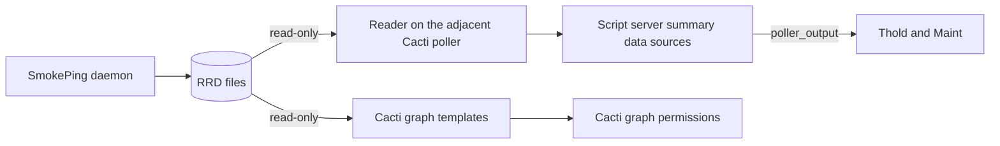

<h1 align="center">
	<picture>
		<source media="(prefers-color-scheme: dark)" srcset="docs/images/logo_dark.png">
		
	</picture>
</h1>

# plugin_smokeping

A Cacti 1.2 plugin that brings SmokePing latency and loss measurements into Cacti as ordinary devices, data sources, and graphs. Smoke graphs then sit next to the device they belong to, under Cacti's permissions, and Thold and Maint can alert on and suppress them.

> **Status: observe mode, release candidate.** The plugin reads SmokePing's configuration and RRD files, shows their state, creates Cacti devices, data sources, and graphs for them, and feeds Thold and Maint. It writes nothing to SmokePing. Managed mode (the plugin writing SmokePing configuration) and remote collectors are later phases and are not in this release. See [docs/install.md](docs/install.md) to start.

## Screenshots

Imported from a live SmokePing 2.8.2 network into Cacti 1.2.31, last 12 hours. Each target's device has a smoke graph for the master and one for each slave (`lon1`, `sgp1`), filed under its SmokePing section in the graph tree.

## Why

SmokePing measures latency distribution and packet loss well, and its smoke graphs show variation that an average-only graph hides. Run alongside Cacti, it leaves three gaps:

- **Separate access control.** SmokePing's CGI knows nothing about Cacti users, groups, or device permissions.
- **No device context.** Latency and interface counters for the same device live in different tools.
- **No path into Cacti alerting.** Thold and Maint work on Cacti data sources and devices, so SmokePing alerts are configured and suppressed separately.

The plugin closes these gaps by representing each SmokePing target as Cacti objects that point at SmokePing's existing RRD files, plus a small set of polled summary values. It reuses Cacti's graphing, permissions, remote data collectors, Thold, and Maint rather than building parallel versions of them.

## Planned scope

| Phase | Scope | Milestones |
|---|---|---|
| 0, research | Compatibility matrix, upstream behavior confirmation, graph fidelity spike | [M1](https://github.com/somethingwithproof/plugin_smokeping/milestone/1) |
| 1, observe | Inventory import, Cacti devices, smoke and summary graphs, Thold alerting, Maint suppression, health page | [M2](https://github.com/somethingwithproof/plugin_smokeping/milestone/2), [M3](https://github.com/somethingwithproof/plugin_smokeping/milestone/3), [M4](https://github.com/somethingwithproof/plugin_smokeping/milestone/4) |
| 2, managed | Cacti-owned configuration namespace, ICMP and TCP probe profiles, revisions, validation, reload, rollback | [M5](https://github.com/somethingwithproof/plugin_smokeping/milestone/5) |
| 3, remote | SmokePing on Cacti remote data collectors, slaves as measurement locations | [M6](https://github.com/somethingwithproof/plugin_smokeping/milestone/6) |

Out of scope: a plugin-owned alerting engine, a reporting engine, a custom daemon or network protocol, managed HTTP/DNS/service checks (servcheck covers them), and writing to SmokePing's RRD files.

## Compatibility targets

| Component | Target |
|---|---|
| Cacti | 1.2.31 or later in 1.2.x, no core patches |
| PHP | 8.2 or later; `setup.php` stays parseable on 8.0 so an unsupported runtime gets a refusal instead of a broken Cacti UI |
| SmokePing | 2.9.0 and 2.8.2; 2.7.3 if a supported distribution still ships it |
| Thold, Maint | No changes required |

## Documentation

| | |
|---|---|
| [Install](docs/install.md) | Requirements, the read-only mount of SmokePing's data directory, installation, containers, supported versions |
| [Operate](docs/operations.md) | What each state means and its evidence, health checks, behavior when inputs fail |
| [Add targets to Cacti](docs/provisioning.md) | One target, many devices, re-linking, permissions |
| [Alerting](docs/alerting.md) | Summary values, Thold durations, staleness, late data, overlap with SmokePing's alerts, Maint |
| [Configuration format](docs/configuration-format.md) | YAML and XML export and import |
| [Backup and restore](docs/backup-restore.md) | What to back up and how a restore resumes |
| [Performance](docs/performance.md) | Measured cost at 100, 1,000, and 10,000 series |
| [Failure qualification](docs/failure-qualification.md) | The failure scenarios and how each is tested |
| [Releasing](docs/RELEASING.md) | The release procedure: the pull request, the signed tag, what the workflow does, how to verify the result |
| [Release archive](docs/release.md) | Version, changelog, and the release archive |
| [Testing](docs/testing.md) | The suites, what CI runs, and the live suite against a real SmokePing |

## Design

- [docs/PLAN.md](docs/PLAN.md) is the full plan: architecture, upstream facts it depends on (with sources), state model, security boundaries, performance arithmetic, testing, and risks.
- [docs/decisions/](docs/decisions/) holds architecture decision records for choices already made.
- [docs/REQUIREMENTS.md](docs/REQUIREMENTS.md) maps every requirement ID to its issue.

## How work is tracked

- **Milestones** follow the plan's milestones. Each has an epic issue listing its sub-issues and exit evidence.
- **Issues** are typed by label: `type: requirement`, `type: research`, `type: decision`, `type: epic`. Requirement issues state numbered, testable requirements (`REQ-AREA-NNN`) and acceptance criteria.
- **Labels** also carry `area:`, `phase:`, `priority:`, and `status:`. See [CONTRIBUTING.md](CONTRIBUTING.md#labels).
- The [project board](https://github.com/users/somethingwithproof/projects/6) shows all issues across milestones.

## Contributing

Read [CONTRIBUTING.md](CONTRIBUTING.md). Commits need a DCO sign-off. Design discussion happens on issues; open decisions carry the `type: decision` label.

## Security

Report vulnerabilities privately; see [SECURITY.md](SECURITY.md).

## License

GNU General Public License v2.0, the same license as Cacti and its plugins. See [LICENSE](LICENSE).
