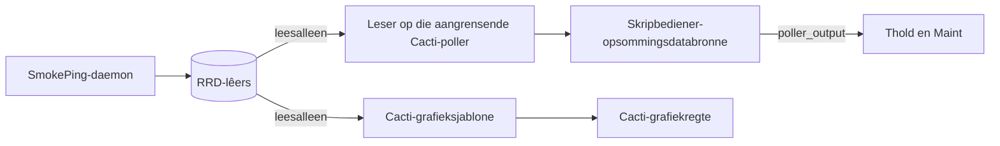

<!-- Source: README.md; SHA256: 17905aa1eac76a7d10dab526734605629fa3d1ada56397642ad4154c5be1feff -->

<!-- translations:start -->
[English](../../../README.md) | [简体中文](../zh-CN/README.md) | [हिन्दी](../hi-IN/README.md) | [Español (España)](../es-ES/README.md) | [Español (Latinoamérica)](../es-419/README.md) | [العربية (السعودية)](../ar-SA/README.md) | [Afrikaans](README.md) | [አማርኛ](../am-ET/README.md) | [العربية (مصر)](../ar-EG/README.md) | [العربية (المغرب)](../ar-MA/README.md) | [বাংলা](../bn-BD/README.md) | [Bosanski](../bs-BA/README.md) | [Deutsch](../de-DE/README.md) | [فارسی](../fa-IR/README.md) | [Filipino](../fil-PH/README.md) | [Français](../fr-FR/README.md) | [Français (Maroc)](../fr-MA/README.md) | [Français (Sénégal)](../fr-SN/README.md) | [Hausa](../ha-NG/README.md) | [עברית](../he-IL/README.md) | [Hrvatski](../hr-HR/README.md) | [Bahasa Indonesia](../id-ID/README.md) | [Igbo](../ig-NG/README.md) | [Italiano](../it-IT/README.md) | [日本語](../ja-JP/README.md) | [한국어](../ko-KR/README.md) | [Malagasy](../mg-MG/README.md) | [मराठी](../mr-IN/README.md) | [Bahasa Melayu](../ms-MY/README.md) | [Nederlands](../nl-NL/README.md) | [Polski](../pl-PL/README.md) | [Português (Brasil)](../pt-BR/README.md) | [Русский](../ru-RU/README.md) | [Kinyarwanda](../rw-RW/README.md) | [Soomaali](../so-SO/README.md) | [Српски](../sr-RS/README.md) | [Svenska](../sv-SE/README.md) | [Kiswahili](../sw-KE/README.md) | [தமிழ்](../ta-IN/README.md) | [తెలుగు](../te-IN/README.md) | [ไทย](../th-TH/README.md) | [Türkçe](../tr-TR/README.md) | [Українська](../uk-UA/README.md) | [اردو](../ur-PK/README.md) | [Tiếng Việt](../vi-VN/README.md) | [isiXhosa](../xh-ZA/README.md) | [Yorùbá](../yo-NG/README.md) | [繁體中文](../zh-TW/README.md) | [isiZulu](../zu-ZA/README.md)
<!-- translations:end -->

  <picture>
    <source media="(prefers-color-scheme: dark)" srcset="../../images/logo_dark.png">
    
  </picture>

# SmokePing-inprop vir Cacti

'n Cacti 1.2-inprop wat SmokePing-latensie- en verliesmetings na Cacti bring as gewone toestelle, databronne en grafieke. Rookgrafieke lê dan langs die toestel waaraan hulle behoort, onder Cacti se toegangsregte, en Thold en Maint kan waarskuwings daarop stel en dit onderdruk. Dit is 'n onafhanklike implementering vir Cacti en is nie deel van, of onderskryf deur, [SmokePing](https://oss.oetiker.ch/smokeping/) nie, wie se oorspronklike outeurs Tobias Oetiker en Niko Tyni is. Die inprop sluit nie SmokePing se kode in nie en voer dit ook nie uit nie: dit lees die konfigurasie- en RRD-lêers wat SmokePing skryf, en sy grafieksjablone is gebou om dieselfde reekse as SmokePing se eie grafieke te teken.

> **Status: in ontwikkeling. Waarnemingsmodus (fase 1) is op `main` geïmplementeer en as die 1.0.0-rc.1-voorvrystelling uitgereik.** Die inprop lees SmokePing se konfigurasie- en RRD-lêers, wys hul status, skep Cacti-toestelle, databronne en grafieke daarvoor, en voed Thold en Maint. Dit skryf niks na SmokePing toe nie. Bestuurde modus (waar die inprop SmokePing-konfigurasie skryf) en afgeleë versamelaars is latere fases wat nog nie begin is nie en nie in hierdie vrystelling ingesluit is nie. Loodstoetse op werklike installasies en 'n nouer ooreenkoms met SmokePing se grafieklegende is steeds oop in mylpaal 4. Sien [docs/install.md](../../install.md) om te begin.

## Toegangsrolle

| Gebied | Toegang |
| --- | --- |
| SmokePing View | Bestaande moniteringsblaaie. |
| SmokePing Operator | Monitering plus die Bedrywighede-bladsy en persoonlike siftingsbevestigings. |
| SmokePing Admin | Operator-toegang plus die bestaande konfigurasie- en administratiewe aksies. |

Nadat opgraderingslêers gekopieer is, maak die Inproppe-bladsy as 'n administrateur oop om
die nuwe gebied te registreer. Ken die Operator-gebied eksplisiet onder **Configuration > Users** of gebruikersgroepe toe.
Opgraderings behou die bestaande View- en Admin-gebied-ID's en -regte. Admin-toegang
erf Operator-toegang, en Operator-toegang erf View-toegang met elke versoek;
dit voeg nie gestoorde regte by gebruikers of groepe nie. Inpropinstellings vereis ook
SmokePing Admin-toegang benewens Cacti se Settings-toestemming.

Cacti-toestelregte beperk steeds die rye en aksies wat vir elke gebruiker beskikbaar is; ongekarteerde objekte vereis 'n administrateur.
Aanmeldbesonderhede, konfigurasie, kartering, skrapping en ander administratiewe wysigings
bly in die administratiewe bladsye. Erkennings geld slegs in die huidige
gebruiker se sessie, vir hoogstens een uur en slegs solank dieselfde waarneming
vars bly. Nuwe of gewysigde waarnemings maak dit ongeldig. Dit merk nooit 'n mislukte
meting as gesond nie en onderdruk ook nie waarskuwings nie.

## Skermkiekies

Ingevoer vanaf 'n lewendige SmokePing 2.8.2-netwerk na Cacti 1.2.31, laaste 12 uur. Elke teiken se toestel het 'n rookgrafiek vir die meester en een vir elke slaaf (`lon1`, `sgp1`), geliasseer onder sy SmokePing-afdeling in die grafiekboom.

## Waarom

SmokePing meet latensieverspreiding en pakkieverlies goed, en sy rookgrafieke wys variasie wat 'n grafiek met slegs gemiddeldes verberg. Wanneer dit saam met Cacti loop, laat dit drie gapings:

- **Afsonderlike toegangsbeheer.** SmokePing se CGI weet niks van Cacti-gebruikers, -groepe of -toestelregte nie.
- **Geen toestelkonteks nie.** Latensie- en koppelvlaktellers vir dieselfde toestel leef in verskillende nutsmiddels.
- **Geen pad na Cacti-waarskuwings nie.** Thold en Maint werk op Cacti-databronne en -toestelle, dus word SmokePing-waarskuwings afsonderlik opgestel en onderdruk.

Die inprop oorbrug hierdie gapings deur elke SmokePing-teiken voor te stel as Cacti-objekte wat na SmokePing se bestaande RRD-lêers wys, plus 'n klein stel gepeilde opsommingswaardes. Dit hergebruik Cacti se grafiekskepping, toegangsregte, Thold en Maint eerder as om parallelle weergawes daarvan te bou. Ondersteuning vir afgeleë Cacti-dataversamelaars word vir fase 3 beplan en is nie in hierdie vrystelling nie.

## Omvang en status

| Fase | Omvang | Mylpale | Status |
|---|---|---|---|
| 0, navorsing | Versoenbaarheidsmatriks, bevestiging van stroomop-gedrag, grafiekgetrouheid-ondersoek | [M1](https://github.com/somethingwithproof/plugin_smokeping/milestone/1) | Bevindinge in `docs/research`; sommige navorsingskwessies is oop |
| 1, waarneming | Inventaris-invoer, Cacti-toestelle, rook- en opsommingsgrafieke, Thold-waarskuwings, Maint-onderdrukking, gesondheidsbladsy | [M2](https://github.com/somethingwithproof/plugin_smokeping/milestone/2), [M3](https://github.com/somethingwithproof/plugin_smokeping/milestone/3), [M4](https://github.com/somethingwithproof/plugin_smokeping/milestone/4) | Vrygestel as 1.0.0-rc.1; loodstoetse oop |
| 2, bestuur | Cacti-besitte konfigurasienaamruimte, ICMP- en TCP-toetsprofiele, hersienings, validering, herlaai, terugrol | [M5](https://github.com/somethingwithproof/plugin_smokeping/milestone/5) | Beplan, nog nie begin nie |
| 3, afgeleë | SmokePing op afgeleë Cacti-dataversamelaars, slawe as metingsliggings | [M6](https://github.com/somethingwithproof/plugin_smokeping/milestone/6) | Beplan, nog nie begin nie |

Buite omvang: 'n inprop-eie waarskuwingsenjin, 'n verslagdoeningsenjin, 'n pasgemaakte daemon of netwerkprotokol, bestuurde HTTP-/DNS-/dienskontroles (servcheck dek dit), en skryf na SmokePing se RRD-lêers.

## Versoenbaarheidsdoelwitte

| Komponent | Doelwit |
|---|---|
| Cacti | 1.2.31 of later in 1.2.x, geen kernwysigings nie |
| PHP | 8.2 of later; `setup.php` bly ontleedbaar op 8.0 sodat 'n nie-ondersteunde looptyd 'n weiering kry in plaas van 'n stukkende Cacti-koppelvlak |
| SmokePing | 2.9.0, 2.8.2 en 2.7.3 (slegs Ubuntu 22.04, tot 2027-06-01) |
| Thold, Maint | Geen wysigings nodig nie |
| Reekse | 10 000 per installasie teen 20 pings en 'n 300 s-stap ([werkverrigting](../../performance.md#supported-series-count)) |

## Dokumentasie

| | |
|---|---|
| [Installeer](../../install.md) | Vereistes, die leesalleen-koppeling van SmokePing se datagids, installasie, houers, ondersteunde weergawes |
| [Bedryf](../../operations.md) | Wat elke status beteken en die bewyse daarvan, gesondheidskontroles, gedrag wanneer toevoer faal |
| [Voeg teikens by Cacti](../../provisioning.md) | Een teiken, baie toestelle, herkoppeling, toegangsregte |
| [Waarskuwings](../../alerting.md) | Opsommingswaardes, Thold-tydsduur, veroudering, laat data, oorvleueling met SmokePing se waarskuwings, Maint |
| [Konfigurasieformaat](../../configuration-format.md) | YAML- en XML-uitvoer en -invoer |
| [Rugsteun en herstel](../../backup-restore.md) | Wat om te rugsteun en hoe 'n herstel hervat |
| [Werkverrigting](../../performance.md) | Plaaslike en vrystellingloper-metings teen 100, 1 000 en 10 000 reekse, en die ondersteunde reekstelling: 10 000 per installasie |
| [Foutkwalifisering](../../failure-qualification.md) | Die foutscenario's en hoe elkeen getoets word |
| [Vrystelling](../../RELEASING.md) | Die vrystellingsprosedure: die trekversoek, die ondertekende merker, wat die werkvloei doen, hoe om die resultaat te verifieer |
| [Vrystellingsargief](../../release.md) | Weergawe, veranderingslogboek en die vrystellingsargief |
| [Toetsing](../../testing.md) | Die toetsstelle, wat CI uitvoer, en die lewendige stel teen 'n werklike SmokePing |

## Ontwerp

- [docs/PLAN.md](../../PLAN.md) is die volledige plan: argitektuur, stroomop-feite waarop dit steun (met bronne), statusmodel, sekuriteitsgrense, werkverrigtingsberekeninge, toetsing en risiko's.
- [docs/decisions/](../../decisions) bevat argitektuurbesluitrekords vir keuses wat reeds gemaak is.
- [docs/REQUIREMENTS.md](../../REQUIREMENTS.md) karteer elke vereiste-ID na sy kwessie.

## Hoe werk nagespoor word

- **Mylpale** volg die plan se mylpale. Elkeen het 'n epiek-kwessie wat sy sub-kwessies en uittreebewyse lys.
- **Kwessies** word volgens etiket getipeer: `type: requirement`, `type: research`, `type: decision`, `type: epic`. Vereistekwessies meld genommerde, toetsbare vereistes (`REQ-AREA-NNN`) en aanvaardingskriteria.
- **Etikette** dra ook `area:`, `phase:`, `priority:` en `status:`. Sien [CONTRIBUTING.md](../../../CONTRIBUTING.md#labels).
- Die [projekbord](https://github.com/users/somethingwithproof/projects/6) wys alle kwessies oor mylpale heen.

## Bydraes

Lees [CONTRIBUTING.md](../../../CONTRIBUTING.md). Byvoegings (commits) benodig 'n DCO-aftekening. Ontwerpbespreking vind op kwessies plaas; oop besluite dra die `type: decision`-etiket.

## Sekuriteit

Rapporteer kwesbaarhede privaat; sien [SECURITY.md](../../../SECURITY.md).

## Lisensie

GNU General Public License v2.0, dieselfde lisensie as Cacti en sy inproppe. Sien [LICENSE](../../../LICENSE).
