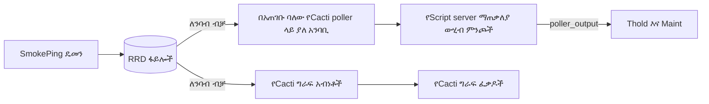

<!-- Source: README.md; SHA256: b41ec705327127cc34ff07d1514a141262752f99c5e2296fdc323d584a777b84 -->

<!-- translations:start -->
[English](../../../README.md) | [简体中文](../zh-CN/README.md) | [हिन्दी](../hi-IN/README.md) | [Español (España)](../es-ES/README.md) | [Español (Latinoamérica)](../es-419/README.md) | [العربية (السعودية)](../ar-SA/README.md) | [Afrikaans](../af-ZA/README.md) | [አማርኛ](README.md) | [العربية (مصر)](../ar-EG/README.md) | [العربية (المغرب)](../ar-MA/README.md) | [বাংলা](../bn-BD/README.md) | [Bosanski](../bs-BA/README.md) | [Deutsch](../de-DE/README.md) | [فارسی](../fa-IR/README.md) | [Filipino](../fil-PH/README.md) | [Français](../fr-FR/README.md) | [Français (Maroc)](../fr-MA/README.md) | [Français (Sénégal)](../fr-SN/README.md) | [Hausa](../ha-NG/README.md) | [עברית](../he-IL/README.md) | [Hrvatski](../hr-HR/README.md) | [Bahasa Indonesia](../id-ID/README.md) | [Igbo](../ig-NG/README.md) | [Italiano](../it-IT/README.md) | [日本語](../ja-JP/README.md) | [한국어](../ko-KR/README.md) | [Malagasy](../mg-MG/README.md) | [मराठी](../mr-IN/README.md) | [Bahasa Melayu](../ms-MY/README.md) | [Nederlands](../nl-NL/README.md) | [Polski](../pl-PL/README.md) | [Português (Brasil)](../pt-BR/README.md) | [Русский](../ru-RU/README.md) | [Kinyarwanda](../rw-RW/README.md) | [Soomaali](../so-SO/README.md) | [Српски](../sr-RS/README.md) | [Svenska](../sv-SE/README.md) | [Kiswahili](../sw-KE/README.md) | [தமிழ்](../ta-IN/README.md) | [తెలుగు](../te-IN/README.md) | [ไทย](../th-TH/README.md) | [Türkçe](../tr-TR/README.md) | [Українська](../uk-UA/README.md) | [اردو](../ur-PK/README.md) | [Tiếng Việt](../vi-VN/README.md) | [isiXhosa](../xh-ZA/README.md) | [Yorùbá](../yo-NG/README.md) | [繁體中文](../zh-TW/README.md) | [isiZulu](../zu-ZA/README.md)
<!-- translations:end -->

  <picture>
    <source media="(prefers-color-scheme: dark)" srcset="../../images/logo_dark.png">
    
  </picture>

# ለCacti የSmokePing ተሰኪ

የSmokePing መዘግየት (latency) እና የፓኬት መጥፋት ልኬቶችን ወደ Cacti እንደ መደበኛ መሣሪያዎች፣ የውሂብ ምንጮች እና ግራፎች የሚያመጣ የCacti 1.2 ተሰኪ ነው። ከዚያም የጭስ (Smoke) ግራፎች በCacti ፈቃዶች ሥር ከሚመለከታቸው መሣሪያ ጎን ይቀመጣሉ፤ እንዲሁም Thold እና Maint ማንቂያዎችን ሊሰጡባቸው እና ሊያግዷቸው ይችላሉ። ይህ ለCacti የተዘጋጀ ራሱን የቻለ ትግበራ ሲሆን፣ ዋና ደራሲዎቹ Tobias Oetiker እና Niko Tyni የሆኑት የ[SmokePing](https://oss.oetiker.ch/smokeping/) አካል አይደለም ወይም በእሱ የተደገፈ አይደለም። ተሰኪው የSmokePing ኮድን አያካትትም ወይም አያስኬድም፦ SmokePing የሚጽፋቸውን የውቅር እና የRRD ፋይሎች ያነባል፣ እንዲሁም የግራፍ አብነቶቹ ልክ እንደ SmokePing የራሱ ግራፎች ተመሳሳይ ተከታታዮችን (series) እንዲስሉ ተደርገው የተገነቡ ናቸው።

> **ሁኔታ፦ በልማት ላይ። የመታዘብ ሁኔታ (ምዕራፍ 1) በ`main` (1.0.0-rc.1) ላይ ከኦፕሬተር ማጣሪያ፣ ከCSV ወደ ውጭ መላኪያ፣ ወላጅ አልባ RRD መለያ፣ የThold ማንቂያ ትርጉም፣ የሥነ-ምህዳር ውህደት መንጠቆዎች እና የርቀት ሰብሳቢ ማባዛት ጋር ተተግብሯል።** ተሰኪው የSmokePingን ውቅር እና RRD ፋይሎች ያነባል፣ ሁኔታቸውን ያሳያል፣ ለእነሱ የCacti መሣሪያዎችን፣ የውሂብ ምንጮችን እና ግራፎችን ይፈጥራል፣ እንዲሁም Tholdን እና Maintን ይመግባል። ወደ SmokePing ምንም አይጽፍም። የሚተዳደር ሁኔታ (ተሰኪው የSmokePing ውቅርን የሚጽፍበት) ቀጣይ ምዕራፍ ነው፤ አልተጀመረም እና በዚህ ልቀት ውስጥ የለም። በእውነተኛ መጫኛዎች ላይ የሚደረጉ ሙከራዎች እና ከSmokePing የግራፍ መግለጫ ጋር ይበልጥ የሚቀራረብ ማዛመድ በምዕራፍ 4 ውስጥ ክፍት ሆነው ቀጥለዋል። ለመጀመር [docs/install.md](../../install.md)ን ይመልከቱ።

## የመዳረሻ ሚናዎች

| ክልል (Realm) | መዳረሻ |
| --- | --- |
| SmokePing View | ነባር የክትትል ገጾች። |
| SmokePing Operator | ክትትል እና የክወናዎች (Operations) ገጽ እንዲሁም የግል ቅድሚያ-መለያ (triage) እውቅናዎች። |
| SmokePing Admin | የOperator መዳረሻ እና ነባር የውቅር እና የአስተዳደር እርምጃዎች። |

የማሻሻያ ፋይሎችን ከቀዱ በኋላ፣ አዲሱን ክልል ለመመዝገብ እንደ አስተዳዳሪ የPlugins ገጹን ይክፈቱ።
በ**Configuration > Users** ወይም በተጠቃሚ ቡድኖች ሥር የOperator ክልልን በግልጽ ይመድቡ።
ማሻሻያዎች ነባር የView እና Admin ክልል መታወቂያዎችን እና ፈቃዶችን ይይዛሉ። የAdmin መዳረሻ
የOperator መዳረሻን ይወርሳል፣ የOperator መዳረሻም በእያንዳንዱ ጥያቄ ላይ የView መዳረሻን ይወርሳል፤
ይህ ለተጠቃሚዎች ወይም ለቡድኖች የተከማቹ ፈቃዶችን አይጨምርም። የተሰኪ ቅንብሮች እንዲሁ
ከCacti የSettings ፈቃድ በተጨማሪ የSmokePing Admin መዳረሻን ይፈልጋሉ።

የCacti መሣሪያ ፈቃዶች አሁንም ለእያንዳንዱ ተጠቃሚ የሚገኙትን ረድፎች እና እርምጃዎች ይገድባሉ፤ ያልተዛመዱ ነገሮች አስተዳዳሪን ይፈልጋሉ።
ምስክርነቶች፣ ውቅር፣ ማዛመድ፣ መሰረዝ እና ሌሎች የአስተዳደር ለውጦች
በአስተዳደር ገጾች ውስጥ ይቆያሉ። እውቅናዎች (Acknowledgments) የሚቆዩት አሁን ባለው
የተጠቃሚ ክፍለ-ጊዜ ውስጥ ብቻ፣ ቢበዛ ለአንድ ሰዓት እና ተመሳሳዩ ምልከታ ትኩስ
ሆኖ እስከቆየ ድረስ ብቻ ነው። አዳዲስ ወይም የተለወጡ ምልከታዎች ዋጋ ያሳጧቸዋል። ያልተሳካ
ልኬትን ጤናማ አድርገው ምልክት አያደርጉም ወይም ማንቂያዎችን አያግዱም።

## ቅጽበታዊ ገጽ እይታዎች

ከቀጥታ SmokePing 2.8.2 አውታረ መረብ ወደ Cacti 1.2.31 የገባ፣ ያለፉት 12 ሰዓታት። እያንዳንዱ የዒላማ መሣሪያ ለዋናው (master) እና ለእያንዳንዱ ተከታይ (slave) (`lon1`፣ `sgp1`) የጭስ ግራፍ አለው፤ በግራፍ ዛፉ ውስጥ በSmokePing ክፍሉ ሥር ተመዝግቧል።

## ለምን

SmokePing የመዘግየት ስርጭትን እና የፓኬት መጥፋትን በጥሩ ሁኔታ ይለካል፣ እና የጭስ ግራፎቹ አማካይ-ብቻ ግራፍ የሚደብቀውን ልዩነት ያሳያሉ። ከCacti ጎን ለጎን ሲሰራ ሦስት ክፍተቶችን ይተዋል፦

- **የተለየ የመዳረሻ ቁጥጥር።** የSmokePing CGI ስለ Cacti ተጠቃሚዎች፣ ቡድኖች ወይም የመሣሪያ ፈቃዶች ምንም አያውቅም።
- **የመሣሪያ አውድ የለም።** ለተመሳሳይ መሣሪያ መዘግየት እና የበይነገጽ ቆጣሪዎች በተለያዩ መሣሪያዎች ውስጥ ይኖራሉ።
- **ወደ Cacti ማንቂያ የሚወስድ መንገድ የለም።** Thold እና Maint የሚሰሩት በCacti የውሂብ ምንጮች እና መሣሪያዎች ላይ ነው፤ ስለዚህ የSmokePing ማንቂያዎች ተለይተው ይዋቀራሉ እና ይታገዳሉ።

ተሰኪው እያንዳንዱን የSmokePing ዒላማ ወደ SmokePing ነባር RRD ፋይሎች የሚያመለክቱ የCacti ነገሮች እና አነስተኛ የሆነ የተጠየቁ ማጠቃለያ እሴቶች ስብስብ በማድረግ እነዚህን ክፍተቶች ይዘጋል። የእነሱን ትይዩ ስሪቶች ከመገንባት ይልቅ የCactiን ግራፍ ማውጣት፣ ፈቃዶችን፣ Tholdን እና Maintን እንደገና ይጠቀማል። በpoller የተገደበ የውቅር ማባዛት (`replicate_out`) አካባቢያዊ ሁኔታን (`poller 1`) እና የሰብሳቢ-አካባቢያዊ ምልከታ መሸጎጫዎችን ተነጥለው እየጠበቀ የርቀት poller ውቅር ሰንጠረዦችን ይገፋል።

## ወሰን እና ሁኔታ

| ምዕራፍ | ወሰን | ወሳኝ ምዕራፎች | ሁኔታ |
|---|---|---|---|
| 0፣ ምርምር | የተኳኋኝነት ማትሪክስ፣ የupstream ባህሪ ማረጋገጫ፣ የግራፍ ትክክለኛነት ሙከራ | [M1](https://github.com/somethingwithproof/plugin_smokeping/milestone/1) | ግኝቶች በ`docs/research` ውስጥ፤ አንዳንድ የምርምር ጉዳዮች ክፍት ናቸው |
| 1፣ መታዘብ | የንብረት ዝርዝር ማስገባት፣ የCacti መሣሪያዎች፣ የጭስ እና የማጠቃለያ ግራፎች፣ የThold ማንቂያ እና የማንቂያ ትርጉም፣ የMaint እገዳ፣ የተጣሩ እይታዎች፣ CSV ወደ ውጭ መላክ፣ ወላጅ አልባ RRD መለየት፣ የሥነ-ምህዳር መንጠቆዎች | [M2](https://github.com/somethingwithproof/plugin_smokeping/milestone/2), [M3](https://github.com/somethingwithproof/plugin_smokeping/milestone/3), [M4](https://github.com/somethingwithproof/plugin_smokeping/milestone/4) | ተተግብሯል፤ ሙከራዎች ክፍት ናቸው |
| 2፣ የሚተዳደር | በCacti ባለቤትነት የተያዘ የውቅር ስም ቦታ፣ የICMP እና TCP መፈተሻ መገለጫዎች፣ ክለሳዎች፣ ማረጋገጫ፣ ዳግም መጫን፣ ወደኋላ መመለስ | [M5](https://github.com/somethingwithproof/plugin_smokeping/milestone/5) | የታቀደ፣ አልተጀመረም |
| 3፣ የርቀት | ለርቀት ውሂብ ሰብሳቢዎች በpoller የተገደቡ ጥያቄዎች እና የ`replicate_out` ሰንጠረዥ ማባዛት (`RemoteReplication`)፤ ሙሉ ባለብዙ ሰብሳቢ SmokePing ማሰማራት ብቃት ማረጋገጫ | [M6](https://github.com/somethingwithproof/plugin_smokeping/milestone/6) | ማባዛትና የpoller ገደብ ተተግብረዋል፤ ባለብዙ ሰብሳቢ ማሰማራት ብቃት ማረጋገጫ ክፍት ነው |

የተተገበሩ የኦፕሬተር የሥራ ፍሰቶች፣ የCLI ትእዛዞች እና የሥነ-ምህዳር መንጠቆዎች፦

- **የንብረት ዝርዝር እና የዒላማ ማጣሪያ (`smokeping_inventory.php`, `smokeping.php`)**፦ `TargetFilter`፣ `TargetRepository::filteredForPoller()`፣ `InventoryPage` እና `ViewPage` ፍለጋ (`filter`)፣ መፈተሻ (`probe`)፣ የዝርዝር መኖር (`presence`)፣ የካርታ ሁኔታ (`mapping`)፣ የትኩስነት ሁኔታ (`state`) እና አማራጭ የገጽ መጠን ክፍፍል (`rows`፦ `All`፣ `25`፣ `50`፣ `100`፣ `200`) ያቀርባሉ። ጠቅላላ ድምሮች የተደበቁ መሣሪያዎችን በፍጹም እንዳያጋልጡ የመሣሪያ ታይነት ከመቆጠሩ በፊት በSQL ውስጥ ይተገበራል።
- **CSV ወደ ውጭ መላክ (`smokeping.php?action=export_csv`)**፦ `CsvExporter` በጠሪው የመሣሪያ ፈቃዶች ሥር ለነቃው የተጣራ እይታ RFC 4180 CRLF ውጤትን ያሰራጫል፣ እንዲሁም የተመን ሉህ ቀመሮችን ለማምከን በ`=`፣ `+`፣ `-`፣ `@`፣ tab ወይም carriage return የሚጀምሩ ሕዋሳትን በአፖስትሮፊ ይጀምራል።
- **ወላጅ አልባ RRD መለየት (`smokeping_health.php`)**፦ `OrphanRrdScanner` እና `HealthCheck::orphanRrds()` በአንባቢው poller ላይ በSmokePing መጫኛ ውስጥ የተገደበ ፍተሻ ያካሂዳሉ፣ `__cgi`፣ `__sortercache` እና ሲምቦሊክ አገናኞችን ይዘላሉ፣ እንዲሁም ባለቤት የሌላቸውን `.rrd` ፋይሎች ክፍት ከሆኑ የዳግም ማገናኛ ጥቆማዎች ጋር ያመሳስላሉ።
- **SmokePing-ወደ-Thold መለወጥ (`smokeping_health.php`, `cli/smokeping.php`)**፦ `TholdTranslator` እና `TholdGenerator` የSmokePing `*** Alerts ***` ትርጓሜዎችን ያነባሉ እና የSmokePing ውቅር ፋይሎችን ሳይቀይሩ የሚደገፉ ተከታታይ የመጥፋት ቅጦችን ወደ ተመጣጣኝ `loss_pct` የThold ገደቦች ይተረጉማሉ። የድር ፍሰቱ GET ቅድመ-እይታን (`action=thold_preview`, `HealthPage::renderTholdPreview()`) ተከትሎ በCSRF የተጠበቀ POST (`action=thold_create`) ይጠቀማል። የማይደገፉ ቅጦች (የRTT ማንቂያዎች፣ wildcard decay፣ የተቀላቀሉ ደረጃዎች) ሳይጻፉ ይዘለላሉ።
- **የአስተዳዳሪ CLI (`cli/smokeping.php`)**፦ `provision <target path> [--device=ID] [--location=NAME]`፣ `relink <old target path> <new target path> [--location=NAME]`፣ `thold-generate <target path> [--alert=NAME] [--apply]`፣ `size-graphs`፣ `upgrade-graphs`፣ `export [--format=yaml|xml] [--file=PATH]`፣ `import --file=PATH [--format=yaml|xml] [--apply --confirm=PLAN]` እና `import-smokeping [--dry-run | --apply --confirm=PLAN] [--file=PATH] [--sections=A,B/C] [--device-per=host|target] [--device-template=ID] [--poller=ID] [--site=ID] [--tree=ID | --tree-name=NAME]` ይደግፋል።
- **የሥነ-ምህዳር መንጠቆዎች (`setup.php`, `Schema::HOOKS`)**፦ 21 መንጠቆዎችን ይመዘግባል፣ ከእነዚህም ውስጥ `abilities_register` (`AbilitiesProvider`፦ በጥብቅ ለንባብ ብቻ የሆኑ `smokeping-list-targets` እና `smokeping-get-health`፣ በጠሪው የተጠቃሚ መታወቂያ ላይ በView ክልል የተገደቡ፣ ምንም ሚስጥር የማይመልሱ)፣ `doctor_register_checks` (`DoctorChecks`፦ `smokeping_stale_targets`፣ `smokeping_freshness_breaches`፣ `smokeping_orphan_rrds`፣ `smokeping_config_path`)፣ `casc_register_providers` (`CascProvider`፦ በ`ConfigCodec` እና `ConfigService` የተደገፈ የ`smokeping` YAML/XML `export`፣ `validate`፣ `plan` እና `apply`)፣ እና `replicate_out` (`RemoteReplication`፦ `poller_id > 1` ላላቸው የርቀት pollerዎች በpoller የተገደበ የ`plugin_smokeping_target`፣ `plugin_smokeping_mapping`፣ `plugin_smokeping_object` እና `plugin_smokeping_relink` ማመሳሰል) ይገኙበታል።

ከወሰን ውጭ፦ በተሰኪ ባለቤትነት የተያዘ የማንቂያ ሞተር፣ የሪፖርት ማቅረቢያ ሞተር፣ ብጁ ዴመን ወይም የአውታረ መረብ ፕሮቶኮል፣ የሚተዳደሩ HTTP/DNS/አገልግሎት ፍተሻዎች (servcheck ይሸፍናቸዋል)፣ እና ወደ SmokePing RRD ፋይሎች መጻፍ።

## የተኳኋኝነት ዒላማዎች

| አካል | ዒላማ |
|---|---|
| Cacti | 1.2.31 ወይም ከዚያ በኋላ በ1.2.x ውስጥ፣ ምንም ዋና ጥገናዎች የሉም |
| PHP | 8.2 ወይም ከዚያ በኋላ፤ ያልተደገፈ የሩጫ ጊዜ የተበላሸ Cacti UI ከማግኘት ይልቅ እምቢታ እንዲያገኝ `setup.php` በ8.0 ላይ ሊተነተን የሚችል ሆኖ ይቆያል |
| SmokePing | 2.9.0፣ 2.8.2 እና 2.7.3 (Ubuntu 22.04 ብቻ፣ እስከ 2027-06-01) |
| Thold፣ Maint | ምንም ለውጦች አያስፈልጉም |
| ተከታታዮች (Series) | በአንድ መጫኛ 10,000 በ20 ፒንጎች እና በ300 ሰከንድ ደረጃ ([አፈጻጸም](../../performance.md#supported-series-count)) |

## ሰነዶች

| | |
|---|---|
| [መጫን](../../install.md) | መስፈርቶች፣ የSmokePing የውሂብ ማውጫ ለንባብ-ብቻ መጫኛ፣ መጫን፣ ኮንቴይነሮች፣ የሚደገፉ ስሪቶች |
| [አሠራር](../../operations.md) | እያንዳንዱ ሁኔታ ምን ማለት እንደሆነ እና ማስረጃው፣ የጤና ፍተሻዎች፣ ግብዓቶች ሲወድቁ የሚኖር ባህሪ |
| [ዒላማዎችን ወደ Cacti አክል](../../provisioning.md) | አንድ ዒላማ፣ ብዙ መሣሪያዎች፣ እንደገና ማገናኘት፣ ፈቃዶች |
| [ማንቂያ](../../alerting.md) | የማጠቃለያ እሴቶች፣ የThold ቆይታዎች፣ መቆየት (staleness)፣ የዘገየ ውሂብ፣ ከSmokePing ማንቂያዎች ጋር መደራረብ፣ Maint |
| [የውቅር ቅርጸት](../../configuration-format.md) | YAML እና XML ወደ ውጭ መላክ እና ማስገባት |
| [ምትኬ እና መልሶ ማግኘት](../../backup-restore.md) | ምን ምትኬ መያዝ እንዳለበት እና መልሶ ማግኘት እንዴት እንደሚቀጥል |
| [አፈጻጸም](../../performance.md) | በ100፣ 1,000 እና 10,000 ተከታታዮች ላይ የአካባቢ እና የልቀት-አስኪያጅ ልኬቶች፣ እና የሚደገፈው የተከታታይ ብዛት፦ በአንድ መጫኛ 10,000 |
| [የብልሽት ብቃት ማረጋገጫ](../../failure-qualification.md) | የብልሽት ሁኔታዎች እና እያንዳንዱ እንዴት እንደሚፈተሽ |
| [ልቀት ማውጣት](../../RELEASING.md) | የልቀት ሂደት፦ የመሳብ ጥያቄ (pull request)፣ የተፈረመ መለያ (signed tag)፣ የሥራ ፍሰቱ ምን እንደሚያደርግ፣ ውጤቱን እንዴት ማረጋገጥ እንደሚቻል |
| [የልቀት ማህደር](../../release.md) | ስሪት፣ የለውጥ መዝገብ እና የልቀት ማህደር |
| [ሙከራ](../../testing.md) | ስብስቦቹ፣ CI ምን እንደሚያስኬድ፣ እና ከእውነተኛ SmokePing ጋር የሚደረገው የቀጥታ ስብስብ |

## ንድፍ

- [docs/PLAN.md](../../PLAN.md) ሙሉው ዕቅድ ነው፦ አርክቴክቸር፣ የሚደገፍባቸው የupstream እውነታዎች (ከምንጮች ጋር)፣ የሁኔታ ሞዴል፣ የደህንነት ወሰኖች፣ የአፈጻጸም ስሌት፣ ሙከራ እና ስጋቶች።
- [docs/decisions/](../../decisions) ቀድሞ ለተደረጉ ምርጫዎች የአርክቴክቸር ውሳኔ መዝገቦችን ይይዛል።
- [docs/REQUIREMENTS.md](../../REQUIREMENTS.md) እያንዳንዱን የመስፈርት መታወቂያ ከጉዳዩ ጋር ያዛምዳል።
- የአካባቢያዊ ማረጋገጫ የPest የአሃድ እና የምንጭ-ሕግ ፍተሻዎችን (`pest --configuration=phpunit.xml`)፣ PHPStan Level 9 (`CACTI_PATH=<cacti-dir> phpstan analyse -c phpstan.neon --no-progress`)፣ የመግቢያ ነጥብ አገባብ ፍተሻዎችን (`php -l` በ`*.php`፣ `include/*.php`፣ `scripts/*.php`፣ `cli/*.php` ላይ) እና የትርጉም ፍተሻዎችን (`sh locales/build_gettext.sh --check`) ያስኬዳል። ለውህደት እና ለኮንቴይነር ከጫፍ እስከ ጫፍ ስብስቦች [docs/testing.md](../../testing.md)ን ይመልከቱ።

## ሥራ እንዴት እንደሚከታተል

- **ወሳኝ ምዕራፎች** የዕቅዱን ወሳኝ ምዕራፎች ይከተላሉ። እያንዳንዱ ንዑስ-ጉዳዮቹን እና የመውጫ ማስረጃውን የሚዘረዝር ዋና (epic) ጉዳይ አለው።
- **ጉዳዮች** በመለያ የተከፋፈሉ ናቸው፦ `type: requirement`፣ `type: research`፣ `type: decision`፣ `type: epic`። የመስፈርት ጉዳዮች ቁጥር የተሰጣቸው፣ ሊፈተሹ የሚችሉ መስፈርቶችን (`REQ-AREA-NNN`) እና የመቀበያ መስፈርቶችን ይገልጻሉ።
- **መለያዎች** እንዲሁ `area:`፣ `phase:`፣ `priority:` እና `status:` ይይዛሉ። [CONTRIBUTING.md](../../../CONTRIBUTING.md#labels)ን ይመልከቱ።
- [የፕሮጀክት ሰሌዳው](https://github.com/users/somethingwithproof/projects/6) በወሳኝ ምዕራፎች ውስጥ ያሉትን ሁሉንም ጉዳዮች ያሳያል።

## አስተዋጽዖ ማድረግ

[CONTRIBUTING.md](../../../CONTRIBUTING.md)ን ያንብቡ። ኮሚቶች (Commits) የDCO ፊርማ ያስፈልጋቸዋል። የንድፍ ውይይት በጉዳዮች ላይ ይካሄዳል፤ ክፍት ውሳኔዎች `type: decision` መለያን ይይዛሉ።

## ደህንነት

ተጋላጭነቶችን በግል ሪፖርት ያድርጉ፤ [SECURITY.md](../../../SECURITY.md)ን ይመልከቱ።

## ፈቃድ

GNU General Public License v2.0፣ ልክ እንደ Cacti እና ተሰኪዎቹ ተመሳሳይ ፈቃድ። [LICENSE](../../../LICENSE)ን ይመልከቱ።
