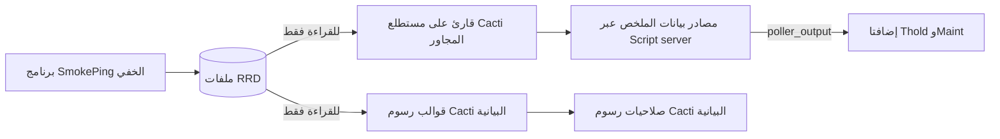

<!-- Source: README.md; SHA256: b41ec705327127cc34ff07d1514a141262752f99c5e2296fdc323d584a777b84 -->

<!-- translations:start -->
[English](../../../README.md) | [简体中文](../zh-CN/README.md) | [हिन्दी](../hi-IN/README.md) | [Español (España)](../es-ES/README.md) | [Español (Latinoamérica)](../es-419/README.md) | [العربية (السعودية)](../ar-SA/README.md) | [Afrikaans](../af-ZA/README.md) | [አማርኛ](../am-ET/README.md) | [العربية (مصر)](README.md) | [العربية (المغرب)](../ar-MA/README.md) | [বাংলা](../bn-BD/README.md) | [Bosanski](../bs-BA/README.md) | [Deutsch](../de-DE/README.md) | [فارسی](../fa-IR/README.md) | [Filipino](../fil-PH/README.md) | [Français](../fr-FR/README.md) | [Français (Maroc)](../fr-MA/README.md) | [Français (Sénégal)](../fr-SN/README.md) | [Hausa](../ha-NG/README.md) | [עברית](../he-IL/README.md) | [Hrvatski](../hr-HR/README.md) | [Bahasa Indonesia](../id-ID/README.md) | [Igbo](../ig-NG/README.md) | [Italiano](../it-IT/README.md) | [日本語](../ja-JP/README.md) | [한국어](../ko-KR/README.md) | [Malagasy](../mg-MG/README.md) | [मराठी](../mr-IN/README.md) | [Bahasa Melayu](../ms-MY/README.md) | [Nederlands](../nl-NL/README.md) | [Polski](../pl-PL/README.md) | [Português (Brasil)](../pt-BR/README.md) | [Русский](../ru-RU/README.md) | [Kinyarwanda](../rw-RW/README.md) | [Soomaali](../so-SO/README.md) | [Српски](../sr-RS/README.md) | [Svenska](../sv-SE/README.md) | [Kiswahili](../sw-KE/README.md) | [தமிழ்](../ta-IN/README.md) | [తెలుగు](../te-IN/README.md) | [ไทย](../th-TH/README.md) | [Türkçe](../tr-TR/README.md) | [Українська](../uk-UA/README.md) | [اردو](../ur-PK/README.md) | [Tiếng Việt](../vi-VN/README.md) | [isiXhosa](../xh-ZA/README.md) | [Yorùbá](../yo-NG/README.md) | [繁體中文](../zh-TW/README.md) | [isiZulu](../zu-ZA/README.md)
<!-- translations:end -->

  <picture>
    <source media="(prefers-color-scheme: dark)" srcset="../../images/logo_dark.png">
    
  </picture>

# إضافة SmokePing لبرنامج Cacti

إضافة لبرنامج Cacti 1.2 تنقل قياسات زمن الاستجابة (latency) وفقدان الحزم (loss) من SmokePing إلى داخل Cacti على هيئة أجهزة ومصادر بيانات ورسوم بيانية عادية. وبذلك تظهر الرسوم البيانية للدخان (smoke graphs) بجوار الجهاز التابع لها مباشرةً، وتخضع لصلاحيات Cacti، كما يمكن لإضافتي Thold وMaint إصدار التنبيهات وكتمها بناءً عليها. هذه الإضافة تنفيذ مستقل مخصص لبرنامج Cacti، وليست جزءًا من مشروع [SmokePing](https://oss.oetiker.ch/smokeping/) — الذي ألّفه في الأصل Tobias Oetiker وNiko Tyni — ولا تحظى باعتماد منه. لا تتضمن الإضافة كود SmokePing ولا تشغّله؛ بل تقرأ ملفات الإعدادات وملفات RRD التي يكتبها SmokePing، كما صُممت قوالب الرسوم البيانية الخاصة بها لرسم نفس سلاسل البيانات الموجودة في رسوم SmokePing الأصلية.

> **الحالة: قيد التطوير. وضع المراقبة (المرحلة 1) مُنفّذ على فرع `main` (1.0.0-rc.1) مع التصفية للمشغّل، وتصدير CSV، واكتشاف ملفات RRD اليتيمة، وترجمة تنبيهات Thold، وخطافات تكامل المنظومة، والنسخ المتماثل للمجمّعات البعيدة.** تقرأ الإضافة ملفات إعدادات SmokePing وملفات RRD، وتعرض حالتها، وتنشئ لها أجهزة ومصادر بيانات ورسومًا بيانية في Cacti، وتغذّي إضافتي Thold وMaint بالبيانات. ولا تكتب الإضافة أي شيء في SmokePing. أما الوضع المُدار (حيث تكتب الإضافة إعدادات SmokePing) فهو مرحلة لاحقة لم تبدأ بعد، وليس مشمولًا في هذا الإصدار. ولا تزال التجارب التشغيلية على بيئات حقيقية ومطابقة وسيلة الإيضاح (graph legend) بشكل أدق مع SmokePing مفتوحة في المعلم (milestone) رقم 4. راجع [docs/install.md](../../install.md) للبدء.

## أدوار الوصول

| النطاق | الصلاحيات |
| --- | --- |
| SmokePing View | صفحات المراقبة الحالية. |
| SmokePing Operator | المراقبة بالإضافة إلى صفحة العمليات (Operations) وإقرارات الفرز الشخصية. |
| SmokePing Admin | صلاحيات Operator بالإضافة إلى الإعدادات الحالية والإجراءات الإدارية. |

بعد نسخ ملفات الترقية، افتح صفحة الإضافات (Plugins) بصلاحية مدير لتسجيل النطاق الجديد. وامنح نطاق Operator صراحةً من خلال **Configuration > Users** أو مجموعات المستخدمين.
تحتفظ الترقيات بمعرّفات نطاقَي View وAdmin ومنح الصلاحيات الحالية الخاصة بهما. وترث صلاحية Admin صلاحية Operator، كما ترث صلاحية Operator صلاحية View مع كل طلب؛ ولا يضيف ذلك منحًا مخزنة إلى المستخدمين أو المجموعات. كما تتطلب إعدادات الإضافة صلاحية SmokePing Admin بالإضافة إلى صلاحية Settings في Cacti.

تظل صلاحيات الأجهزة في Cacti تقيّد الصفوف والإجراءات المتاحة لكل مستخدم؛ وتتطلب الكائنات غير المربوطة تدخل مدير النظام.
وتبقى بيانات الاعتماد والإعدادات والربط والحذف وغيرها من التغييرات الإدارية في الصفحات الإدارية. وتستمر الإقرارات (acknowledgments) في جلسة المستخدم الحالية فقط، ولمدة ساعة واحدة بحد أقصى، وفقط ما دامت الملاحظة نفسها حديثة. وتبطلها أي ملاحظات جديدة أو متغيرة. وهي لا تُظهر أبدًا أي قياس فاشل على أنه سليم ولا تكتم التنبيهات.

## لقطات الشاشة

تم الاستيراد من شبكة SmokePing 2.8.2 فعلية إلى Cacti 1.2.31 خلال آخر 12 ساعة. يحتوي جهاز كل هدف على رسم بياني للدخان للخادم الرئيسي (master) ورسم بياني لكل خادم تابع (`lon1` و`sgp1`)، ومُصنّفة تحت قسم SmokePing الخاص بها في شجرة الرسوم البيانية.

## لماذا هذه الإضافة؟

يقيس SmokePing توزيع زمن الاستجابة وفقدان الحزم بكفاءة، وتُظهر رسومه البيانية للدخان التباين الذي تخفيه الرسوم المعتمدة على المتوسط فقط. لكن عند تشغيله بجانب Cacti، تبقى ثلاث فجوات:

- **تحكم منفصل في الوصول.** لا تعرف واجهة CGI الخاصة بـ SmokePing شيئًا عن مستخدمي Cacti أو مجموعاته أو صلاحيات أجهزته.
- **غياب سياق الجهاز.** تعيش بيانات زمن الاستجابة وعدادات الواجهات لنفس الجهاز في أدوات مختلفة.
- **عدم وجود مسار لتنبيهات Cacti.** تعمل إضافتا Thold وMaint على مصادر بيانات وأجهزة Cacti، ولذلك يتم إعداد تنبيهات SmokePing وكتمها بشكل منفصل.

تسد الإضافة هذه الفجوات من خلال تمثيل كل هدف في SmokePing ككائنات في Cacti تشير إلى ملفات RRD الحالية الخاصة بـ SmokePing، مع مجموعة صغيرة من القيم الملخصة التي يتم استطلاعها (polled). وتعيد استخدام نظام الرسوم البيانية والصلاحيات وإضافتي Thold وMaint في Cacti بدلًا من بناء بدائل موازية لها. وتدفع عملية نسخ الإعدادات المقيدة بنطاق المستطلع (`replicate_out`) جداول إعدادات المستطلعات البعيدة مع إبقاء الوضع المحلي (`poller 1`) وذاكرات التخزين المؤقت للملاحظات المحلية في كل مجمّع معزولة.

## النطاق والحالة

| المرحلة | النطاق | المراحل الرئيسية | الحالة |
|---|---|---|---|
| 0، البحث | مصفوفة التوافق، تأكيد سلوك المشروع الأصلي، تجربة مبدئية لدقة الرسوم البيانية | [M1](https://github.com/somethingwithproof/plugin_smokeping/milestone/1) | النتائج موجودة في `docs/research`؛ بعض قضايا البحث لا تزال مفتوحة |
| 1، المراقبة | استيراد الجرد، أجهزة Cacti، رسوم الدخان والملخص، تنبيهات Thold وترجمة التنبيهات، كتم Maint، العروض المصفّاة، تصدير CSV، اكتشاف ملفات RRD اليتيمة، خطافات المنظومة | [M2](https://github.com/somethingwithproof/plugin_smokeping/milestone/2)، [M3](https://github.com/somethingwithproof/plugin_smokeping/milestone/3)، [M4](https://github.com/somethingwithproof/plugin_smokeping/milestone/4) | مُنفّذة؛ التجارب التشغيلية مفتوحة |
| 2، الإدارة | نطاق إعدادات مملوك لـ Cacti، ملفات فحص ICMP وTCP، المراجعات، التحقق، إعادة التحميل، التراجع | [M5](https://github.com/somethingwithproof/plugin_smokeping/milestone/5) | مخطط لها، لم تبدأ بعد |
| 3، التشغيل عن بُعد | استعلامات مقيدة بنطاق المستطلع ونسخ الجداول عبر `replicate_out` لمجمّعات البيانات البعيدة (`RemoteReplication`)؛ تأهيل النشر الكامل لـ SmokePing متعدد المجمّعات | [M6](https://github.com/somethingwithproof/plugin_smokeping/milestone/6) | النسخ المتماثل وتقييد المستطلع مُنفّذان؛ تأهيل النشر متعدد المجمّعات مفتوح |

مسارات عمل المشغّل وأوامر CLI وخطافات المنظومة المُنفّذة:

- **تصفية الجرد والأهداف (`smokeping_inventory.php`, `smokeping.php`)**: توفر `TargetFilter` و`TargetRepository::filteredForPoller()` و`InventoryPage` و`ViewPage` البحث (`filter`)، والمجس (`probe`)، والوجود في الجرد (`presence`)، وحالة الربط (`mapping`)، وحالة الحداثة (`state`)، وتقسيم الصفحات الاختياري حسب الحجم (`rows`: `All`، `25`، `50`، `100`، `200`). تُفرض رؤية الأجهزة في SQL قبل العدّ حتى لا تكشف الإجماليات عن الأجهزة المخفية أبدًا.
- **تصدير CSV (`smokeping.php?action=export_csv`)**: يبث `CsvExporter` مخرجات RFC 4180 بأسطر CRLF للعرض المصفّى النشط وفق صلاحيات الأجهزة للمستدعي، مع وضع فاصلة عليا قبل الخلايا التي تبدأ بـ `=` أو `+` أو `-` أو `@` أو tab أو carriage return لتحييد صيغ جداول البيانات.
- **اكتشاف ملفات RRD اليتيمة (`smokeping_health.php`)**: ينفّذ `OrphanRrdScanner` و`HealthCheck::orphanRrds()` مسحًا محدودًا لمسار SmokePing على المستطلع القارئ، مع تخطي `__cgi` و`__sortercache` والروابط الرمزية، ومطابقة ملفات `.rrd` غير المملوكة مع مقترحات إعادة الربط المفتوحة.
- **التحويل من SmokePing إلى Thold (`smokeping_health.php`, `cli/smokeping.php`)**: يقرأ `TholdTranslator` و`TholdGenerator` تعريفات `*** Alerts ***` في SmokePing ويترجمان أنماط الفقدان المتتالي المدعومة إلى عتبات `loss_pct` مكافئة في Thold دون تعديل ملفات إعداد SmokePing. يستخدم مسار الويب معاينة GET (`action=thold_preview`, `HealthPage::renderTholdPreview()`) يليها طلب POST محمي برمز CSRF (`action=thold_create`). وتُتخطى الأنماط غير المدعومة (تنبيهات RTT، وتلاشي أحرف البدل، والمستويات المختلطة) دون كتابة.
- **واجهة سطر أوامر المسؤول (`cli/smokeping.php`)**: تدعم `provision <target path> [--device=ID] [--location=NAME]`، و`relink <old target path> <new target path> [--location=NAME]`، و`thold-generate <target path> [--alert=NAME] [--apply]`، و`size-graphs`، و`upgrade-graphs`، و`export [--format=yaml|xml] [--file=PATH]`، و`import --file=PATH [--format=yaml|xml] [--apply --confirm=PLAN]`، و`import-smokeping [--dry-run | --apply --confirm=PLAN] [--file=PATH] [--sections=A,B/C] [--device-per=host|target] [--device-template=ID] [--poller=ID] [--site=ID] [--tree=ID | --tree-name=NAME]`.
- **خطافات المنظومة (`setup.php`, `Schema::HOOKS`)**: تسجّل 21 خطافًا، منها `abilities_register` (`AbilitiesProvider`: `smokeping-list-targets` و`smokeping-get-health` للقراءة فقط بشكل صارم، مقيدتان بنطاق View مقابل معرّف مستخدم المستدعي، ولا ترجعان أي أسرار)، و`doctor_register_checks` (`DoctorChecks`: `smokeping_stale_targets` و`smokeping_freshness_breaches` و`smokeping_orphan_rrds` و`smokeping_config_path`)، و`casc_register_providers` (`CascProvider`: عمليات `export` و`validate` و`plan` و`apply` بصيغة YAML/XML لمزوّد `smokeping` بدعم من `ConfigCodec` و`ConfigService`)، و`replicate_out` (`RemoteReplication`: مزامنة مقيدة بنطاق المستطلع لجداول `plugin_smokeping_target` و`plugin_smokeping_mapping` و`plugin_smokeping_object` و`plugin_smokeping_relink` للمستطلعات البعيدة التي يكون فيها `poller_id > 1`).

خارج النطاق: محرك تنبيهات مملوك للإضافة، محرك تقارير، برنامج خفي (daemon) أو بروتوكول شبكة مخصص، فحوصات HTTP/DNS/الخدمات المُدارة (تغطيها إضافة servcheck)، والكتابة في ملفات RRD الخاصة بـ SmokePing.

## أهداف التوافق

| المكوّن | الهدف |
|---|---|
| Cacti | 1.2.31 أو أحدث ضمن سلسلة 1.2.x، بدون تعديلات على النواة |
| PHP | 8.2 أو أحدث؛ يظل ملف `setup.php` قابلًا للتحليل على الإصدار 8.0 حتى يحصل وقت التشغيل غير المدعوم على رسالة رفض بدلًا من تعطل واجهة Cacti |
| SmokePing | 2.9.0 و2.8.2 و2.7.3 (على Ubuntu 22.04 فقط، حتى 2027-06-01) |
| Thold وMaint | لا تتطلبان أي تعديلات |
| السلاسل | 10,000 سلسلة لكل تثبيت بمعدل 20 نبضة وخطوة زمنية 300 ثانية ([الأداء](../../performance.md#supported-series-count)) |

## التوثيق

| | |
|---|---|
| [التثبيت](../../install.md) | المتطلبات، ربط مجلد بيانات SmokePing للقراءة فقط، التثبيت، الحاويات، الإصدارات المدعومة |
| [التشغيل](../../operations.md) | معنى كل حالة وأدلتها، الفحوصات الصحية، السلوك عند فشل المدخلات |
| [إضافة الأهداف إلى Cacti](../../provisioning.md) | هدف واحد، أجهزة متعددة، إعادة الربط، الصلاحيات |
| [التنبيهات](../../alerting.md) | القيم الملخصة، مدد Thold، تقادم البيانات، البيانات المتأخرة، التداخل مع تنبيهات SmokePing، إضافة Maint |
| [تنسيق الإعدادات](../../configuration-format.md) | التصدير والاستيراد بصيغتي YAML وXML |
| [النسخ الاحتياطي والاستعادة](../../backup-restore.md) | ما يجب نسخه احتياطيًا وكيفية استئناف العمل بعد الاستعادة |
| [الأداء](../../performance.md) | القياسات المحلية وعلى مشغّل الإصدار عند 100 و1,000 و10,000 سلسلة، والحد المدعوم: 10,000 سلسلة لكل تثبيت |
| [تأهيل الأعطال](../../failure-qualification.md) | سيناريوهات الأعطال وكيفية اختبار كل منها |
| [إجراءات الإصدار](../../RELEASING.md) | خطوات الإصدار: طلب السحب، الوسم الموقّع، ما يفعله سير العمل، كيفية التحقق من النتيجة |
| [أرشيف الإصدارات](../../release.md) | رقم الإصدار، سجل التغييرات، وأرشيف الإصدارات |
| [الاختبارات](../../testing.md) | مجموعات الاختبار، ما تشغّله بيئة التكامل المستمر (CI)، ومجموعة الاختبار الحية ضد SmokePing فعلي |

## التصميم

- [docs/PLAN.md](../../PLAN.md) هي الخطة الكاملة: البنية المعمارية، حقائق المشروع الأصلي التي تعتمد عليها (مع المصادر)، نموذج الحالات، الحدود الأمنية، حسابات الأداء، الاختبارات، والمخاطر.
- [docs/decisions/](../../decisions) يحتوي على سجلات القرارات المعمارية للخيارات التي تم حسمها بالفعل.
- [docs/REQUIREMENTS.md](../../REQUIREMENTS.md) يربط كل معرّف متطلب بالقضية (issue) الخاصة به.
- يشغّل التحقق المحلي اختبارات الوحدة وقواعد المصدر عبر Pest (`pest --configuration=phpunit.xml`)، وتحليل PHPStan المستوى 9 (`CACTI_PATH=<cacti-dir> phpstan analyse -c phpstan.neon --no-progress`)، وفحوصات صياغة نقاط الدخول (`php -l` على `*.php` و`include/*.php` و`scripts/*.php` و`cli/*.php`)، وفحوصات الترجمة (`sh locales/build_gettext.sh --check`). راجع [docs/testing.md](../../testing.md) لمجموعات التكامل والاختبار الشامل في الحاويات.

## كيفية تتبع العمل

- **المراحل الرئيسية** تتبع المراحل الرئيسية في الخطة. ولكل مرحلة قضية ملحمية (epic issue) تسرد القضايا الفرعية التابعة لها وأدلة الإتمام.
- **القضايا** مصنفة حسب التسميات: `type: requirement` و`type: research` و`type: decision` و`type: epic`. وتحدد قضايا المتطلبات متطلبات مرقمة وقابلة للاختبار (`REQ-AREA-NNN`) ومعايير القبول.
- **التسميات** تحمل أيضًا `area:` و`phase:` و`priority:` و`status:`. راجع [CONTRIBUTING.md](../../../CONTRIBUTING.md#labels).
- تعرض [لوحة المشروع](https://github.com/users/somethingwithproof/projects/6) جميع القضايا عبر المراحل الرئيسية.

## المساهمة

اقرأ [CONTRIBUTING.md](../../../CONTRIBUTING.md). تتطلب الإيداعات (commits) توقيع DCO. وتجري نقاشات التصميم داخل القضايا؛ وتحمل القرارات المفتوحة التسمية `type: decision`.

## الأمان

أبلغ عن الثغرات الأمنية بشكل خاص؛ راجع [SECURITY.md](../../../SECURITY.md).

## الترخيص

رخصة جنو العمومية الإصدار 2.0 (GNU General Public License v2.0)، وهي نفس رخصة برنامج Cacti وإضافاته. راجع [LICENSE](../../../LICENSE).
