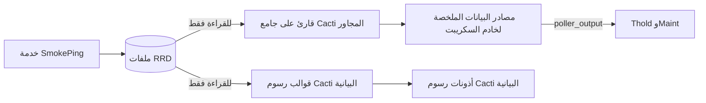

<!-- Source: README.md; SHA256: b41ec705327127cc34ff07d1514a141262752f99c5e2296fdc323d584a777b84 -->

<!-- translations:start -->
[English](../../../README.md) | [简体中文](../zh-CN/README.md) | [हिन्दी](../hi-IN/README.md) | [Español (España)](../es-ES/README.md) | [Español (Latinoamérica)](../es-419/README.md) | [العربية (السعودية)](../ar-SA/README.md) | [Afrikaans](../af-ZA/README.md) | [አማርኛ](../am-ET/README.md) | [العربية (مصر)](../ar-EG/README.md) | [العربية (المغرب)](README.md) | [বাংলা](../bn-BD/README.md) | [Bosanski](../bs-BA/README.md) | [Deutsch](../de-DE/README.md) | [فارسی](../fa-IR/README.md) | [Filipino](../fil-PH/README.md) | [Français](../fr-FR/README.md) | [Français (Maroc)](../fr-MA/README.md) | [Français (Sénégal)](../fr-SN/README.md) | [Hausa](../ha-NG/README.md) | [עברית](../he-IL/README.md) | [Hrvatski](../hr-HR/README.md) | [Bahasa Indonesia](../id-ID/README.md) | [Igbo](../ig-NG/README.md) | [Italiano](../it-IT/README.md) | [日本語](../ja-JP/README.md) | [한국어](../ko-KR/README.md) | [Malagasy](../mg-MG/README.md) | [मराठी](../mr-IN/README.md) | [Bahasa Melayu](../ms-MY/README.md) | [Nederlands](../nl-NL/README.md) | [Polski](../pl-PL/README.md) | [Português (Brasil)](../pt-BR/README.md) | [Русский](../ru-RU/README.md) | [Kinyarwanda](../rw-RW/README.md) | [Soomaali](../so-SO/README.md) | [Српски](../sr-RS/README.md) | [Svenska](../sv-SE/README.md) | [Kiswahili](../sw-KE/README.md) | [தமிழ்](../ta-IN/README.md) | [తెలుగు](../te-IN/README.md) | [ไทย](../th-TH/README.md) | [Türkçe](../tr-TR/README.md) | [Українська](../uk-UA/README.md) | [اردو](../ur-PK/README.md) | [Tiếng Việt](../vi-VN/README.md) | [isiXhosa](../xh-ZA/README.md) | [Yorùbá](../yo-NG/README.md) | [繁體中文](../zh-TW/README.md) | [isiZulu](../zu-ZA/README.md)
<!-- translations:end -->

  <picture>
    <source media="(prefers-color-scheme: dark)" srcset="../../images/logo_dark.png">
    
  </picture>

# إضافة SmokePing لـ Cacti

إضافة لـ Cacti 1.2 تجلب قياسات زمن الاستجابة وفقدان الحزم من SmokePing إلى داخل Cacti كأجهزة ومصادر بيانات ورسوم بيانية عادية. وبذلك تصبح الرسوم البيانية للدخان (Smoke graphs) موضوعة بجانب الجهاز الذي تنتمي إليه، وتحت صلاحيات Cacti، كما يمكن لـ Thold وMaint إرسال التنبيهات بشأنها أو إخفاؤها مؤقتًا. إنها تنفيذ مستقل مخصص لـ Cacti وليست جزءًا من [SmokePing](https://oss.oetiker.ch/smokeping/) ولا معتمدة منه، والذي ألفه في الأصل Tobias Oetiker وNiko Tyni. لا تتضمن الإضافة شيفرة SmokePing ولا تقوم بتشغيلها: فهي تقرأ فقط ملفات التكوين وملفات RRD التي يكتبها SmokePing، وقد صُممت قوالب الرسوم البيانية الخاصة بها لرسم نفس السلاسل التي ترسمها رسوم SmokePing نفسها.

> **الحالة: قيد التطوير. تم تنفيذ وضع المراقبة (المرحلة 1) على الفرع `main` (1.0.0-rc.1) مع التصفية للمشغّل، وتصدير CSV، واكتشاف ملفات RRD اليتيمة، وترجمة تنبيهات Thold، وخطافات تكامل المنظومة، والنسخ المتماثل للمجمّعات البعيدة.** تقرأ الإضافة ملفات التكوين وملفات RRD الخاصة بـ SmokePing، وتعرض حالتها، وتنشئ أجهزة Cacti ومصادر البيانات والرسوم البيانية لها، وتزود Thold وMaint بالبيانات. وهي لا تكتب أي شيء في SmokePing. أما الوضع المُدار (قيام الإضافة بكتابة تكوين SmokePing) فهو مرحلة لاحقة لم تبدأ بعد وليست ضمن هذا الإصدار. لا تزال التجارب الميدانية على التثبيتات الفعلية والمطابقة الأدق لوسيلة إيضاح الرسم البياني لـ SmokePing مفتوحة في المعلم 4 (milestone 4). راجع [docs/install.md](../../install.md) للبدء.

## أدوار الوصول

| النطاق | الصلاحية |
| --- | --- |
| SmokePing View | صفحات المراقبة الحالية. |
| SmokePing Operator | المراقبة بالإضافة إلى صفحة العمليات وتأكيدات الفرز الشخصية. |
| SmokePing Admin | صلاحية المشغل (Operator) بالإضافة إلى صفحات التكوين الحالية والإجراءات الإدارية. |

بعد نسخ ملفات الترقية، افتح صفحة الإضافات (Plugins) بصفتك مديرًا لتسجيل النطاق الجديد. عيّن نطاق المشغل (Operator) صراحةً تحت **Configuration > Users** أو ضمن مجموعات المستخدمين. تحتفظ الترقيات بمعرّفات نطاقي العرض (View) والإدارة (Admin) والمنح الحالية. ترث صلاحية الإدارة صلاحية المشغل، وترث صلاحية المشغل صلاحية العرض عند كل طلب؛ ولا يضيف هذا منحًا مخزنة للمستخدمين أو المجموعات. كما تتطلب إعدادات الإضافة صلاحية SmokePing Admin بالإضافة إلى صلاحية الإعدادات (Settings) في Cacti.

لا تزال أذونات الأجهزة في Cacti تحد من الصفوف والإجراءات المتاحة لكل مستخدم؛ وتتطلب الكائنات غير المربوطة تدخل المدير. وتبقى بيانات الاعتماد والتكوين والربط والحذف والتغييرات الإدارية الأخرى محصورة في الصفحات الإدارية. تدوم التأكيدات فقط خلال جلسة المستخدم الحالية، ولمدة لا تتجاوز ساعة واحدة وفقط ما دامت الملاحظة نفسها حديثة. وتبطلها الملاحظات الجديدة أو المتغيرة. كما أنها لا تجعل القياس الفاشل سليمًا أبدًا ولا توقف التنبيهات.

## لقطات الشاشة

مستوردة من شبكة SmokePing 2.8.2 حية إلى Cacti 1.2.31، لآخر 12 ساعة. يضم جهاز كل هدف رسمًا بيانيًا للدخان للخادم الرئيسي وآخر لكل خادم تابع (`lon1`، `sgp1`)، ومصنفًا تحت قسم SmokePing الخاص به في شجرة الرسوم البيانية.

## لماذا هذه الإضافة

يقيس SmokePing توزيع زمن الاستجابة وفقدان الحزم بكفاءة عالية، وتُظهر رسومه البيانية للدخان التباينات التي يخفيها الرسم البياني المعتمد على المتوسط فقط. لكن تشغيله جنبًا إلى جنب مع Cacti يترك ثلاث فجوات:

- **تحكم منفصل في الوصول.** لا تعرف واجهة CGI الخاصة بـ SmokePing أي شيء عن مستخدمي Cacti أو مجموعاته أو أذونات أجهزته.
- **غياب سياق الجهاز.** يتواجد زمن الاستجابة وعدادات الواجهات لنفس الجهاز في أداتين مختلفتين.
- **غياب مسار إلى تنبيهات Cacti.** يعمل Thold وMaint على مصادر بيانات Cacti وأجهزته، لذا يتم تكوين تنبيهات SmokePing وإيقافها بشكل منفصل.

تسد الإضافة هذه الفجوات من خلال تمثيل كل هدف في SmokePing ككائنات في Cacti تشير إلى ملفات RRD الموجودة لـ SmokePing، بالإضافة إلى مجموعة صغيرة من القيم الملخصة المستطلعة. وهي تعيد استخدام الرسوم البيانية والأذونات وThold وMaint في Cacti بدلًا من بناء نسخ موازية لها. وتدفع عملية نسخ التكوين المقيدة بنطاق المستطلع (`replicate_out`) جداول تكوين المستطلعات البعيدة مع إبقاء الوضع المحلي (`poller 1`) وذاكرات التخزين المؤقت للملاحظات المحلية لدى كل جامع معزولة.

## النطاق والحالة

| المرحلة | النطاق | المعالم | الحالة |
|---|---|---|---|
| 0، البحث | مصفوفة التوافق، تأكيد سلوك المشروع الأصلي، تجربة دقة الرسوم البيانية | [M1](https://github.com/somethingwithproof/plugin_smokeping/milestone/1) | النتائج في `docs/research`؛ لا تزال بعض قضايا البحث مفتوحة |
| 1، المراقبة | استيراد الجرد، أجهزة Cacti، رسوم الدخان والملخص، تنبيهات Thold وترجمة التنبيهات، الإخفاء عبر Maint، العروض المصفّاة، تصدير CSV، اكتشاف ملفات RRD اليتيمة، خطافات المنظومة | [M2](https://github.com/somethingwithproof/plugin_smokeping/milestone/2)، [M3](https://github.com/somethingwithproof/plugin_smokeping/milestone/3)، [M4](https://github.com/somethingwithproof/plugin_smokeping/milestone/4) | مُنفّذة؛ التجارب الميدانية مفتوحة |
| 2، الإدارة | مساحة أسماء تكوين مملوكة لـ Cacti، ملفات تعريف فحص ICMP وTCP، المراجعات، التحقق، إعادة التحميل، التراجع | [M5](https://github.com/somethingwithproof/plugin_smokeping/milestone/5) | مخطط لها، لم تبدأ بعد |
| 3، البُعد | استعلامات مقيدة بنطاق المستطلع ونسخ الجداول عبر `replicate_out` لجامعات البيانات البعيدة (`RemoteReplication`)؛ تأهيل النشر الكامل لـ SmokePing متعدد الجامعات | [M6](https://github.com/somethingwithproof/plugin_smokeping/milestone/6) | النسخ المتماثل وتقييد المستطلع مُنفّذان؛ تأهيل النشر متعدد الجامعات مفتوح |

مسارات عمل المشغّل وأوامر CLI وخطافات المنظومة المُنفّذة:

- **تصفية الجرد والأهداف (`smokeping_inventory.php`, `smokeping.php`)**: توفر `TargetFilter` و`TargetRepository::filteredForPoller()` و`InventoryPage` و`ViewPage` البحث (`filter`)، والمجس (`probe`)، والوجود في الجرد (`presence`)، وحالة الربط (`mapping`)، وحالة الحداثة (`state`)، وتقسيم الصفحات الاختياري حسب الحجم (`rows`: `All`، `25`، `50`، `100`، `200`). تُفرض رؤية الأجهزة في SQL قبل العدّ حتى لا تكشف المجاميع عن الأجهزة المخفية أبداً.
- **تصدير CSV (`smokeping.php?action=export_csv`)**: يبث `CsvExporter` مخرجات RFC 4180 بأسطر CRLF للعرض المصفّى النشط تحت أذونات أجهزة المستدعي، مع سبق الخلايا التي تبدأ بـ `=` أو `+` أو `-` أو `@` أو tab أو carriage return بفاصلة عليا لتحييد صيغ جداول البيانات.
- **اكتشاف ملفات RRD اليتيمة (`smokeping_health.php`)**: ينفّذ `OrphanRrdScanner` و`HealthCheck::orphanRrds()` مسحاً محدوداً لنقطة تحميل SmokePing على المستطلع القارئ، مع تخطي `__cgi` و`__sortercache` والروابط الرمزية، ومطابقة ملفات `.rrd` غير المملوكة مع مقترحات إعادة الربط المفتوحة.
- **التحويل من SmokePing إلى Thold (`smokeping_health.php`, `cli/smokeping.php`)**: يقرأ `TholdTranslator` و`TholdGenerator` تعريفات `*** Alerts ***` الخاصة بـ SmokePing ويترجمان أنماط الفقدان المتتالي المدعومة إلى عتبات `loss_pct` مكافئة في Thold دون تعديل ملفات تكوين SmokePing. يستخدم مسار الويب معاينة GET (`action=thold_preview`, `HealthPage::renderTholdPreview()`) متبوعة بطلب POST محمي برمز CSRF (`action=thold_create`). وتُتخطى الأنماط غير المدعومة (تنبيهات RTT، وتلاشي أحرف البدل، والمستويات المختلطة) دون كتابة.
- **واجهة سطر أوامر المسؤول (`cli/smokeping.php`)**: تدعم `provision <target path> [--device=ID] [--location=NAME]`، و`relink <old target path> <new target path> [--location=NAME]`، و`thold-generate <target path> [--alert=NAME] [--apply]`، و`size-graphs`، و`upgrade-graphs`، و`export [--format=yaml|xml] [--file=PATH]`، و`import --file=PATH [--format=yaml|xml] [--apply --confirm=PLAN]`، و`import-smokeping [--dry-run | --apply --confirm=PLAN] [--file=PATH] [--sections=A,B/C] [--device-per=host|target] [--device-template=ID] [--poller=ID] [--site=ID] [--tree=ID | --tree-name=NAME]`.
- **خطافات المنظومة (`setup.php`, `Schema::HOOKS`)**: تسجّل 21 خطافاً، تشمل `abilities_register` (`AbilitiesProvider`: `smokeping-list-targets` و`smokeping-get-health` للقراءة فقط بشكل صارم، مقيدتان بنطاق View مقابل معرّف مستخدم المستدعي، ولا ترجعان أي أسرار)، و`doctor_register_checks` (`DoctorChecks`: `smokeping_stale_targets` و`smokeping_freshness_breaches` و`smokeping_orphan_rrds` و`smokeping_config_path`)، و`casc_register_providers` (`CascProvider`: عمليات `export` و`validate` و`plan` و`apply` بصيغة YAML/XML لمزوّد `smokeping` بدعم من `ConfigCodec` و`ConfigService`)، و`replicate_out` (`RemoteReplication`: مزامنة مقيدة بنطاق المستطلع لجداول `plugin_smokeping_target` و`plugin_smokeping_mapping` و`plugin_smokeping_object` و`plugin_smokeping_relink` للمستطلعات البعيدة التي يكون فيها `poller_id > 1`).

خارج النطاق: محرك تنبيهات مملوك للإضافة، محرك تقارير، برنامج خفي مخصص أو بروتوكول شبكة، فحوصات HTTP/DNS/الخدمات المُدارة (تغطيها إضافة servcheck)، والكتابة في ملفات RRD الخاصة بـ SmokePing.

## أهداف التوافق

| المكون | الهدف |
|---|---|
| Cacti | الإصدار 1.2.31 أو أحدث ضمن السلسلة 1.2.x، بدون تعديلات على النواة |
| PHP | الإصدار 8.2 أو أحدث؛ يظل `setup.php` قابلًا للتحليل على 8.0 بحيث تتلقى بيئة التشغيل غير المدعومة رفضًا صريحًا بدل تعطل واجهة Cacti |
| SmokePing | الإصدارات 2.9.0 و2.8.2 و2.7.3 (على Ubuntu 22.04 فقط، حتى 2027-06-01) |
| Thold وMaint | لا يتطلبان أي تغييرات |
| السلاسل | 10,000 لكل تثبيت بمعدل 20 إشارة ping وخطوة زمنية 300 ثانية ([الأداء](../../performance.md#supported-series-count)) |

## الوثائق

| | |
|---|---|
| [التثبيت](../../install.md) | المتطلبات، ربط مجلد بيانات SmokePing للقراءة فقط، التثبيت، الحاويات، الإصدارات المدعومة |
| [التشغيل](../../operations.md) | معنى كل حالة وأدلتها، فحوصات الحالة الصحية، السلوك عند فشل المدخلات |
| [إضافة أهداف إلى Cacti](../../provisioning.md) | هدف واحد، أجهزة متعددة، إعادة الربط، الأذونات |
| [التنبيهات](../../alerting.md) | القيم الملخصة، مدد Thold، تقادم البيانات، البيانات المتأخرة، التداخل مع تنبيهات SmokePing، Maint |
| [صيغة التكوين](../../configuration-format.md) | التصدير والاستيراد بصيغتي YAML وXML |
| [النسخ الاحتياطي والاستعادة](../../backup-restore.md) | ما يجب نسخه احتياطيًا وكيف تستأنف الاستعادة العمل |
| [الأداء](../../performance.md) | القياسات المحلية وعلى مشغل الإصدارات عند 100 و1,000 و10,000 سلسلة، وعدد السلاسل المدعوم: 10,000 لكل تثبيت |
| [تأهيل الأعطال](../../failure-qualification.md) | سيناريوهات الأعطال وكيفية اختبار كل منها |
| [الإصدار](../../RELEASING.md) | إجراء الإصدار: طلب الدمج، الوسم الموقع، ما يفعله سير العمل، كيفية التحقق من النتيجة |
| [أرشيف الإصدارات](../../release.md) | الإصدار، سجل التغييرات، وأرشيف الإصدارات |
| [الاختبارات](../../testing.md) | مجموعات الاختبارات، ما يشغله CI، ومجموعة الاختبارات الحية مقابل SmokePing فعلي |

## التصميم

- [docs/PLAN.md](../../PLAN.md) هي الخطة الكاملة: البنية المعمارية، حقائق المشروع الأصلي التي تعتمد عليها (مع المصادر)، نموذج الحالة، الحدود الأمنية، حسابات الأداء، الاختبارات، والمخاطر.
- [docs/decisions/](../../decisions) يحتوي على سجلات القرارات المعمارية للاختيارات التي تم اتخاذها بالفعل.
- [docs/REQUIREMENTS.md](../../REQUIREMENTS.md) يربط كل معرّف متطلب بقضيته المقابلة.
- يشغّل التحقق المحلي اختبارات الوحدة وقواعد المصدر عبر Pest (`pest --configuration=phpunit.xml`)، وتحليل PHPStan المستوى 9 (`CACTI_PATH=<cacti-dir> phpstan analyse -c phpstan.neon --no-progress`)، وفحوصات صياغة نقاط الدخول (`php -l` على `*.php` و`include/*.php` و`scripts/*.php` و`cli/*.php`)، وفحوصات الترجمة (`sh locales/build_gettext.sh --check`). راجع [docs/testing.md](../../testing.md) لمجموعات التكامل والاختبار الشامل في الحاويات.

## كيفية تتبع العمل

- **المعالم (Milestones)** تتبع معالم الخطة. يضم كل معلم قضية رئيسية (epic) تسرد قضاياه الفرعية وأدلة الإنجاز.
- **القضايا (Issues)** مصنفة حسب التسمية: `type: requirement`، `type: research`، `type: decision`، `type: epic`. تحدد قضايا المتطلبات متطلبات مرقمة وقابلة للاختبار (`REQ-AREA-NNN`) ومعايير القبول.
- **التسميات (Labels)** تحمل أيضًا `area:` و`phase:` و`priority:` و`status:`. راجع [CONTRIBUTING.md](../../../CONTRIBUTING.md#labels).
- تعرض [لوحة المشروع](https://github.com/users/somethingwithproof/projects/6) جميع القضايا عبر المعالم.

## المساهمة

اقرأ [CONTRIBUTING.md](../../../CONTRIBUTING.md). تتطلب الإيداعات توقيع DCO (`sign-off`). تجري مناقشات التصميم في القضايا؛ وتحمل القرارات المفتوحة التسمية `type: decision`.

## الأمان

أبلغ عن الثغرات الأمنية بشكل خاص؛ راجع [SECURITY.md](../../../SECURITY.md).

## الرخصة

رخصة جنو العمومية الإصدار 2.0 (GNU General Public License v2.0)، وهي نفس الرخصة المعتمدة لـ Cacti وإضافاته. راجع [LICENSE](../../../LICENSE).
