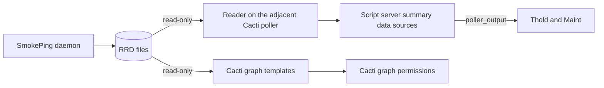

<!-- Source: README.md; SHA256: b41ec705327127cc34ff07d1514a141262752f99c5e2296fdc323d584a777b84 -->

<!-- translations:start -->
[English](../../../README.md) | [简体中文](../zh-CN/README.md) | [हिन्दी](../hi-IN/README.md) | [Español (España)](../es-ES/README.md) | [Español (Latinoamérica)](../es-419/README.md) | [العربية (السعودية)](README.md) | [Afrikaans](../af-ZA/README.md) | [አማርኛ](../am-ET/README.md) | [العربية (مصر)](../ar-EG/README.md) | [العربية (المغرب)](../ar-MA/README.md) | [বাংলা](../bn-BD/README.md) | [Bosanski](../bs-BA/README.md) | [Deutsch](../de-DE/README.md) | [فارسی](../fa-IR/README.md) | [Filipino](../fil-PH/README.md) | [Français](../fr-FR/README.md) | [Français (Maroc)](../fr-MA/README.md) | [Français (Sénégal)](../fr-SN/README.md) | [Hausa](../ha-NG/README.md) | [עברית](../he-IL/README.md) | [Hrvatski](../hr-HR/README.md) | [Bahasa Indonesia](../id-ID/README.md) | [Igbo](../ig-NG/README.md) | [Italiano](../it-IT/README.md) | [日本語](../ja-JP/README.md) | [한국어](../ko-KR/README.md) | [Malagasy](../mg-MG/README.md) | [मराठी](../mr-IN/README.md) | [Bahasa Melayu](../ms-MY/README.md) | [Nederlands](../nl-NL/README.md) | [Polski](../pl-PL/README.md) | [Português (Brasil)](../pt-BR/README.md) | [Русский](../ru-RU/README.md) | [Kinyarwanda](../rw-RW/README.md) | [Soomaali](../so-SO/README.md) | [Српски](../sr-RS/README.md) | [Svenska](../sv-SE/README.md) | [Kiswahili](../sw-KE/README.md) | [தமிழ்](../ta-IN/README.md) | [తెలుగు](../te-IN/README.md) | [ไทย](../th-TH/README.md) | [Türkçe](../tr-TR/README.md) | [Українська](../uk-UA/README.md) | [اردو](../ur-PK/README.md) | [Tiếng Việt](../vi-VN/README.md) | [isiXhosa](../xh-ZA/README.md) | [Yorùbá](../yo-NG/README.md) | [繁體中文](../zh-TW/README.md) | [isiZulu](../zu-ZA/README.md)
<!-- translations:end -->

  <picture>
    <source media="(prefers-color-scheme: dark)" srcset="../../images/logo_dark.png">
    
  </picture>

# إضافة SmokePing لـ Cacti

إضافة لـ Cacti 1.2 تدمج قياسات التأخير وفقدان الحزم من SmokePing كأجهزة ومصادر بيانات ورسوم عادية في Cacti. تظهر الرسوم الدخانية بجوار الجهاز المعني وتخضع لصلاحيات Cacti، ويمكن لـ Thold وMaint إصدار تنبيهات عنها وكبتها. هذا تنفيذ مستقل لـ Cacti، وليس جزءًا من [SmokePing](https://oss.oetiker.ch/smokeping/) ولا معتمدًا منه؛ ومؤلفاه الأصليان هما Tobias Oetiker وNiko Tyni. لا تضم الإضافة شيفرة SmokePing ولا تشغّلها: بل تقرأ إعداده وملفات RRD التي يكتبها، وترسم قوالبها السلاسل نفسها التي ترسمها رسوم SmokePing الأصلية.

> **الحالة: قيد التطوير. وضع المراقبة (المرحلة 1) منفّذ في `main` (1.0.0-rc.1) مع تصفية المشغّل، وتصدير CSV، واكتشاف ملفات RRD اليتيمة، وترجمة تنبيهات Thold، وخطافات تكامل المنظومة، والنسخ المتماثل للمجمّعات البعيدة.** تقرأ الإضافة إعداد SmokePing وملفات RRD، وتعرض حالتها، وتنشئ لها أجهزة ومصادر بيانات ورسومًا في Cacti، وتزوّد Thold وMaint بالبيانات. ولا تكتب أي شيء في SmokePing. الوضع المُدار (كتابة الإضافة لإعداد SmokePing) مرحلة لاحقة لم تبدأ وغير مشمولة في هذا الإصدار. ما تزال التجارب في تثبيتات فعلية وتحسين مطابقة مفتاح الرسم لرسوم SmokePing ضمن الأعمال المتبقية في المعلم 4. للبدء راجع [docs/install.md](docs/install.md).

## أدوار الوصول

| نطاق الأذونات | الوصول |
| --- | --- |
| SmokePing View | صفحات المراقبة الحالية. |
| SmokePing Operator | المراقبة وصفحة العمليات والإقرارات الشخصية أثناء التحقيق. |
| SmokePing Admin | وصول المشغّل مع الإعدادات والإجراءات الإدارية الحالية. |

بعد نسخ ملفات الترقية، افتح صفحة الإضافات بصفتك مسؤولًا لتسجيل نطاق الأذونات الجديد. امنح نطاق Operator صراحةً ضمن **الإعداد > المستخدمون** أو مجموعات المستخدمين. تحتفظ الترقيات بمعرّفات نطاقي View وAdmin ومنحهما الحالي. يرث Admin وصول Operator ويرث Operator وصول View في كل طلب؛ ولا يضيف ذلك منحًا مخزّنة للمستخدمين أو المجموعات. تتطلب إعدادات الإضافة أيضًا SmokePing Admin بالإضافة إلى إذن الإعدادات في Cacti.

تظل أذونات أجهزة Cacti تقيّد الصفوف والإجراءات المتاحة لكل مستخدم؛ وتتطلب الكائنات غير المرتبطة مسؤولًا. تبقى بيانات الاعتماد والإعدادات والربط والحذف والتغييرات الإدارية الأخرى في الصفحات الإدارية. لا تستمر الإقرارات إلا في جلسة المستخدم الحالي، لمدة ساعة على الأكثر وفقط ما دامت الملاحظة نفسها حديثة. تُبطلها الملاحظات الجديدة أو المعدّلة. ولا تجعل قياسًا فاشلًا سليمًا أو تكبح التنبيهات مطلقًا.

## لقطات الشاشة

استيراد من شبكة SmokePing 2.8.2 عاملة إلى Cacti 1.2.31، لآخر 12 ساعة. يضم جهاز كل هدف رسمًا دخانيًا للرئيسي ورسمًا لكل تابع (`lon1`، `sgp1`)، ضمن قسم SmokePing الخاص به في شجرة الرسوم.

## الدافع

يقيس SmokePing توزيع التأخير وفقدان الحزم جيدًا؛ وتُظهر رسومه الدخانية تغيرات تخفيها رسوم المتوسطات. عند تشغيله بجوار Cacti تبقى ثلاث فجوات:

- **تحكم منفصل في الوصول.** لا يعرف CGI الخاص بـ SmokePing مستخدمي Cacti أو مجموعاته أو صلاحيات أجهزته.
- **غياب سياق الجهاز.** توجد بيانات التأخير وعدّادات واجهات الجهاز نفسه في أداتين مختلفتين.
- **غياب التكامل مع تنبيهات Cacti.** يعمل Thold وMaint على مصادر بيانات Cacti وأجهزته، لذا تُضبط تنبيهات SmokePing وتُكبت على نحو منفصل.

تسد الإضافة هذه الفجوات بتمثيل كل هدف SmokePing بكائنات Cacti تشير إلى ملفات SmokePing RRD القائمة، مع مجموعة صغيرة من قيم الملخص التي يجري استطلاعها. وهي تعيد استخدام رسوم Cacti وصلاحياته وThold وMaint. وتدفع عملية نسخ الإعدادات المقيدة بنطاق المستطلع (`replicate_out`) جداول إعدادات المستطلعات البعيدة مع إبقاء الوضع المحلي (`poller 1`) وذاكرات التخزين المؤقت للملاحظات المحلية لدى كل مجمّع معزولة.

## النطاق والحالة

| المرحلة | النطاق | المعالم | الحالة |
|---|---|---|---|
| 0، البحث | مصفوفة التوافق، تأكيد السلوك الأصلي، نموذج أولي لمطابقة الرسوم | [M1](https://github.com/somethingwithproof/plugin_smokeping/milestone/1) | النتائج في `docs/research`؛ بعض مسائل البحث ما تزال مفتوحة |
| 1، المراقبة | استيراد الجرد، أجهزة Cacti، الرسوم الدخانية والملخصة، تنبيهات Thold وترجمة التنبيهات، كبت Maint، العروض المصفّاة، تصدير CSV، اكتشاف ملفات RRD اليتيمة، خطافات المنظومة | [M2](https://github.com/somethingwithproof/plugin_smokeping/milestone/2)، [M3](https://github.com/somethingwithproof/plugin_smokeping/milestone/3)، [M4](https://github.com/somethingwithproof/plugin_smokeping/milestone/4) | منفّذة؛ التجارب الميدانية متبقية |
| 2، الإدارة | نطاق أسماء إعداد يملكه Cacti، ملفات تعريف مجسّات ICMP وTCP، المراجعات، التحقق، إعادة التحميل، التراجع | [M5](https://github.com/somethingwithproof/plugin_smokeping/milestone/5) | مخططة، لم تبدأ |
| 3، التشغيل البعيد | استعلامات مقيدة بنطاق المستطلع ونسخ الجداول عبر `replicate_out` لمجمّعات البيانات البعيدة (`RemoteReplication`)؛ تأهيل النشر الكامل لـ SmokePing متعدد المجمّعات | [M6](https://github.com/somethingwithproof/plugin_smokeping/milestone/6) | النسخ المتماثل وتقييد المستطلع منفّذان؛ تأهيل النشر متعدد المجمّعات متبقٍ |

مسارات عمل المشغّل وأوامر CLI وخطافات المنظومة المنفّذة:

- **تصفية الجرد والأهداف (`smokeping_inventory.php`, `smokeping.php`)**: توفر `TargetFilter` و`TargetRepository::filteredForPoller()` و`InventoryPage` و`ViewPage` البحث (`filter`) والمجس (`probe`) والوجود في الجرد (`presence`) وحالة الربط (`mapping`) وحالة الحداثة (`state`) وتقسيم الصفحات الاختياري حسب الحجم (`rows`: `All`, `25`, `50`, `100`, `200`). تُفرض رؤية الأجهزة في SQL قبل العدّ بحيث لا تكشف المجاميع عن أي أجهزة مخفية أبدًا.
- **تصدير CSV (`smokeping.php?action=export_csv`)**: يبث `CsvExporter` مخرجات RFC 4180 بفاصل أسطر CRLF للعرض المصفّى النشط ضمن صلاحيات أجهزة المستدعي، مع سبق الخلايا التي تبدأ بـ `=` أو `+` أو `-` أو `@` أو حرف الجدولة أو إرجاع الحامل بفاصلة عليا لتحييد صيغ جداول البيانات.
- **اكتشاف ملفات RRD اليتيمة (`smokeping_health.php`)**: ينفّذ `OrphanRrdScanner` و`HealthCheck::orphanRrds()` مسحًا محدودًا لنقطة تحميل SmokePing على المستطلع القارئ، مع تخطي `__cgi` و`__sortercache` والروابط الرمزية، ومطابقة ملفات `.rrd` غير المملوكة مع مقترحات إعادة الربط المفتوحة.
- **التحويل من SmokePing إلى Thold (`smokeping_health.php`, `cli/smokeping.php`)**: يقرأ `TholdTranslator` و`TholdGenerator` تعريفات `*** Alerts ***` في SmokePing ويترجمان أنماط الفقدان المتتالي المدعومة إلى عتبات `loss_pct` مكافئة في Thold دون تعديل ملفات إعداد SmokePing. يستخدم مسار الويب معاينة GET (`action=thold_preview`, `HealthPage::renderTholdPreview()`) متبوعة بطلب POST محمي برمز CSRF (`action=thold_create`). وتُتخطى الأنماط غير المدعومة (تنبيهات RTT، واضمحلال أحرف البدل، والمستويات المختلطة) دون كتابة.
- **واجهة سطر أوامر المسؤول (`cli/smokeping.php`)**: تدعم `provision <target path> [--device=ID] [--location=NAME]` و`relink <old target path> <new target path> [--location=NAME]` و`thold-generate <target path> [--alert=NAME] [--apply]` و`size-graphs` و`upgrade-graphs` و`export [--format=yaml|xml] [--file=PATH]` و`import --file=PATH [--format=yaml|xml] [--apply --confirm=PLAN]` و`import-smokeping [--dry-run | --apply --confirm=PLAN] [--file=PATH] [--sections=A,B/C] [--device-per=host|target] [--device-template=ID] [--poller=ID] [--site=ID] [--tree=ID | --tree-name=NAME]`.
- **خطافات المنظومة (`setup.php`, `Schema::HOOKS`)**: تسجّل 21 خطافًا، بما فيها `abilities_register` (`AbilitiesProvider`: القدرتان `smokeping-list-targets` و`smokeping-get-health` للقراءة فقط بشكل صارم، مقيدتان بنطاق View وفق معرّف مستخدم المستدعي دون إرجاع أي أسرار)، و`doctor_register_checks` (`DoctorChecks`: `smokeping_stale_targets` و`smokeping_freshness_breaches` و`smokeping_orphan_rrds` و`smokeping_config_path`)، و`casc_register_providers` (`CascProvider`: عمليات `export` و`validate` و`plan` و`apply` بصيغتي YAML/XML لمزود `smokeping` بدعم من `ConfigCodec` و`ConfigService`)، و`replicate_out` (`RemoteReplication`: مزامنة مقيدة بنطاق المستطلع لجداول `plugin_smokeping_target` و`plugin_smokeping_mapping` و`plugin_smokeping_object` و`plugin_smokeping_relink` للمستطلعات البعيدة حيث `poller_id > 1`).

خارج النطاق: محرك تنبيهات خاص، محرك تقارير، خدمة خلفية أو بروتوكول شبكة مخصص، فحوص HTTP/DNS/الخدمات المُدارة (يتولاها servcheck)، والكتابة في ملفات SmokePing RRD.

## أهداف التوافق

| المكوّن | الهدف |
|---|---|
| Cacti | 1.2.31 أو أحدث من سلسلة 1.2.x، دون ترقيعات للنواة |
| PHP | 8.2 أو أحدث؛ يظل `setup.php` قابلًا للتحليل في 8.0 كي يرفض بيئة غير مدعومة دون تعطيل واجهة Cacti |
| SmokePing | 2.9.0 و2.8.2 و2.7.3 (الأخير على Ubuntu 22.04 فقط حتى 2027-06-01) |
| Thold وMaint | لا حاجة إلى تغييرات |
| السلاسل | 10,000 لكل تثبيت مع 20 نبضة ping وخطوة 300 ثانية ([الأداء](docs/performance.md#supported-series-count)) |

## التوثيق

| | |
|---|---|
| [التثبيت](docs/install.md) | المتطلبات، ربط دليل البيانات للقراءة فقط، التثبيت، الحاويات، الإصدارات المدعومة |
| [التشغيل](docs/operations.md) | معنى كل حالة وأدلتها، فحوص الصحة، السلوك عند تعطل المدخلات |
| [إضافة الأهداف إلى Cacti](docs/provisioning.md) | هدف واحد، أجهزة عديدة، إعادة الربط، الصلاحيات |
| [التنبيهات](docs/alerting.md) | قيم الملخص، مدد Thold، التقادم والبيانات المتأخرة، التداخل مع تنبيهات SmokePing، Maint |
| [صيغة الإعداد](docs/configuration-format.md) | تصدير YAML وXML واستيرادهما |
| [النسخ الاحتياطي والاستعادة](docs/backup-restore.md) | ما يجب نسخه وكيفية استئناف العمل بعد الاستعادة |
| [الأداء](docs/performance.md) | قياسات محلية وعلى مشغّل الإصدار مع 100 و1,000 و10,000 سلسلة؛ العدد المدعوم 10,000 لكل تثبيت |
| [تأهيل الأعطال](../../failure-qualification.md) | سيناريوهات الأعطال واختبار كل منها |
| [إجراء الإصدار](../../RELEASING.md) | طلب السحب والوسم الموقّع وسلوك سير العمل والتحقق من النتيجة |
| [أرشيف الإصدار](../../release.md) | الإصدار وسجل التغييرات والأرشيف المنشور |
| [الاختبار](../../testing.md) | مجموعات الاختبار وما ينفذه CI والمجموعة الحية مع SmokePing حقيقي |

## التصميم

- [docs/PLAN.md](../../PLAN.md) هو الخطة الكاملة: المعمارية والحقائق الأصلية المعتمدة عليها (مع مصادرها) ونموذج الحالات وحدود الأمان وحسابات الأداء والاختبارات والمخاطر.
- يحفظ [docs/decisions/](../../decisions) سجلات القرارات المعمارية المتخذة.
- يربط [docs/REQUIREMENTS.md](../../REQUIREMENTS.md) معرّف كل متطلب بمسألته.
- يشغّل التحقق المحلي اختبارات الوحدة وقواعد المصدر عبر Pest (`pest --configuration=phpunit.xml`)، وتحليل PHPStan المستوى 9 (`CACTI_PATH=<cacti-dir> phpstan analyse -c phpstan.neon --no-progress`)، وفحوصات صياغة نقاط الدخول (`php -l` على `*.php` و`include/*.php` و`scripts/*.php` و`cli/*.php`)، وفحوصات الترجمة (`sh locales/build_gettext.sh --check`). راجع [docs/testing.md](../../testing.md) لمجموعات التكامل والاختبار الشامل داخل الحاويات.

## تتبّع العمل

- تتبع **المعالم** معالم الخطة. لكل منها مشكلة ملحمية تسرد مشكلاتها الفرعية وأدلة اكتمالها.
- تُصنَّف **المشكلات** بالوسوم `type: requirement` و`type: research` و`type: decision` و`type: epic`. تتضمن مشكلات المتطلبات متطلبات مرقمة قابلة للاختبار (`REQ-AREA-NNN`) ومعايير قبول.
- تشمل **الوسوم** أيضًا `area:` و`phase:` و`priority:` و`status:`. راجع [CONTRIBUTING.md](../../../CONTRIBUTING.md#labels).
- تعرض [لوحة المشروع](https://github.com/users/somethingwithproof/projects/6) كل المشكلات عبر المعالم.

## المساهمة

اقرأ [CONTRIBUTING.md](../../../CONTRIBUTING.md). تتطلب عمليات الإيداع إقرار DCO. تجري مناقشة التصميم في المشكلات؛ وتحمل القرارات المفتوحة وسم `type: decision`.

## الأمان

أبلغ عن الثغرات على نحو خاص؛ راجع [SECURITY.md](../../../SECURITY.md).

## الترخيص

رخصة GNU العمومية العامة v2.0، وهي رخصة Cacti وإضافاته نفسها. راجع [LICENSE](../../../LICENSE).
