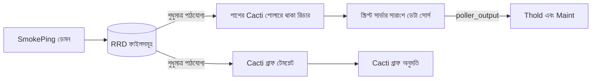

<!-- Source: README.md; SHA256: b41ec705327127cc34ff07d1514a141262752f99c5e2296fdc323d584a777b84 -->

<!-- translations:start -->
[English](../../../README.md) | [简体中文](../zh-CN/README.md) | [हिन्दी](../hi-IN/README.md) | [Español (España)](../es-ES/README.md) | [Español (Latinoamérica)](../es-419/README.md) | [العربية (السعودية)](../ar-SA/README.md) | [Afrikaans](../af-ZA/README.md) | [አማርኛ](../am-ET/README.md) | [العربية (مصر)](../ar-EG/README.md) | [العربية (المغرب)](../ar-MA/README.md) | [বাংলা](README.md) | [Bosanski](../bs-BA/README.md) | [Deutsch](../de-DE/README.md) | [فارسی](../fa-IR/README.md) | [Filipino](../fil-PH/README.md) | [Français](../fr-FR/README.md) | [Français (Maroc)](../fr-MA/README.md) | [Français (Sénégal)](../fr-SN/README.md) | [Hausa](../ha-NG/README.md) | [עברית](../he-IL/README.md) | [Hrvatski](../hr-HR/README.md) | [Bahasa Indonesia](../id-ID/README.md) | [Igbo](../ig-NG/README.md) | [Italiano](../it-IT/README.md) | [日本語](../ja-JP/README.md) | [한국어](../ko-KR/README.md) | [Malagasy](../mg-MG/README.md) | [मराठी](../mr-IN/README.md) | [Bahasa Melayu](../ms-MY/README.md) | [Nederlands](../nl-NL/README.md) | [Polski](../pl-PL/README.md) | [Português (Brasil)](../pt-BR/README.md) | [Русский](../ru-RU/README.md) | [Kinyarwanda](../rw-RW/README.md) | [Soomaali](../so-SO/README.md) | [Српски](../sr-RS/README.md) | [Svenska](../sv-SE/README.md) | [Kiswahili](../sw-KE/README.md) | [தமிழ்](../ta-IN/README.md) | [తెలుగు](../te-IN/README.md) | [ไทย](../th-TH/README.md) | [Türkçe](../tr-TR/README.md) | [Українська](../uk-UA/README.md) | [اردو](../ur-PK/README.md) | [Tiếng Việt](../vi-VN/README.md) | [isiXhosa](../xh-ZA/README.md) | [Yorùbá](../yo-NG/README.md) | [繁體中文](../zh-TW/README.md) | [isiZulu](../zu-ZA/README.md)
<!-- translations:end -->

  <picture>
    <source media="(prefers-color-scheme: dark)" srcset="../../images/logo_dark.png">
    
  </picture>

# Cacti-র জন্য SmokePing প্লাগইন

একটি Cacti 1.2 প্লাগইন যা SmokePing ল্যাটেন্সি এবং প্যাকেট লস পরিমাপগুলোকে সাধারণ ডিভাইস, ডেটা সোর্স এবং গ্রাফ হিসেবে Cacti-তে নিয়ে আসে। এর ফলে স্মোক গ্রাফগুলো সংশ্লিষ্ট ডিভাইসের পাশেই Cacti-র অনুমতির অধীনে থাকে এবং Thold ও Maint সেগুলোর ওপর অ্যালার্ট দিতে ও সাপ্রেস করতে পারে। এটি Cacti-র জন্য একটি স্বতন্ত্র বাস্তবায়ন এবং [SmokePing](https://oss.oetiker.ch/smokeping/)-এর অংশ নয় বা এর দ্বারা অনুমোদিতও নয়, যার মূল লেখক Tobias Oetiker এবং Niko Tyni। এই প্লাগইনটি SmokePing-এর কোড অন্তর্ভুক্ত করে না বা চালায় না: এটি SmokePing-এর লেখা কনফিগারেশন ও RRD ফাইল পড়ে এবং এর গ্রাফ টেমপ্লেটগুলো SmokePing-এর নিজস্ব গ্রাফের মতো একই সিরিজ আঁকার জন্য তৈরি।

> **অবস্থা: উন্নয়নাধীন। অবজার্ভ মোড (ধাপ ১) `main` ব্রাঞ্চে বাস্তবায়িত হয়েছে এবং 1.0.0-rc.1 প্রি-রিলিজ হিসেবে প্রকাশিত হয়েছে।** প্লাগইনটি SmokePing-এর কনফিগারেশন ও RRD ফাইল পড়ে, সেগুলোর অবস্থা দেখায়, সেগুলোর জন্য Cacti ডিভাইস, ডেটা সোর্স ও গ্রাফ তৈরি করে এবং Thold ও Maint-এ ডেটা সরবরাহ করে। এটি SmokePing-এ কোনো কিছু লেখে না। ম্যানেজড মোড (প্লাগইন দ্বারা SmokePing কনফিগারেশন লেখা) এবং রিমোট কালেক্টর পরবর্তী ধাপগুলোর অংশ, যা এখনো শুরু হয়নি এবং এই রিলিজে নেই। মাইলস্টোন ৪-এ বাস্তব ইনস্টলেশনে পাইলট পরীক্ষা এবং SmokePing-এর গ্রাফ লিজেন্ডের সাথে আরও নিখুঁত মিল আনার কাজ এখনো বাকি রয়েছে। শুরু করতে [docs/install.md](../../install.md) দেখুন।

## অ্যাক্সেস ভূমিকা

| রিয়েলম | অ্যাক্সেস |
| --- | --- |
| SmokePing View | বিদ্যমান মনিটরিং পেজসমূহ। |
| SmokePing Operator | মনিটরিং, সাথে Operations পেজ এবং ব্যক্তিগত ট্রায়াজ স্বীকৃতি। |
| SmokePing Admin | Operator অ্যাক্সেস, সাথে বিদ্যমান কনফিগারেশন ও প্রশাসনিক কার্যক্রম। |

আপগ্রেড ফাইলগুলো কপি করার পর, নতুন রিয়েলম নিবন্ধন করতে অ্যাডমিনিস্ট্রেটর হিসেবে Plugins পেজ খুলুন। **Configuration > Users** অথবা ইউজার গ্রুপের অধীনে Operator রিয়েলমটি স্পষ্টভাবে নির্ধারণ করুন।
আপগ্রেডের ক্ষেত্রে বিদ্যমান View এবং Admin রিয়েলম আইডি ও অনুমোদনগুলো অপরিবর্তিত থাকে। প্রতিটি রিকোয়েস্টে Admin অ্যাক্সেস স্বয়ংক্রিয়ভাবে Operator অ্যাক্সেস পায় এবং Operator অ্যাক্সেস স্বয়ংক্রিয়ভাবে View অ্যাক্সেস পায়; এটি ব্যবহারকারী বা গ্রুপে কোনো স্থায়ী অনুমোদন যোগ করে না। প্লাগইন সেটিংসের জন্য Cacti-র Settings অনুমতির পাশাপাশি SmokePing Admin অ্যাক্সেসও প্রয়োজন।

Cacti ডিভাইস অনুমতি এখনো প্রতিটি ব্যবহারকারীর জন্য উপলব্ধ সারি ও কার্যক্রম সীমিত করে; ম্যাপ না করা অবজেক্টগুলোর জন্য অ্যাডমিনিস্ট্রেটর প্রয়োজন।
ক্রেডেনশিয়াল, কনফিগারেশন, ম্যাপিং, মুছে ফেলা এবং অন্যান্য প্রশাসনিক পরিবর্তন প্রশাসনিক পেজগুলোতেই থাকে। স্বীকৃতি কেবল বর্তমান ব্যবহারকারীর সেশনেই স্থায়ী হয়, সর্বোচ্চ এক ঘণ্টার জন্য এবং কেবল ততক্ষণই যতক্ষণ একই পর্যবেক্ষণ সতেজ থাকে। নতুন বা পরিবর্তিত পর্যবেক্ষণ এগুলোকে অকার্যকর করে দেয়। এগুলো কখনোই ব্যর্থ পরিমাপকে সুস্থ হিসেবে চিহ্নিত করে না বা অ্যালার্ট বন্ধ করে না।

## স্ক্রিনশট

একটি সক্রিয় SmokePing 2.8.2 নেটওয়ার্ক থেকে Cacti 1.2.31-এ আমদানিকৃত, শেষ ১২ ঘণ্টার তথ্য। প্রতিটি টার্গেটের ডিভাইসে মাস্টারের জন্য একটি এবং প্রতিটি স্লেভের (`lon1`, `sgp1`) জন্য একটি করে স্মোক গ্রাফ রয়েছে, যা গ্রাফ ট্রিতে এর SmokePing সেকশনের অধীনে সাজানো আছে।

## কেন

SmokePing ল্যাটেন্সি ডিস্ট্রিবিউশন এবং প্যাকেট লস ভালোভাবে পরিমাপ করে, এবং এর স্মোক গ্রাফগুলো এমন তারতম্য দেখায় যা শুধু গড় মান দেখানো গ্রাফ আড়াল করে। Cacti-র পাশাপাশি চালালে এটি তিনটি ঘাটতি তৈরি করে:

- **পৃথক অ্যাক্সেস নিয়ন্ত্রণ।** SmokePing-এর CGI Cacti-র ব্যবহারকারী, গ্রুপ বা ডিভাইস অনুমতি সম্পর্কে কিছু জানে না।
- **ডিভাইস প্রসঙ্গের অভাব।** একই ডিভাইসের ল্যাটেন্সি এবং ইন্টারফেস কাউন্টার ভিন্ন ভিন্ন টুলে থাকে।
- **Cacti অ্যালার্টিংয়ে কোনো পথ নেই।** Thold এবং Maint Cacti-র ডেটা সোর্স ও ডিভাইসের ওপর কাজ করে, তাই SmokePing অ্যালার্টগুলো আলাদাভাবে কনফিগার ও সাপ্রেস করতে হয়।

প্লাগইনটি প্রতিটি SmokePing টার্গেটকে এমন Cacti অবজেক্ট হিসেবে উপস্থাপন করে এই ঘাটতিগুলো দূর করে, যা SmokePing-এর বিদ্যমান RRD ফাইলগুলোর দিকে নির্দেশ করে এবং এর সাথে কিছু সংক্ষিপ্ত পোল করা মান রাখে। এগুলোর সমান্তরাল সংস্করণ তৈরি না করে এটি Cacti-র গ্রাফিং, অনুমতি, Thold এবং Maint পুনর্ব্যবহার করে। Cacti রিমোট ডেটা কালেক্টরের জন্য সহায়তা ধাপ ৩-এর জন্য পরিকল্পিত এবং এই রিলিজে নেই।

## পরিধি ও অবস্থা

| ধাপ | পরিধি | মাইলস্টোন | অবস্থা |
|---|---|---|---|
| ০, গবেষণা | সামঞ্জস্যের ম্যাট্রিক্স, আপস্ট্রিম আচরণ নিশ্চিতকরণ, গ্রাফের নিখুঁততা যাচাই | [M1](https://github.com/somethingwithproof/plugin_smokeping/milestone/1) | ফলাফল `docs/research`-এ রয়েছে; কিছু গবেষণামূলক ইস্যু এখনো খোলা আছে |
| ১, অবজার্ভ | ইনভেন্টরি আমদানি, Cacti ডিভাইস, স্মোক ও সারাংশ গ্রাফ, Thold অ্যালার্টিং, Maint সাপ্রেশন, হেলথ পেজ | [M2](https://github.com/somethingwithproof/plugin_smokeping/milestone/2), [M3](https://github.com/somethingwithproof/plugin_smokeping/milestone/3), [M4](https://github.com/somethingwithproof/plugin_smokeping/milestone/4) | 1.0.0-rc.1 হিসেবে প্রকাশিত; পাইলট পরীক্ষা চলমান |
| ২, ম্যানেজড | Cacti-র নিজস্ব কনফিগারেশন নেমস্পেস, ICMP ও TCP প্রোব প্রোফাইল, রিভিশন, যাচাইকরণ, রিলোড, রোলব্যাক | [M5](https://github.com/somethingwithproof/plugin_smokeping/milestone/5) | পরিকল্পিত, শুরু হয়নি |
| ৩, রিমোট | Cacti রিমোট ডেটা কালেক্টরে SmokePing, পরিমাপ অবস্থান হিসেবে স্লেভ | [M6](https://github.com/somethingwithproof/plugin_smokeping/milestone/6) | পরিকল্পিত, শুরু হয়নি |

পরিধির বাইরে: প্লাগইন-নিজস্ব অ্যালার্টিং ইঞ্জিন, রিপোর্টিং ইঞ্জিন, কাস্টম ডেমন বা নেটওয়ার্ক প্রোটোকল, ম্যানেজড HTTP/DNS/সার্ভিস চেক (servcheck এগুলো পরিচালনা করে), এবং SmokePing-এর RRD ফাইলে লেখা।

## সামঞ্জস্যের লক্ষ্যমাত্রা

| উপাদান | লক্ষ্যমাত্রা |
|---|---|
| Cacti | 1.2.x-এ 1.2.31 বা পরবর্তী সংস্করণ, কোনো কোর প্যাচ ছাড়া |
| PHP | 8.2 বা পরবর্তী সংস্করণ; `setup.php` 8.0-তেও পার্সযোগ্য থাকে যাতে অসমর্থিত রানটাইমে Cacti UI ভেঙে যাওয়ার বদলে স্পষ্ট প্রত্যাখ্যান বার্তা পাওয়া যায় |
| SmokePing | 2.9.0, 2.8.2, এবং 2.7.3 (শুধুমাত্র Ubuntu 22.04, 2027-06-01 পর্যন্ত) |
| Thold, Maint | কোনো পরিবর্তনের প্রয়োজন নেই |
| সিরিজ | ২০টি পিং এবং ৩০০ সেকেন্ড স্টেপে প্রতি ইনস্টলেশনে ১০,০০০ ([পারফরম্যান্স](../../performance.md#supported-series-count)) |

## নথিপত্র

| | |
|---|---|
| [ইনস্টল](../../install.md) | প্রয়োজনীয়তা, SmokePing-এর ডেটা ডিরেক্টরির রিড-অনলি মাউন্ট, ইনস্টলেশন, কন্টেইনার, সমর্থিত সংস্করণ |
| [পরিচালনা](../../operations.md) | প্রতিটি অবস্থার অর্থ ও প্রমাণ, হেলথ চেক, ইনপুট ব্যর্থ হলে আচরণ |
| [Cacti-তে টার্গেট যোগ করুন](../../provisioning.md) | একটি টার্গেট, একাধিক ডিভাইস, রি-লিঙ্কিং, অনুমতি |
| [অ্যালার্টিং](../../alerting.md) | সারাংশ মান, Thold সময়কাল, পুরনো ডেটা, বিলম্বিত ডেটা, SmokePing-এর অ্যালার্টের সাথে ওভারল্যাপ, Maint |
| [কনফিগারেশন ফরম্যাট](../../configuration-format.md) | YAML এবং XML এক্সপোর্ট ও ইমপোর্ট |
| [ব্যাকআপ ও পুনরুদ্ধার](../../backup-restore.md) | কী ব্যাকআপ নিতে হবে এবং পুনরুদ্ধার কীভাবে পুনরায় শুরু হয় |
| [পারফরম্যান্স](../../performance.md) | ১০০, ১,০০০ এবং ১০,০০০ সিরিজে স্থানীয় ও রিলিজ-রানার পরিমাপ, এবং সমর্থিত সিরিজ সংখ্যা: প্রতি ইনস্টলেশনে ১০,০০০ |
| [ব্যর্থতা যোগ্যতা যাচাই](../../failure-qualification.md) | ব্যর্থতার পরিস্থিতি এবং প্রতিটি কীভাবে পরীক্ষা করা হয় |
| [রিলিজ প্রক্রিয়া](../../RELEASING.md) | রিলিজ প্রক্রিয়া: পুল রিকোয়েস্ট, স্বাক্ষরিত ট্যাগ, ওয়ার্কফ্লো যা করে, ফলাফল যাচাই করার পদ্ধতি |
| [রিলিজ আর্কাইভ](../../release.md) | সংস্করণ, চেঞ্জলগ এবং রিলিজ আর্কাইভ |
| [পরীক্ষা](../../testing.md) | টেস্ট স্যুট, CI যা চালায় এবং প্রকৃত SmokePing-এর বিপরীতে লাইভ স্যুট |

## নকশা

- [docs/PLAN.md](../../PLAN.md) হলো সম্পূর্ণ পরিকল্পনা: স্থাপত্য, এর ওপর নির্ভরশীল আপস্ট্রিম তথ্য (উৎসসহ), স্টেট মডেল, নিরাপত্তা সীমা, পারফরম্যান্স হিসাব, পরীক্ষা এবং ঝুঁকি।
- [docs/decisions/](../../decisions) অংশে ইতিমধ্যে নেওয়া সিদ্ধান্তগুলোর জন্য আর্কিটেকচার ডিসিশন রেকর্ড সংরক্ষিত আছে।
- [docs/REQUIREMENTS.md](../../REQUIREMENTS.md) প্রতিটি রিকোয়ারমেন্ট আইডিকে এর সংশ্লিষ্ট ইস্যুর সাথে ম্যাপ করে।

## কাজের অগ্রগতি যেভাবে ট্র্যাক করা হয়

- **মাইলস্টোন** পরিকল্পনার মাইলস্টোনগুলো অনুসরণ করে। প্রতিটিতে একটি এপিক ইস্যু থাকে যেখানে এর সাব-ইস্যু এবং সমাপ্তির প্রমাণ তালিকাভুক্ত থাকে।
- **ইস্যু** লেবেল অনুযায়ী শ্রেণিবদ্ধ: `type: requirement`, `type: research`, `type: decision`, `type: epic`। রিকোয়ারমেন্ট ইস্যুগুলোতে নম্বরযুক্ত, পরীক্ষাযোগ্য রিকোয়ারমেন্ট (`REQ-AREA-NNN`) এবং গ্রহণযোগ্যতার মানদণ্ড উল্লেখ থাকে।
- **লেবেলগুলোতে** `area:`, `phase:`, `priority:` এবং `status:` থাকে। [CONTRIBUTING.md](../../../CONTRIBUTING.md#labels) দেখুন।
- [প্রজেক্ট বোর্ড](https://github.com/users/somethingwithproof/projects/6)-এ সব মাইলস্টোনের ইস্যুগুলো দেখা যায়।

## অবদান রাখা

[CONTRIBUTING.md](../../../CONTRIBUTING.md) পড়ুন। কমিটগুলোতে DCO সাইন-অফ থাকা আবশ্যক। নকশা সংক্রান্ত আলোচনা ইস্যুগুলোতে হয়; উন্মুক্ত সিদ্ধান্তগুলোতে `type: decision` লেবেল থাকে।

## নিরাপত্তা

নিরাপত্তা ত্রুটিগুলো ব্যক্তিগতভাবে রিপোর্ট করুন; [SECURITY.md](../../../SECURITY.md) দেখুন।

## লাইসেন্স

GNU General Public License v2.0, যা Cacti এবং এর প্লাগইনগুলোর মতোই একই লাইসেন্স। [LICENSE](../../../LICENSE) দেখুন।
