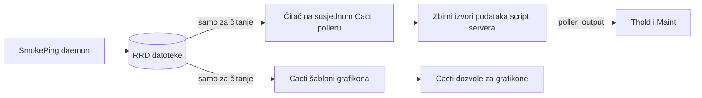

<!-- Source: README.md; SHA256: b41ec705327127cc34ff07d1514a141262752f99c5e2296fdc323d584a777b84 -->

<!-- translations:start -->
[English](../../../README.md) | [简体中文](../zh-CN/README.md) | [हिन्दी](../hi-IN/README.md) | [Español (España)](../es-ES/README.md) | [Español (Latinoamérica)](../es-419/README.md) | [العربية (السعودية)](../ar-SA/README.md) | [Afrikaans](../af-ZA/README.md) | [አማርኛ](../am-ET/README.md) | [العربية (مصر)](../ar-EG/README.md) | [العربية (المغرب)](../ar-MA/README.md) | [বাংলা](../bn-BD/README.md) | [Bosanski](README.md) | [Deutsch](../de-DE/README.md) | [فارسی](../fa-IR/README.md) | [Filipino](../fil-PH/README.md) | [Français](../fr-FR/README.md) | [Français (Maroc)](../fr-MA/README.md) | [Français (Sénégal)](../fr-SN/README.md) | [Hausa](../ha-NG/README.md) | [עברית](../he-IL/README.md) | [Hrvatski](../hr-HR/README.md) | [Bahasa Indonesia](../id-ID/README.md) | [Igbo](../ig-NG/README.md) | [Italiano](../it-IT/README.md) | [日本語](../ja-JP/README.md) | [한국어](../ko-KR/README.md) | [Malagasy](../mg-MG/README.md) | [मराठी](../mr-IN/README.md) | [Bahasa Melayu](../ms-MY/README.md) | [Nederlands](../nl-NL/README.md) | [Polski](../pl-PL/README.md) | [Português (Brasil)](../pt-BR/README.md) | [Русский](../ru-RU/README.md) | [Kinyarwanda](../rw-RW/README.md) | [Soomaali](../so-SO/README.md) | [Српски](../sr-RS/README.md) | [Svenska](../sv-SE/README.md) | [Kiswahili](../sw-KE/README.md) | [தமிழ்](../ta-IN/README.md) | [తెలుగు](../te-IN/README.md) | [ไทย](../th-TH/README.md) | [Türkçe](../tr-TR/README.md) | [Українська](../uk-UA/README.md) | [اردو](../ur-PK/README.md) | [Tiếng Việt](../vi-VN/README.md) | [isiXhosa](../xh-ZA/README.md) | [Yorùbá](../yo-NG/README.md) | [繁體中文](../zh-TW/README.md) | [isiZulu](../zu-ZA/README.md)
<!-- translations:end -->

  <picture>
    <source media="(prefers-color-scheme: dark)" srcset="../../images/logo_dark.png">
    
  </picture>

# SmokePing dodatak za Cacti

Dodatak za Cacti 1.2 koji donosi SmokePing mjerenja kašnjenja i gubitka paketa u Cacti kao standardne uređaje, izvore podataka i grafikone. Smoke grafikoni tada stoje odmah pored uređaja kojem pripadaju, pod Cacti dozvolama, dok Thold i Maint mogu slati alarme na osnovu njih i privremeno ih potiskivati. Ovo je nezavisna implementacija za Cacti i nije dio projekta [SmokePing](https://oss.oetiker.ch/smokeping/), čiji su izvorni autori Tobias Oetiker i Niko Tyni, niti ima njegovu zvaničnu podršku. Dodatak ne sadrži niti pokreće SmokePing kod: čita konfiguracijske i RRD datoteke koje zapisuje SmokePing, a njegovi šabloni grafikona napravljeni su da crtaju iste serije kao i vlastiti grafikoni SmokePinga.

> **Status: u razvoju. Režim praćenja (faza 1) implementiran je na grani `main` i objavljen kao predizdanje 1.0.0-rc.1.** Dodatak čita SmokePing konfiguracijske i RRD datoteke, prikazuje njihovo stanje, kreira Cacti uređaje, izvore podataka i grafikone za njih te dostavlja podatke dodacima Thold i Maint. Ne upisuje ništa u SmokePing. Upravljani režim (gdje dodatak upisuje SmokePing konfiguraciju) i udaljeni kolektori predstavljaju kasnije faze, još nisu započeti i nisu uključeni u ovo izdanje. Pilot testiranja na stvarnim instalacijama i još bliže podudaranje sa SmokePing legendom grafikona još su otvoreni u prekretnici 4. Za početak pogledajte [docs/install.md](../../install.md).

## Uloge pristupa

| Područje (Realm) | Pristup |
| --- | --- |
| SmokePing View | Postojeće stranice za praćenje. |
| SmokePing Operator | Praćenje plus stranica Operacije i lične potvrde prilikom trijaže. |
| SmokePing Admin | Pristup operatera plus postojeća konfiguracija i administrativne akcije. |

Nakon kopiranja datoteka za nadogradnju, otvorite stranicu Plugins kao administrator da registrujete
novo područje. Dodijelite područje Operator izričito u sekciji **Configuration > Users** ili korisničkim grupama.
Nadogradnje zadržavaju postojeće ID-jeve i dodjele za područja View i Admin. Admin pristup
nasljeđuje Operator pristup, a Operator pristup nasljeđuje View pristup pri svakom zahtjevu;
ovo ne dodaje sačuvane dodjele korisnicima ni grupama. Postavke dodatka također zahtijevaju
SmokePing Admin pristup pored Cacti dozvole Settings.

Cacti dozvole za uređaje i dalje ograničavaju redove i akcije dostupne svakom korisniku; nemapirani objekti zahtijevaju administratora.
Pristupni podaci, konfiguracija, mapiranje, brisanje i druge administrativne izmjene
ostaju na administrativnim stranicama. Potvrde traju samo u trenutnoj
korisničkoj sesiji, najviše jedan sat i samo dok isto zapažanje ostaje
aktuelno. Nova ili izmijenjena zapažanja ih poništavaju. One nikada ne označavaju neuspješno
mjerenje kao ispravno niti potiskuju alarme.

## Snimci ekrana

Uvezeno iz žive SmokePing 2.8.2 mreže u Cacti 1.2.31, posljednjih 12 sati. Uređaj svakog cilja ima smoke grafikon za glavni čvor i po jedan za svaki podređeni čvor (`lon1`, `sgp1`), smješten pod odgovarajućom SmokePing sekcijom u stablu grafikona.

## Zašto

SmokePing dobro mjeri raspodjelu kašnjenja i gubitak paketa, a njegovi smoke grafikoni otkrivaju odstupanja koja grafikon sa samo prosječnom vrijednošću sakriva. Kada radi paralelno uz Cacti, ostavlja tri praznine:

- **Odvojena kontrola pristupa.** SmokePing CGI ne zna ništa o Cacti korisnicima, grupama ni dozvolama za uređaje.
- **Nedostatak konteksta uređaja.** Podaci o kašnjenju i brojači interfejsa za isti uređaj nalaze se u različitim alatima.
- **Nema puta do Cacti alarma.** Thold i Maint rade sa Cacti izvorima podataka i uređajima, pa se SmokePing alarmi konfigurišu i potiskuju odvojeno.

Dodatak zatvara ove praznine tako što svaki SmokePing cilj predstavlja kao Cacti objekte koji pokazuju na postojeće SmokePing RRD datoteke, uz mali skup prikupljenih zbirnih vrijednosti. Ponovo koristi Cacti grafikone, dozvole, Thold i Maint umjesto da gradi paralelne zamjene. Podrška za Cacti udaljene kolektore podataka planirana je za fazu 3 i nije dio ovog izdanja.

## Opseg i status

| Faza | Opseg | Prekretnice | Status |
|---|---|---|---|
| 0, istraživanje | Matrica kompatibilnosti, potvrda ponašanja izvornog projekta, provjera vjernosti grafikona | [M1](https://github.com/somethingwithproof/plugin_smokeping/milestone/1) | Nalazi u `docs/research`; neka istraživačka pitanja su još otvorena |
| 1, praćenje | Uvoz inventara, Cacti uređaji, smoke i zbirni grafikoni, Thold alarmi, Maint potiskivanje, stranica ispravnosti | [M2](https://github.com/somethingwithproof/plugin_smokeping/milestone/2), [M3](https://github.com/somethingwithproof/plugin_smokeping/milestone/3), [M4](https://github.com/somethingwithproof/plugin_smokeping/milestone/4) | Objavljeno kao 1.0.0-rc.1; pilot testiranja otvorena |
| 2, upravljano | Konfiguracijski prostor imena pod upravom Cactija, profili ICMP i TCP sondi, revizije, validacija, ponovno učitavanje, vraćanje | [M5](https://github.com/somethingwithproof/plugin_smokeping/milestone/5) | Planirano, nije započeto |
| 3, udaljeno | SmokePing na Cacti udaljenim kolektorima podataka, podređeni čvorovi kao lokacije mjerenja | [M6](https://github.com/somethingwithproof/plugin_smokeping/milestone/6) | Planirano, nije započeto |

Izvan opsega: vlastiti sistem alarma u dodatku, sistem za generisanje izvještaja, prilagođeni daemon ili mrežni protokol, upravljane HTTP/DNS/servisne provjere (njih pokriva servcheck) i pisanje u SmokePing RRD datoteke.

## Ciljevi kompatibilnosti

| Komponenta | Cilj |
|---|---|
| Cacti | 1.2.31 ili noviji u grani 1.2.x, bez zakrpa jezgra |
| PHP | 8.2 ili noviji; `setup.php` ostaje sintaksno ispravan na 8.0 kako bi nepodržano okruženje dobilo odbijanje umjesto pokvarenog Cacti interfejsa |
| SmokePing | 2.9.0, 2.8.2 i 2.7.3 (samo Ubuntu 22.04, do 2027-06-01) |
| Thold, Maint | Nisu potrebne izmjene |
| Serije | 10.000 po instalaciji uz 20 pingova i korak od 300 s ([performanse](../../performance.md#supported-series-count)) |

## Dokumentacija

| | |
|---|---|
| [Instalacija](../../install.md) | Zahtjevi, montiranje SmokePing direktorija s podacima samo za čitanje, instalacija, kontejneri, podržane verzije |
| [Rad i održavanje](../../operations.md) | Značenje svakog stanja i pripadajući dokazi, provjere ispravnosti, ponašanje kada ulazi zakažu |
| [Dodavanje ciljeva u Cacti](../../provisioning.md) | Jedan cilj, više uređaja, ponovno povezivanje, dozvole |
| [Alarmiranje](../../alerting.md) | Zbirne vrijednosti, trajanja u Tholdu, zastarjelost, zakašnjeli podaci, preklapanje sa SmokePing alarmima, Maint |
| [Format konfiguracije](../../configuration-format.md) | YAML i XML izvoz i uvoz |
| [Rezervna kopija i vraćanje](../../backup-restore.md) | Šta treba sačuvati u rezervnoj kopiji i kako se rad nastavlja nakon vraćanja |
| [Performanse](../../performance.md) | Lokalna mjerenja i mjerenja na runneru za izdanja pri 100, 1.000 i 10.000 serija te podržani broj serija: 10.000 po instalaciji |
| [Kvalifikacija kvarova](../../failure-qualification.md) | Scenariji kvarova i način testiranja svakog od njih |
| [Objavljivanje izdanja](../../RELEASING.md) | Procedura izdanja: pull zahtjev, potpisana oznaka, koraci radnog toka, provjera rezultata |
| [Arhiva izdanja](../../release.md) | Verzija, zapisnik izmjena i arhiva izdanja |
| [Testiranje](../../testing.md) | Testni skupovi, šta CI pokreće i živi testni skup protiv stvarnog SmokePinga |

## Dizajn

- [docs/PLAN.md](../../PLAN.md) predstavlja potpuni plan: arhitekturu, činjenice izvornog projekta na koje se oslanja (sa izvorima), model stanja, sigurnosne granice, proračune performansi, testiranje i rizike.
- [docs/decisions/](../../decisions) sadrži zapise arhitektonskih odluka (ADR) za već donesene izbore.
- [docs/REQUIREMENTS.md](../../REQUIREMENTS.md) mapira svaki identifikator zahtjeva na odgovarajući problem (issue).

## Kako se prati rad

- **Prekretnice (Milestones)** prate prekretnice iz plana. Svaka ima krovni zadatak (epic) sa spiskom podzadataka i izlaznih dokaza.
- **Zadaci (Issues)** su označeni etiketama tipa: `type: requirement`, `type: research`, `type: decision`, `type: epic`. Zadaci zahtjeva navode numerisane, provjerljive zahtjeve (`REQ-AREA-NNN`) i kriterije prihvatanja.
- **Etikete (Labels)** također nose prefikse `area:`, `phase:`, `priority:` i `status:`. Pogledajte [CONTRIBUTING.md](../../../CONTRIBUTING.md#labels).
- [Tabla projekta](https://github.com/users/somethingwithproof/projects/6) prikazuje sve zadatke kroz sve prekretnice.

## Doprinos projektu

Pročitajte [CONTRIBUTING.md](../../../CONTRIBUTING.md). Commitovi zahtijevaju DCO potpis (sign-off). Rasprave o dizajnu vode se na zadacima (issues); otvorene odluke nose etiketu `type: decision`.

## Sigurnost

Sigurnosne ranjivosti prijavite privatno; pogledajte [SECURITY.md](../../../SECURITY.md).

## Licenca

GNU General Public License v2.0, ista licenca kao Cacti i njegovi dodaci. Pogledajte [LICENSE](../../../LICENSE).
