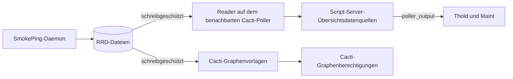

<!-- Source: README.md; SHA256: 17905aa1eac76a7d10dab526734605629fa3d1ada56397642ad4154c5be1feff -->

<!-- translations:start -->
[English](../../../README.md) | [简体中文](../zh-CN/README.md) | [हिन्दी](../hi-IN/README.md) | [Español (España)](../es-ES/README.md) | [Español (Latinoamérica)](../es-419/README.md) | [العربية (السعودية)](../ar-SA/README.md) | [Afrikaans](../af-ZA/README.md) | [አማርኛ](../am-ET/README.md) | [العربية (مصر)](../ar-EG/README.md) | [العربية (المغرب)](../ar-MA/README.md) | [বাংলা](../bn-BD/README.md) | [Deutsch](README.md) | [فارسی](../fa-IR/README.md) | [Filipino](../fil-PH/README.md) | [Français](../fr-FR/README.md) | [Français (Maroc)](../fr-MA/README.md) | [Français (Sénégal)](../fr-SN/README.md) | [Hausa](../ha-NG/README.md) | [עברית](../he-IL/README.md) | [Bahasa Indonesia](../id-ID/README.md) | [Igbo](../ig-NG/README.md) | [Italiano](../it-IT/README.md) | [日本語](../ja-JP/README.md) | [한국어](../ko-KR/README.md) | [Malagasy](../mg-MG/README.md) | [मराठी](../mr-IN/README.md) | [Bahasa Melayu](../ms-MY/README.md) | [Nederlands](../nl-NL/README.md) | [Polski](../pl-PL/README.md) | [Português (Brasil)](../pt-BR/README.md) | [Русский](../ru-RU/README.md) | [Kinyarwanda](../rw-RW/README.md) | [Soomaali](../so-SO/README.md) | [Svenska](../sv-SE/README.md) | [Kiswahili](../sw-KE/README.md) | [தமிழ்](../ta-IN/README.md) | [తెలుగు](../te-IN/README.md) | [ไทย](../th-TH/README.md) | [Türkçe](../tr-TR/README.md) | [Українська](../uk-UA/README.md) | [اردو](../ur-PK/README.md) | [Tiếng Việt](../vi-VN/README.md) | [isiXhosa](../xh-ZA/README.md) | [Yorùbá](../yo-NG/README.md) | [繁體中文](../zh-TW/README.md) | [isiZulu](../zu-ZA/README.md)
<!-- translations:end -->

  <picture>
    <source media="(prefers-color-scheme: dark)" srcset="../../images/logo_dark.png">
    
  </picture>

# SmokePing-Plugin für Cacti

Ein Cacti-1.2-Plugin, das Latenz- und Paketverlustmessungen von SmokePing als reguläre Geräte, Datenquellen und Graphen in Cacti integriert. Smoke-Graphen stehen dann direkt neben dem jeweiligen Gerät, unterliegen den Cacti-Berechtigungen und können von Thold und Maint überwacht bzw. unterdrückt werden. Es handelt sich um eine eigenständige Implementierung für Cacti, die weder Teil von [SmokePing](https://oss.oetiker.ch/smokeping/) ist noch von diesem Projekt unterstützt wird (Originalautoren von SmokePing: Tobias Oetiker und Niko Tyni). Das Plugin enthält keinen SmokePing-Code und führt diesen auch nicht aus: Es liest ausschließlich die von SmokePing geschriebenen Konfigurations- und RRD-Dateien ein, und seine Graphenvorlagen sind so aufgebaut, dass sie dieselben Datenreihen wie die nativen SmokePing-Graphen darstellen.

> **Status: In Entwicklung. Der Observe-Modus (Phase 1) ist auf `main` implementiert und als Vorabversion 1.0.0-rc.1 veröffentlicht.** Das Plugin liest die Konfigurations- und RRD-Dateien von SmokePing, zeigt deren Zustand an, legt entsprechende Cacti-Geräte, Datenquellen und Graphen an und versorgt Thold und Maint mit Daten. Es nimmt keinerlei Schreibzugriffe auf SmokePing vor. Der Managed-Modus (bei dem das Plugin die SmokePing-Konfiguration schreibt) sowie Remote-Kollektoren sind spätere Phasen, wurden noch nicht begonnen und sind in diesem Release nicht enthalten. Pilotbetriebe auf produktiven Installationen sowie eine noch genauere Angleichung an die Graphenlegende von SmokePing sind in Meilenstein 4 noch offen. Siehe [docs/install.md](../../install.md) für den Einstieg.

## Zugriffsrollen

| Realm | Zugriff |
| --- | --- |
| SmokePing View | Bestehende Monitoring-Seiten. |
| SmokePing Operator | Monitoring sowie die Seite „Operations“ und persönliche Triage-Bestätigungen. |
| SmokePing Admin | Operator-Zugriff sowie die bestehenden Konfigurations- und Verwaltungsaktionen. |

Öffnen Sie nach dem Kopieren der Upgrade-Dateien als Administrator die Plugins-Seite, um den neuen Realm zu registrieren. Weisen Sie den Operator-Realm explizit unter **Configuration > Users** oder über Benutzergruppen zu. Upgrades behalten die bestehenden Realm-IDs und -Berechtigungen für View und Admin bei. Admin-Zugriff erbt bei jeder Anfrage den Operator-Zugriff, und Operator-Zugriff erbt den View-Zugriff; dadurch werden Benutzern oder Gruppen keine zusätzlichen gespeicherten Berechtigungen hinzugefügt. Für Plugin-Einstellungen ist zusätzlich zur Cacti-Berechtigung „Settings“ auch SmokePing-Admin-Zugriff erforderlich.

Cacti-Geräteberechtigungen schränken weiterhin die für jeden Benutzer verfügbaren Zeilen und Aktionen ein; nicht zugeordnete Objekte erfordern einen Administrator. Zugangsdaten, Konfiguration, Zuordnungen, Löschungen und andere administrative Änderungen verbleiben auf den Verwaltungsseiten. Bestätigungen gelten nur in der aktuellen Benutzersitzung, für höchstens eine Stunde und nur solange dieselbe Beobachtung aktuell bleibt. Neue oder geänderte Beobachtungen machen sie ungültig. Sie markieren eine fehlgeschlagene Messung niemals als fehlerfrei und unterdrücken keine Alarme.

## Screenshots

Importiert aus einem produktiven SmokePing-2.8.2-Netzwerk in Cacti 1.2.31, letzte 12 Stunden. Das Gerät jedes Ziels verfügt über einen Smoke-Graphen für den Master sowie jeweils einen für jeden Slave (`lon1`, `sgp1`), eingeordnet unter dem jeweiligen SmokePing-Abschnitt im Graphenbaum.

## Warum

SmokePing misst Latenzverteilungen und Paketverluste zuverlässig, und seine Smoke-Graphen machen Schwankungen sichtbar, die ein reiner Durchschnittsgraph verbirgt. Parallel zu Cacti betrieben bleiben jedoch drei Lücken:

- **Getrennte Zugriffskontrolle.** Das CGI von SmokePing kennt keine Cacti-Benutzer, -Gruppen oder -Geräteberechtigungen.
- **Fehlender Gerätekontext.** Latenzwerte und Schnittstellenzähler für dasselbe Gerät liegen in unterschiedlichen Werkzeugen.
- **Keine Anbindung an Cacti-Alarmierung.** Thold und Maint arbeiten auf Cacti-Datenquellen und -Geräten, sodass SmokePing-Alarme separat konfiguriert und unterdrückt werden müssen.

Das Plugin schließt diese Lücken, indem es jedes SmokePing-Ziel als Cacti-Objekte abbildet, die auf die vorhandenen RRD-Dateien von SmokePing verweisen, ergänzt um eine kleine Menge abgefragter Zusammenfassungswerte. Es nutzt die Graphenfunktionen, Berechtigungen, Thold und Maint von Cacti weiter, statt parallele Systeme dafür aufzubauen. Unterstützung für Cacti Remote Data Collectors ist für Phase 3 geplant und nicht in diesem Release enthalten.

## Umfang und Status

| Phase | Umfang | Meilensteine | Status |
|---|---|---|---|
| 0, Forschung | Kompatibilitätsmatrix, Bestätigung des Upstream-Verhaltens, Machbarkeitsstudie zur Graphentreue | [M1](https://github.com/somethingwithproof/plugin_smokeping/milestone/1) | Ergebnisse in `docs/research`; einige Forschungs-Issues sind noch offen |
| 1, Observe | Bestandsimport, Cacti-Geräte, Smoke- und Übersichtsgraphen, Thold-Alarmierung, Maint-Unterdrückung, Statusseite | [M2](https://github.com/somethingwithproof/plugin_smokeping/milestone/2), [M3](https://github.com/somethingwithproof/plugin_smokeping/milestone/3), [M4](https://github.com/somethingwithproof/plugin_smokeping/milestone/4) | Veröffentlicht als 1.0.0-rc.1; Pilotbetriebe offen |
| 2, Managed | Von Cacti verwalteter Konfigurations-Namespace, ICMP- und TCP-Probe-Profile, Revisionen, Validierung, Neuladen, Rollback | [M5](https://github.com/somethingwithproof/plugin_smokeping/milestone/5) | Geplant, nicht begonnen |
| 3, Remote | SmokePing auf Cacti Remote Data Collectors, Slaves als Messstandorte | [M6](https://github.com/somethingwithproof/plugin_smokeping/milestone/6) | Geplant, nicht begonnen |

Nicht im Umfang enthalten: eine eigene Alarmierungs-Engine im Plugin, eine Reporting-Engine, ein eigener Daemon oder ein eigenes Netzwerkprotokoll, verwaltete HTTP-/DNS-/Dienstprüfungen (diese deckt servcheck ab) sowie Schreibzugriffe auf die RRD-Dateien von SmokePing.

## Kompatibilitätsziele

| Komponente | Ziel |
|---|---|
| Cacti | 1.2.31 oder neuer in 1.2.x, keine Core-Patches |
| PHP | 8.2 oder neuer; `setup.php` bleibt unter 8.0 parsbar, damit eine nicht unterstützte Laufzeitumgebung eine saubere Ablehnung statt einer defekten Cacti-Oberfläche erhält |
| SmokePing | 2.9.0, 2.8.2 und 2.7.3 (nur Ubuntu 22.04, bis 2027-06-01) |
| Thold, Maint | Keine Änderungen erforderlich |
| Datenreihen | 10.000 pro Installation bei 20 Pings und einem 300-s-Intervall ([Performance](../../performance.md#supported-series-count)) |

## Dokumentation

| | |
|---|---|
| [Installation](../../install.md) | Anforderungen, das schreibgeschützte Einbinden des SmokePing-Datenverzeichnisses, Installation, Container, unterstützte Versionen |
| [Betrieb](../../operations.md) | Bedeutung der einzelnen Zustände und zugehörige Nachweise, Integritätsprüfungen, Verhalten bei fehlerhaften Eingaben |
| [Ziele zu Cacti hinzufügen](../../provisioning.md) | Ein Ziel, mehrere Geräte, erneute Verknüpfung, Berechtigungen |
| [Alarmierung](../../alerting.md) | Zusammenfassungswerte, Thold-Dauern, Veralterung, verspätete Daten, Überschneidung mit SmokePing-Alarmen, Maint |
| [Konfigurationsformat](../../configuration-format.md) | YAML- und XML-Export und -Import |
| [Sicherung und Wiederherstellung](../../backup-restore.md) | Was gesichert werden muss und wie die Wiederherstellung fortgesetzt wird |
| [Performance](../../performance.md) | Lokale und Release-Runner-Messungen bei 100, 1.000 und 10.000 Datenreihen sowie die unterstützte Anzahl an Datenreihen: 10.000 pro Installation |
| [Fehlerqualifizierung](../../failure-qualification.md) | Die Fehlerszenarien und wie jedes einzelne getestet wird |
| [Releases erstellen](../../RELEASING.md) | Der Release-Prozess: Pull Request, signiertes Tag, Aufgaben des Workflows, Überprüfung des Ergebnisses |
| [Release-Archiv](../../release.md) | Version, Änderungsprotokoll und das Release-Archiv |
| [Tests](../../testing.md) | Die Test-Suites, was die CI ausführt, und die Live-Suite gegen ein echtes SmokePing |

## Design

- [docs/PLAN.md](../../PLAN.md) enthält den vollständigen Plan: Architektur, zugrunde liegende Upstream-Fakten (mit Quellen), Zustandsmodell, Sicherheitsgrenzen, Performance-Berechnungen, Tests und Risiken.
- [docs/decisions/](../../decisions) enthält Architecture Decision Records zu bereits getroffenen Entscheidungen.
- [docs/REQUIREMENTS.md](../../REQUIREMENTS.md) ordnet jede Anforderungs-ID dem zugehörigen Issue zu.

## So wird die Arbeit nachverfolgt

- **Meilensteine** orientieren sich an den Meilensteinen des Plans. Jeder verfügt über ein Epic-Issue mit seinen Unter-Issues und den Abschlussnachweisen.
- **Issues** sind über Labels typisiert: `type: requirement`, `type: research`, `type: decision`, `type: epic`. Anforderungs-Issues definieren nummerierte, testbare Anforderungen (`REQ-AREA-NNN`) sowie Akzeptanzkriterien.
- **Labels** enthalten außerdem `area:`, `phase:`, `priority:` und `status:`. Siehe [CONTRIBUTING.md](../../../CONTRIBUTING.md#labels).
- Das [Projektboard](https://github.com/users/somethingwithproof/projects/6) zeigt alle Issues über sämtliche Meilensteine hinweg.

## Mitwirken

Lesen Sie [CONTRIBUTING.md](../../../CONTRIBUTING.md). Commits erfordern ein DCO-Sign-off. Designdiskussionen finden in Issues statt; offene Entscheidungen tragen das Label `type: decision`.

## Sicherheit

Melden Sie Sicherheitslücken vertraulich; siehe [SECURITY.md](../../../SECURITY.md).

## Lizenz

GNU General Public License v2.0, dieselbe Lizenz wie Cacti und seine Plugins. Siehe [LICENSE](../../../LICENSE).
