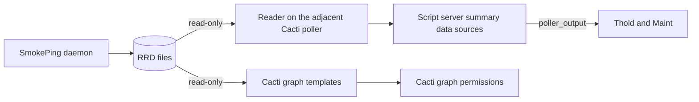

<!-- Source: README.md; SHA256: 17905aa1eac76a7d10dab526734605629fa3d1ada56397642ad4154c5be1feff -->

<!-- translations:start -->
[English](../../../README.md) | [简体中文](../zh-CN/README.md) | [हिन्दी](../hi-IN/README.md) | [Español (España)](../es-ES/README.md) | [Español (Latinoamérica)](README.md) | [العربية](../ar-SA/README.md)
<!-- translations:end -->

  <picture>
    <source media="(prefers-color-scheme: dark)" srcset="../../images/logo_dark.png">
    
  </picture>

# Complemento SmokePing para Cacti

Un complemento para Cacti 1.2 que incorpora las mediciones de latencia y pérdida de SmokePing como dispositivos, fuentes de datos y gráficos normales de Cacti. Los gráficos de humo aparecen junto al dispositivo al que pertenecen, bajo los permisos de Cacti, y Thold y Maint pueden alertar sobre ellos y suprimirlos. Es una implementación independiente para Cacti, no forma parte de [SmokePing](https://oss.oetiker.ch/smokeping/) ni está respaldada por él; sus autores originales son Tobias Oetiker y Niko Tyni. El complemento no incluye ni ejecuta código SmokePing: lee su configuración y sus archivos RRD, y sus plantillas dibujan las mismas series que los gráficos originales de SmokePing.

> **Estado: en desarrollo. El modo de observación (fase 1) está implementado en `main` y publicado como versión preliminar 1.0.0-rc.1.** El complemento lee la configuración y los archivos RRD de SmokePing, muestra su estado, crea dispositivos, fuentes y gráficos Cacti para ellos, y alimenta Thold y Maint. No escribe nada en SmokePing. El modo gestionado (escritura de configuración SmokePing por el complemento) y los recolectores remotos son fases posteriores, no iniciadas y no incluidas aquí. Las pruebas piloto en instalaciones reales y un ajuste mayor de la leyenda de los gráficos de SmokePing siguen pendientes en el hito 4. Consulte [docs/install.md](docs/install.md) para empezar.

## Roles de acceso

| Permiso | Acceso |
| --- | --- |
| SmokePing View | Páginas de supervisión existentes. |
| SmokePing Operator | Supervisión, página de operaciones y acuses personales de investigación. |
| SmokePing Admin | Acceso de operador más configuración y acciones administrativas existentes. |

Después de copiar los archivos de actualización, abra la página Complementos como administrador para registrar el nuevo permiso. Asigne expresamente Operator en **Configuración > Usuarios** o en los grupos de usuarios. Las actualizaciones conservan los identificadores y las concesiones de View y Admin. En cada petición, Admin hereda el acceso Operator y Operator hereda View; esto no añade concesiones almacenadas a usuarios ni grupos. Los ajustes del complemento también requieren SmokePing Admin, además del permiso Ajustes de Cacti.

Los permisos de dispositivos de Cacti siguen limitando las filas y acciones disponibles para cada usuario; los objetos sin asociación requieren un administrador. Credenciales, configuración, asociaciones, eliminación y otros cambios administrativos permanecen en las páginas administrativas. Los acuses solo duran en la sesión del usuario actual, como máximo una hora y mientras la misma observación siga vigente. Las observaciones nuevas o modificadas los invalidan. Nunca marcan como correcta una medición fallida ni suprimen alertas.

## Capturas de pantalla

Importado desde una red SmokePing 2.8.2 en funcionamiento a Cacti 1.2.31, últimas 12 horas. El dispositivo de cada objetivo tiene un gráfico de humo del maestro y uno por esclavo (`lon1`, `sgp1`), archivados bajo su sección SmokePing en el árbol de gráficos.

## Motivo

SmokePing mide bien la distribución de latencia y la pérdida de paquetes; sus gráficos de humo muestran variaciones que oculta un gráfico de medias. Al ejecutarlo junto a Cacti quedan tres carencias:

- **Control de acceso separado.** El CGI de SmokePing no conoce usuarios, grupos ni permisos de dispositivos Cacti.
- **Sin contexto de dispositivo.** La latencia y los contadores de interfaces del mismo dispositivo residen en herramientas distintas.
- **Sin integración con las alertas de Cacti.** Thold y Maint trabajan sobre dispositivos y fuentes Cacti, por lo que las alertas SmokePing se configuran y suprimen aparte.

El complemento cubre esas carencias representando cada objetivo SmokePing mediante objetos Cacti que apuntan a sus archivos RRD existentes, más un pequeño conjunto de valores resumen sondeados. Reutiliza los gráficos, permisos, Thold y Maint de Cacti. El soporte de recolectores remotos está previsto para la fase 3 y no está en esta versión.

## Alcance y estado

| Fase | Alcance | Hitos | Estado |
|---|---|---|---|
| 0, investigación | Matriz de compatibilidad, confirmación del comportamiento original, prototipo de fidelidad de gráficos | [M1](https://github.com/somethingwithproof/plugin_smokeping/milestone/1) | Resultados en `docs/research`; algunas investigaciones siguen abiertas |
| 1, observación | Importación de inventario, dispositivos Cacti, gráficos de humo y resumen, alertas Thold, supresión Maint, página de estado | [M2](https://github.com/somethingwithproof/plugin_smokeping/milestone/2), [M3](https://github.com/somethingwithproof/plugin_smokeping/milestone/3), [M4](https://github.com/somethingwithproof/plugin_smokeping/milestone/4) | Publicado como 1.0.0-rc.1; pilotos pendientes |
| 2, gestionado | Espacio de configuración propiedad de Cacti, perfiles de sondas ICMP y TCP, revisiones, validación, recarga y reversión | [M5](https://github.com/somethingwithproof/plugin_smokeping/milestone/5) | Previsto, no iniciado |
| 3, remoto | SmokePing en recolectores remotos Cacti, esclavos como ubicaciones de medición | [M6](https://github.com/somethingwithproof/plugin_smokeping/milestone/6) | Previsto, no iniciado |

Fuera de alcance: motor propio de alertas, motor de informes, servicio o protocolo de red personalizado, comprobaciones gestionadas HTTP/DNS/servicios (las cubre servcheck), y escritura en archivos RRD de SmokePing.

## Objetivos de compatibilidad

| Componente | Objetivo |
|---|---|
| Cacti | 1.2.31 o posterior de 1.2.x, sin parches del núcleo |
| PHP | 8.2 o posterior; `setup.php` sigue siendo interpretable en 8.0 para rechazar un entorno incompatible sin romper la interfaz Cacti |
| SmokePing | 2.9.0, 2.8.2 y 2.7.3 (solo Ubuntu 22.04, hasta 2027-06-01) |
| Thold, Maint | No requieren cambios |
| Series | 10.000 por instalación con 20 pings y paso de 300 s ([rendimiento](docs/performance.md#supported-series-count)) |

## Documentación

| | |
|---|---|
| [Instalar](docs/install.md) | Requisitos, montaje de solo lectura del directorio de datos, instalación, contenedores, versiones admitidas |
| [Operar](docs/operations.md) | Significado y evidencias de cada estado, comprobaciones de salud, comportamiento ante fallos de entradas |
| [Añadir objetivos a Cacti](docs/provisioning.md) | Un objetivo, muchos dispositivos, reasociación, permisos |
| [Alertas](docs/alerting.md) | Valores resumen, duraciones Thold, obsolescencia, datos tardíos, solapamiento con alertas SmokePing, Maint |
| [Formato de configuración](docs/configuration-format.md) | Exportación e importación YAML y XML |
| [Copia y restauración](docs/backup-restore.md) | Qué respaldar y cómo se reanuda tras una restauración |
| [Rendimiento](docs/performance.md) | Mediciones locales y del ejecutor de publicaciones con 100, 1.000 y 10.000 series, y el número admitido: 10.000 por instalación |
| [Calificación de fallos](../../failure-qualification.md) | Escenarios de fallo y pruebas de cada uno |
| [Publicar](../../RELEASING.md) | Procedimiento de publicación: solicitud de cambios, etiqueta firmada, flujo de trabajo y comprobación del resultado |
| [Archivo de publicación](../../release.md) | Versión, historial de cambios y archivo distribuido |
| [Pruebas](../../testing.md) | Suites, ejecución de CI y suite en vivo contra un SmokePing real |

## Diseño

- [docs/PLAN.md](../../PLAN.md) es el plan completo: arquitectura, hechos originales de los que depende (con fuentes), modelo de estados, límites de seguridad, cálculos de rendimiento, pruebas y riesgos.
- [docs/decisions/](../../decisions) contiene registros de decisiones de arquitectura ya tomadas.
- [docs/REQUIREMENTS.md](../../REQUIREMENTS.md) relaciona cada requisito con su incidencia.

## Seguimiento del trabajo

- Los **hitos** siguen los del plan. Cada uno tiene una incidencia épica con sus subincidencias y pruebas de finalización.
- Las **incidencias** se clasifican mediante `type: requirement`, `type: research`, `type: decision` y `type: epic`. Los requisitos indican condiciones numeradas y comprobables (`REQ-AREA-NNN`) y criterios de aceptación.
- Las **etiquetas** incluyen también `area:`, `phase:`, `priority:` y `status:`. Consulte [CONTRIBUTING.md](../../../CONTRIBUTING.md#labels).
- El [tablero del proyecto](https://github.com/users/somethingwithproof/projects/6) muestra todas las incidencias de los distintos hitos.

## Contribuir

Lea [CONTRIBUTING.md](../../../CONTRIBUTING.md). Los commits requieren la firma DCO. El diseño se debate en las incidencias; las decisiones abiertas llevan la etiqueta `type: decision`.

## Seguridad

Comunique las vulnerabilidades de forma privada; consulte [SECURITY.md](../../../SECURITY.md).

## Licencia

Licencia Pública General GNU v2.0, la misma que Cacti y sus complementos. Consulte [LICENSE](../../../LICENSE).
