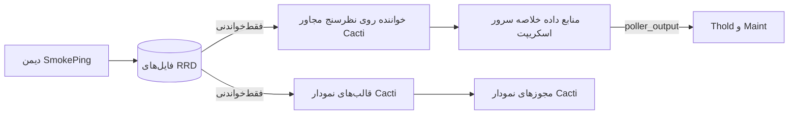

<!-- Source: README.md; SHA256: 17905aa1eac76a7d10dab526734605629fa3d1ada56397642ad4154c5be1feff -->

<!-- translations:start -->
[English](../../../README.md) | [简体中文](../zh-CN/README.md) | [हिन्दी](../hi-IN/README.md) | [Español (España)](../es-ES/README.md) | [Español (Latinoamérica)](../es-419/README.md) | [العربية (السعودية)](../ar-SA/README.md) | [Afrikaans](../af-ZA/README.md) | [አማርኛ](../am-ET/README.md) | [العربية (مصر)](../ar-EG/README.md) | [العربية (المغرب)](../ar-MA/README.md) | [বাংলা](../bn-BD/README.md) | [Bosanski](../bs-BA/README.md) | [Deutsch](../de-DE/README.md) | [فارسی](README.md) | [Filipino](../fil-PH/README.md) | [Français](../fr-FR/README.md) | [Français (Maroc)](../fr-MA/README.md) | [Français (Sénégal)](../fr-SN/README.md) | [Hausa](../ha-NG/README.md) | [עברית](../he-IL/README.md) | [Hrvatski](../hr-HR/README.md) | [Bahasa Indonesia](../id-ID/README.md) | [Igbo](../ig-NG/README.md) | [Italiano](../it-IT/README.md) | [日本語](../ja-JP/README.md) | [한국어](../ko-KR/README.md) | [Malagasy](../mg-MG/README.md) | [मराठी](../mr-IN/README.md) | [Bahasa Melayu](../ms-MY/README.md) | [Nederlands](../nl-NL/README.md) | [Polski](../pl-PL/README.md) | [Português (Brasil)](../pt-BR/README.md) | [Русский](../ru-RU/README.md) | [Kinyarwanda](../rw-RW/README.md) | [Soomaali](../so-SO/README.md) | [Српски](../sr-RS/README.md) | [Svenska](../sv-SE/README.md) | [Kiswahili](../sw-KE/README.md) | [தமிழ்](../ta-IN/README.md) | [తెలుగు](../te-IN/README.md) | [ไทย](../th-TH/README.md) | [Türkçe](../tr-TR/README.md) | [Українська](../uk-UA/README.md) | [اردو](../ur-PK/README.md) | [Tiếng Việt](../vi-VN/README.md) | [isiXhosa](../xh-ZA/README.md) | [Yorùbá](../yo-NG/README.md) | [繁體中文](../zh-TW/README.md) | [isiZulu](../zu-ZA/README.md)
<!-- translations:end -->

  <picture>
    <source media="(prefers-color-scheme: dark)" srcset="../../images/logo_dark.png">
    
  </picture>

# افزونه SmokePing برای Cacti

یک افزونه Cacti 1.2 که اندازه‌گیری‌های تاخیر و از دست رفتن بسته SmokePing را به‌عنوان دستگاه‌ها، منابع داده و نمودارهای عادی به Cacti می‌آورد. در این حالت، نمودارهای دود در کنار دستگاه مربوط به خود و تحت مجوزهای Cacti قرار می‌گیرند و Thold و Maint می‌توانند برای آن‌ها هشدار صادر کرده و آن‌ها را سرکوب کنند. این افزونه یک پیاده‌سازی مستقل برای Cacti است و بخشی از [SmokePing](https://oss.oetiker.ch/smokeping/) — که نویسندگان اصلی آن Tobias Oetiker و Niko Tyni هستند — نیست و مورد تایید آن قرار ندارد. این افزونه کد SmokePing را در بر ندارد و آن را اجرا نمی‌کند: بلکه پیکربندی و فایل‌های RRD نوشته‌شده توسط SmokePing را می‌خواند و قالب‌های نمودار آن به‌گونه‌ای ساخته شده‌اند که همان سری‌های نمودارهای خود SmokePing را رسم کنند.

> **وضعیت: در حال توسعه. حالت مشاهده (فاز ۱) روی `main` پیاده‌سازی شده و به‌عنوان پیش‌انتشار 1.0.0-rc.1 منتشر شده است.** این افزونه پیکربندی و فایل‌های RRD مربوط به SmokePing را می‌خواند، وضعیت آن‌ها را نمایش می‌دهد، دستگاه‌ها، منابع داده و نمودارهای Cacti را برای آن‌ها ایجاد می‌کند و داده‌ها را در اختیار Thold و Maint قرار می‌دهد. هیچ چیزی در SmokePing نمی‌نویسد. حالت مدیریت‌شده (نوشتن پیکربندی SmokePing توسط افزونه) و جمع‌آوری‌کننده‌های از راه دور در فازهای بعدی هستند، هنوز شروع نشده‌اند و در این انتشار وجود ندارند. آزمایش‌های پایلوت روی نصب‌های واقعی و تطبیق نزدیک‌تر با راهنمای نمودار SmokePing هنوز در نقطه عطف ۴ باز هستند. برای شروع به [docs/install.md](../../install.md) مراجعه کنید.

## نقش‌های دسترسی

| قلمرو | دسترسی |
| --- | --- |
| SmokePing View | صفحات نظارت موجود. |
| SmokePing Operator | نظارت به همراه صفحه عملیات و تاییدهای تریاژ شخصی. |
| SmokePing Admin | دسترسی Operator به همراه پیکربندی موجود و اقدام‌های مدیریتی. |

پس از کپی کردن فایل‌های ارتقا، به‌عنوان مدیر صفحه Plugins را باز کنید تا قلمرو جدید ثبت شود. قلمرو Operator را به‌صورت صریح در بخش **Configuration > Users** یا گروه‌های کاربری تخصیص دهید.
ارتقاها شناسه‌ها و مجوزهای اعطاشده قلمروهای View و Admin موجود را حفظ می‌کنند. دسترسی Admin
دسترسی Operator را به ارث می‌برد و دسترسی Operator در هر درخواست دسترسی View را به ارث می‌برد؛
این کار مجوز ذخیره‌شده جدیدی به کاربران یا گروه‌ها اضافه نمی‌کند. تنظیمات افزونه علاوه بر مجوز Settings در Cacti،
به دسترسی SmokePing Admin نیز نیاز دارد.

مجوزهای دستگاه Cacti همچنان سطرها و اقدام‌های در دسترس هر کاربر را محدود می‌کنند؛ اشیای نگاشت‌نشده نیاز به مدیر دارند.
اعتبارنامه‌ها، پیکربندی، نگاشت، حذف و سایر تغییرات مدیریتی
در صفحات مدیریتی باقی می‌مانند. تاییدها فقط در نشست فعلی کاربر،
حداکثر به مدت یک ساعت و تنها تا زمانی که همان مشاهده تازه باقی بماند، دوام دارند.
مشاهدات جدید یا تغییریافته آن‌ها را باطل می‌کنند. آن‌ها هرگز یک اندازه‌گیری ناموفق را
سالم علامت‌گذاری نمی‌کنند و هشدارها را سرکوب نمی‌کنند.

## تصاویر محیط کاربری

واردشده از یک شبکه زنده SmokePing 2.8.2 به Cacti 1.2.31، ۱۲ ساعت گذشته. دستگاه هر هدف دارای یک نمودار دود برای مستر و یک نمودار برای هر اسلیو (`lon1`، `sgp1`) است که در درخت نمودار زیر بخش SmokePing خود ثبت شده‌اند.

## چرا

SmokePing توزیع تاخیر و از دست رفتن بسته را به‌خوبی اندازه‌گیری می‌کند و نمودارهای دود آن نوساناتی را نشان می‌دهند که یک نمودار مبتنی بر میانگین آن‌ها را پنهان می‌کند. اجرای آن در کنار Cacti سه شکاف باقی می‌گذارد:

- **کنترل دسترسی جداگانه.** CGI مربوط به SmokePing هیچ اطلاعی از کاربران، گروه‌ها یا مجوزهای دستگاه Cacti ندارد.
- **نبود زمینه دستگاه.** تاخیر و شمارنده‌های رابط برای یک دستگاه واحد در ابزارهای متفاوتی قرار دارند.
- **نبود مسیر به هشداردهی Cacti.** Thold و Maint روی منابع داده و دستگاه‌های Cacti کار می‌کنند، بنابراین هشدارهای SmokePing به‌طور جداگانه پیکربندی و سرکوب می‌شوند.

این افزونه با نمایش هر هدف SmokePing به‌عنوان اشیای Cacti که به فایل‌های RRD موجود SmokePing اشاره می‌کنند، به همراه مجموعه کوچکی از مقادیر خلاصه نظرسنجی‌شده، این شکاف‌ها را پر می‌کند. به‌جای ساخت نسخه‌های موازی، از نمودارکشی، مجوزها، Thold و Maint خود Cacti استفاده مجدد می‌کند. پشتیبانی از جمع‌آوری‌کننده‌های داده از راه دور Cacti برای فاز ۳ برنامه‌ریزی شده است و در این انتشار وجود ندارد.

## محدوده و وضعیت

| فاز | محدوده | نقاط عطف | وضعیت |
|---|---|---|---|
| ۰، پژوهش | ماتریس سازگاری، تایید رفتار بالادست، بررسی دقت نمودار | [M1](https://github.com/somethingwithproof/plugin_smokeping/milestone/1) | یافته‌ها در `docs/research`؛ برخی مسائل پژوهشی باز هستند |
| ۱، مشاهده | وارد کردن فهرست دارایی، دستگاه‌های Cacti، نمودارهای دود و خلاصه، هشداردهی Thold، سرکوب Maint، صفحه سلامت | [M2](https://github.com/somethingwithproof/plugin_smokeping/milestone/2), [M3](https://github.com/somethingwithproof/plugin_smokeping/milestone/3), [M4](https://github.com/somethingwithproof/plugin_smokeping/milestone/4) | با نسخه 1.0.0-rc.1 منتشر شده؛ پایلوت‌ها باز هستند |
| ۲، مدیریت‌شده | فضای نام پیکربندی متعلق به Cacti، پروفایل‌های کاوشگر ICMP و TCP، بازبینی‌ها، اعتبارسنجی، بارگذاری مجدد، بازگشت به عقب | [M5](https://github.com/somethingwithproof/plugin_smokeping/milestone/5) | برنامه‌ریزی‌شده، شروع نشده |
| ۳، از راه دور | SmokePing روی جمع‌آوری‌کننده‌های داده از راه دور Cacti، اسلیوها به‌عنوان مکان‌های اندازه‌گیری | [M6](https://github.com/somethingwithproof/plugin_smokeping/milestone/6) | برنامه‌ریزی‌شده، شروع نشده |

خارج از محدوده: موتور هشداردهی متعلق به افزونه، موتور گزارش‌دهی، دیمن یا پروتکل شبکه سفارشی، بررسی‌های مدیریت‌شده HTTP/DNS/سرویس (servcheck آن‌ها را پوشش می‌دهد) و نوشتن در فایل‌های RRD مربوط به SmokePing.

## اهداف سازگاری

| مولفه | هدف |
|---|---|
| Cacti | 1.2.31 یا جدیدتر در شاخه 1.2.x، بدون نیاز به وصله هسته |
| PHP | 8.2 یا جدیدتر؛ `setup.php` روی نسخه 8.0 قابل تجزیه باقی می‌ماند تا یک محیط اجرای پشتیبانی‌نشده به‌جای خراب کردن رابط کاربری Cacti، با پیام رد مواجه شود |
| SmokePing | 2.9.0، 2.8.2 و 2.7.3 (فقط Ubuntu 22.04، تا 2027-06-01) |
| Thold، Maint | نیازی به تغییر نیست |
| سری‌ها | ۱۰٬۰۰۰ سری در هر نصب با ۲۰ پینگ و گام ۳۰۰ ثانیه‌ای ([کارایی](../../performance.md#supported-series-count)) |

## مستندات

| | |
|---|---|
| [نصب](../../install.md) | پیش‌نیازها، اتصال فقط‌خواندنی دایرکتوری داده SmokePing، نصب، کانتینرها، نسخه‌های پشتیبانی‌شده |
| [عملیات](../../operations.md) | معنای هر وضعیت و شواهد آن، بررسی‌های سلامت، رفتار هنگام خطای ورودی‌ها |
| [افزودن اهداف به Cacti](../../provisioning.md) | یک هدف، چندین دستگاه، اتصال مجدد، مجوزها |
| [هشداردهی](../../alerting.md) | مقادیر خلاصه، بازه‌های زمانی Thold، کهنگی داده، داده‌های دیررس، همپوشانی با هشدارهای SmokePing، Maint |
| [قالب پیکربندی](../../configuration-format.md) | خروجی گرفتن و وارد کردن با YAML و XML |
| [پشتیبان‌گیری و بازیابی](../../backup-restore.md) | چه چیزهایی باید پشتیبان‌گیری شوند و بازیابی چگونه از سر گرفته می‌شود |
| [کارایی](../../performance.md) | اندازه‌گیری‌های محلی و روی اجراکننده انتشار در ۱۰۰، ۱٬۰۰۰ و ۱۰٬۰۰۰ سری، و تعداد سری پشتیبانی‌شده: ۱۰٬۰۰۰ در هر نصب |
| [ارزیابی خرابی](../../failure-qualification.md) | سناریوهای خرابی و نحوه آزمایش هر یک |
| [انتشار](../../RELEASING.md) | روند انتشار: پول‌ریکوئست، برچسب امضاشده، کارهایی که گردش کار انجام می‌دهد، نحوه تایید نتیجه |
| [آرشیو انتشار](../../release.md) | نسخه، گزارش تغییرات و آرشیو انتشار |
| [آزمایش](../../testing.md) | مجموعه‌های آزمایش، مواردی که CI اجرا می‌کند و مجموعه آزمایش زنده در برابر یک SmokePing واقعی |

## طراحی

- [docs/PLAN.md](../../PLAN.md) طرح کامل است: معماری، حقایق بالادستی که به آن‌ها وابسته است (همراه با منابع)، مدل وضعیت، مرزهای امنیتی، محاسبات کارایی، آزمایش و ریسک‌ها.
- [docs/decisions/](../../decisions) سوابق تصمیم‌گیری معماری را برای انتخاب‌های انجام‌شده نگه می‌دارد.
- [docs/REQUIREMENTS.md](../../REQUIREMENTS.md) هر شناسه نیازمندی را به مسئله مربوط به آن نگاشت می‌کند.

## نحوه پیگیری کارها

- **نقاط عطف** از نقاط عطف طرح پیروی می‌کنند. هر کدام یک مسئله اپیک دارند که زیرمسئله‌ها و شواهد خروج آن را فهرست می‌کند.
- **مسئله‌ها** بر اساس برچسب دسته‌بندی می‌شوند: `type: requirement`، `type: research`، `type: decision`، `type: epic`. مسئله‌های نیازمندی، نیازمندی‌های شماره‌گذاری‌شده و قابل آزمایش (`REQ-AREA-NNN`) و معیارهای پذیرش را بیان می‌کنند.
- **برچسب‌ها** همچنین شامل `area:`، `phase:`، `priority:` و `status:` هستند. به [CONTRIBUTING.md](../../../CONTRIBUTING.md#labels) مراجعه کنید.
- [تابلوی پروژه](https://github.com/users/somethingwithproof/projects/6) همه مسئله‌ها را در میان نقاط عطف نمایش می‌دهد.

## مشارکت

فایل [CONTRIBUTING.md](../../../CONTRIBUTING.md) را بخوانید. کامیت‌ها به امضای DCO نیاز دارند. بحث‌های طراحی در مسئله‌ها انجام می‌شود؛ تصمیم‌های باز دارای برچسب `type: decision` هستند.

## امنیت

آسیب‌پذیری‌ها را به‌صورت خصوصی گزارش دهید؛ به [SECURITY.md](../../../SECURITY.md) مراجعه کنید.

## مجوز

پروانه عمومی همگانی گنو نسخه ۲.۰، همان مجوز Cacti و افزونه‌های آن. به [LICENSE](../../../LICENSE) مراجعه کنید.
