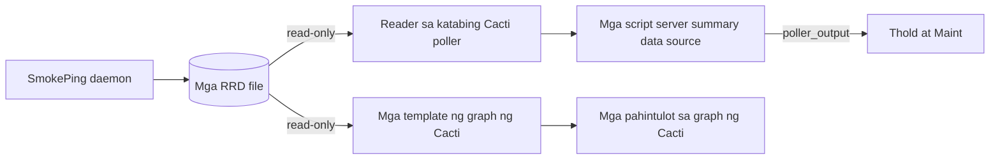

<!-- Source: README.md; SHA256: 17905aa1eac76a7d10dab526734605629fa3d1ada56397642ad4154c5be1feff -->

<!-- translations:start -->
[English](../../../README.md) | [简体中文](../zh-CN/README.md) | [हिन्दी](../hi-IN/README.md) | [Español (España)](../es-ES/README.md) | [Español (Latinoamérica)](../es-419/README.md) | [العربية (السعودية)](../ar-SA/README.md) | [Afrikaans](../af-ZA/README.md) | [አማርኛ](../am-ET/README.md) | [العربية (مصر)](../ar-EG/README.md) | [العربية (المغرب)](../ar-MA/README.md) | [বাংলা](../bn-BD/README.md) | [Bosanski](../bs-BA/README.md) | [Deutsch](../de-DE/README.md) | [فارسی](../fa-IR/README.md) | [Filipino](README.md) | [Français](../fr-FR/README.md) | [Français (Maroc)](../fr-MA/README.md) | [Français (Sénégal)](../fr-SN/README.md) | [Hausa](../ha-NG/README.md) | [עברית](../he-IL/README.md) | [Hrvatski](../hr-HR/README.md) | [Bahasa Indonesia](../id-ID/README.md) | [Igbo](../ig-NG/README.md) | [Italiano](../it-IT/README.md) | [日本語](../ja-JP/README.md) | [한국어](../ko-KR/README.md) | [Malagasy](../mg-MG/README.md) | [मराठी](../mr-IN/README.md) | [Bahasa Melayu](../ms-MY/README.md) | [Nederlands](../nl-NL/README.md) | [Polski](../pl-PL/README.md) | [Português (Brasil)](../pt-BR/README.md) | [Русский](../ru-RU/README.md) | [Kinyarwanda](../rw-RW/README.md) | [Soomaali](../so-SO/README.md) | [Српски](../sr-RS/README.md) | [Svenska](../sv-SE/README.md) | [Kiswahili](../sw-KE/README.md) | [தமிழ்](../ta-IN/README.md) | [తెలుగు](../te-IN/README.md) | [ไทย](../th-TH/README.md) | [Türkçe](../tr-TR/README.md) | [Українська](../uk-UA/README.md) | [اردو](../ur-PK/README.md) | [Tiếng Việt](../vi-VN/README.md) | [isiXhosa](../xh-ZA/README.md) | [Yorùbá](../yo-NG/README.md) | [繁體中文](../zh-TW/README.md) | [isiZulu](../zu-ZA/README.md)
<!-- translations:end -->

  <picture>
    <source media="(prefers-color-scheme: dark)" srcset="../../images/logo_dark.png">
    
  </picture>

# SmokePing plugin para sa Cacti

Isang plugin para sa Cacti 1.2 na nagdadala ng mga sukat ng latency at packet loss mula sa SmokePing patungo sa Cacti bilang mga karaniwang device, data source, at graph. Dahil dito, nakapwesto ang mga smoke graph sa tabi ng device na kinabibilangan nito, sa ilalim ng mga pahintulot ng Cacti, at maaaring magpadala ng alerto ang Thold at pansamantalang patahimikin ang mga ito gamit ang Maint. Ito ay isang hiwalay na implementasyon para sa Cacti at hindi bahagi ng, o ineendorso ng, [SmokePing](https://oss.oetiker.ch/smokeping/), na ang mga orihinal na may-akda ay sina Tobias Oetiker at Niko Tyni. Hindi naglalaman o nagpapatakbo ng code ng SmokePing ang plugin: binabasa nito ang configuration at mga RRD file na isinusulat ng SmokePing, at ang mga graph template nito ay binuo upang iguhit ang parehong mga serye tulad ng sa mga sariling graph ng SmokePing.

> **Status: nasa yugto ng pag-develop. Ang Observe mode (unang yugto) ay ipinatupad na sa `main` at inilabas bilang 1.0.0-rc.1 pre-release.** Binabasa ng plugin ang configuration at mga RRD file ng SmokePing, ipinapakita ang katayuan ng mga ito, gumagawa ng mga Cacti device, data source, at graph para sa mga ito, at nagbibigay ng datos sa Thold at Maint. Wala itong isinusulat sa SmokePing. Ang Managed mode (kung saan ang plugin ang magsusulat ng configuration ng SmokePing) at ang mga remote collector ay para sa mga susunod na yugto, hindi pa nasisimulan, at hindi kasama sa release na ito. Bukas pa rin sa milestone 4 ang mga pilot deployment sa aktwal na mga instalasyon at ang mas malapit na pagtutugma sa graph legend ng SmokePing. Tingnan ang [docs/install.md](../../install.md) upang magsimula.

## Mga tungkulin sa pag-access

| Realm | Pag-access |
| --- | --- |
| SmokePing View | Mga kasalukuyang pahina ng pagsubaybay. |
| SmokePing Operator | Pagsubaybay kasama ang pahina ng Operations at mga personal na pagkilala sa triage. |
| SmokePing Admin | Pag-access ng Operator kasama ang kasalukuyang configuration at mga gawaing pang-administrasyon. |

Pagkatapos kopyahin ang mga upgrade file, buksan ang pahina ng Plugins bilang administrator upang
irehistro ang bagong realm. Tahasang italaga ang Operator realm sa ilalim ng **Configuration > Users** o sa mga user group.
Pinapanatili ng mga pag-upgrade ang mga kasalukuyang View at Admin realm ID at pahintulot. Namamana ng Admin access
ang Operator access, at namamana ng Operator access ang View access sa bawat request;
hindi ito nagdaragdag ng mga nakaimbak na pahintulot sa mga user o grupo. Nangangailangan din ang mga setting ng plugin
ng SmokePing Admin access bukod pa sa Settings permission ng Cacti.

Nililimitahan pa rin ng mga pahintulot sa Cacti device ang mga row at aksyon na magagamit ng bawat user; ang mga hindi naka-map na object ay nangangailangan ng administrator.
Ang mga kredensyal, configuration, pagmamapa, pagtanggal, at iba pang mga pagbabagong pang-administrasyon
ay nananatili sa mga pahinang pang-administrasyon. Ang mga pagkilala (acknowledgment) ay tumatagal lamang sa kasalukuyang
session ng user, nang hindi hihigit sa isang oras at hangga't nananatiling sariwa ang parehong obserbasyon.
Pinapawalang-bisa ang mga ito ng mga bago o nabagong obserbasyon. Hindi nito kailanman minamarkahan bilang maayos
ang isang nabigong pagsukat o pinipigilan ang mga alerto.

## Mga Screenshot

Na-import mula sa isang aktibong network ng SmokePing 2.8.2 patungo sa Cacti 1.2.31, huling 12 oras. Ang device ng bawat target ay may smoke graph para sa master at isa para sa bawat slave (`lon1`, `sgp1`), na nakahanay sa ilalim ng seksyon ng SmokePing nito sa graph tree.

## Bakit

Mahusay na sinusukat ng SmokePing ang distribusyon ng latency at packet loss, at ipinapakita ng mga smoke graph nito ang pagkakaiba-iba na itinatago ng isang graph na average lamang ang ipinapakita. Kapag pinatakbo katabi ng Cacti, nag-iiwan ito ng tatlong puwang:

- **Hiwalay na kontrol sa pag-access.** Walang alam ang CGI ng SmokePing tungkol sa mga user, grupo, o pahintulot sa device ng Cacti.
- **Walang konteksto ng device.** Ang latency at ang mga interface counter para sa parehong device ay nasa magkakaibang tool.
- **Walang direktang daan patungo sa pag-alerto ng Cacti.** Gumagana ang Thold at Maint sa mga data source at device ng Cacti, kaya ang mga alerto ng SmokePing ay hiwalay na kino-configure at pinipigilan.

Tinutugunan ng plugin ang mga puwang na ito sa pamamagitan ng pagkatawan sa bawat target ng SmokePing bilang mga object ng Cacti na nakaturo sa mga kasalukuyang RRD file ng SmokePing, kasama ang isang maliit na hanay ng mga na-poll na buod na halaga. Ginagamit nitong muli ang graphing, mga pahintulot, Thold, at Maint ng Cacti sa halip na bumuo ng magkakahiwalay na bersyon ng mga ito. Ang suporta para sa mga remote data collector ng Cacti ay nakaplano para sa ikatlong yugto at hindi pa kasama sa release na ito.

## Saklaw at katayuan

| Yugto | Saklaw | Mga Milestone | Katayuan |
|---|---|---|---|
| 0, pananaliksik | Compatibility matrix, kumpirmasyon ng upstream na pag-uugali, graph fidelity spike | [M1](https://github.com/somethingwithproof/plugin_smokeping/milestone/1) | Mga natuklasan sa `docs/research`; may ilang bukas na isyu sa pananaliksik |
| 1, observe | Pag-import ng imbentaryo, mga Cacti device, mga smoke at summary graph, pag-alerto sa Thold, pagpigil gamit ang Maint, pahina ng kalusugan | [M2](https://github.com/somethingwithproof/plugin_smokeping/milestone/2), [M3](https://github.com/somethingwithproof/plugin_smokeping/milestone/3), [M4](https://github.com/somethingwithproof/plugin_smokeping/milestone/4) | Inilabas bilang 1.0.0-rc.1; bukas para sa mga pilot |
| 2, managed | Namespace ng configuration na pag-aari ng Cacti, mga profile ng ICMP at TCP probe, mga rebisyon, pagpapatunay, pag-reload, rollback | [M5](https://github.com/somethingwithproof/plugin_smokeping/milestone/5) | Nakaplano, hindi pa nasisimulan |
| 3, remote | SmokePing sa mga remote data collector ng Cacti, mga slave bilang mga lokasyon ng pagsukat | [M6](https://github.com/somethingwithproof/plugin_smokeping/milestone/6) | Nakaplano, hindi pa nasisimulan |

Wala sa saklaw: isang alerting engine na pag-aari ng plugin, isang reporting engine, isang custom na daemon o network protocol, mga pinamamahalaang pagsusuri ng HTTP/DNS/serbisyo (saklaw ito ng servcheck), at pagsusulat sa mga RRD file ng SmokePing.

## Mga target sa pagiging tugma

| Bahagi | Target |
|---|---|
| Cacti | 1.2.31 o mas bago sa 1.2.x, walang kinakailangang core patch |
| PHP | 8.2 o mas bago; nananatiling na-parse ang `setup.php` sa 8.0 upang ang hindi suportadong runtime ay makakuha ng pagtanggi sa halip na sirang Cacti UI |
| SmokePing | 2.9.0, 2.8.2, at 2.7.3 (Ubuntu 22.04 lamang, hanggang 2027-06-01) |
| Thold, Maint | Walang kinakailangang pagbabago |
| Mga serye | 10,000 bawat instalasyon sa 20 ping at 300 s na step ([pagganap](../../performance.md#supported-series-count)) |

## Dokumentasyon

| | |
|---|---|
| [Pag-install](../../install.md) | Mga kinakailangan, ang read-only na mount ng data directory ng SmokePing, pag-install, mga container, mga suportadong bersyon |
| [Pagpapatakbo](../../operations.md) | Kahulugan ng bawat katayuan at ebidensya nito, mga health check, pag-uugali kapag nabigo ang mga input |
| [Pagdaragdag ng mga target sa Cacti](../../provisioning.md) | Isang target, maraming device, muling pag-uugnay, mga pahintulot |
| [Pag-alerto](../../alerting.md) | Mga buod na halaga, tagal ng Thold, pagiging luma ng datos, huling datos, pagsasanib sa mga alerto ng SmokePing, Maint |
| [Format ng configuration](../../configuration-format.md) | Pag-export at pag-import ng YAML at XML |
| [Pag-backup at pag-restore](../../backup-restore.md) | Ano ang iba-backup at paano nagpapatuloy ang pag-restore |
| [Pagganap](../../performance.md) | Mga sukat sa lokal at release-runner sa 100, 1,000, at 10,000 na serye, at ang suportadong bilang ng serye: 10,000 bawat instalasyon |
| [Kuwalipikasyon ng pagkabigo](../../failure-qualification.md) | Ang mga senaryo ng pagkabigo at kung paano sinusuri ang bawat isa |
| [Paglalabas ng release](../../RELEASING.md) | Ang proseso ng paglabas: ang pull request, ang nilagdaang tag, ang ginagawa ng workflow, paano patunayan ang resulta |
| [Archive ng release](../../release.md) | Bersyon, changelog, at ang archive ng release |
| [Pagsusuri](../../testing.md) | Ang mga suite, ang pinapatakbo ng CI, at ang live suite laban sa isang aktwal na SmokePing |

## Disenyo

- Ang [docs/PLAN.md](../../PLAN.md) ay ang kumpletong plano: arkitektura, mga upstream na katotohanan na pinagbabatayan nito (may mga sanggunian), modelo ng katayuan, mga hangganan ng seguridad, kalkulasyon ng pagganap, pagsusuri, at mga panganib.
- Ang [docs/decisions/](../../decisions) ay naglalaman ng mga architecture decision record para sa mga pasyang nagawa na.
- Ang [docs/REQUIREMENTS.md](../../REQUIREMENTS.md) ay nagmamapa ng bawat requirement ID sa kaukulang isyu nito.

## Paano sinusubaybayan ang trabaho

- **Mga Milestone** ay sumusunod sa mga milestone ng plano. Bawat isa ay may epic issue na naglilista ng mga sub-issue nito at exit evidence.
- **Mga Isyu** ay minamarkahan ayon sa uri gamit ang label: `type: requirement`, `type: research`, `type: decision`, `type: epic`. Ang mga requirement issue ay naglalahad ng may numerong, nasusuring mga kinakailangan (`REQ-AREA-NNN`) at pamantayan sa pagtanggap.
- **Mga Label** ay nagdadala rin ng `area:`, `phase:`, `priority:`, at `status:`. Tingnan ang [CONTRIBUTING.md](../../../CONTRIBUTING.md#labels).
- Ipinapakita ng [project board](https://github.com/users/somethingwithproof/projects/6) ang lahat ng mga isyu sa lahat ng milestone.

## Pag-ambag

Basahin ang [CONTRIBUTING.md](../../../CONTRIBUTING.md). Kailangan ng mga commit ng DCO sign-off. Nagaganap ang talakayan sa disenyo sa mga isyu; ang mga bukas na desisyon ay may label na `type: decision`.

## Seguridad

Iulat ang mga kahinaan nang pribado; tingnan ang [SECURITY.md](../../../SECURITY.md).

## Lisensya

GNU General Public License v2.0, ang parehong lisensya ng Cacti at mga plugin nito. Tingnan ang [LICENSE](../../../LICENSE).
