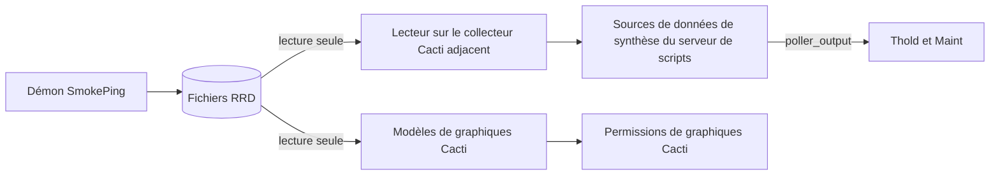

<!-- Source: README.md; SHA256: b41ec705327127cc34ff07d1514a141262752f99c5e2296fdc323d584a777b84 -->

<!-- translations:start -->
[English](../../../README.md) | [简体中文](../zh-CN/README.md) | [हिन्दी](../hi-IN/README.md) | [Español (España)](../es-ES/README.md) | [Español (Latinoamérica)](../es-419/README.md) | [العربية (السعودية)](../ar-SA/README.md) | [Afrikaans](../af-ZA/README.md) | [አማርኛ](../am-ET/README.md) | [العربية (مصر)](../ar-EG/README.md) | [العربية (المغرب)](../ar-MA/README.md) | [বাংলা](../bn-BD/README.md) | [Bosanski](../bs-BA/README.md) | [Deutsch](../de-DE/README.md) | [فارسی](../fa-IR/README.md) | [Filipino](../fil-PH/README.md) | [Français](README.md) | [Français (Maroc)](../fr-MA/README.md) | [Français (Sénégal)](../fr-SN/README.md) | [Hausa](../ha-NG/README.md) | [עברית](../he-IL/README.md) | [Hrvatski](../hr-HR/README.md) | [Bahasa Indonesia](../id-ID/README.md) | [Igbo](../ig-NG/README.md) | [Italiano](../it-IT/README.md) | [日本語](../ja-JP/README.md) | [한국어](../ko-KR/README.md) | [Malagasy](../mg-MG/README.md) | [मराठी](../mr-IN/README.md) | [Bahasa Melayu](../ms-MY/README.md) | [Nederlands](../nl-NL/README.md) | [Polski](../pl-PL/README.md) | [Português (Brasil)](../pt-BR/README.md) | [Русский](../ru-RU/README.md) | [Kinyarwanda](../rw-RW/README.md) | [Soomaali](../so-SO/README.md) | [Српски](../sr-RS/README.md) | [Svenska](../sv-SE/README.md) | [Kiswahili](../sw-KE/README.md) | [தமிழ்](../ta-IN/README.md) | [తెలుగు](../te-IN/README.md) | [ไทย](../th-TH/README.md) | [Türkçe](../tr-TR/README.md) | [Українська](../uk-UA/README.md) | [اردو](../ur-PK/README.md) | [Tiếng Việt](../vi-VN/README.md) | [isiXhosa](../xh-ZA/README.md) | [Yorùbá](../yo-NG/README.md) | [繁體中文](../zh-TW/README.md) | [isiZulu](../zu-ZA/README.md)
<!-- translations:end -->

  <picture>
    <source media="(prefers-color-scheme: dark)" srcset="../../images/logo_dark.png">
    
  </picture>

# Plugin SmokePing pour Cacti

Un plugin Cacti 1.2 qui intègre les mesures de latence et de perte de paquets de SmokePing dans Cacti sous forme d'équipements, de sources de données et de graphiques ordinaires. Les graphiques Smoke apparaissent ainsi à côté de l'équipement auquel ils appartiennent, sous le contrôle des permissions de Cacti, et Thold et Maint peuvent déclencher des alertes et les mettre en sourdine. Il s'agit d'une implémentation indépendante pour Cacti qui ne fait pas partie de [SmokePing](https://oss.oetiker.ch/smokeping/), dont les auteurs originaux sont Tobias Oetiker et Niko Tyni, et n'est pas approuvée par ce projet. Le plugin n'inclut ni n'exécute le code de SmokePing : il lit la configuration et les fichiers RRD écrits par SmokePing, et ses modèles de graphiques sont conçus pour tracer les mêmes séries que les graphiques propres à SmokePing.

> **Statut : en cours de développement. Le mode observation (phase 1) est implémenté sur `main` (1.0.0-rc.1) avec le filtrage opérateur, l'export CSV, la détection des RRD orphelins, la traduction d'alertes Thold, les hooks d'intégration écosystème et la réplication pour collecteurs distants.** Le plugin lit la configuration et les fichiers RRD de SmokePing, affiche leur état, crée les équipements, sources de données et graphiques Cacti correspondants, et alimente Thold et Maint. Il n'écrit rien dans SmokePing. Le mode géré (écriture de la configuration SmokePing par le plugin) est une phase ultérieure, non commencée, et ne figure pas dans cette version. Les déploiements pilotes sur des installations réelles et un alignement plus fidèle avec la légende des graphiques SmokePing restent ouverts dans le jalon 4. Consultez [docs/install.md](../../install.md) pour commencer.

## Rôles d'accès

| Domaine | Accès |
| --- | --- |
| SmokePing View | Pages de supervision existantes. |
| SmokePing Operator | Supervision, plus la page Opérations et les acquittements de triage personnels. |
| SmokePing Admin | Accès Operator, plus les actions de configuration et d'administration existantes. |

Après avoir copié les fichiers de mise à niveau, ouvrez la page Plugins en tant qu'administrateur pour enregistrer le nouveau domaine. Attribuez explicitement le domaine Operator dans **Configuration > Users** ou aux groupes d'utilisateurs. Les mises à niveau conservent les identifiants et les droits des domaines View et Admin existants. L'accès Admin hérite de l'accès Operator, et l'accès Operator hérite de l'accès View à chaque requête ; cela n'ajoute pas d'autorisations enregistrées aux utilisateurs ou aux groupes. Les paramètres du plugin requièrent également l'accès SmokePing Admin en plus de la permission Settings de Cacti.

Les permissions d'équipement Cacti continuent de limiter les lignes et les actions disponibles pour chaque utilisateur ; les objets non associés nécessitent un administrateur. Les identifiants, la configuration, l'association, la suppression et les autres modifications d'administration restent dans les pages d'administration. Les acquittements ne durent que pendant la session en cours de l'utilisateur, pendant une heure au maximum et uniquement tant que la même observation reste à jour. Les observations nouvelles ou modifiées les invalident. Ils ne marquent jamais une mesure en échec comme saine et ne suppriment jamais les alertes.

## Captures d'écran

Importé depuis un réseau SmokePing 2.8.2 en production vers Cacti 1.2.31, sur les 12 dernières heures. L'équipement de chaque cible dispose d'un graphique Smoke pour le maître et d'un graphique pour chaque esclave (`lon1`, `sgp1`), classés dans sa section SmokePing au sein de l'arborescence des graphiques.

## Pourquoi

SmokePing mesure efficacement la distribution de la latence et la perte de paquets, et ses graphiques en nuage de fumée mettent en évidence des variations qu'un graphique limité à la moyenne masque. Utilisé en parallèle de Cacti, il laisse trois lacunes :

- **Contrôle d'accès séparé.** Le CGI de SmokePing ignore tout des utilisateurs, groupes et permissions d'équipement de Cacti.
- **Absence de contexte d'équipement.** La latence et les compteurs d'interface d'un même équipement résident dans des outils distincts.
- **Aucun relais vers les alertes de Cacti.** Thold et Maint s'appuient sur les sources de données et les équipements Cacti ; les alertes SmokePing sont donc configurées et mises en sourdine séparément.

Le plugin comble ces lacunes en représentant chaque cible SmokePing par des objets Cacti qui pointent vers les fichiers RRD existants de SmokePing, accompagnés d'un petit ensemble de valeurs de synthèse interrogées. Il réutilise la génération de graphiques, les permissions, Thold et Maint de Cacti plutôt que d'en reconstruire des versions parallèles. La réplication de configuration limitée au collecteur (`replicate_out`) pousse les tables de configuration vers les collecteurs distants tout en maintenant isolés le mode local (collecteur 1) et les caches d'observation locaux au collecteur.

## Périmètre et statut

| Phase | Périmètre | Jalons | Statut |
|---|---|---|---|
| 0, recherche | Matrice de compatibilité, confirmation du comportement en amont, prototype de fidélité des graphiques | [M1](https://github.com/somethingwithproof/plugin_smokeping/milestone/1) | Résultats dans `docs/research` ; certaines issues de recherche restent ouvertes |
| 1, observation | Importation d'inventaire, équipements Cacti, graphiques Smoke et de synthèse, alertes Thold et traduction d'alertes, mise en sourdine Maint, vues filtrées, export CSV, détection des RRD orphelins, hooks écosystème | [M2](https://github.com/somethingwithproof/plugin_smokeping/milestone/2), [M3](https://github.com/somethingwithproof/plugin_smokeping/milestone/3), [M4](https://github.com/somethingwithproof/plugin_smokeping/milestone/4) | Implémentée ; pilotes ouverts |
| 2, géré | Espace de noms de configuration géré par Cacti, profils de sondes ICMP et TCP, révisions, validation, rechargement, retour arrière | [M5](https://github.com/somethingwithproof/plugin_smokeping/milestone/5) | Planifiée, non commencée |
| 3, distant | Requêtes limitées au collecteur et réplication de tables `replicate_out` pour les collecteurs de données distants (`RemoteReplication`) ; qualification complète du déploiement SmokePing multi-collecteurs | [M6](https://github.com/somethingwithproof/plugin_smokeping/milestone/6) | Réplication et filtrage par collecteur implémentés ; qualification du déploiement multi-collecteurs ouverte |

Workflows opérateur, commandes CLI et hooks écosystème implémentés :

- **Filtrage d'inventaire et de cibles (`smokeping_inventory.php`, `smokeping.php`)** : `TargetFilter`, `TargetRepository::filteredForPoller()`, `InventoryPage` et `ViewPage` fournissent la recherche (`filter`), la sonde (`probe`), la présence dans l'inventaire (`presence`), le statut d'association (`mapping`), l'état de fraîcheur (`state`) et la pagination optionnelle (`rows` : `All`, `25`, `50`, `100`, `200`). La visibilité des équipements est appliquée en SQL avant le comptage afin que les totaux n'exposent jamais d'équipements masqués.
- **Export CSV (`smokeping.php?action=export_csv`)** : `CsvExporter` diffuse une sortie RFC 4180 CRLF pour la vue filtrée active selon les permissions d'équipement de l'appelant, en préfixant par une apostrophe les cellules commençant par `=`, `+`, `-`, `@`, tabulation ou retour chariot afin de neutraliser les formules de tableur.
- **Détection des RRD orphelins (`smokeping_health.php`)** : `OrphanRrdScanner` et `HealthCheck::orphanRrds()` effectuent une analyse bornée du montage SmokePing sur le collecteur lecteur, en ignorant `__cgi`, `__sortercache` et les liens symboliques, et en croisant les fichiers `.rrd` sans propriétaire avec les propositions de réassociation ouvertes.
- **Conversion SmokePing vers Thold (`smokeping_health.php`, `cli/smokeping.php`)** : `TholdTranslator` et `TholdGenerator` lisent les définitions `*** Alerts ***` de SmokePing et traduisent les motifs de pertes consécutives pris en charge en seuils Thold `loss_pct` équivalents sans modifier les fichiers de configuration de SmokePing. Le flux web utilise un aperçu GET (`action=thold_preview`, `HealthPage::renderTholdPreview()`) suivi d'un POST protégé par CSRF (`action=thold_create`). Les motifs non pris en charge (alertes RTT, décroissance par joker, niveaux mixtes) sont ignorés sans écriture.
- **CLI administrateur (`cli/smokeping.php`)** : prend en charge `provision <target path> [--device=ID] [--location=NAME]`, `relink <old target path> <new target path> [--location=NAME]`, `thold-generate <target path> [--alert=NAME] [--apply]`, `size-graphs`, `upgrade-graphs`, `export [--format=yaml|xml] [--file=PATH]`, `import --file=PATH [--format=yaml|xml] [--apply --confirm=PLAN]` et `import-smokeping [--dry-run | --apply --confirm=PLAN] [--file=PATH] [--sections=A,B/C] [--device-per=host|target] [--device-template=ID] [--poller=ID] [--site=ID] [--tree=ID | --tree-name=NAME]`.
- **Hooks écosystème (`setup.php`, `Schema::HOOKS`)** : enregistre 21 hooks, dont `abilities_register` (`AbilitiesProvider` : capacités strictement en lecture seule `smokeping-list-targets` et `smokeping-get-health`, restreintes au domaine View pour l'identifiant utilisateur de l'appelant, ne renvoyant aucun secret), `doctor_register_checks` (`DoctorChecks` : `smokeping_stale_targets`, `smokeping_freshness_breaches`, `smokeping_orphan_rrds`, `smokeping_config_path`), `casc_register_providers` (`CascProvider` : fournisseur `smokeping` YAML/XML `export`, `validate`, `plan` et `apply` reposant sur `ConfigCodec` et `ConfigService`) et `replicate_out` (`RemoteReplication` : synchronisation limitée au collecteur de `plugin_smokeping_target`, `plugin_smokeping_mapping`, `plugin_smokeping_object` et `plugin_smokeping_relink` pour les collecteurs distants avec `poller_id > 1`).

Hors périmètre : un moteur d'alertes propre au plugin, un moteur de rapports, un démon ou protocole réseau personnalisé, les vérifications gérées HTTP/DNS/de services (servcheck les couvre déjà), ainsi que l'écriture dans les fichiers RRD de SmokePing.

## Cibles de compatibilité

| Composant | Cible |
|---|---|
| Cacti | 1.2.31 ou ultérieure dans la branche 1.2.x, sans correctif du noyau |
| PHP | 8.2 ou ultérieure ; `setup.php` reste analysable sous 8.0 afin qu'un environnement d'exécution non pris en charge reçoive un refus propre plutôt qu'une interface Cacti cassée |
| SmokePing | 2.9.0, 2.8.2 et 2.7.3 (Ubuntu 22.04 uniquement, jusqu'au 2027-06-01) |
| Thold, Maint | Aucune modification requise |
| Séries | 10 000 par installation avec 20 pings et un pas de 300 s ([performance](../../performance.md#supported-series-count)) |

## Documentation

| | |
|---|---|
| [Installation](../../install.md) | Prérequis, montage en lecture seule du répertoire de données SmokePing, installation, conteneurs, versions prises en charge |
| [Exploitation](../../operations.md) | Signification de chaque état et ses preuves, vérifications d'intégrité, comportement en cas d'échec des entrées |
| [Ajouter des cibles à Cacti](../../provisioning.md) | Une cible, plusieurs équipements, réassociation, permissions |
| [Alertes](../../alerting.md) | Valeurs de synthèse, durées Thold, obsolescence, données tardives, chevauchement avec les alertes de SmokePing, Maint |
| [Format de configuration](../../configuration-format.md) | Exportation et importation YAML et XML |
| [Sauvegarde et restauration](../../backup-restore.md) | Éléments à sauvegarder et reprise après restauration |
| [Performance](../../performance.md) | Mesures locales et sur exécuteur de publication à 100, 1 000 et 10 000 séries, et nombre de séries pris en charge : 10 000 par installation |
| [Qualification des défaillances](../../failure-qualification.md) | Scénarios de défaillance et méthode de test de chacun |
| [Publication](../../RELEASING.md) | Procédure de publication : pull request, étiquette signée, actions du workflow, vérification du résultat |
| [Archive des versions](../../release.md) | Version, journal des modifications et archive des versions |
| [Tests](../../testing.md) | Suites de tests, exécutions en CI et suite en conditions réelles contre un véritable SmokePing |

## Conception

- [docs/PLAN.md](../../PLAN.md) constitue le plan complet : architecture, faits en amont sur lesquels il s'appuie (avec sources), modèle d'états, limites de sécurité, calculs de performance, tests et risques.
- [docs/decisions/](../../decisions) contient les enregistrements de décisions d'architecture pour les choix déjà arrêtés.
- [docs/REQUIREMENTS.md](../../REQUIREMENTS.md) associe chaque identifiant d'exigence à son issue.
- La vérification locale exécute les tests unitaires et règles de source Pest (`pest --configuration=phpunit.xml`), PHPStan niveau 9 (`CACTI_PATH=<cacti-dir> phpstan analyse -c phpstan.neon --no-progress`), la vérification syntaxique des points d'entrée (`php -l` sur `*.php`, `include/*.php`, `scripts/*.php`, `cli/*.php`) et la vérification des traductions (`sh locales/build_gettext.sh --check`). Consultez [docs/testing.md](../../testing.md) pour les suites d'intégration et de bout en bout en conteneur.

## Suivi des travaux

- **Jalons** : ils suivent les jalons du plan. Chacun dispose d'une issue épique listant ses sous-issues et ses preuves de validation.
- **Issues** : elles sont typées par étiquette : `type: requirement`, `type: research`, `type: decision`, `type: epic`. Les issues d'exigence énoncent des exigences numérotées et testables (`REQ-AREA-NNN`) ainsi que des critères d'acceptation.
- **Étiquettes** : elles portent également `area:`, `phase:`, `priority:` et `status:`. Consultez [CONTRIBUTING.md](../../../CONTRIBUTING.md#labels).
- Le [tableau de projet](https://github.com/users/somethingwithproof/projects/6) présente l'ensemble des issues sur tous les jalons.

## Contribution

Lisez [CONTRIBUTING.md](../../../CONTRIBUTING.md). Les commits nécessitent une signature DCO (sign-off). Les discussions de conception ont lieu dans les issues ; les décisions ouvertes portent l'étiquette `type: decision`.

## Sécurité

Signalez les vulnérabilités en privé ; consultez [SECURITY.md](../../../SECURITY.md).

## Licence

GNU General Public License v2.0, la même licence que Cacti et ses plugins. Consultez [LICENSE](../../../LICENSE).
