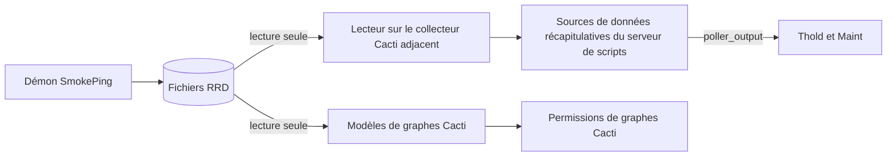

<!-- Source: README.md; SHA256: b41ec705327127cc34ff07d1514a141262752f99c5e2296fdc323d584a777b84 -->

<!-- translations:start -->
[English](../../../README.md) | [简体中文](../zh-CN/README.md) | [हिन्दी](../hi-IN/README.md) | [Español (España)](../es-ES/README.md) | [Español (Latinoamérica)](../es-419/README.md) | [العربية (السعودية)](../ar-SA/README.md) | [Afrikaans](../af-ZA/README.md) | [አማርኛ](../am-ET/README.md) | [العربية (مصر)](../ar-EG/README.md) | [العربية (المغرب)](../ar-MA/README.md) | [বাংলা](../bn-BD/README.md) | [Bosanski](../bs-BA/README.md) | [Deutsch](../de-DE/README.md) | [فارسی](../fa-IR/README.md) | [Filipino](../fil-PH/README.md) | [Français](../fr-FR/README.md) | [Français (Maroc)](README.md) | [Français (Sénégal)](../fr-SN/README.md) | [Hausa](../ha-NG/README.md) | [עברית](../he-IL/README.md) | [Hrvatski](../hr-HR/README.md) | [Bahasa Indonesia](../id-ID/README.md) | [Igbo](../ig-NG/README.md) | [Italiano](../it-IT/README.md) | [日本語](../ja-JP/README.md) | [한국어](../ko-KR/README.md) | [Malagasy](../mg-MG/README.md) | [मराठी](../mr-IN/README.md) | [Bahasa Melayu](../ms-MY/README.md) | [Nederlands](../nl-NL/README.md) | [Polski](../pl-PL/README.md) | [Português (Brasil)](../pt-BR/README.md) | [Русский](../ru-RU/README.md) | [Kinyarwanda](../rw-RW/README.md) | [Soomaali](../so-SO/README.md) | [Српски](../sr-RS/README.md) | [Svenska](../sv-SE/README.md) | [Kiswahili](../sw-KE/README.md) | [தமிழ்](../ta-IN/README.md) | [తెలుగు](../te-IN/README.md) | [ไทย](../th-TH/README.md) | [Türkçe](../tr-TR/README.md) | [Українська](../uk-UA/README.md) | [اردو](../ur-PK/README.md) | [Tiếng Việt](../vi-VN/README.md) | [isiXhosa](../xh-ZA/README.md) | [Yorùbá](../yo-NG/README.md) | [繁體中文](../zh-TW/README.md) | [isiZulu](../zu-ZA/README.md)
<!-- translations:end -->

  <picture>
    <source media="(prefers-color-scheme: dark)" srcset="../../images/logo_dark.png">
    
  </picture>

# Extension SmokePing pour Cacti

Une extension pour Cacti 1.2 qui intègre les mesures de latence et de perte de paquets de SmokePing dans Cacti sous forme d'équipements, de sources de données et de graphes standards. Les graphes de fumée (*smoke graphs*) s'affichent ainsi à côté de l'équipement auquel ils appartiennent, sous le contrôle des permissions de Cacti, tandis que Thold et Maint peuvent déclencher des alertes et les suspendre. Il s'agit d'une implémentation indépendante pour Cacti, qui ne fait pas partie de [SmokePing](https://oss.oetiker.ch/smokeping/) — dont les auteurs originaux sont Tobias Oetiker et Niko Tyni — et n'est ni affiliée ni approuvée par ce projet. L'extension n'inclut ni n'exécute le code de SmokePing : elle lit la configuration et les fichiers RRD produits par SmokePing, et ses modèles de graphes sont conçus pour tracer les mêmes séries que les graphes natifs de SmokePing.

> **Statut : en cours de développement. Le mode observation (phase 1) est implémenté sur `main` et publié en préversion 1.0.0-rc.1.** L'extension lit la configuration et les fichiers RRD de SmokePing, affiche leur état, crée les équipements, sources de données et graphes Cacti correspondants, et alimente Thold et Maint. Elle n'écrit rien dans SmokePing. Le mode géré (écriture de la configuration SmokePing par l'extension) et les collecteurs distants relèvent de phases ultérieures, non entamées, et ne figurent pas dans cette version. Les déploiements pilotes sur des installations réelles ainsi qu'un alignement plus fidèle sur la légende des graphes SmokePing restent ouverts dans le jalon 4. Consultez [docs/install.md](../../install.md) pour commencer.

## Rôles d'accès

| Domaine | Accès |
| --- | --- |
| SmokePing View | Pages de supervision existantes. |
| SmokePing Operator | Supervision, plus la page Opérations et les acquittements personnels de triage. |
| SmokePing Admin | Accès Opérateur, plus les pages de configuration existantes et les actions d'administration. |

Après avoir copié les fichiers de mise à niveau, ouvrez la page Plugins en tant qu'administrateur pour enregistrer
le nouveau domaine. Attribuez explicitement le domaine Operator sous **Configuration > Users** ou aux groupes d'utilisateurs.
Les mises à niveau conservent les identifiants et les autorisations existants des domaines View et Admin. L'accès Admin
hérite de l'accès Operator, et l'accès Operator hérite de l'accès View à chaque requête ;
cela n'ajoute pas d'autorisations enregistrées aux utilisateurs ni aux groupes. Les paramètres de l'extension requièrent également
l'accès SmokePing Admin en plus de la permission Settings de Cacti.

Les permissions d'équipement de Cacti continuent de restreindre les lignes et les actions accessibles à chaque utilisateur ; les objets non associés requièrent un administrateur.
Les identifiants, la configuration, le mappage, la suppression et les autres modifications administratives
restent cantonnés aux pages d'administration. Les acquittements ne durent que le temps de la session en cours de
l'utilisateur, pendant une heure au maximum et uniquement tant que la même observation demeure
fraîche. Toute observation nouvelle ou modifiée les invalide. Ils ne marquent jamais une mesure
en échec comme saine et ne suspendent pas les alertes.

## Captures d'écran

Importé depuis un réseau SmokePing 2.8.2 en production vers Cacti 1.2.31, sur les 12 dernières heures. L'équipement de chaque cible dispose d'un graphe de fumée pour le maître et d'un graphe pour chaque esclave (`lon1`, `sgp1`), classés sous sa section SmokePing dans l'arborescence des graphes.

## Pourquoi

SmokePing mesure avec précision la distribution de la latence et la perte de paquets, et ses graphes de fumée révèlent une variabilité qu'un graphe basé uniquement sur la moyenne dissimule. Utilisé en parallèle de Cacti, il laisse toutefois trois lacunes :

- **Contrôle d'accès séparé.** Le CGI de SmokePing ne connaît ni les utilisateurs, ni les groupes, ni les permissions d'équipement de Cacti.
- **Absence de contexte d'équipement.** Les mesures de latence et les compteurs d'interface d'un même équipement résident dans des outils distincts.
- **Aucune intégration aux alertes Cacti.** Thold et Maint opèrent sur les sources de données et les équipements Cacti ; les alertes SmokePing doivent donc être configurées et suspendues séparément.

L'extension comble ces lacunes en représentant chaque cible SmokePing par des objets Cacti qui pointent vers les fichiers RRD existants de SmokePing, accompagnés d'un ensemble restreint de valeurs récapitulatives collectées. Elle réutilise le moteur graphique, les permissions, Thold et Maint de Cacti plutôt que de réimplémenter des mécanismes parallèles. La prise en charge des collecteurs de données distants de Cacti est prévue pour la phase 3 et ne fait pas partie de cette version.

## Périmètre et statut

| Phase | Périmètre | Jalons | Statut |
|---|---|---|---|
| 0, recherche | Matrice de compatibilité, confirmation du comportement amont, prototype de fidélité des graphes | [M1](https://github.com/somethingwithproof/plugin_smokeping/milestone/1) | Résultats dans `docs/research` ; certains tickets de recherche restent ouverts |
| 1, observation | Importation de l'inventaire, équipements Cacti, graphes de fumée et récapitulatifs, alertes Thold, suspension Maint, page de santé | [M2](https://github.com/somethingwithproof/plugin_smokeping/milestone/2), [M3](https://github.com/somethingwithproof/plugin_smokeping/milestone/3), [M4](https://github.com/somethingwithproof/plugin_smokeping/milestone/4) | Publié en version 1.0.0-rc.1 ; pilotes ouverts |
| 2, géré | Espace de configuration géré par Cacti, profils de sondes ICMP et TCP, révisions, validation, rechargement, restauration | [M5](https://github.com/somethingwithproof/plugin_smokeping/milestone/5) | Planifié, non commencé |
| 3, distant | SmokePing sur les collecteurs de données distants de Cacti, esclaves en tant que points de mesure | [M6](https://github.com/somethingwithproof/plugin_smokeping/milestone/6) | Planifié, non commencé |

Hors périmètre : un moteur d'alertes propre à l'extension, un moteur de rapports, un démon ou protocole réseau personnalisé, les contrôles gérés HTTP/DNS/de services (couverts par servcheck) et l'écriture dans les fichiers RRD de SmokePing.

## Cibles de compatibilité

| Composant | Cible |
|---|---|
| Cacti | 1.2.31 ou ultérieure dans la branche 1.2.x, sans correctif du noyau |
| PHP | 8.2 ou ultérieure ; `setup.php` reste analysable sous 8.0 afin qu'un environnement d'exécution non pris en charge renvoie un refus propre plutôt que de casser l'interface Cacti |
| SmokePing | 2.9.0, 2.8.2 et 2.7.3 (Ubuntu 22.04 uniquement, jusqu'au 2027-06-01) |
| Thold, Maint | Aucune modification requise |
| Séries | 10 000 par installation avec 20 pings et un pas de 300 s ([performances](../../performance.md#supported-series-count)) |

## Documentation

| | |
|---|---|
| [Installation](../../install.md) | Prérequis, montage en lecture seule du répertoire de données de SmokePing, installation, conteneurs, versions prises en charge |
| [Exploitation](../../operations.md) | Signification de chaque état et preuves associées, contrôles de santé, comportement en cas de défaillance des entrées |
| [Ajouter des cibles à Cacti](../../provisioning.md) | Une cible, plusieurs équipements, réassociation, permissions |
| [Alertes](../../alerting.md) | Valeurs récapitulatives, durées Thold, fraîcheur des données, données tardives, chevauchement avec les alertes de SmokePing, Maint |
| [Format de configuration](../../configuration-format.md) | Exportation et importation YAML et XML |
| [Sauvegarde et restauration](../../backup-restore.md) | Éléments à sauvegarder et reprise après restauration |
| [Performances](../../performance.md) | Mesures locales et sur l'exécuteur de publication à 100, 1 000 et 10 000 séries, et nombre de séries pris en charge : 10 000 par installation |
| [Qualification des défaillances](../../failure-qualification.md) | Scénarios de défaillance et modalités de test de chacun |
| [Publication](../../RELEASING.md) | Procédure de publication : la pull request, le tag signé, le déroulement du workflow et la vérification du résultat |
| [Archive des versions](../../release.md) | Version, journal des modifications et archive des versions |
| [Tests](../../testing.md) | Les suites de tests, ce qu'exécute l'intégration continue et la suite en direct contre une instance SmokePing réelle |

## Conception

- [docs/PLAN.md](../../PLAN.md) est le plan complet : architecture, faits amont sur lesquels il s'appuie (avec sources), modèle d'état, frontières de sécurité, calculs de performance, tests et risques.
- [docs/decisions/](../../decisions) contient les dossiers de décision d'architecture (*ADR*) pour les choix déjà arrêtés.
- [docs/REQUIREMENTS.md](../../REQUIREMENTS.md) associe chaque identifiant d'exigence à son ticket.

## Suivi du travail

- Les **jalons** suivent les jalons du plan. Chacun dispose d'un ticket épique (*epic*) listant ses sous-tickets et les preuves de validation.
- Les **tickets** sont typés par étiquette : `type: requirement`, `type: research`, `type: decision`, `type: epic`. Les tickets d'exigence énoncent des exigences numérotées et testables (`REQ-AREA-NNN`) ainsi que leurs critères d'acceptation.
- Les **étiquettes** portent également les préfixes `area:`, `phase:`, `priority:` et `status:`. Consultez [CONTRIBUTING.md](../../../CONTRIBUTING.md#labels).
- Le [tableau de projet](https://github.com/users/somethingwithproof/projects/6) présente l'ensemble des tickets répartis sur les différents jalons.

## Contribution

Lisez [CONTRIBUTING.md](../../../CONTRIBUTING.md). Les commits doivent comporter une signature DCO (*DCO sign-off*). Les discussions de conception ont lieu sur les tickets ; les décisions ouvertes portent l'étiquette `type: decision`.

## Sécurité

Signalez les vulnérabilités en privé ; consultez [SECURITY.md](../../../SECURITY.md).

## Licence

Licence publique générale GNU v2.0, la même licence que Cacti et ses extensions. Consultez [LICENSE](../../../LICENSE).
