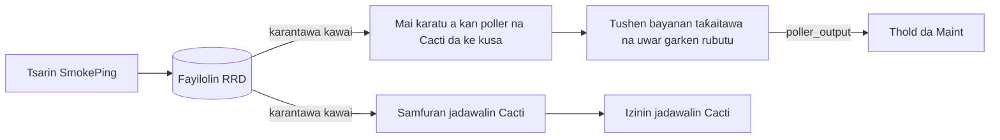

<!-- Source: README.md; SHA256: 17905aa1eac76a7d10dab526734605629fa3d1ada56397642ad4154c5be1feff -->

<!-- translations:start -->
[English](../../../README.md) | [简体中文](../zh-CN/README.md) | [हिन्दी](../hi-IN/README.md) | [Español (España)](../es-ES/README.md) | [Español (Latinoamérica)](../es-419/README.md) | [العربية (السعودية)](../ar-SA/README.md) | [Afrikaans](../af-ZA/README.md) | [አማርኛ](../am-ET/README.md) | [العربية (مصر)](../ar-EG/README.md) | [العربية (المغرب)](../ar-MA/README.md) | [বাংলা](../bn-BD/README.md) | [Deutsch](../de-DE/README.md) | [فارسی](../fa-IR/README.md) | [Filipino](../fil-PH/README.md) | [Français](../fr-FR/README.md) | [Français (Maroc)](../fr-MA/README.md) | [Français (Sénégal)](../fr-SN/README.md) | [Hausa](README.md) | [עברית](../he-IL/README.md) | [Bahasa Indonesia](../id-ID/README.md) | [Igbo](../ig-NG/README.md) | [Italiano](../it-IT/README.md) | [日本語](../ja-JP/README.md) | [한국어](../ko-KR/README.md) | [Malagasy](../mg-MG/README.md) | [मराठी](../mr-IN/README.md) | [Bahasa Melayu](../ms-MY/README.md) | [Nederlands](../nl-NL/README.md) | [Polski](../pl-PL/README.md) | [Português (Brasil)](../pt-BR/README.md) | [Русский](../ru-RU/README.md) | [Kinyarwanda](../rw-RW/README.md) | [Soomaali](../so-SO/README.md) | [Svenska](../sv-SE/README.md) | [Kiswahili](../sw-KE/README.md) | [தமிழ்](../ta-IN/README.md) | [తెలుగు](../te-IN/README.md) | [ไทย](../th-TH/README.md) | [Türkçe](../tr-TR/README.md) | [Українська](../uk-UA/README.md) | [اردو](../ur-PK/README.md) | [Tiếng Việt](../vi-VN/README.md) | [isiXhosa](../xh-ZA/README.md) | [Yorùbá](../yo-NG/README.md) | [繁體中文](../zh-TW/README.md) | [isiZulu](../zu-ZA/README.md)
<!-- translations:end -->

  <picture>
    <source media="(prefers-color-scheme: dark)" srcset="../../images/logo_dark.png">
    
  </picture>

# Plugin na SmokePing don Cacti

Wani plugin na Cacti 1.2 ne da ke kawo ma'aunin jinkiri da asarar fakiti na SmokePing zuwa cikin Cacti a matsayin na'urori na yau da kullum, tushen bayanai, da jadawalai. Zane-zanen hayaki (smoke graphs) na zama kusa da na'urar da suke nata, ƙarƙashin izinin Cacti, kuma Thold da Maint na iya bayar da gargaɗi ko dakatar da su. Wannan tsari ne mai zaman kansa don Cacti kuma ba ya cikin [SmokePing](https://oss.oetiker.ch/smokeping/) ko samun amincewarsa, wanda mawallafansa na asali su ne Tobias Oetiker da Niko Tyni. Plugin ɗin ba ya ƙunshe da lambar SmokePing kuma ba ya gudanar da ita: yana karanta fayilolin saiti da fayilolin RRD da SmokePing ke rubutawa ne kawai, kuma an gina samfuran jadawalinsa don zana jerin bayanai iri ɗaya da zane-zanen SmokePing na asali.

> **Matsayi: yana kan haɓakawa. An aiwatar da yanayin lura (mataki na 1) a kan `main` kuma an fitar da shi a matsayin sigar gwaji ta 1.0.0-rc.1.** Plugin ɗin yana karanta fayilolin saiti da RRD na SmokePing, yana nuna yanayinsu, yana ƙirƙirar na'urorin Cacti, tushen bayanai, da jadawalai a kansu, sannan yana ciyar da Thold da Maint. Ba ya rubuta komai zuwa SmokePing. Yanayin sarrafawa (inda plugin ɗin ke rubuta saitin SmokePing) da masu tattara bayanai na nesa matakai ne na gaba da ba a fara ba, kuma ba sa cikin wannan fitowar. Gwaje-gwajen fili a kan shigarwa na ainihi da daidaita bayanin alamar jadawalin SmokePing har yanzu suna buɗe a milestone 4. Duba [docs/install.md](../../install.md) don farawa.

## Matsayin shiga

| Yankin izini | Shiga |
| --- | --- |
| SmokePing View | Shafukan sa ido da ke akwai. |
| SmokePing Operator | Sa ido tare da shafin Operations da amincewar tantancewa ta mutum ɗaya. |
| SmokePing Admin | Ikon Operator tare da shafukan saiti da ayyukan gudanarwa da ke akwai. |

Bayan kwafin fayilolin haɓakawa, buɗe shafin Plugins a matsayin mai gudanarwa don yin rajistar
sabon yankin izini. Ba da yankin Operator kai tsaye a ƙarƙashin **Configuration > Users** ko rukunin masu amfani.
Haɓakawa yana riƙe da lambobin ID da izinin View da Admin da ke akwai. Ikon Admin
yana gadon ikon Operator, kuma ikon Operator yana gadon ikon View a kan kowace buƙata;
wannan ba ya ƙara ajiyayyun izini ga masu amfani ko rukunoni. Saitunan plugin kuma suna buƙatar
ikon SmokePing Admin baya ga izinin Settings na Cacti.

Izinin na'urorin Cacti har yanzu yana iyakance layuka da ayyukan da kowane mai amfani zai iya samu; abubuwan da ba a haɗa su ba suna buƙatar mai gudanarwa.
Bayanan sirri, saiti, haɗa taswira, gogewa da sauran sauye-sauyen gudanarwa
suna ci gaba da zama a shafukan gudanarwa. Amincewar tantancewa suna aiki ne kawai a zaman
mai amfani na yanzu, na tsawon awa ɗaya a mafi yawa kuma muddin wannan lurar tana nan
da sabonta. Sabbin lurace-lurace ko waɗanda suka canza suna soke su. Ba sa taɓa sanya ma'aunin da ya gaza
a matsayin mai lafiya ko dakatar da gargaɗi.

## Hotunan allo

An shigo da su daga hanyar sadarwar SmokePing 2.8.2 mai aiki zuwa Cacti 1.2.31, awanni 12 da suka gabata. Kowane na'urar manufa tana da jadawalin hayaki don uwar garke ta farko (master) da guda ɗaya don kowace mataimakiya (`lon1`, `sgp1`), an tsara su a ƙarƙashin sashin SmokePing nasu a cikin bishiyar jadawali.

## Dalili

SmokePing yana auna rarrabuwar jinkiri da asarar fakiti sosai, kuma zane-zanen hayakinsa suna nuna bambance-bambancen da jadawalin matsakaici kaɗai ke ɓoyewa. Idan aka gudanar da shi tare da Cacti, yana barin giɓi guda uku:

- **Ikon shiga daban.** CGI na SmokePing bai san komai game da masu amfani na Cacti, rukunoni, ko izinin na'urori ba.
- **Babu mahallin na'ura.** Jinkiri da ma'aunin tashar sadarwa na na'ura guda suna zama a cikin kayan aiki daban-daban.
- **Babu hanya zuwa gargaɗin Cacti.** Thold da Maint suna aiki a kan tushen bayanai da na'urorin Cacti, don haka ana saita gargaɗin SmokePing da dakatar da su daban.

Plugin ɗin yana rufe waɗannan giɓi ta hanyar wakiltar kowace manufar SmokePing a matsayin abubuwan Cacti da ke nuna fayilolin RRD na SmokePing da ke akwai, tare da ƙaramin rukuni na taƙaitattun ƙimomin da aka tattara. Yana sake amfani da zane-zanen Cacti, izini, Thold, da Maint maimakon gina sabbin siffofinsu na daban. An shirya tallafi don masu tattara bayanai na nesa na Cacti a mataki na 3 kuma ba ya cikin wannan fitowar.

## Iyaka da matsayi

| Mataki | Iyaka | Ma'aunan ci gaba | Matsayi |
|---|---|---|---|
| 0, bincike | Jadawalin dacewa, tabbatar da halayyar asali, gwajin daidaiton jadawali | [M1](https://github.com/somethingwithproof/plugin_smokeping/milestone/1) | Sakamako yana cikin `docs/research`; wasu batutuwan bincike suna buɗe |
| 1, lura | Shigo da jerin kayayyaki, na'urorin Cacti, zane-zanen hayaki da taƙaitawa, gargaɗin Thold, dakatarwar Maint, shafin lafiya | [M2](https://github.com/somethingwithproof/plugin_smokeping/milestone/2), [M3](https://github.com/somethingwithproof/plugin_smokeping/milestone/3), [M4](https://github.com/somethingwithproof/plugin_smokeping/milestone/4) | An fitar a matsayin 1.0.0-rc.1; gwaje-gwajen fili suna buɗe |
| 2, sarrafawa | Yankin sunan saiti mallakar Cacti, bayanan binciken ICMP da TCP, gyare-gyare, tabbatarwa, sake lodawa, mayarwa baya | [M5](https://github.com/somethingwithproof/plugin_smokeping/milestone/5) | An shirya, ba a fara ba |
| 3, nesa | SmokePing a kan masu tattara bayanai na nesa na Cacti, mataimaka a matsayin wuraren aunawa | [M6](https://github.com/somethingwithproof/plugin_smokeping/milestone/6) | An shirya, ba a fara ba |

Ba sa cikin iyaka: injin gargaɗi mallakar plugin, injin rahoto, sabis na musamman ko ƙa'idar sadarwa, binciken HTTP/DNS/sabis da aka sarrafa (servcheck yana kula da su), da rubutawa zuwa fayilolin RRD na SmokePing.

## Manufofin dacewa

| Bangare | Manufa |
|---|---|
| Cacti | 1.2.31 ko fiye a cikin 1.2.x, ba tare da gyare-gyaren core ba |
| PHP | 8.2 ko fiye; `setup.php` yana ci gaba da karantuwa a kan 8.0 domin tsarin da ba a tallafawa ya samu ƙin yarda maimakon karya fuskar Cacti |
| SmokePing | 2.9.0, 2.8.2, da 2.7.3 (Ubuntu 22.04 kaɗai, har zuwa 2027-06-01) |
| Thold, Maint | Ba a buƙatar wani sauyi ba |
| Jerin bayanai | 10,000 ga kowane shigarwa a ping 20 da tazarar s 300 ([ƙarfin aiki](../../performance.md#supported-series-count)) |

## Takardun bayani

| | |
|---|---|
| [Shigarwa](../../install.md) | Abubuwan da ake buƙata, hawa fayilolin bayanan SmokePing na karantawa kaɗai, shigarwa, kwantenoni, sigogin da ake tallafawa |
| [Aiki](../../operations.md) | Ma'anar kowane matsayi da shaidarsa, duba lafiya, halayya lokacin da shigarwa ta gaza |
| [Ƙara manufofi zuwa Cacti](../../provisioning.md) | Manufa ɗaya, na'urori da yawa, sake haɗawa, izini |
| [Gargaɗi](../../alerting.md) | Taƙaitattun ƙimomi, tsawon lokacin Thold, tsufan bayanai, bayanan da suka makara, karo da gargaɗin SmokePing, Maint |
| [Tsarin saiti](../../configuration-format.md) | Fitarwa da shigarwa na YAML da XML |
| [Ajiyar baya da maidowa](../../backup-restore.md) | Abin da za a ajiye da yadda maidowa ke ci gaba |
| [Ƙarfin aiki](../../performance.md) | Ma'aunin gida da na injin fitarwa a jerin 100, 1,000, da 10,000, da adadin jerin da aka tallafawa: 10,000 ga kowane shigarwa |
| [Tabbatar da gazawa](../../failure-qualification.md) | Yanayin gazawa da yadda ake gwada kowane ɗaya |
| [Fitar da sabon saki](../../RELEASING.md) | Tsarin fitarwa: pull request, alamar sa hannu, abin da tsarin aiki ke yi, yadda ake tabbatar da sakamako |
| [Rumbun fitarwa](../../release.md) | Siga, jerin canje-canje, da rumbun fitarwa |
| [Gwaji](../../testing.md) | Rukunin gwaje-gwaje, abin da CI ke gudanarwa, da gwaji na kai tsaye a kan SmokePing na ainihi |

## Zayyana

- [docs/PLAN.md](../../PLAN.md) shi ne cikakken shirin: tsarin gini, gaskiyar asali da ya dogara da ita (tare da tushe), tsarin matsayi, iyakokin tsaro, lissafin ƙarfin aiki, gwaji, da haɗura.
- [docs/decisions/](../../decisions) yana riƙe da bayanan shawarwarin tsarin gini don zaɓuɓɓukan da aka riga aka yanke.
- [docs/REQUIREMENTS.md](../../REQUIREMENTS.md) yana haɗa kowane lambar buƙata zuwa batunsa.

## Yadda ake bin diddigin aiki

- **Milestones** suna bin ma'aunan ci gaban shirin. Kowane ɗaya yana da babban batu (epic issue) da ke jero ƙananan batutuwa da shaidar kammala shi.
- **Batutuwa (Issues)** ana rarraba su ta alama: `type: requirement`, `type: research`, `type: decision`, `type: epic`. Batutuwan buƙatu suna bayyana buƙatu masu lamba da za a iya gwadawa (`REQ-AREA-NNN`) da ƙa'idodin karɓa.
- **Alamomi (Labels)** kuma suna ɗauke da `area:`, `phase:`, `priority:`, da `status:`. Duba [CONTRIBUTING.md](../../../CONTRIBUTING.md#labels).
- [Allon aiki](https://github.com/users/somethingwithproof/projects/6) yana nuna dukkan batutuwa a duk ma'aunan ci gaba.

## Bayar da gudummawa

Karanta [CONTRIBUTING.md](../../../CONTRIBUTING.md). Commits suna buƙatar sa hannun DCO. Tattaunawar zayyana tana gudana ne a kan batutuwa; buɗaɗɗun shawarwari suna ɗauke da alamar `type: decision`.

## Tsaro

Bayar da rahoton raunin tsaro a asirce; duba [SECURITY.md](../../../SECURITY.md).

## Lasisi

GNU General Public License v2.0, lasisi iri ɗaya da na Cacti da ƙarin plugins ɗinsa. Duba [LICENSE](../../../LICENSE).
