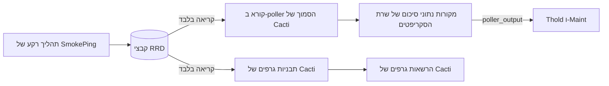

<!-- Source: README.md; SHA256: 17905aa1eac76a7d10dab526734605629fa3d1ada56397642ad4154c5be1feff -->

<!-- translations:start -->
[English](../../../README.md) | [简体中文](../zh-CN/README.md) | [हिन्दी](../hi-IN/README.md) | [Español (España)](../es-ES/README.md) | [Español (Latinoamérica)](../es-419/README.md) | [العربية (السعودية)](../ar-SA/README.md) | [Afrikaans](../af-ZA/README.md) | [አማርኛ](../am-ET/README.md) | [العربية (مصر)](../ar-EG/README.md) | [العربية (المغرب)](../ar-MA/README.md) | [বাংলা](../bn-BD/README.md) | [Deutsch](../de-DE/README.md) | [فارسی](../fa-IR/README.md) | [Filipino](../fil-PH/README.md) | [Français](../fr-FR/README.md) | [Français (Maroc)](../fr-MA/README.md) | [Français (Sénégal)](../fr-SN/README.md) | [Hausa](../ha-NG/README.md) | [עברית](README.md) | [Bahasa Indonesia](../id-ID/README.md) | [Igbo](../ig-NG/README.md) | [Italiano](../it-IT/README.md) | [日本語](../ja-JP/README.md) | [한국어](../ko-KR/README.md) | [Malagasy](../mg-MG/README.md) | [मराठी](../mr-IN/README.md) | [Bahasa Melayu](../ms-MY/README.md) | [Nederlands](../nl-NL/README.md) | [Polski](../pl-PL/README.md) | [Português (Brasil)](../pt-BR/README.md) | [Русский](../ru-RU/README.md) | [Kinyarwanda](../rw-RW/README.md) | [Soomaali](../so-SO/README.md) | [Svenska](../sv-SE/README.md) | [Kiswahili](../sw-KE/README.md) | [தமிழ்](../ta-IN/README.md) | [తెలుగు](../te-IN/README.md) | [ไทย](../th-TH/README.md) | [Türkçe](../tr-TR/README.md) | [Українська](../uk-UA/README.md) | [اردو](../ur-PK/README.md) | [Tiếng Việt](../vi-VN/README.md) | [isiXhosa](../xh-ZA/README.md) | [Yorùbá](../yo-NG/README.md) | [繁體中文](../zh-TW/README.md) | [isiZulu](../zu-ZA/README.md)
<!-- translations:end -->

  <picture>
    <source media="(prefers-color-scheme: dark)" srcset="../../images/logo_dark.png">
    
  </picture>

# תוסף SmokePing עבור Cacti

תוסף עבור Cacti 1.2 המייבא מדידות שיהוי ואובדן מנות של SmokePing אל תוך Cacti כהתקנים, מקורות נתונים וגרפים רגילים. גרפי העשן מוצגים בסמוך להתקן שאליו הם שייכים, תחת ההרשאות של Cacti, ותוספי Thold ו-Maint יכולים להתריע עליהם ולהשתיק התראות עבורם. זהו מימוש עצמאי עבור Cacti, והוא אינו חלק מ-[SmokePing](https://oss.oetiker.ch/smokeping/) ואינו מאושר על ידו; יוצריו המקוריים הם Tobias Oetiker ו-Niko Tyni. התוסף אינו כולל ואינו מריץ את הקוד של SmokePing: הוא קורא את קבצי התצורה וקבצי ה-RRD ש-SmokePing כותב, ותבניות הגרפים שלו בנויות כך שיציירו את אותן הסדרות כמו הגרפים של SmokePing עצמו.

> **סטטוס: בפיתוח. מצב צפייה (שלב 1) ממומש בענף `main` ושוחרר כמהדורה מוקדמת 1.0.0-rc.1.** התוסף קורא את קבצי התצורה וה-RRD של SmokePing, מציג את מצבם, יוצר עבורם התקנים, מקורות נתונים וגרפים ב-Cacti, ומזין את Thold ו-Maint. הוא אינו כותב דבר אל SmokePing. מצב מנוהל (שבו התוסף כותב את תצורת SmokePing) ואספנים מרוחקים הם שלבים מאוחרים יותר שטרם החלו ואינם כלולים במהדורה זו. פיילוטים בהתקנות אמיתיות והתאמה קרובה יותר למקרא הגרפים של SmokePing עדיין פתוחים באבן דרך 4. ראו [docs/install.md](../../install.md) כדי להתחיל.

## תפקידי גישה

| תחום הרשאה | גישה |
| --- | --- |
| צפיית SmokePing | דפי הניטור הקיימים. |
| מפעיל SmokePing | ניטור בתוספת דף הפעולות ואישורי מיון ראשוני אישיים. |
| מנהל SmokePing | גישת מפעיל בתוספת פעולות התצורה והניהול הקיימות. |

לאחר העתקת קבצי השדרוג, פתחו את דף התוספים כמנהל מערכת כדי לרשום את תחום ההרשאה החדש. הקצו את תחום ההרשאה של מפעיל במפורש תחת **תצורה > משתמשים** או קבוצות משתמשים. שדרוגים שומרים על מזהי תחומי ההרשאה וההקצאות הקיימים של צפייה ומנהל. גישת מנהל יורשת גישת מפעיל, וגישת מפעיל יורשת גישת צפייה בכל בקשה; פעולה זו אינה מוסיפה הקצאות שמורות למשתמשים או לקבוצות. הגדרות התוסף דורשות גם גישת מנהל SmokePing בנוסף להרשאת ההגדרות של Cacti.

הרשאות ההתקנים של Cacti עדיין מגבילות את השורות והפעולות הזמינות לכל משתמש; אובייקטים לא ממופים דורשים מנהל מערכת.
פרטי גישה, תצורה, מיפוי, מחיקה ושינויים מנהלתיים אחרים נותרים בדפי הניהול. אישורים תקפים רק בהפעלה הנוכחית של המשתמש, למשך שעה אחת לכל היותר ורק כל עוד אותה תצפית נותרת עדכנית. תצפיות חדשות או כאלה שהשתנו פוסלות אותם. הם לעולם אינם מסמנים מדידה שנכשלה כתקינה ואינם משתיקים התראות.

## צילומי מסך

יובא מרשת SmokePing 2.8.2 פעילה אל תוך Cacti 1.2.31, ב-12 השעות האחרונות. להתקן של כל יעד יש גרף עשן עבור הראשי ואחד עבור כל משני (`lon1`, `sgp1`), המתויקים תחת מקטע SmokePing שלהם בעץ הגרפים.

## מדוע

SmokePing מודד היטב את התפלגות השיהוי ואובדן המנות, וגרפי העשן שלו מציגים שונות שגרף של ממוצע בלבד מסתיר. כאשר הוא רץ לצד Cacti, נותרים שלושה פערים:

- **בקרת גישה נפרדת.** ממשק ה-CGI של SmokePing אינו מכיר משתמשים, קבוצות או הרשאות התקנים של Cacti.
- **ללא הקשר התקן.** נתוני שיהוי ומוני ממשקים עבור אותו התקן נמצאים בכלים נפרדים.
- **ללא נתיב להתראות של Cacti.** Thold ו-Maint פועלים על מקורות נתונים והתקנים של Cacti, כך שהתראות SmokePing מוגדרות ומושתקות בנפרד.

התוסף סוגר פערים אלה על ידי ייצוג כל יעד של SmokePing כאובייקטים של Cacti המצביעים על קבצי ה-RRD הקיימים של SmokePing, בתוספת סט קטן של ערכי סיכום הנדגמים בתשאול. הוא עושה שימוש חוזר ביכולות הגרפים, ההרשאות, Thold ו-Maint של Cacti במקום לבנות גרסאות מקבילות שלהם. תמיכה באספני נתונים מרוחקים של Cacti מתוכננת לשלב 3 ואינה כלולה במהדורה זו.

## היקף וסטטוס

| שלב | היקף | אבני דרך | סטטוס |
|---|---|---|---|
| 0, מחקר | מטריצת תאימות, אימות התנהגות במקור, בדיקת היתכנות לדיוק הגרפים | [M1](https://github.com/somethingwithproof/plugin_smokeping/milestone/1) | הממצאים נמצאים ב-`docs/research`; חלק מנושאי המחקר פתוחים |
| 1, מצב צפייה | ייבוא מלאי, התקני Cacti, גרפי עשן וסיכום, התראות Thold, השתקת Maint, דף תקינות | [M2](https://github.com/somethingwithproof/plugin_smokeping/milestone/2), [M3](https://github.com/somethingwithproof/plugin_smokeping/milestone/3), [M4](https://github.com/somethingwithproof/plugin_smokeping/milestone/4) | שוחרר כ-1.0.0-rc.1; פתוח לפיילוטים |
| 2, מצב מנוהל | מרחב שמות תצורה בבעלות Cacti, פרופילי בדיקות ICMP ו-TCP, גרסאות, אימות, טעינה מחדש, שחזור לאחור | [M5](https://github.com/somethingwithproof/plugin_smokeping/milestone/5) | מתוכנן, טרם החל |
| 3, מרוחק | SmokePing על גבי אספני נתונים מרוחקים של Cacti, שרתים משניים כמיקומי מדידה | [M6](https://github.com/somethingwithproof/plugin_smokeping/milestone/6) | מתוכנן, טרם החל |

מחוץ להיקף: מנוע התראות בבעלות התוסף, מנוע דיווח, תהליך רקע או פרוטוקול רשת מותאמים אישית, בדיקות מנוהלות של HTTP/DNS/שירותים (תוסף servcheck מכסה אותן), וכתיבה לקבצי ה-RRD של SmokePing.

## יעדי תאימות

| רכיב | יעד |
|---|---|
| Cacti | 1.2.31 ואילך בסדרת 1.2.x, ללא טלאי ליבה |
| PHP | 8.2 ואילך; הקובץ `setup.php` נשאר תקין לניתוח ב-8.0 כדי שסביבת ריצה לא נתמכת תקבל דחייה מסודרת במקום ממשק Cacti שבור |
| SmokePing | 2.9.0, 2.8.2 ו-2.7.3 (Ubuntu 22.04 בלבד, עד 2027-06-01) |
| Thold, Maint | לא נדרשים שינויים |
| סדרות | 10,000 לכל התקנה בתדירות של 20 פינגים וצעד של 300 שניות ([ביצועים](../../performance.md#supported-series-count)) |

## תיעוד

| | |
|---|---|
| [התקנה](../../install.md) | דרישות, עיגון לקריאה בלבד של תיקיית הנתונים של SmokePing, התקנה, מכולות, גרסאות נתמכות |
| [תפעול](../../operations.md) | משמעות כל מצב והראיות שלו, בדיקות תקינות, התנהגות כאשר הקלט נכשל |
| [הוספת יעדים אל Cacti](../../provisioning.md) | יעד אחד, התקנים רבים, קישור מחדש, הרשאות |
| [התראות](../../alerting.md) | ערכי סיכום, משכי זמן של Thold, התיישנות נתונים, נתונים מאוחרים, חפיפה עם התראות SmokePing, תוסף Maint |
| [פורמט תצורה](../../configuration-format.md) | ייצוא וייבוא ב-YAML וב-XML |
| [גיבוי ושחזור](../../backup-restore.md) | מה לגבות וכיצד השחזור מתחדש |
| [ביצועים](../../performance.md) | מדידות מקומיות ומדידות בסביבת ההרצה של המהדורה ב-100, 1,000 ו-10,000 סדרות, ומספר הסדרות הנתמך: 10,000 לכל התקנה |
| [הסמכת כשלים](../../failure-qualification.md) | תרחישי הכשל וכיצד כל אחד מהם נבדק |
| [שחרור גרסאות](../../RELEASING.md) | נוהל השחרור: בקשת המיזוג, התג החתום, מה שתהליך העבודה עושה, כיצד לאמת את התוצאה |
| [ארכיון מהדורות](../../release.md) | גרסה, יומן שינויים וארכיון המהדורות |
| [בדיקות](../../testing.md) | חבילות הבדיקה, מה CI מריץ וחבילת הבדיקות החיה מול SmokePing אמיתי |

## תכנון

- [docs/PLAN.md](../../PLAN.md) היא התוכנית המלאה: ארכיטקטורה, עובדות מקור שהיא מסתמכת עליהן (עם מקורות), מודל מצבים, גבולות אבטחה, חישובי ביצועים, בדיקות וסיכונים.
- [docs/decisions/](../../decisions) מכילה רשומות החלטות ארכיטקטורה עבור בחירות שכבר התקבלו.
- [docs/REQUIREMENTS.md](../../REQUIREMENTS.md) ממפה כל מזהה דרישה אל הנושא שלו.

## כיצד מתבצע מעקב אחר העבודה

- **אבני דרך** עוקבות אחר אבני הדרך של התוכנית. לכל אחת יש נושא-על המפרט את נושאי המשנה שלה ואת ראיות הסיום.
- **נושאים** מסווגים לפי תווית: `type: requirement`, `type: research`, `type: decision`, `type: epic`. נושאי דרישות מציינים דרישות ממוספרות ובנות-בדיקה (`REQ-AREA-NNN`) וקריטריוני קבלה.
- **תוויות** כוללות גם `area:`, `phase:`, `priority:` ו-`status:`. ראו [CONTRIBUTING.md](../../../CONTRIBUTING.md#labels).
- [לוח הפרויקט](https://github.com/users/somethingwithproof/projects/6) מציג את כל הנושאים על פני אבני הדרך.

## תרומה לפרויקט

קראו את [CONTRIBUTING.md](../../../CONTRIBUTING.md). קומיטים דורשים חתימת DCO. דיוני תכנון מתקיימים בנושאים; החלטות פתוחות נושאות את התווית `type: decision`.

## אבטחה

דווחו על פגיעויות באופן פרטי; ראו [SECURITY.md](../../../SECURITY.md).

## רישיון

הרישיון הציבורי הכללי של GNU גרסה 2.0, אותו רישיון כמו Cacti והתוספים שלה. ראו [LICENSE](../../../LICENSE).
