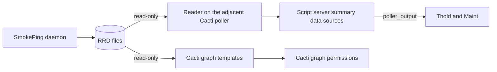

<!-- Source: README.md; SHA256: b41ec705327127cc34ff07d1514a141262752f99c5e2296fdc323d584a777b84 -->

<!-- translations:start -->
[English](../../../README.md) | [简体中文](../zh-CN/README.md) | [हिन्दी](README.md) | [Español (España)](../es-ES/README.md) | [Español (Latinoamérica)](../es-419/README.md) | [العربية (السعودية)](../ar-SA/README.md) | [Afrikaans](../af-ZA/README.md) | [አማርኛ](../am-ET/README.md) | [العربية (مصر)](../ar-EG/README.md) | [العربية (المغرب)](../ar-MA/README.md) | [বাংলা](../bn-BD/README.md) | [Bosanski](../bs-BA/README.md) | [Deutsch](../de-DE/README.md) | [فارسی](../fa-IR/README.md) | [Filipino](../fil-PH/README.md) | [Français](../fr-FR/README.md) | [Français (Maroc)](../fr-MA/README.md) | [Français (Sénégal)](../fr-SN/README.md) | [Hausa](../ha-NG/README.md) | [עברית](../he-IL/README.md) | [Hrvatski](../hr-HR/README.md) | [Bahasa Indonesia](../id-ID/README.md) | [Igbo](../ig-NG/README.md) | [Italiano](../it-IT/README.md) | [日本語](../ja-JP/README.md) | [한국어](../ko-KR/README.md) | [Malagasy](../mg-MG/README.md) | [मराठी](../mr-IN/README.md) | [Bahasa Melayu](../ms-MY/README.md) | [Nederlands](../nl-NL/README.md) | [Polski](../pl-PL/README.md) | [Português (Brasil)](../pt-BR/README.md) | [Русский](../ru-RU/README.md) | [Kinyarwanda](../rw-RW/README.md) | [Soomaali](../so-SO/README.md) | [Српски](../sr-RS/README.md) | [Svenska](../sv-SE/README.md) | [Kiswahili](../sw-KE/README.md) | [தமிழ்](../ta-IN/README.md) | [తెలుగు](../te-IN/README.md) | [ไทย](../th-TH/README.md) | [Türkçe](../tr-TR/README.md) | [Українська](../uk-UA/README.md) | [اردو](../ur-PK/README.md) | [Tiếng Việt](../vi-VN/README.md) | [isiXhosa](../xh-ZA/README.md) | [Yorùbá](../yo-NG/README.md) | [繁體中文](../zh-TW/README.md) | [isiZulu](../zu-ZA/README.md)
<!-- translations:end -->

  <picture>
    <source media="(prefers-color-scheme: dark)" srcset="../../images/logo_dark.png">
    
  </picture>

# Cacti के लिए SmokePing प्लगइन

Cacti 1.2 का एक प्लगइन जो SmokePing के विलंब और पैकेट हानि मापों को सामान्य Cacti उपकरणों, डेटा स्रोतों और ग्राफ़ों के रूप में लाता है। स्मोक ग्राफ़ संबंधित उपकरण के साथ, Cacti अनुमतियों के अधीन दिखते हैं और Thold तथा Maint उनके अलर्ट दे और दबा सकते हैं। यह Cacti के लिए स्वतंत्र कार्यान्वयन है; यह [SmokePing](https://oss.oetiker.ch/smokeping/) का हिस्सा या उसके द्वारा समर्थित नहीं है, जिसके मूल लेखक Tobias Oetiker और Niko Tyni हैं। प्लगइन में SmokePing कोड शामिल नहीं है और वह उसे चलाता भी नहीं: यह उसकी कॉन्फ़िगरेशन और RRD फ़ाइलें पढ़ता है तथा इसके ग्राफ़ टेम्पलेट मूल SmokePing ग्राफ़ों जैसी ही शृंखलाएँ बनाते हैं।

> **स्थिति: विकासाधीन। अवलोकन मोड (चरण 1) `main` (1.0.0-rc.1) में ऑपरेटर फ़िल्टरिंग, CSV निर्यात, अनाथ RRD पहचान, Thold अलर्ट अनुवाद, पारिस्थितिकी एकीकरण हुक और दूरस्थ संग्रहकर्ता प्रतिकृति के साथ लागू है।** प्लगइन SmokePing कॉन्फ़िगरेशन और RRD फ़ाइलें पढ़ता है, उनकी स्थिति दिखाता है, उनके लिए Cacti उपकरण, डेटा स्रोत और ग्राफ़ बनाता है तथा Thold और Maint को डेटा देता है। यह SmokePing में कुछ नहीं लिखता। प्रबंधित मोड (प्लगइन द्वारा SmokePing कॉन्फ़िगरेशन लिखना) एक बाद का चरण है, शुरू नहीं हुआ है और यहाँ शामिल नहीं है। वास्तविक इंस्टॉलेशन पर पायलट तथा SmokePing ग्राफ़ों के संकेतक विवरण से बेहतर मेल अभी माइलस्टोन 4 में शेष हैं। शुरू करने के लिए [docs/install.md](docs/install.md) देखें।

## पहुँच भूमिकाएँ

| अनुमति क्षेत्र | पहुँच |
| --- | --- |
| SmokePing View | मौजूदा निगरानी पृष्ठ। |
| SmokePing Operator | निगरानी के साथ संचालन पृष्ठ और व्यक्तिगत जाँच पुष्टि। |
| SmokePing Admin | ऑपरेटर पहुँच के साथ मौजूदा कॉन्फ़िगरेशन और प्रशासनिक कार्रवाइयाँ। |

अपग्रेड फ़ाइलें कॉपी करने के बाद नया अनुमति क्षेत्र दर्ज करने के लिए व्यवस्थापक के रूप में प्लगइन पृष्ठ खोलें। **कॉन्फ़िगरेशन > उपयोगकर्ता** या उपयोगकर्ता समूहों में Operator अनुमति स्पष्ट रूप से दें। अपग्रेड मौजूदा View और Admin क्षेत्र के ID और अनुदान सुरक्षित रखते हैं। हर अनुरोध में Admin को Operator और Operator को View पहुँच विरासत में मिलती है; इससे उपयोगकर्ता या समूह में संग्रहीत अनुदान नहीं जुड़ते। प्लगइन सेटिंग के लिए Cacti की Settings अनुमति के अतिरिक्त SmokePing Admin भी आवश्यक है।

Cacti डिवाइस अनुमतियाँ अब भी हर उपयोगकर्ता के लिए उपलब्ध पंक्तियाँ और कार्रवाइयाँ सीमित करती हैं; अनमैप ऑब्जेक्ट के लिए व्यवस्थापक चाहिए। क्रेडेंशियल, कॉन्फ़िगरेशन, मैपिंग, हटाना और अन्य प्रशासनिक बदलाव प्रशासनिक पृष्ठों में ही रहते हैं। पुष्टि केवल वर्तमान उपयोगकर्ता के सत्र में, अधिकतम एक घंटे तक और उसी अवलोकन के ताज़ा रहने तक रहती है। नए या बदले अवलोकन उसे अमान्य कर देते हैं। यह कभी विफल माप को स्वस्थ नहीं बताती या अलर्ट नहीं दबाती।

## स्क्रीनशॉट

चालू SmokePing 2.8.2 नेटवर्क से Cacti 1.2.31 में आयात, पिछले 12 घंटे। हर लक्ष्य के उपकरण में मास्टर का एक स्मोक ग्राफ़ और हर स्लेव (`lon1`, `sgp1`) का एक ग्राफ़ होता है, जो ग्राफ़ ट्री में उसके SmokePing अनुभाग में रखे जाते हैं।

## क्यों

SmokePing विलंब वितरण और पैकेट हानि अच्छी तरह मापता है; इसके स्मोक ग्राफ़ वे बदलाव दिखाते हैं जिन्हें औसत वाला ग्राफ़ छिपाता है। Cacti के साथ चलाने पर तीन कमियाँ रहती हैं:

- **अलग पहुँच नियंत्रण।** SmokePing CGI को Cacti उपयोगकर्ताओं, समूहों और उपकरण अनुमतियों की जानकारी नहीं होती।
- **उपकरण संदर्भ नहीं।** एक उपकरण का विलंब और इंटरफ़ेस काउंटर अलग-अलग औज़ारों में रहते हैं।
- **Cacti अलर्ट से एकीकरण नहीं।** Thold और Maint Cacti डेटा स्रोतों और उपकरणों पर काम करते हैं, इसलिए SmokePing अलर्ट अलग से कॉन्फ़िगर और दबाए जाते हैं।

प्लगइन हर SmokePing लक्ष्य को मौजूदा SmokePing RRD फ़ाइलों की ओर संकेत करने वाले Cacti ऑब्जेक्ट और कुछ पोल किए गए सारांश मानों से दर्शाकर ये कमियाँ पूरी करता है। यह Cacti के ग्राफ़, अनुमतियाँ, Thold और Maint का पुनः उपयोग करता है। पोलर-सीमित कॉन्फ़िगरेशन प्रतिकृति (`replicate_out`) दूरस्थ पोलर कॉन्फ़िगरेशन तालिकाएँ भेजती है, जबकि स्थानीय मोड (poller 1) और संग्रहकर्ता-स्थानीय अवलोकन कैश अलग-थलग रहते हैं।

## दायरा और स्थिति

| चरण | दायरा | माइलस्टोन | स्थिति |
|---|---|---|---|
| 0, शोध | संगतता तालिका, मूल व्यवहार की पुष्टि, ग्राफ़ समानता प्रोटोटाइप | [M1](https://github.com/somethingwithproof/plugin_smokeping/milestone/1) | परिणाम `docs/research` में; कुछ शोध मुद्दे खुले हैं |
| 1, अवलोकन | इन्वेंटरी आयात, Cacti उपकरण, स्मोक और सारांश ग्राफ़, Thold अलर्ट व अलर्ट अनुवाद, Maint दमन, फ़िल्टर किए दृश्य, CSV निर्यात, अनाथ RRD पहचान, पारिस्थितिकी हुक | [M2](https://github.com/somethingwithproof/plugin_smokeping/milestone/2), [M3](https://github.com/somethingwithproof/plugin_smokeping/milestone/3), [M4](https://github.com/somethingwithproof/plugin_smokeping/milestone/4) | लागू; पायलट शेष |
| 2, प्रबंधित | Cacti के स्वामित्व वाला कॉन्फ़िगरेशन नामस्थान, ICMP और TCP प्रोब प्रोफ़ाइल, संशोधन, सत्यापन, रीलोड, रोलबैक | [M5](https://github.com/somethingwithproof/plugin_smokeping/milestone/5) | नियोजित, शुरू नहीं |
| 3, दूरस्थ | दूरस्थ डेटा संग्रहकर्ताओं के लिए पोलर-सीमित क्वेरी और `replicate_out` तालिका प्रतिकृति (`RemoteReplication`); पूर्ण बहु-संग्रहकर्ता SmokePing परिनियोजन योग्यता जाँच | [M6](https://github.com/somethingwithproof/plugin_smokeping/milestone/6) | प्रतिकृति और पोलर सीमांकन लागू; बहु-संग्रहकर्ता परिनियोजन योग्यता जाँच शेष |

लागू किए गए ऑपरेटर कार्यप्रवाह, CLI कमांड और पारिस्थितिकी हुक:

- **इन्वेंटरी और लक्ष्य फ़िल्टरिंग (`smokeping_inventory.php`, `smokeping.php`)**: `TargetFilter`, `TargetRepository::filteredForPoller()`, `InventoryPage`, और `ViewPage` खोज (`filter`), प्रोब (`probe`), इन्वेंटरी उपस्थिति (`presence`), मैपिंग स्थिति (`mapping`), ताज़गी स्थिति (`state`), और वैकल्पिक पृष्ठ-आकार पृष्ठांकन (`rows`: `All`, `25`, `50`, `100`, `200`) प्रदान करते हैं। गिनती से पहले SQL में ही डिवाइस दृश्यता लागू की जाती है ताकि कुल संख्या में छिपे हुए डिवाइस कभी उजागर न हों।
- **CSV निर्यात (`smokeping.php?action=export_csv`)**: `CsvExporter` कॉलर की डिवाइस अनुमतियों के अंतर्गत सक्रिय फ़िल्टर किए दृश्य के लिए RFC 4180 CRLF आउटपुट स्ट्रीम करता है और स्प्रेडशीट फ़ॉर्मूलों को निष्क्रिय करने के लिए `=`, `+`, `-`, `@`, टैब या कैरिज रिटर्न से शुरू होने वाले सेल के आगे एक अपोस्ट्रॉफ़ी जोड़ता है।
- **अनाथ RRD पहचान (`smokeping_health.php`)**: `OrphanRrdScanner` और `HealthCheck::orphanRrds()` रीडर पोलर पर SmokePing माउंट का सीमित स्कैन करते हैं, `__cgi`, `__sortercache` और सिंबॉलिक लिंक को छोड़ते हैं, तथा बिना स्वामी वाली `.rrd` फ़ाइलों का खुले री-लिंक प्रस्तावों से मिलान करते हैं।
- **SmokePing-से-Thold रूपांतरण (`smokeping_health.php`, `cli/smokeping.php`)**: `TholdTranslator` और `TholdGenerator` SmokePing की `*** Alerts ***` परिभाषाएँ पढ़ते हैं और SmokePing कॉन्फ़िगरेशन फ़ाइलों को बदले बिना समर्थित क्रमिक हानि पैटर्न को समतुल्य `loss_pct` Thold सीमाओं में बदलते हैं। वेब प्रवाह में GET पूर्वावलोकन (`action=thold_preview`, `HealthPage::renderTholdPreview()`) के बाद CSRF-सुरक्षित POST (`action=thold_create`) का उपयोग होता है। असमर्थित पैटर्न (RTT अलर्ट, वाइल्डकार्ड क्षय, मिश्रित स्तर) बिना लिखे छोड़ दिए जाते हैं।
- **प्रशासक CLI (`cli/smokeping.php`)**: `provision <target path> [--device=ID] [--location=NAME]`, `relink <old target path> <new target path> [--location=NAME]`, `thold-generate <target path> [--alert=NAME] [--apply]`, `size-graphs`, `upgrade-graphs`, `export [--format=yaml|xml] [--file=PATH]`, `import --file=PATH [--format=yaml|xml] [--apply --confirm=PLAN]`, और `import-smokeping [--dry-run | --apply --confirm=PLAN] [--file=PATH] [--sections=A,B/C] [--device-per=host|target] [--device-template=ID] [--poller=ID] [--site=ID] [--tree=ID | --tree-name=NAME]` का समर्थन करता है।
- **पारिस्थितिकी हुक (`setup.php`, `Schema::HOOKS`)**: 21 हुक पंजीकृत करता है, जिनमें `abilities_register` (`AbilitiesProvider`: केवल पढ़ने योग्य `smokeping-list-targets` और `smokeping-get-health`, कॉलर की उपयोगकर्ता ID पर View क्षेत्र द्वारा नियंत्रित, कोई गोपनीय मान नहीं लौटाता), `doctor_register_checks` (`DoctorChecks`: `smokeping_stale_targets`, `smokeping_freshness_breaches`, `smokeping_orphan_rrds`, `smokeping_config_path`), `casc_register_providers` (`CascProvider`: `ConfigCodec` और `ConfigService` समर्थित `smokeping` YAML/XML `export`, `validate`, `plan`, और `apply`), तथा `replicate_out` (`RemoteReplication`: `poller_id > 1` वाले दूरस्थ पोलरों के लिए `plugin_smokeping_target`, `plugin_smokeping_mapping`, `plugin_smokeping_object`, और `plugin_smokeping_relink` का पोलर-सीमित समन्वयन) शामिल हैं।

दायरे से बाहर: अपना अलर्ट इंजन, रिपोर्टिंग इंजन, कस्टम डेमन या नेटवर्क प्रोटोकॉल, प्रबंधित HTTP/DNS/सेवा जाँच (servcheck इन्हें संभालता है), और SmokePing RRD फ़ाइलों में लिखना।

## संगतता लक्ष्य

| घटक | लक्ष्य |
|---|---|
| Cacti | 1.2.x में 1.2.31 या बाद का, कोर पैच के बिना |
| PHP | 8.2 या बाद का; `setup.php` को 8.0 भी पार्स कर सकता है, ताकि असमर्थित रनटाइम Cacti UI तोड़े बिना अस्वीकार हो |
| SmokePing | 2.9.0, 2.8.2, और 2.7.3 (केवल Ubuntu 22.04, 2027-06-01 तक) |
| Thold, Maint | कोई बदलाव आवश्यक नहीं |
| शृंखलाएँ | प्रति इंस्टॉलेशन 10,000, 20 पिंग और 300 सेकंड चरण के साथ ([प्रदर्शन](docs/performance.md#supported-series-count)) |

## दस्तावेज़

| | |
|---|---|
| [स्थापना](docs/install.md) | आवश्यकताएँ, डेटा डायरेक्टरी का केवल-पठन माउंट, स्थापना, कंटेनर, समर्थित संस्करण |
| [संचालन](docs/operations.md) | हर स्थिति का अर्थ और प्रमाण, स्वास्थ्य जाँच, इनपुट विफलता का व्यवहार |
| [Cacti में लक्ष्य जोड़ना](docs/provisioning.md) | एक लक्ष्य, कई उपकरण, पुनः संबद्ध करना, अनुमतियाँ |
| [अलर्ट](docs/alerting.md) | सारांश मान, Thold अवधि, पुराने और देर से आए डेटा, SmokePing अलर्ट का दोहराव, Maint |
| [कॉन्फ़िगरेशन प्रारूप](docs/configuration-format.md) | YAML और XML निर्यात तथा आयात |
| [बैकअप और बहाली](docs/backup-restore.md) | क्या बैकअप लें और बहाली के बाद काम कैसे जारी होता है |
| [प्रदर्शन](docs/performance.md) | 100, 1,000 और 10,000 शृंखलाओं पर स्थानीय तथा रिलीज़ रनर माप; प्रति इंस्टॉलेशन 10,000 समर्थित |
| [विफलता परीक्षण](../../failure-qualification.md) | विफलता परिदृश्य और हर एक का परीक्षण |
| [रिलीज़ प्रक्रिया](../../RELEASING.md) | पुल अनुरोध, हस्ताक्षरित टैग, वर्कफ़्लो और परिणाम जाँचने की प्रक्रिया |
| [रिलीज़ आर्काइव](../../release.md) | संस्करण, परिवर्तन सूची और वितरित आर्काइव |
| [परीक्षण](../../testing.md) | सूट, CI में चलने वाले परीक्षण, वास्तविक SmokePing पर लाइव सूट |

## डिज़ाइन

- [docs/PLAN.md](../../PLAN.md) पूरी योजना है: वास्तुकला, निर्भर मूल तथ्य (स्रोत सहित), स्थिति मॉडल, सुरक्षा सीमाएँ, प्रदर्शन गणना, परीक्षण और जोखिम।
- [docs/decisions/](../../decisions) में लिए जा चुके वास्तुकला निर्णयों के अभिलेख हैं।
- [docs/REQUIREMENTS.md](../../REQUIREMENTS.md) हर आवश्यकता ID को उसके मुद्दे से जोड़ता है।
- स्थानीय सत्यापन Pest यूनिट और स्रोत-नियम जाँच (`pest --configuration=phpunit.xml`), PHPStan Level 9 (`CACTI_PATH=<cacti-dir> phpstan analyse -c phpstan.neon --no-progress`), प्रवेश-बिंदु सिंटैक्स जाँच (`*.php`, `include/*.php`, `scripts/*.php`, `cli/*.php` पर `php -l`), और अनुवाद जाँच (`sh locales/build_gettext.sh --check`) चलाता है। एकीकरण और कंटेनर एंड-टू-एंड सूट के लिए [docs/testing.md](../../testing.md) देखें।

## काम का अनुश्रवण

- **माइलस्टोन** प्लान का अनुसरण करते हैं। हर माइलस्टोन की एक एपिक इश्यू में उप-इश्यू और समापन प्रमाण हैं।
- **इश्यू** लेबल से वर्गीकृत हैं: `type: requirement`, `type: research`, `type: decision`, `type: epic`। आवश्यकता इश्यू में क्रमांकित, परीक्षण योग्य आवश्यकताएँ (`REQ-AREA-NNN`) और स्वीकृति मानदंड हैं।
- **लेबल** में `area:`, `phase:`, `priority:` और `status:` भी हैं। [CONTRIBUTING.md](../../../CONTRIBUTING.md#labels) देखें।
- [परियोजना बोर्ड](https://github.com/users/somethingwithproof/projects/6) सभी माइलस्टोन की इश्यू दिखाता है।

## योगदान

[CONTRIBUTING.md](../../../CONTRIBUTING.md) पढ़ें। कमिट में DCO sign-off आवश्यक है। डिज़ाइन चर्चा इश्यू में होती है; खुले निर्णयों पर `type: decision` लेबल है।

## सुरक्षा

कमज़ोरियाँ निजी रूप से रिपोर्ट करें; [SECURITY.md](../../../SECURITY.md) देखें।

## लाइसेंस

GNU General Public License v2.0, वही लाइसेंस जो Cacti और उसके प्लगइन का है। [LICENSE](../../../LICENSE) देखें।
