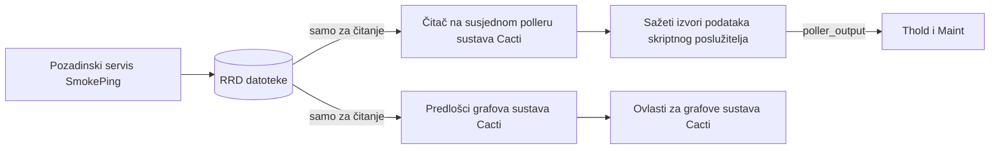

<!-- Source: README.md; SHA256: 17905aa1eac76a7d10dab526734605629fa3d1ada56397642ad4154c5be1feff -->

<!-- translations:start -->
[English](../../../README.md) | [简体中文](../zh-CN/README.md) | [हिन्दी](../hi-IN/README.md) | [Español (España)](../es-ES/README.md) | [Español (Latinoamérica)](../es-419/README.md) | [العربية (السعودية)](../ar-SA/README.md) | [Afrikaans](../af-ZA/README.md) | [አማርኛ](../am-ET/README.md) | [العربية (مصر)](../ar-EG/README.md) | [العربية (المغرب)](../ar-MA/README.md) | [বাংলা](../bn-BD/README.md) | [Bosanski](../bs-BA/README.md) | [Deutsch](../de-DE/README.md) | [فارسی](../fa-IR/README.md) | [Filipino](../fil-PH/README.md) | [Français](../fr-FR/README.md) | [Français (Maroc)](../fr-MA/README.md) | [Français (Sénégal)](../fr-SN/README.md) | [Hausa](../ha-NG/README.md) | [עברית](../he-IL/README.md) | [Hrvatski](README.md) | [Bahasa Indonesia](../id-ID/README.md) | [Igbo](../ig-NG/README.md) | [Italiano](../it-IT/README.md) | [日本語](../ja-JP/README.md) | [한국어](../ko-KR/README.md) | [Malagasy](../mg-MG/README.md) | [मराठी](../mr-IN/README.md) | [Bahasa Melayu](../ms-MY/README.md) | [Nederlands](../nl-NL/README.md) | [Polski](../pl-PL/README.md) | [Português (Brasil)](../pt-BR/README.md) | [Русский](../ru-RU/README.md) | [Kinyarwanda](../rw-RW/README.md) | [Soomaali](../so-SO/README.md) | [Српски](../sr-RS/README.md) | [Svenska](../sv-SE/README.md) | [Kiswahili](../sw-KE/README.md) | [தமிழ்](../ta-IN/README.md) | [తెలుగు](../te-IN/README.md) | [ไทย](../th-TH/README.md) | [Türkçe](../tr-TR/README.md) | [Українська](../uk-UA/README.md) | [اردو](../ur-PK/README.md) | [Tiếng Việt](../vi-VN/README.md) | [isiXhosa](../xh-ZA/README.md) | [Yorùbá](../yo-NG/README.md) | [繁體中文](../zh-TW/README.md) | [isiZulu](../zu-ZA/README.md)
<!-- translations:end -->

  <picture>
    <source media="(prefers-color-scheme: dark)" srcset="../../images/logo_dark.png">
    
  </picture>

# Dodatak SmokePing za Cacti

Dodatak za Cacti 1.2 koji u Cacti donosi mjerenja latencije i gubitka paketa iz alata SmokePing u obliku uobičajenih uređaja, izvora podataka i grafova. Smoke grafovi tada stoje uz uređaj kojem pripadaju, pod ovlastima sustava Cacti, a Thold i Maint na temelju njih mogu slati upozorenja i privremeno ih prigušivati. Riječ je o neovisnoj implementaciji za Cacti koja nije dio projekta [SmokePing](https://oss.oetiker.ch/smokeping/), čiji su izvorni autori Tobias Oetiker i Niko Tyni, niti ga taj projekt podupire. Dodatak ne uključuje niti izvršava kod SmokePinga: očitava konfiguraciju i RRD datoteke koje SmokePing zapisuje, a njegovi predlošci grafova oblikovani su tako da iscrtavaju iste nizove kao izvorni grafovi SmokePinga.

> **Stanje: u razvoju. Način promatranja (faza 1) implementiran je na grani `main` i objavljen kao predizdanje 1.0.0-rc.1.** Dodatak očitava konfiguraciju i RRD datoteke SmokePinga, prikazuje njihovo stanje, stvara uređaje, izvore podataka i grafove u sustavu Cacti te opskrbljuje Thold i Maint. Ne zapisuje ništa u SmokePing. Upravljani način rada (u kojem dodatak zapisuje konfiguraciju SmokePinga) i udaljeni sakupljači predviđeni su za kasnije faze, još nisu započeti te nisu obuhvaćeni ovim izdanjem. Pilotske primjene na stvarnim instalacijama i preciznije usklađivanje s legendom grafova SmokePinga ostaju otvoreni u prekretnici 4. Za početak pogledajte [docs/install.md](../../install.md).

## Pristupne uloge

| Područje ovlasti (Realm) | Pristup |
| --- | --- |
| SmokePing View | Postojeće stranice nadzora. |
| SmokePing Operator | Nadzor, stranica Operacije i osobne potvrde pri razvrstavanju (trijaži). |
| SmokePing Admin | Pristup operatera te postojeće konfiguracijske i administrativne radnje. |

Nakon kopiranja datoteka nadogradnje otvorite stranicu Plugins kao administrator kako biste registrirali
novo područje ovlasti. Izričito dodijelite područje Operator u izborniku **Configuration > Users** ili korisničkim skupinama.
Nadogradnje zadržavaju postojeće identifikatore i ovlasti za područja View i Admin. Pristup Admin
nasljeđuje pristup Operator, a pristup Operator nasljeđuje pristup View pri svakom zahtjevu;
time se ne dodaju pohranjene ovlasti korisnicima ni skupinama. Postavke dodatka dodatno zahtijevaju
pristup SmokePing Admin povrh ovlasti Settings u sustavu Cacti.

Ovlasti za uređaje u sustavu Cacti i dalje ograničavaju retke i radnje dostupne pojedinom korisniku; nepridruženi objekti zahtijevaju administratora.
Vjerodajnice, konfiguracija, pridruživanje, brisanje i ostale administrativne promjene
ostaju na administrativnim stranicama. Potvrde vrijede isključivo unutar trenutačne
korisničke sesije, najdulje jedan sat i samo dok isto opažanje ostaje
aktualno. Nova ili izmijenjena opažanja ih poništavaju. Nikada ne označavaju neuspjelo
mjerenje ispravnim niti prigušuju upozorenja.

## Slike zaslona

Uvezeno iz žive mreže SmokePing 2.8.2 u Cacti 1.2.31, posljednjih 12 sati. Uređaj svakog cilja ima smoke graf za glavni čvor i po jedan za svaki podređeni čvor (`lon1`, `sgp1`), smještene pod odgovarajućim odjeljkom SmokePinga u stablu grafova.

## Zašto

SmokePing pouzdano mjeri raspodjelu latencije i gubitak paketa, a njegovi smoke grafovi prikazuju kolebanja koja graf s isključivo prosječnom vrijednošću prikriva. Kada radi uz Cacti, ostaju tri praznine:

- **Odvojeni nadzor pristupa.** CGI sučelje SmokePinga ne poznaje korisnike, skupine ni ovlasti za uređaje u sustavu Cacti.
- **Izostanak konteksta uređaja.** Podaci o latenciji i brojači sučelja za isti uređaj nalaze se u različitim alatima.
- **Nema izravnog puta do upozorenja u sustavu Cacti.** Thold i Maint rade nad izvorima podataka i uređajima sustava Cacti pa se upozorenja SmokePinga moraju konfigurirati i prigušivati odvojeno.

Dodatak zatvara te praznine predstavljajući svaki cilj SmokePinga kao objekte sustava Cacti koji upućuju na postojeće RRD datoteke SmokePinga, uz manji skup prikupljenih sažetih vrijednosti. Ponovno upotrebljava iscrtavanje grafova, ovlasti, Thold i Maint sustava Cacti umjesto izgradnje usporednih rješenja. Podrška za udaljene sakupljače podataka sustava Cacti planirana je za fazu 3 i nije uključena u ovo izdanje.

## Opseg i stanje

| Faza | Opseg | Prekretnice | Stanje |
|---|---|---|---|
| 0, istraživanje | Matrica kompatibilnosti, potvrda ponašanja uzvodnog projekta, provjera vjernosti grafova | [M1](https://github.com/somethingwithproof/plugin_smokeping/milestone/1) | Nalazi u `docs/research`; dio istraživačkih tema još je otvoren |
| 1, promatranje | Uvoz inventara, uređaji sustava Cacti, smoke i sažeti grafovi, upozorenja Thold, prigušivanje Maint, stranica ispravnosti | [M2](https://github.com/somethingwithproof/plugin_smokeping/milestone/2), [M3](https://github.com/somethingwithproof/plugin_smokeping/milestone/3), [M4](https://github.com/somethingwithproof/plugin_smokeping/milestone/4) | Objavljeno kao 1.0.0-rc.1; pilotske primjene otvorene |
| 2, upravljano | Imenski prostor konfiguracije pod upravljanjem sustava Cacti, profili ICMP i TCP sondi, revizije, provjera valjanosti, ponovno učitavanje, povrat | [M5](https://github.com/somethingwithproof/plugin_smokeping/milestone/5) | Planirano, nije započeto |
| 3, udaljeno | SmokePing na udaljenim sakupljačima podataka sustava Cacti, podređeni čvorovi kao mjerne lokacije | [M6](https://github.com/somethingwithproof/plugin_smokeping/milestone/6) | Planirano, nije započeto |

Izvan opsega: vlastiti mehanizam upozoravanja u dodatku, sustav za izradu izvješća, prilagođeni pozadinski servis ili mrežni protokol, upravljane HTTP/DNS/servisne provjere (pokriva ih servcheck) te zapisivanje u RRD datoteke SmokePinga.

## Ciljevi kompatibilnosti

| Komponenta | Cilj |
|---|---|
| Cacti | 1.2.31 ili noviji u grani 1.2.x, bez zakrpa jezgre |
| PHP | 8.2 ili noviji; `setup.php` ostaje raščlanjiv na inačici 8.0 kako bi nepodržano okruženje dobilo uredno odbijanje umjesto neispravnog sučelja sustava Cacti |
| SmokePing | 2.9.0, 2.8.2 i 2.7.3 (samo Ubuntu 22.04, do 2027-06-01) |
| Thold, Maint | Nisu potrebne izmjene |
| Nizovi | 10.000 po instalaciji pri 20 pingova i koraku od 300 s ([performanse](../../performance.md#supported-series-count)) |

## Dokumentacija

| | |
|---|---|
| [Instalacija](../../install.md) | Zahtjevi, montiranje mape s podacima SmokePinga samo za čitanje, instalacija, spremnici, podržane inačice |
| [Upravljanje radom](../../operations.md) | Značenje svakog stanja i pripadajući dokazi, provjere ispravnosti, ponašanje pri neispravnim ulaznim podacima |
| [Dodavanje ciljeva u Cacti](../../provisioning.md) | Jedan cilj, više uređaja, ponovno povezivanje, ovlasti |
| [Upozoravanje](../../alerting.md) | Sažete vrijednosti, trajanja u Tholdu, zastarjelost, zakašnjeli podaci, preklapanje s upozorenjima SmokePinga, Maint |
| [Format konfiguracije](../../configuration-format.md) | Izvoz i uvoz u formatima YAML i XML |
| [Sigurnosno kopiranje i oporavak](../../backup-restore.md) | Što pohraniti u sigurnosnu kopiju i kako se rad nastavlja nakon oporavka |
| [Performanse](../../performance.md) | Lokalna mjerenja i mjerenja na poslužitelju za izdanja pri 100, 1.000 i 10.000 nizova te podržani broj nizova: 10.000 po instalaciji |
| [Kvalifikacija kvarova](../../failure-qualification.md) | Scenariji kvarova i način ispitivanja svakog od njih |
| [Objava izdanja](../../RELEASING.md) | Postupak objave: zahtjev za povlačenje (PR), potpisana oznaka, koraci tijeka rada, provjera ishoda |
| [Arhiva izdanja](../../release.md) | Inačica, dnevnik promjena i arhiva izdanja |
| [Ispitivanje](../../testing.md) | Skupovi testova, što izvodi CI i ispitivanje uživo prema stvarnom SmokePingu |

## Arhitektura i oblikovanje

- [docs/PLAN.md](../../PLAN.md) donosi cjeloviti plan: arhitekturu, činjenice uzvodnog projekta na koje se oslanja (s izvorima), model stanja, sigurnosne granice, proračune performansi, ispitivanje i rizike.
- [docs/decisions/](../../decisions) sadrži zapise arhitektonskih odluka (ADR) za već donesene izbore.
- [docs/REQUIREMENTS.md](../../REQUIREMENTS.md) povezuje svaki identifikator zahtjeva s pripadajućom prijavom (issue).

## Način praćenja rada

- **Prekretnice (Milestones)** prate prekretnice plana. Svaka ima krovnu prijavu (epic) s popisom podzadataka i izlaznih dokaza.
- **Prijave (Issues)** označene su oznakama vrste: `type: requirement`, `type: research`, `type: decision`, `type: epic`. Prijave zahtjeva definiraju numerirane, ispitive zahtjeve (`REQ-AREA-NNN`) i kriterije prihvaćanja.
- **Oznake (Labels)** dodatno sadržavaju `area:`, `phase:`, `priority:` i `status:`. Pogledajte [CONTRIBUTING.md](../../../CONTRIBUTING.md#labels).
- [Ploča projekta](https://github.com/users/somethingwithproof/projects/6) prikazuje sve prijave kroz sve prekretnice.

## Doprinos

Pročitajte [CONTRIBUTING.md](../../../CONTRIBUTING.md). Commitovi zahtijevaju DCO potpis (sign-off). Rasprave o oblikovanju odvijaju se u prijavama; otvorene odluke nose oznaku `type: decision`.

## Sigurnost

Ranjivosti prijavite povjerljivo; pogledajte [SECURITY.md](../../../SECURITY.md).

## Licencija

GNU General Public License v2.0, ista licencija kao Cacti i njegovi dodaci. Pogledajte [LICENSE](../../../LICENSE).
