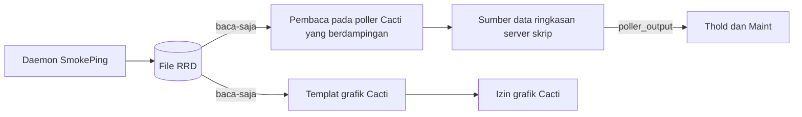

<!-- Source: README.md; SHA256: 17905aa1eac76a7d10dab526734605629fa3d1ada56397642ad4154c5be1feff -->

<!-- translations:start -->
[English](../../../README.md) | [简体中文](../zh-CN/README.md) | [हिन्दी](../hi-IN/README.md) | [Español (España)](../es-ES/README.md) | [Español (Latinoamérica)](../es-419/README.md) | [العربية (السعودية)](../ar-SA/README.md) | [Afrikaans](../af-ZA/README.md) | [አማርኛ](../am-ET/README.md) | [العربية (مصر)](../ar-EG/README.md) | [العربية (المغرب)](../ar-MA/README.md) | [বাংলা](../bn-BD/README.md) | [Deutsch](../de-DE/README.md) | [فارسی](../fa-IR/README.md) | [Filipino](../fil-PH/README.md) | [Français](../fr-FR/README.md) | [Français (Maroc)](../fr-MA/README.md) | [Français (Sénégal)](../fr-SN/README.md) | [Hausa](../ha-NG/README.md) | [עברית](../he-IL/README.md) | [Bahasa Indonesia](README.md) | [Igbo](../ig-NG/README.md) | [Italiano](../it-IT/README.md) | [日本語](../ja-JP/README.md) | [한국어](../ko-KR/README.md) | [Malagasy](../mg-MG/README.md) | [मराठी](../mr-IN/README.md) | [Bahasa Melayu](../ms-MY/README.md) | [Nederlands](../nl-NL/README.md) | [Polski](../pl-PL/README.md) | [Português (Brasil)](../pt-BR/README.md) | [Русский](../ru-RU/README.md) | [Kinyarwanda](../rw-RW/README.md) | [Soomaali](../so-SO/README.md) | [Svenska](../sv-SE/README.md) | [Kiswahili](../sw-KE/README.md) | [தமிழ்](../ta-IN/README.md) | [తెలుగు](../te-IN/README.md) | [ไทย](../th-TH/README.md) | [Türkçe](../tr-TR/README.md) | [Українська](../uk-UA/README.md) | [اردو](../ur-PK/README.md) | [Tiếng Việt](../vi-VN/README.md) | [isiXhosa](../xh-ZA/README.md) | [Yorùbá](../yo-NG/README.md) | [繁體中文](../zh-TW/README.md) | [isiZulu](../zu-ZA/README.md)
<!-- translations:end -->

  <picture>
    <source media="(prefers-color-scheme: dark)" srcset="../../images/logo_dark.png">
    
  </picture>

# Plugin SmokePing untuk Cacti

Plugin Cacti 1.2 yang menghadirkan pengukuran latensi dan kehilangan paket SmokePing ke dalam Cacti sebagai perangkat, sumber data, dan grafik biasa. Grafik smoke kemudian ditempatkan di samping perangkat pemiliknya, di bawah izin akses Cacti, sehingga Thold dan Maint dapat memicu peringatan serta menonaktifkannya sementara. Plugin ini merupakan implementasi independen untuk Cacti dan bukan bagian dari, maupun didukung oleh, [SmokePing](https://oss.oetiker.ch/smokeping/), yang penulis aslinya adalah Tobias Oetiker dan Niko Tyni. Plugin ini tidak menyertakan maupun menjalankan kode SmokePing: plugin ini membaca file konfigurasi dan RRD yang ditulis oleh SmokePing, dan templat grafiknya dibuat untuk menggambar seri yang sama seperti grafik SmokePing sendiri.

> **Status: dalam pengembangan. Mode pantau (fase 1) telah diimplementasikan pada `main` dan dirilis sebagai prarilis 1.0.0-rc.1.** Plugin ini membaca file konfigurasi dan RRD SmokePing, menampilkan statusnya, membuat perangkat, sumber data, dan grafik Cacti untuk data tersebut, serta menyalurkannya ke Thold dan Maint. Plugin ini tidak menulis apa pun ke SmokePing. Mode terkelola (plugin menulis konfigurasi SmokePing) dan pengumpul jarak jauh merupakan fase selanjutnya, belum dimulai, dan tidak ada dalam rilis ini. Uji coba pada instalasi nyata dan penyesuaian lebih dekat dengan legenda grafik SmokePing masih terbuka pada pencapaian 4. Lihat [docs/install.md](../../install.md) untuk memulai.

## Peran akses

| Realm | Akses |
| --- | --- |
| SmokePing View | Halaman pemantauan yang sudah ada. |
| SmokePing Operator | Pemantauan ditambah halaman Operasi dan pengakuan triase pribadi. |
| SmokePing Admin | Akses Operator ditambah konfigurasi yang sudah ada dan tindakan administratif. |

Setelah menyalin file pemutakhiran, buka halaman Plugins sebagai administrator untuk mendaftarkan
realm baru tersebut. Tetapkan realm Operator secara eksplisit di bawah **Configuration > Users** atau grup pengguna.
Pemutakhiran mempertahankan ID dan pemberian izin realm View serta Admin yang sudah ada. Akses Admin
mewarisi akses Operator, dan akses Operator mewarisi akses View pada setiap permintaan;
hal ini tidak menambahkan izin tersimpan ke pengguna atau grup. Pengaturan plugin juga memerlukan
akses SmokePing Admin selain izin Settings milik Cacti.

Izin perangkat Cacti tetap membatasi baris dan tindakan yang tersedia untuk setiap pengguna; objek yang belum dipetakan memerlukan administrator.
Kredensial, konfigurasi, pemetaan, penghapusan, dan perubahan administratif lainnya
tetap berada di halaman administratif. Pengakuan hanya berlaku dalam sesi
pengguna saat ini, paling lama satu jam dan hanya selama pengamatan yang sama masih
baru. Pengamatan baru atau yang berubah akan membatalkannya. Pengakuan tidak pernah menandai pengukuran
yang gagal sebagai sehat atau menekan peringatan.

## Tangkapan layar

Diimpor dari jaringan SmokePing 2.8.2 aktif ke dalam Cacti 1.2.31, 12 jam terakhir. Perangkat setiap target memiliki satu grafik smoke untuk master dan satu untuk masing-masing slave (`lon1`, `sgp1`), yang ditempatkan di bawah bagian SmokePing pada pohon grafik.

## Mengapa

SmokePing mengukur distribusi latensi dan kehilangan paket dengan baik, dan grafik smoke-nya menampilkan variasi yang disembunyikan oleh grafik rata-rata saja. Jika dijalankan berdampingan dengan Cacti, terdapat tiga celah:

- **Kontrol akses terpisah.** CGI SmokePing tidak mengetahui apa pun tentang pengguna, grup, atau izin perangkat Cacti.
- **Tidak ada konteks perangkat.** Latensi dan penghitung antarmuka untuk perangkat yang sama berada di alat yang berbeda.
- **Tidak ada jalur ke peringatan Cacti.** Thold dan Maint bekerja pada sumber data dan perangkat Cacti, sehingga peringatan SmokePing dikonfigurasi dan dinonaktifkan sementara secara terpisah.

Plugin ini menutup celah tersebut dengan merepresentasikan setiap target SmokePing sebagai objek Cacti yang mengarah ke file RRD SmokePing yang sudah ada, ditambah sejumlah kecil nilai ringkasan yang diambil melalui polling. Plugin ini menggunakan kembali pembuatan grafik, izin, Thold, dan Maint milik Cacti alih-alih membangun versi paralelnya. Dukungan untuk pengumpul data jarak jauh Cacti direncanakan untuk fase 3 dan tidak ada dalam rilis ini.

## Ruang lingkup dan status

| Fase | Ruang lingkup | Pencapaian | Status |
|---|---|---|---|
| 0, riset | Matriks kompatibilitas, konfirmasi perilaku hulu, eksperimen kesetiaan grafik | [M1](https://github.com/somethingwithproof/plugin_smokeping/milestone/1) | Temuan di `docs/research`; beberapa isu riset masih terbuka |
| 1, pantau | Impor inventaris, perangkat Cacti, grafik smoke dan ringkasan, peringatan Thold, penonaktifan sementara Maint, halaman kesehatan | [M2](https://github.com/somethingwithproof/plugin_smokeping/milestone/2), [M3](https://github.com/somethingwithproof/plugin_smokeping/milestone/3), [M4](https://github.com/somethingwithproof/plugin_smokeping/milestone/4) | Dirilis sebagai 1.0.0-rc.1; uji coba terbuka |
| 2, terkelola | Namespace konfigurasi milik Cacti, profil probe ICMP dan TCP, revisi, validasi, muat ulang, pemulihan versi sebelumnya | [M5](https://github.com/somethingwithproof/plugin_smokeping/milestone/5) | Direncanakan, belum dimulai |
| 3, jarak jauh | SmokePing pada pengumpul data jarak jauh Cacti, slave sebagai lokasi pengukuran | [M6](https://github.com/somethingwithproof/plugin_smokeping/milestone/6) | Direncanakan, belum dimulai |

Di luar ruang lingkup: mesin peringatan milik plugin sendiri, mesin pelaporan, daemon atau protokol jaringan khusus, pemeriksaan HTTP/DNS/layanan terkelola (ditangani oleh servcheck), dan penulisan ke file RRD SmokePing.

## Target kompatibilitas

| Komponen | Target |
|---|---|
| Cacti | 1.2.31 atau lebih baru pada 1.2.x, tanpa patch inti |
| PHP | 8.2 atau lebih baru; `setup.php` tetap dapat diurai pada 8.0 agar runtime yang tidak didukung mendapatkan penolakan alih-alih merusak UI Cacti |
| SmokePing | 2.9.0, 2.8.2, dan 2.7.3 (khusus Ubuntu 22.04, hingga 2027-06-01) |
| Thold, Maint | Tidak diperlukan perubahan |
| Seri | 10.000 per instalasi pada 20 ping dan langkah 300 d ([performa](../../performance.md#supported-series-count)) |

## Dokumentasi

| | |
|---|---|
| [Instalasi](../../install.md) | Persyaratan, mount baca-saja untuk direktori data SmokePing, instalasi, kontainer, versi yang didukung |
| [Pengoperasian](../../operations.md) | Arti setiap status dan buktinya, pemeriksaan kesehatan, perilaku saat input gagal |
| [Tambahkan target ke Cacti](../../provisioning.md) | Satu target, banyak perangkat, penautan ulang, izin |
| [Peringatan](../../alerting.md) | Nilai ringkasan, durasi Thold, kedaluwarsa data, data terlambat, tumpang tindih dengan peringatan SmokePing, Maint |
| [Format konfigurasi](../../configuration-format.md) | Ekspor dan impor YAML serta XML |
| [Pencadangan dan pemulihan](../../backup-restore.md) | Apa yang perlu dicadangkan dan bagaimana pemulihan dilanjutkan |
| [Performa](../../performance.md) | Pengukuran lokal dan release-runner pada 100, 1.000, dan 10.000 seri, serta jumlah seri yang didukung: 10.000 per instalasi |
| [Kualifikasi kegagalan](../../failure-qualification.md) | Skenario kegagalan dan cara masing-masing diuji |
| [Rilis](../../RELEASING.md) | Prosedur rilis: pull request, tag bertanda tangan, apa yang dilakukan alur kerja, cara memverifikasi hasilnya |
| [Arsip rilis](../../release.md) | Versi, catatan perubahan, dan arsip rilis |
| [Pengujian](../../testing.md) | Rangkaian pengujian, apa yang dijalankan CI, dan pengujian langsung terhadap SmokePing nyata |

## Desain

- [docs/PLAN.md](../../PLAN.md) adalah rencana lengkap: arsitektur, fakta hulu yang menjadi ketergantungannya (beserta sumber), model status, batasan keamanan, aritmetika performa, pengujian, dan risiko.
- [docs/decisions/](../../decisions) menyimpan catatan keputusan arsitektur untuk pilihan yang sudah dibuat.
- [docs/REQUIREMENTS.md](../../REQUIREMENTS.md) memetakan setiap ID persyaratan ke isunya.

## Cara kerja pelacakan pekerjaan

- **Pencapaian** mengikuti pencapaian dalam rencana. Masing-masing memiliki isu epik yang mencantumkan sub-isu dan bukti penyelesaiannya.
- **Isu** dikelompokkan berdasarkan label: `type: requirement`, `type: research`, `type: decision`, `type: epic`. Isu persyaratan menyatakan persyaratan bernomor yang dapat diuji (`REQ-AREA-NNN`) dan kriteria penerimaan.
- **Label** juga memuat `area:`, `phase:`, `priority:`, dan `status:`. Lihat [CONTRIBUTING.md](../../../CONTRIBUTING.md#labels).
- [Papan proyek](https://github.com/users/somethingwithproof/projects/6) menampilkan seluruh isu di semua pencapaian.

## Berkontribusi

Baca [CONTRIBUTING.md](../../../CONTRIBUTING.md). Commit memerlukan penandatanganan DCO. Diskusi desain berlangsung di isu; keputusan terbuka memakai label `type: decision`.

## Keamanan

Laporkan kerentanan secara pribadi; lihat [SECURITY.md](../../../SECURITY.md).

## Lisensi

GNU General Public License v2.0, lisensi yang sama dengan Cacti dan plugin-pluginnya. Lihat [LICENSE](../../../LICENSE).
