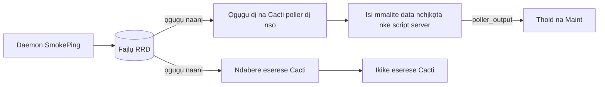

<!-- Source: README.md; SHA256: b41ec705327127cc34ff07d1514a141262752f99c5e2296fdc323d584a777b84 -->

<!-- translations:start -->
[English](../../../README.md) | [简体中文](../zh-CN/README.md) | [हिन्दी](../hi-IN/README.md) | [Español (España)](../es-ES/README.md) | [Español (Latinoamérica)](../es-419/README.md) | [العربية (السعودية)](../ar-SA/README.md) | [Afrikaans](../af-ZA/README.md) | [አማርኛ](../am-ET/README.md) | [العربية (مصر)](../ar-EG/README.md) | [العربية (المغرب)](../ar-MA/README.md) | [বাংলা](../bn-BD/README.md) | [Bosanski](../bs-BA/README.md) | [Deutsch](../de-DE/README.md) | [فارسی](../fa-IR/README.md) | [Filipino](../fil-PH/README.md) | [Français](../fr-FR/README.md) | [Français (Maroc)](../fr-MA/README.md) | [Français (Sénégal)](../fr-SN/README.md) | [Hausa](../ha-NG/README.md) | [עברית](../he-IL/README.md) | [Hrvatski](../hr-HR/README.md) | [Bahasa Indonesia](../id-ID/README.md) | [Igbo](README.md) | [Italiano](../it-IT/README.md) | [日本語](../ja-JP/README.md) | [한국어](../ko-KR/README.md) | [Malagasy](../mg-MG/README.md) | [मराठी](../mr-IN/README.md) | [Bahasa Melayu](../ms-MY/README.md) | [Nederlands](../nl-NL/README.md) | [Polski](../pl-PL/README.md) | [Português (Brasil)](../pt-BR/README.md) | [Русский](../ru-RU/README.md) | [Kinyarwanda](../rw-RW/README.md) | [Soomaali](../so-SO/README.md) | [Српски](../sr-RS/README.md) | [Svenska](../sv-SE/README.md) | [Kiswahili](../sw-KE/README.md) | [தமிழ்](../ta-IN/README.md) | [తెలుగు](../te-IN/README.md) | [ไทย](../th-TH/README.md) | [Türkçe](../tr-TR/README.md) | [Українська](../uk-UA/README.md) | [اردو](../ur-PK/README.md) | [Tiếng Việt](../vi-VN/README.md) | [isiXhosa](../xh-ZA/README.md) | [Yorùbá](../yo-NG/README.md) | [繁體中文](../zh-TW/README.md) | [isiZulu](../zu-ZA/README.md)
<!-- translations:end -->

  <picture>
    <source media="(prefers-color-scheme: dark)" srcset="../../images/logo_dark.png">
    
  </picture>

# Ngwá mgbakwunye SmokePing maka Cacti

Ngwá mgbakwunye Cacti 1.2 nke na-eweta ntụle igbu oge na mfu nke SmokePing n'ime Cacti dị ka ngwaọrụ, isi mmalite data, na eserese nkịtị. Eserese anwụrụ ọkụ na-anọ n'akụkụ ngwaọrụ nke ha, n'okpuru ikike Cacti, ma Thold na Maint nwere ike ịdọ aka na ntị ma kwụsịtụ ha. Ọ bụ mmejupụta nọọrọ onwe ya maka Cacti ma ọ bụghị akụkụ nke, ma ọ bụ nke [SmokePing](https://oss.oetiker.ch/smokeping/) kwadoro, nke ndị dere ya na mbụ bụ Tobias Oetiker na Niko Tyni. Ngwá mgbakwunye ahụ etinyeghị ma ọ bụ mee ka koodu SmokePing rụọ ọrụ: ọ na-agụ nhazi na faịlụ RRD nke SmokePing na-ede, a rụkwara ndabere eserese ya ka o see otu usoro dị ka eserese SmokePing n'onwe ya.

> **Ọnọdụ: a na-ewulite ya. E mejupụtala ọnọdụ nleba anya (agba nke 1) na `main` (1.0.0-rc.1) tinyere nzacha onye ọrụ, mbupụ CSV, nchọpụta RRD enweghị nwe, ntụgharị ọkwa Thold, nko njikọta gburugburu ebe obibi (ecosystem hooks), na nṅomi maka ndị nchịkọta dịpụrụ adịpụ.** Ngwá mgbakwunye ahụ na-agụ nhazi SmokePing na faịlụ RRD, na-egosi ọnọdụ ha, na-emepụta ngwaọrụ Cacti, isi mmalite data, na eserese maka ha, ma na-enye Thold na Maint ozi. Ọ naghị ede ihe ọ bụla na SmokePing. Ọnọdụ njikwa (ngwá mgbakwunye na-ede nhazi SmokePing) bụ agba ga-abịa n'ihu, amalitebeghị, ọ dịghịkwa na mwepụta a. Nnwale mbụ na nrụnye dị adị na nkwekọrịta dị nso na nkọwa eserese SmokePing ka ghere oghe n'agba nke 4. Lee [docs/install.md](../../install.md) iji malite.

## Ọrụ nnweta

| Mpaghara | Nnweta |
| --- | --- |
| SmokePing View | Ibe nleba anya dị adị. |
| SmokePing Operator | Nleba anya tinyere ibe Ọrụ na nnabata nhazi onwe onye. |
| SmokePing Admin | Nnweta Operator tinyere nhazi dị adị na omume nchịkwa. |

Mgbe i detụchara faịlụ nkwalite, meghee ibe Plugins dị ka onye nchịkwa iji debanye aha
mpaghara ọhụrụ ahụ. Nye mpaghara Operator kpọmkwem n'okpuru **Configuration > Users** ma ọ bụ otu ndị ọrụ.
Nkwalite na-echekwa ID mpaghara View na Admin dị adị na ikike enyere. Nnweta Admin
na-eketa nnweta Operator, nnweta Operator na-eketekwa nnweta View na arịrịọ ọ bụla;
nke a anaghị agbakwunye ikike echekwara na ndị ọrụ ma ọ bụ otu. Ntọala ngwá mgbakwunye chọkwara
nnweta SmokePing Admin na mgbakwunye na ikike Settings nke Cacti.

Ikike ngwaọrụ Cacti ka na-egbochi ahịrị na omume dịrị onye ọrụ ọ bụla; ihe ndị na-enweghị njikọ chọrọ onye nchịkwa.
Asambodo nzuzo, nhazi, njikọ, nhichapụ na mgbanwe nchịkwa ndị ọzọ
na-anọ na ibe nchịkwa. Nnabata na-adịgide naanị n'oge nnọkọ onye ọrụ dị ugbu a,
maka oge kachasị otu awa ma naanị mgbe otu nchọpụta ahụ ka dị ọhụrụ.
Nchọpụta ọhụrụ ma ọ bụ nke gbanwere na-eme ka ha ghara ịdị irè. Ha anaghị akara ntụle
dara ada dị ka nke dị mma ma ọ bụ kwụsịtụ ịdọ aka na ntị.

## Nseta ihuenyo

E si na netwọk SmokePing 2.8.2 dị ndụ bubata ya n'ime Cacti 1.2.31, awa 12 gara aga. Ngwaọrụ ebumnuche ọ bụla nwere eserese anwụrụ ọkụ maka master na otu maka slave ọ bụla (`lon1`, `sgp1`), edobere n'okpuru ngalaba SmokePing ya n'osisi eserese.

## Ihe kpatara ya

SmokePing na-atụ nkesa igbu oge na mfu packet nke ọma, eserese anwụrụ ọkụ ya na-egosikwa mgbanwe nke eserese nkezi naanị na-ezochi. Mgbe ọ na-arụ ọrụ n'akụkụ Cacti, ọ na-ahapụ oghere atọ:

- **Njikwa nnweta dị iche.** CGI nke SmokePing amaghị ihe ọ bụla gbasara ndị ọrụ, otu, ma ọ bụ ikike ngwaọrụ Cacti.
- **Enweghị njikọ ngwaọrụ.** Igbu oge na ngụkọ interface maka otu ngwaọrụ dị na ngwaọrụ dị iche iche.
- **Enweghị ụzọ banye n'ịdọ aka na ntị Cacti.** Thold na Maint na-arụ ọrụ na isi mmalite data na ngwaọrụ Cacti, ya mere a na-ahazi ma na-akwụsịtụ ịdọ aka na ntị SmokePing iche.

Ngwá mgbakwunye ahụ na-emechi oghere ndị a site n'ịgosipụta ebumnuche SmokePing ọ bụla dị ka ihe Cacti nke na-arụtụ aka na faịlụ RRD SmokePing dị adị, tinyere obere otu uru nchịkọta anakọtara. Ọ na-ejigharị eserese, ikike, Thold, na Maint nke Cacti kama iwulite ụdị yiri ha. Nṅomi nhazi nwere oke na poller (`replicate_out`) na-eziga tebụl nhazi poller dịpụrụ adịpụ ka ọ na-edobe ọnọdụ mpaghara (poller 1) na nchekwa nleba anya mpaghara nke onye nchịkọta iche.

## Oke ọrụ na ọnọdụ

| Agba | Oke ọrụ | Ebumnuche oge | Ọnọdụ |
|---|---|---|---|
| 0, nchọpụta | Tebụl nkwekọrịta, nkwenye omume isi mmalite, nnwale izi ezi eserese | [M1](https://github.com/somethingwithproof/plugin_smokeping/milestone/1) | Nchọpụta dị na `docs/research`; ụfọdụ okwu nchọpụta ka ghere oghe |
| 1, nleba anya | Mbubata ngwaahịa, ngwaọrụ Cacti, eserese anwụrụ ọkụ na nchịkọta, ịdọ aka na ntị Thold na ntụgharị ọkwa, nkwụsịtụ Maint, nlele a zachara, mbupụ CSV, nchọpụta RRD enweghị nwe, nko gburugburu ebe obibi | [M2](https://github.com/somethingwithproof/plugin_smokeping/milestone/2), [M3](https://github.com/somethingwithproof/plugin_smokeping/milestone/3), [M4](https://github.com/somethingwithproof/plugin_smokeping/milestone/4) | E mejupụtala; nnwale mbụ ghere oghe |
| 2, njikwa | Mpaghara aha nhazi nke Cacti nwe, profaịlụ nyocha ICMP na TCP, ndezigharị, nkwenye, ibugharị, mweghachi azụ | [M5](https://github.com/somethingwithproof/plugin_smokeping/milestone/5) | A haziri ya, amalitebeghị |
| 3, dịpụrụ adịpụ | Ajụjụ nwere oke na poller na nṅomi tebụl `replicate_out` maka ndị nchịkọta data dịpụrụ adịpụ (`RemoteReplication`); ntozu zuru ezu maka ntinye SmokePing nwere ọtụtụ ndị nchịkọta | [M6](https://github.com/somethingwithproof/plugin_smokeping/milestone/6) | E mejupụtala nṅomi na oke poller; ntozu ntinye nwere ọtụtụ ndị nchịkọta ghere oghe |

Usoro ọrụ onye ọrụ, iwu CLI, na nko gburugburu ebe obibi e mejupụtara:

- **Nzacha ngwaahịa na ebumnuche (`smokeping_inventory.php`, `smokeping.php`)**: `TargetFilter`, `TargetRepository::filteredForPoller()`, `InventoryPage`, na `ViewPage` na-enye ọchụchọ (`filter`), nyocha (`probe`), ọnụnọ na ngwaahịa (`presence`), ọnọdụ njikọ (`mapping`), ọnọdụ ọhụrụ (`state`), na nkewa ibe nhọrọ (`rows`: `All`, `25`, `50`, `100`, `200`). A na-amanye ihu ngwaọrụ na SQL tupu ịgụ ọnụ ka ngụkọta ghara ikpughe ngwaọrụ e zoro ezo.
- **Mbupụ CSV (`smokeping.php?action=export_csv`)**: `CsvExporter` na-ebupụ mmepụta RFC 4180 CRLF maka nlele a zachara dị ugbu a n'okpuru ikike ngwaọrụ onye na-akpọ, na-etinye akara apọstrọfị n'ihu mkpụrụokwu na-ebido na `=`, `+`, `-`, `@`, tab, ma ọ bụ carriage return iji gbochie usoro mgbako na mpempe akwụkwọ.
- **Nchọpụta RRD enweghị nwe (`smokeping_health.php`)**: `OrphanRrdScanner` na `HealthCheck::orphanRrds()` na-eme nyocha nwere oke nke ntinye SmokePing na poller na-agụ ya, na-amafe `__cgi`, `__sortercache`, na njikọ nnọchiteanya, ma na-atụnyere faịlụ `.rrd` enweghị nwe na atụmatụ njikọghachi mepere emepe.
- **Ntụgharị SmokePing gaa na Thold (`smokeping_health.php`, `cli/smokeping.php`)**: `TholdTranslator` na `TholdGenerator` na-agụ nkọwa `*** Alerts ***` nke SmokePing ma na-atụgharị usoro mfu na-esote ibe ya a kwadoro ka ha bụrụ oke `loss_pct` nke Thold dabara adaba n'agbanweghị faịlụ nhazi SmokePing. Usoro weebụ na-eji nlele mbụ GET (`action=thold_preview`, `HealthPage::renderTholdPreview()`) nke POST echedoro CSRF (`action=thold_create`) sochiri. A na-amafe usoro a na-akwadoghị (ọkwa RTT, mbelata wildcard, ọkwa agwakọtara) n'edeghị ihe ọ bụla.
- **CLI onye nchịkwa (`cli/smokeping.php`)**: na-akwado `provision <target path> [--device=ID] [--location=NAME]`, `relink <old target path> <new target path> [--location=NAME]`, `thold-generate <target path> [--alert=NAME] [--apply]`, `size-graphs`, `upgrade-graphs`, `export [--format=yaml|xml] [--file=PATH]`, `import --file=PATH [--format=yaml|xml] [--apply --confirm=PLAN]`, na `import-smokeping [--dry-run | --apply --confirm=PLAN] [--file=PATH] [--sections=A,B/C] [--device-per=host|target] [--device-template=ID] [--poller=ID] [--site=ID] [--tree=ID | --tree-name=NAME]`.
- **Nko gburugburu ebe obibi (`setup.php`, `Schema::HOOKS`)**: na-edebanye aha nko 21, gụnyere `abilities_register` (`AbilitiesProvider`: `smokeping-list-targets` na `smokeping-get-health` nke na-agụ naanị, nke e mechiri na mpaghara View megide ID onye ọrụ na-akpọ, anaghị eweghachi ihe nzuzo ọ bụla), `doctor_register_checks` (`DoctorChecks`: `smokeping_stale_targets`, `smokeping_freshness_breaches`, `smokeping_orphan_rrds`, `smokeping_config_path`), `casc_register_providers` (`CascProvider`: onye na-enye `smokeping` YAML/XML `export`, `validate`, `plan`, na `apply` nke `ConfigCodec` na `ConfigService` kwadoro), na `replicate_out` (`RemoteReplication`: mmekọrịta nwere oke na poller nke `plugin_smokeping_target`, `plugin_smokeping_mapping`, `plugin_smokeping_object`, na `plugin_smokeping_relink` maka ndị poller dịpụrụ adịpụ nwere `poller_id > 1`).

Ihe na-abụghị n'oke ọrụ: injin ịdọ aka na ntị nke ngwá mgbakwunye nwe, injin mkpesa, daemon ma ọ bụ usoro netwọk ahaziri ahazi, nyocha HTTP/DNS/ọrụ ejikwa (servcheck na-ekpuchi ha), na ide ihe na faịlụ RRD nke SmokePing.

## Ebumnuche nkwekọrịta

| Akụkụ | Ebumnuche |
|---|---|
| Cacti | 1.2.31 ma ọ bụ karịa na 1.2.x, enweghị mgbanwe koodu isi |
| PHP | 8.2 ma ọ bụ karịa; `setup.php` na-anọgide na-enwe ike ịgụ na 8.0 ka runtime a na-akwadoghị wee nweta ajụ kama ihu Cacti gbajiri agbaji |
| SmokePing | 2.9.0, 2.8.2, na 2.7.3 (Ubuntu 22.04 naanị, ruo 2027-06-01) |
| Thold, Maint | Enweghị mgbanwe achọrọ |
| Usoro | 10,000 kwa nrụnye na ping 20 na nzọụkwụ 300 s ([arụmọrụ](../../performance.md#supported-series-count)) |

## Akwụkwọ ntuziaka

| | |
|---|---|
| [Wụnye](../../install.md) | Ihe achọrọ, njikọ ọgụgụ naanị nke ndekọ data SmokePing, nrụnye, containers, ụdị a kwadoro |
| [Rụọ ọrụ](../../operations.md) | Ihe ọnọdụ ọ bụla pụtara na ihe akaebe ya, nyocha ahụike, omume mgbe ntinye dara ada |
| [Tinye ebumnuche na Cacti](../../provisioning.md) | Otu ebumnuche, ọtụtụ ngwaọrụ, ijikọghachi, ikike |
| [Ịdọ aka na ntị](../../alerting.md) | Uru nchịkọta, ogologo oge Thold, ịka nká data, data na-abịa n'azụ oge, ndakọrịta na ịdọ aka na ntị SmokePing, Maint |
| [Ụdị nhazi](../../configuration-format.md) | Mbupụ na mbubata YAML na XML |
| [Nchekwa na mweghachi](../../backup-restore.md) | Ihe a ga-echekwa na otu mweghachi si maliteghachi |
| [Arụmọrụ](../../performance.md) | Ntụle mpaghara na nke onye na-agba ọsọ mwepụta na usoro 100, 1,000, na 10,000, yana ọnụọgụ usoro a kwadoro: 10,000 kwa nrụnye |
| [Ntụle ọdịda](../../failure-qualification.md) | Ọnọdụ ọdịda na otu esi anwale nke ọ bụla |
| [Mwepụta](../../RELEASING.md) | Usoro mwepụta: arịrịọ pull, mkpado bịanyere aka, ihe usoro ọrụ na-eme, otu esi enyocha nsonaazụ |
| [Ebe nchekwa mwepụta](../../release.md) | Ụdị, ndekọ mgbanwe, na ebe nchekwa mwepụta |
| [Nnwale](../../testing.md) | Nchịkọta nnwale, ihe CI na-agba, na nnwale dị ndụ megide SmokePing dị adị |

## Nhazi usoro

- [docs/PLAN.md](../../PLAN.md) bụ atụmatụ zuru oke: usoro nhazi, eziokwu isi mmalite ọ dabere na ya (ya na isi mmalite), ụdị ọnọdụ, oke nchekwa, mgbakọ na mwepụ arụmọrụ, nnwale, na ihe egwu.
- [docs/decisions/](../../decisions) nwere ndekọ mkpebi usoro nhazi maka nhọrọ ndị e meela.
- [docs/REQUIREMENTS.md](../../REQUIREMENTS.md) na-ejikọ ID ihe achọrọ ọ bụla na okwu ya.
- Nkwenye mpaghara na-agba ule otu na nlele iwu isi mmalite nke Pest (`pest --configuration=phpunit.xml`), PHPStan Level 9 (`CACTI_PATH=<cacti-dir> phpstan analyse -c phpstan.neon --no-progress`), nlele usoro ederede ebe ntinye (`php -l` na `*.php`, `include/*.php`, `scripts/*.php`, `cli/*.php`), na nlele ntụgharị asụsụ (`sh locales/build_gettext.sh --check`). Lee [docs/testing.md](../../testing.md) maka nchịkọta ule njikọta na nke container site na mmalite ruo n'ọgwụgwụ.

## Otu esi eso ọrụ

- **Ebumnuche oge** na-eso ebumnuche oge nke atụmatụ ahụ. Nke ọ bụla nwere okwu epic na-edepụta obere okwu ya na ihe akaebe ọpụpụ.
- **Okwu** nwere ụdị dị ka akara: `type: requirement`, `type: research`, `type: decision`, `type: epic`. Okwu ihe achọrọ na-ekwu ihe achọrọ a gụrụ nọmba, nke a pụrụ ịnwale (`REQ-AREA-NNN`) na njirisi nnabata.
- **Akara** na-ebukwa `area:`, `phase:`, `priority:`, na `status:`. Lee [CONTRIBUTING.md](../../../CONTRIBUTING.md#labels).
- [Bọọdụ ọrụ](https://github.com/users/somethingwithproof/projects/6) na-egosi okwu niile n'ofe ebumnuche oge.

## Ntinye aka

Gụọ [CONTRIBUTING.md](../../../CONTRIBUTING.md). Ntinye koodu chọrọ nkwado DCO. Mkparịta ụka nhazi na-eme n'okwu; mkpebi ndị ghere oghe na-ebu akara `type: decision`.

## Nchekwa

Kọọ adịghị ike nchekwa na nzuzo; lee [SECURITY.md](../../../SECURITY.md).

## Ikikere

GNU General Public License v2.0, otu ikikere dị ka Cacti na ngwá mgbakwunye ya. Lee [LICENSE](../../../LICENSE).
