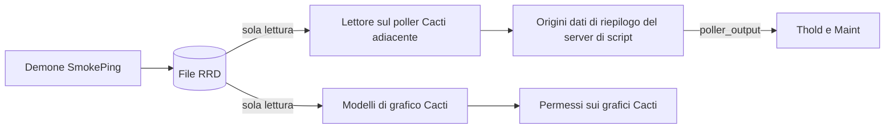

<!-- Source: README.md; SHA256: 17905aa1eac76a7d10dab526734605629fa3d1ada56397642ad4154c5be1feff -->

<!-- translations:start -->
[English](../../../README.md) | [简体中文](../zh-CN/README.md) | [हिन्दी](../hi-IN/README.md) | [Español (España)](../es-ES/README.md) | [Español (Latinoamérica)](../es-419/README.md) | [العربية (السعودية)](../ar-SA/README.md) | [Afrikaans](../af-ZA/README.md) | [አማርኛ](../am-ET/README.md) | [العربية (مصر)](../ar-EG/README.md) | [العربية (المغرب)](../ar-MA/README.md) | [বাংলা](../bn-BD/README.md) | [Deutsch](../de-DE/README.md) | [فارسی](../fa-IR/README.md) | [Filipino](../fil-PH/README.md) | [Français](../fr-FR/README.md) | [Français (Maroc)](../fr-MA/README.md) | [Français (Sénégal)](../fr-SN/README.md) | [Hausa](../ha-NG/README.md) | [עברית](../he-IL/README.md) | [Bahasa Indonesia](../id-ID/README.md) | [Igbo](../ig-NG/README.md) | [Italiano](README.md) | [日本語](../ja-JP/README.md) | [한국어](../ko-KR/README.md) | [Malagasy](../mg-MG/README.md) | [मराठी](../mr-IN/README.md) | [Bahasa Melayu](../ms-MY/README.md) | [Nederlands](../nl-NL/README.md) | [Polski](../pl-PL/README.md) | [Português (Brasil)](../pt-BR/README.md) | [Русский](../ru-RU/README.md) | [Kinyarwanda](../rw-RW/README.md) | [Soomaali](../so-SO/README.md) | [Svenska](../sv-SE/README.md) | [Kiswahili](../sw-KE/README.md) | [தமிழ்](../ta-IN/README.md) | [తెలుగు](../te-IN/README.md) | [ไทย](../th-TH/README.md) | [Türkçe](../tr-TR/README.md) | [Українська](../uk-UA/README.md) | [اردو](../ur-PK/README.md) | [Tiếng Việt](../vi-VN/README.md) | [isiXhosa](../xh-ZA/README.md) | [Yorùbá](../yo-NG/README.md) | [繁體中文](../zh-TW/README.md) | [isiZulu](../zu-ZA/README.md)
<!-- translations:end -->

  <picture>
    <source media="(prefers-color-scheme: dark)" srcset="../../images/logo_dark.png">
    
  </picture>

# Plugin SmokePing per Cacti

Un plugin per Cacti 1.2 che porta le misurazioni di latenza e perdita di pacchetti di SmokePing all'interno di Cacti come dispositivi, origini dati e grafici ordinari. I grafici smoke vengono così posizionati accanto al dispositivo a cui appartengono, sotto il controllo dei permessi di Cacti, e Thold e Maint possono generare avvisi su di essi e sospenderli. Si tratta di un'implementazione indipendente per Cacti e non fa parte né è approvata da [SmokePing](https://oss.oetiker.ch/smokeping/), i cui autori originali sono Tobias Oetiker e Niko Tyni. Il plugin non include né esegue il codice di SmokePing: legge i file di configurazione e i file RRD scritti da SmokePing, e i suoi modelli di grafico sono progettati per tracciare le stesse serie dei grafici nativi di SmokePing.

> **Stato: in fase di sviluppo. La modalità Observe (fase 1) è implementata su `main` e rilasciata come pre-release 1.0.0-rc.1.** Il plugin legge la configurazione e i file RRD di SmokePing, ne mostra lo stato, crea i relativi dispositivi, origini dati e grafici in Cacti e alimenta Thold e Maint. Non scrive nulla verso SmokePing. La modalità Managed (in cui il plugin scrive la configurazione di SmokePing) e i collector remoti appartengono a fasi successive, non ancora avviate e non incluse in questo rilascio. I progetti pilota su installazioni reali e una maggiore aderenza alla legenda dei grafici di SmokePing sono ancora aperti nella milestone 4. Per iniziare, consultare [docs/install.md](../../install.md).

## Ruoli di accesso

| Realm | Accesso |
| --- | --- |
| SmokePing View | Pagine di monitoraggio esistenti. |
| SmokePing Operator | Monitoraggio più la pagina Operations e le prese in carico personali per il triage. |
| SmokePing Admin | Accesso Operator più le pagine di configurazione esistenti e le azioni amministrative. |

Dopo aver copiato i file di aggiornamento, aprire la pagina Plugins come amministratore per registrare
il nuovo realm. Assegnare esplicitamente il realm Operator in **Configuration > Users** o nei gruppi di utenti.
Gli aggiornamenti mantengono gli ID e le autorizzazioni esistenti dei realm View e Admin. L'accesso Admin
eredita l'accesso Operator, e l'accesso Operator eredita l'accesso View a ogni richiesta;
ciò non aggiunge autorizzazioni memorizzate a utenti o gruppi. Anche le impostazioni del plugin richiedono
l'accesso SmokePing Admin in aggiunta al permesso Settings di Cacti.

I permessi sui dispositivi di Cacti continuano a limitare le righe e le azioni disponibili per ciascun utente; gli oggetti non mappati richiedono un amministratore.
Credenziali, configurazione, mappatura, eliminazione e altre modifiche amministrative
restano nelle pagine amministrative. Le prese in carico durano solo nella sessione corrente
dell'utente, per al massimo un'ora e solo finché la stessa osservazione rimane
aggiornata. Osservazioni nuove o modificate le invalidano. Non contrassegnano mai come integra una
misurazione fallita né sopprimono gli avvisi.

## Schermate

Importati da una rete SmokePing 2.8.2 attiva in Cacti 1.2.31, ultime 12 ore. Il dispositivo di ciascun target dispone di un grafico smoke per il master e di uno per ciascuno slave (`lon1`, `sgp1`), archiviato nella rispettiva sezione SmokePing all'interno dell'albero dei grafici.

## Motivazione

SmokePing misura in modo efficace la distribuzione della latenza e la perdita di pacchetti, e i suoi grafici smoke mostrano variazioni che un grafico basato sulla sola media nasconde. Eseguito parallelamente a Cacti, lascia tuttavia tre lacune:

- **Controllo degli accessi separato.** Il CGI di SmokePing non conosce gli utenti, i gruppi o i permessi sui dispositivi di Cacti.
- **Assenza di contesto sul dispositivo.** La latenza e i contatori delle interfacce dello stesso dispositivo risiedono in strumenti diversi.
- **Nessuna integrazione con gli avvisi di Cacti.** Thold e Maint operano su origini dati e dispositivi di Cacti, pertanto gli avvisi di SmokePing vengono configurati e sospesi separatamente.

Il plugin colma queste lacune rappresentando ogni target SmokePing come oggetti di Cacti che puntano ai file RRD esistenti di SmokePing, insieme a un piccolo insieme di valori di riepilogo raccolti tramite polling. Riutilizza i grafici, i permessi, Thold e Maint di Cacti anziché crearne versioni parallele. Il supporto per i collector di dati remoti di Cacti è pianificato per la fase 3 e non è incluso in questo rilascio.

## Ambito e stato

| Fase | Ambito | Milestone | Stato |
|---|---|---|---|
| 0, ricerca | Matrice di compatibilità, conferma del comportamento upstream, studio sulla fedeltà dei grafici | [M1](https://github.com/somethingwithproof/plugin_smokeping/milestone/1) | Risultati in `docs/research`; alcune issue di ricerca sono ancora aperte |
| 1, observe | Importazione dell'inventario, dispositivi Cacti, grafici smoke e di riepilogo, avvisi Thold, sospensione Maint, pagina di stato | [M2](https://github.com/somethingwithproof/plugin_smokeping/milestone/2), [M3](https://github.com/somethingwithproof/plugin_smokeping/milestone/3), [M4](https://github.com/somethingwithproof/plugin_smokeping/milestone/4) | Rilasciata come 1.0.0-rc.1; progetti pilota aperti |
| 2, managed | Namespace di configurazione gestito da Cacti, profili di probe ICMP e TCP, revisioni, convalida, ricaricamento, rollback | [M5](https://github.com/somethingwithproof/plugin_smokeping/milestone/5) | Pianificata, non avviata |
| 3, remote | SmokePing su collector di dati remoti di Cacti, slave come sedi di misurazione | [M6](https://github.com/somethingwithproof/plugin_smokeping/milestone/6) | Pianificata, non avviata |

Fuori ambito: un motore di avvisi proprio del plugin, un motore di reportistica, un demone o protocollo di rete personalizzato, controlli HTTP/DNS/di servizio gestiti (coperti da servcheck) e la scrittura sui file RRD di SmokePing.

## Requisiti di compatibilità

| Componente | Target |
|---|---|
| Cacti | 1.2.31 o successivo nella serie 1.2.x, nessuna patch al core |
| PHP | 8.2 o successivo; `setup.php` resta analizzabile su 8.0 in modo che un runtime non supportato riceva un rifiuto esplicito anziché compromettere l'interfaccia utente di Cacti |
| SmokePing | 2.9.0, 2.8.2 e 2.7.3 (solo Ubuntu 22.04, fino al 2027-06-01) |
| Thold, Maint | Nessuna modifica richiesta |
| Serie | 10.000 per installazione con 20 ping e un intervallo (step) di 300 s ([prestazioni](../../performance.md#supported-series-count)) |

## Documentazione

| | |
|---|---|
| [Installazione](../../install.md) | Requisiti, montaggio in sola lettura della directory dei dati di SmokePing, installazione, container, versioni supportate |
| [Operatività](../../operations.md) | Significato di ciascuno stato ed evidenze correlate, controlli di integrità, comportamento in caso di errori negli input |
| [Aggiunta di target a Cacti](../../provisioning.md) | Un target, molti dispositivi, ricollegamento, permessi |
| [Avvisi](../../alerting.md) | Valori di riepilogo, durate Thold, dati obsoleti, dati in ritardo, sovrapposizione con gli avvisi di SmokePing, Maint |
| [Formato di configurazione](../../configuration-format.md) | Esportazione e importazione YAML e XML |
| [Backup e ripristino](../../backup-restore.md) | Cosa sottoporre a backup e modalità di ripresa dopo un ripristino |
| [Prestazioni](../../performance.md) | Misurazioni locali e su runner di rilascio a 100, 1.000 e 10.000 serie e numero di serie supportato: 10.000 per installazione |
| [Qualificazione dei guasti](../../failure-qualification.md) | Scenari di guasto e modalità di test per ciascuno di essi |
| [Rilascio](../../RELEASING.md) | Procedura di rilascio: la pull request, il tag firmato, le operazioni del workflow, la verifica del risultato |
| [Archivio dei rilasci](../../release.md) | Versione, changelog e archivio dei rilasci |
| [Test](../../testing.md) | Le suite di test, cosa esegue la CI e la suite live contro un'istanza SmokePing reale |

## Progettazione

- [docs/PLAN.md](../../PLAN.md) è il piano completo: architettura, fatti upstream da cui dipende (con relative fonti), modello di stato, confini di sicurezza, calcolo delle prestazioni, test e rischi.
- [docs/decisions/](../../decisions) contiene gli architecture decision record per le scelte già effettuate.
- [docs/REQUIREMENTS.md](../../REQUIREMENTS.md) associa ogni ID requisito alla rispettiva issue.

## Tracciamento del lavoro

- **Milestone**: seguono le milestone del piano. Ciascuna dispone di una issue epica che elenca le relative sotto-issue e le evidenze di chiusura.
- **Issue**: sono classificate tramite etichette: `type: requirement`, `type: research`, `type: decision`, `type: epic`. Le issue dei requisiti definiscono requisiti numerati e verificabili (`REQ-AREA-NNN`) e criteri di accettazione.
- **Etichette**: includono anche `area:`, `phase:`, `priority:` e `status:`. Consultare [CONTRIBUTING.md](../../../CONTRIBUTING.md#labels).
- La [bacheca di progetto](https://github.com/users/somethingwithproof/projects/6) mostra tutte le issue suddivise per milestone.

## Come contribuire

Leggere [CONTRIBUTING.md](../../../CONTRIBUTING.md). I commit richiedono la firma DCO (sign-off). La discussione progettuale avviene sulle issue; le decisioni aperte riportano l'etichetta `type: decision`.

## Sicurezza

Segnalare le vulnerabilità privatamente; consultare [SECURITY.md](../../../SECURITY.md).

## Licenza

GNU General Public License v2.0, la stessa licenza di Cacti e dei suoi plugin. Consultare [LICENSE](../../../LICENSE).
