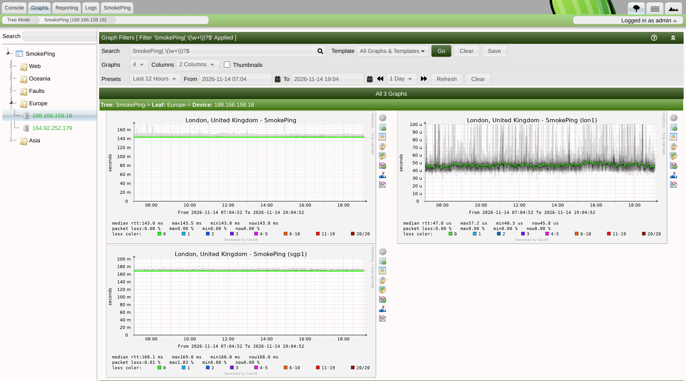
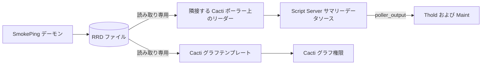

<!-- Source: README.md; SHA256: 17905aa1eac76a7d10dab526734605629fa3d1ada56397642ad4154c5be1feff -->

<!-- translations:start -->
[English](../../../README.md) | [简体中文](../zh-CN/README.md) | [हिन्दी](../hi-IN/README.md) | [Español (España)](../es-ES/README.md) | [Español (Latinoamérica)](../es-419/README.md) | [العربية (السعودية)](../ar-SA/README.md) | [Afrikaans](../af-ZA/README.md) | [አማርኛ](../am-ET/README.md) | [العربية (مصر)](../ar-EG/README.md) | [العربية (المغرب)](../ar-MA/README.md) | [বাংলা](../bn-BD/README.md) | [Bosanski](../bs-BA/README.md) | [Deutsch](../de-DE/README.md) | [فارسی](../fa-IR/README.md) | [Filipino](../fil-PH/README.md) | [Français](../fr-FR/README.md) | [Français (Maroc)](../fr-MA/README.md) | [Français (Sénégal)](../fr-SN/README.md) | [Hausa](../ha-NG/README.md) | [עברית](../he-IL/README.md) | [Hrvatski](../hr-HR/README.md) | [Bahasa Indonesia](../id-ID/README.md) | [Igbo](../ig-NG/README.md) | [Italiano](../it-IT/README.md) | [日本語](README.md) | [한국어](../ko-KR/README.md) | [Malagasy](../mg-MG/README.md) | [मराठी](../mr-IN/README.md) | [Bahasa Melayu](../ms-MY/README.md) | [Nederlands](../nl-NL/README.md) | [Polski](../pl-PL/README.md) | [Português (Brasil)](../pt-BR/README.md) | [Русский](../ru-RU/README.md) | [Kinyarwanda](../rw-RW/README.md) | [Soomaali](../so-SO/README.md) | [Српски](../sr-RS/README.md) | [Svenska](../sv-SE/README.md) | [Kiswahili](../sw-KE/README.md) | [தமிழ்](../ta-IN/README.md) | [తెలుగు](../te-IN/README.md) | [ไทย](../th-TH/README.md) | [Türkçe](../tr-TR/README.md) | [Українська](../uk-UA/README.md) | [اردو](../ur-PK/README.md) | [Tiếng Việt](../vi-VN/README.md) | [isiXhosa](../xh-ZA/README.md) | [Yorùbá](../yo-NG/README.md) | [繁體中文](../zh-TW/README.md) | [isiZulu](../zu-ZA/README.md)
<!-- translations:end -->

  <picture>
    <source media="(prefers-color-scheme: dark)" srcset="../../images/logo_dark.png">
    
  </picture>

# Cacti 用 SmokePing プラグイン

SmokePing のレイテンシおよびパケットロス計測結果を、通常のデバイス、データソース、およびグラフとして Cacti に取り込む Cacti 1.2 プラグインです。スモークグラフは対象デバイスの隣に配置され、Cacti の権限管理下に置かれるため、Thold によるアラート発報や Maint によるアラート抑制が可能になります。本プラグインは Cacti 向けの独立した実装であり、[SmokePing](https://oss.oetiker.ch/smokeping/)（原著者：Tobias Oetiker および Niko Tyni）の一部ではなく、公式に承認されたものでもありません。本プラグインには SmokePing のコードは含まれておらず、実行もしません。SmokePing が出力する設定ファイルと RRD ファイルを読み取り、グラフテンプレートは SmokePing 独自のグラフと同じ系列を描画するように構築されています。

> **ステータス：開発中。Observe モード（フェーズ 1）は `main` に実装済みで、プレリリース 1.0.0-rc.1 としてリリースされています。** 本プラグインは SmokePing の設定ファイルおよび RRD ファイルを読み取り、その状態を表示し、対応する Cacti デバイス・データソース・グラフを作成して、Thold および Maint にデータを提供します。SmokePing 側には一切書き込みを行いません。Managed モード（プラグインから SmokePing 設定を書き込む機能）およびリモートコレクターは後続のフェーズであり、未着手で本リリースには含まれていません。実環境でのパイロット運用および SmokePing グラフ凡例とのさらなる一致については、マイルストーン 4 で引き続き対応中です。開始するには [docs/install.md](../../install.md) をご覧ください。

## アクセスロール

| レルム | アクセス権限 |
| --- | --- |
| SmokePing View | 既存の監視ページ。 |
| SmokePing Operator | 監視ページに加え、Operations ページおよび個人単位のトリアージ確認応答（acknowledgment）。 |
| SmokePing Admin | Operator の権限に加え、既存の設定変更および管理操作。 |

アップグレード用ファイルをコピーした後、管理者として Plugins ページを開き、新しいレルムを登録してください。Operator レルムは **Configuration > Users** またはユーザーグループから明示的に割り当てます。アップグレード時は既存の View および Admin のレルム ID と付与権限が保持されます。Admin アクセスはリクエストごとに Operator アクセスを継承し、Operator アクセスは View アクセスを継承します。これによりユーザーやグループに保存済みの権限付与が追加されることはありません。また、プラグイン設定には Cacti の Settings 権限に加えて SmokePing Admin アクセスが必要です。

各ユーザーが利用できる行と操作は、引き続き Cacti のデバイス権限によって制限されます。未マッピングのオブジェクトには管理者権限が必要です。認証情報、設定、マッピング、削除、その他の管理上の変更は管理ページ内にとどまります。確認応答（acknowledgment）は現在のユーザーセッション内でのみ有効で、最大 1 時間、かつ同一の観測結果が最新（fresh）である間だけ維持されます。新しい観測結果や変更された観測結果があると無効化されます。確認応答によって、失敗した計測が正常とみなされたり、アラートが抑制されたりすることはありません。

## スクリーンショット

実際の SmokePing 2.8.2 ネットワークから Cacti 1.2.31 に取り込んだ直近 12 時間の表示例です。各ターゲットのデバイスには、マスター用と各スレーブ（`lon1`、`sgp1`）用のスモークグラフが作成され、グラフツリー内の対応する SmokePing セクション配下に登録されます。

## 開発の背景

SmokePing はレイテンシ分布とパケットロスを正確に計測し、そのスモークグラフは平均値のみのグラフでは隠れてしまうばらつきを可視化します。しかし Cacti と並べて運用する場合、次の 3 つのギャップが生じます。

- **アクセス制御の分離。** SmokePing の CGI は Cacti のユーザー、グループ、デバイス権限を一切認識しません。
- **デバイスコンテキストの欠如。** 同一デバイスのレイテンシとインターフェースカウンタが別々のツールに分散します。
- **Cacti アラートへの連携手段がない。** Thold と Maint は Cacti のデータソースおよびデバイスに対して動作するため、SmokePing のアラートは別途設定・抑制する必要があります。

本プラグインは、SmokePing の既存 RRD ファイルを参照する Cacti オブジェクトおよび少数のポーリング済みサマリー値として各 SmokePing ターゲットを表現することで、これらのギャップを解消します。並行する独自機能を構築するのではなく、Cacti のグラフ描画、権限管理、Thold、および Maint を再利用します。Cacti リモートデータコレクターのサポートはフェーズ 3 で計画されており、本リリースには含まれていません。

## スコープとステータス

| フェーズ | スコープ | マイルストーン | ステータス |
|---|---|---|---|
| 0, research | 互換性マトリクス、アップストリームの挙動確認、グラフ再現性の検証スパイク | [M1](https://github.com/somethingwithproof/plugin_smokeping/milestone/1) | 調査結果は `docs/research` に収録。一部のリサーチ課題は対応中 |
| 1, observe | インベントリインポート、Cacti デバイス、スモーク／サマリーグラフ、Thold アラート、Maint 抑制、ヘルスページ | [M2](https://github.com/somethingwithproof/plugin_smokeping/milestone/2), [M3](https://github.com/somethingwithproof/plugin_smokeping/milestone/3), [M4](https://github.com/somethingwithproof/plugin_smokeping/milestone/4) | 1.0.0-rc.1 としてリリース済み。パイロット運用受付中 |
| 2, managed | Cacti 管理下の設定名前空間、ICMP および TCP プローブプロファイル、リビジョン、検証、リロード、ロールバック | [M5](https://github.com/somethingwithproof/plugin_smokeping/milestone/5) | 計画中（未着手） |
| 3, remote | Cacti リモートデータコレクター上での SmokePing、計測拠点としてのスレーブ対応 | [M6](https://github.com/somethingwithproof/plugin_smokeping/milestone/6) | 計画中（未着手） |

スコープ外：プラグイン独自のアラートエンジン、レポートエンジン、カスタムデーモンまたはネットワークプロトコル、マネージド HTTP/DNS/サービスチェック（servcheck が担当）、および SmokePing の RRD ファイルへの書き込み。

## 互換性ターゲット

| コンポーネント | ターゲット |
|---|---|
| Cacti | 1.2.x 系列の 1.2.31 以降（コアパッチ不要） |
| PHP | 8.2 以降。未サポート環境で Cacti UI を破損させずに拒否できるよう、`setup.php` は PHP 8.0 でも構文解析可能に維持 |
| SmokePing | 2.9.0、2.8.2、および 2.7.3（Ubuntu 22.04 のみ、2027-06-01 まで） |
| Thold, Maint | 変更不要 |
| 系列数 | 1 インストールあたり 10,000 系列（20 ping、300 秒ステップ時）（[パフォーマンス](../../performance.md#supported-series-count)） |

## ドキュメント

| | |
|---|---|
| [インストール](../../install.md) | 要件、SmokePing データディレクトリの読み取り専用マウント、インストール手順、コンテナ、サポートバージョン |
| [運用](../../operations.md) | 各状態の意味と根拠、ヘルスチェック、入力障害時の動作 |
| [Cacti へのターゲット追加](../../provisioning.md) | 1 ターゲットから複数デバイスへの展開、再リンク、権限 |
| [アラート](../../alerting.md) | サマリー値、Thold の継続時間、鮮度切れ（staleness）、遅延データ、SmokePing アラートとの重複、Maint |
| [設定フォーマット](../../configuration-format.md) | YAML および XML のエクスポート／インポート |
| [バックアップとリストア](../../backup-restore.md) | バックアップ対象とリストア後の再開方法 |
| [パフォーマンス](../../performance.md) | 100、1,000、10,000 系列でのローカルおよびリリースランナー計測結果、ならびにサポート系列数（1 インストールあたり 10,000） |
| [障害適格性検証](../../failure-qualification.md) | 障害シナリオと各テスト手法 |
| [リリース手順](../../RELEASING.md) | リリースプロセス：プルリクエスト、署名付きタグ、ワークフローの処理内容、結果の検証方法 |
| [リリースアーカイブ](../../release.md) | バージョン、変更履歴、リリースアーカイブ |
| [テスト](../../testing.md) | テストスイート、CI 実行内容、実際の SmokePing に対するライブテストスイート |

## 設計

- [docs/PLAN.md](../../PLAN.md) は全体計画書です。アーキテクチャ、前提とするアップストリーム仕様（出典付き）、状態モデル、セキュリティ境界、パフォーマンス計算、テスト、およびリスクを記載しています。
- [docs/decisions/](../../decisions) には、決定済みのアーキテクチャ決定記録（ADR）を格納しています。
- [docs/REQUIREMENTS.md](../../REQUIREMENTS.md) は、各要件 ID と対応する Issue を対応付けています。

## 作業の管理方法

- **マイルストーン** は計画書のマイルストーンに準拠しています。各マイルストーンには、サブ Issue と完了エビデンスをまとめたエピック Issue があります。
- **Issue** はラベルで種別分けされています：`type: requirement`、`type: research`、`type: decision`、`type: epic`。要件 Issue には番号付きのテスト可能な要件（`REQ-AREA-NNN`）と受け入れ基準が記載されています。
- **ラベル** には `area:`、`phase:`、`priority:`、および `status:` も付与されます。詳細は [CONTRIBUTING.md](../../../CONTRIBUTING.md#labels) をご覧ください。
- [プロジェクトボード](https://github.com/users/somethingwithproof/projects/6) では、全マイルストーンにわたるすべての Issue を確認できます。

## コントリビューション

[CONTRIBUTING.md](../../../CONTRIBUTING.md) をお読みください。コミットには DCO サインオフが必要です。設計に関する議論は Issue 上で行われ、未決の決定事項には `type: decision` ラベルが付与されます。

## セキュリティ

脆弱性は非公開で報告してください。詳細は [SECURITY.md](../../../SECURITY.md) をご覧ください。

## ライセンス

Cacti およびそのプラグインと同じ GNU General Public License v2.0 です。詳細は [LICENSE](../../../LICENSE) をご覧ください。
