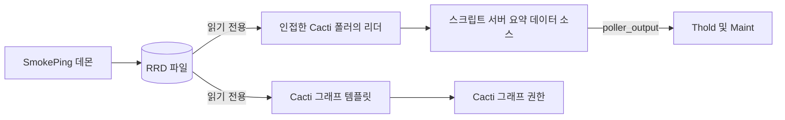

<!-- Source: README.md; SHA256: b41ec705327127cc34ff07d1514a141262752f99c5e2296fdc323d584a777b84 -->

<!-- translations:start -->
[English](../../../README.md) | [简体中文](../zh-CN/README.md) | [हिन्दी](../hi-IN/README.md) | [Español (España)](../es-ES/README.md) | [Español (Latinoamérica)](../es-419/README.md) | [العربية (السعودية)](../ar-SA/README.md) | [Afrikaans](../af-ZA/README.md) | [አማርኛ](../am-ET/README.md) | [العربية (مصر)](../ar-EG/README.md) | [العربية (المغرب)](../ar-MA/README.md) | [বাংলা](../bn-BD/README.md) | [Bosanski](../bs-BA/README.md) | [Deutsch](../de-DE/README.md) | [فارسی](../fa-IR/README.md) | [Filipino](../fil-PH/README.md) | [Français](../fr-FR/README.md) | [Français (Maroc)](../fr-MA/README.md) | [Français (Sénégal)](../fr-SN/README.md) | [Hausa](../ha-NG/README.md) | [עברית](../he-IL/README.md) | [Hrvatski](../hr-HR/README.md) | [Bahasa Indonesia](../id-ID/README.md) | [Igbo](../ig-NG/README.md) | [Italiano](../it-IT/README.md) | [日本語](../ja-JP/README.md) | [한국어](README.md) | [Malagasy](../mg-MG/README.md) | [मराठी](../mr-IN/README.md) | [Bahasa Melayu](../ms-MY/README.md) | [Nederlands](../nl-NL/README.md) | [Polski](../pl-PL/README.md) | [Português (Brasil)](../pt-BR/README.md) | [Русский](../ru-RU/README.md) | [Kinyarwanda](../rw-RW/README.md) | [Soomaali](../so-SO/README.md) | [Српски](../sr-RS/README.md) | [Svenska](../sv-SE/README.md) | [Kiswahili](../sw-KE/README.md) | [தமிழ்](../ta-IN/README.md) | [తెలుగు](../te-IN/README.md) | [ไทย](../th-TH/README.md) | [Türkçe](../tr-TR/README.md) | [Українська](../uk-UA/README.md) | [اردو](../ur-PK/README.md) | [Tiếng Việt](../vi-VN/README.md) | [isiXhosa](../xh-ZA/README.md) | [Yorùbá](../yo-NG/README.md) | [繁體中文](../zh-TW/README.md) | [isiZulu](../zu-ZA/README.md)
<!-- translations:end -->

  <picture>
    <source media="(prefers-color-scheme: dark)" srcset="../../images/logo_dark.png">
    
  </picture>

# Cacti용 SmokePing 플러그인

SmokePing의 지연 시간(latency) 및 손실률(packet loss) 측정값을 일반 디바이스, 데이터 소스, 그래프로 Cacti에 가져오는 Cacti 1.2 플러그인입니다. Smoke 그래프는 해당 디바이스 옆에 배치되어 Cacti의 권한 체계 아래에서 관리되며, Thold와 Maint가 이를 기반으로 알림을 보내고 억제(suppress)할 수 있습니다. 이 플러그인은 Cacti를 위한 독립적인 구현체이며, Tobias Oetiker와 Niko Tyni가 원저자인 [SmokePing](https://oss.oetiker.ch/smokeping/)의 일부이거나 그로부터 공식 보증을 받은 것이 아닙니다. 이 플러그인은 SmokePing의 코드를 포함하거나 실행하지 않으며, SmokePing이 작성한 구성 파일과 RRD 파일을 읽기만 합니다. 또한 그래프 템플릿은 SmokePing 자체 그래프와 동일한 시리즈를 그리도록 구성되어 있습니다.

> **상태: 개발 중입니다. Observe 모드(1단계)가 `main` 브랜치에 구현되었으며 1.0.0-rc.1 프리릴리스로 배포되었습니다.** 이 플러그인은 SmokePing의 구성과 RRD 파일을 읽어 상태를 표시하고, 이를 위한 Cacti 디바이스, 데이터 소스, 그래프를 생성하며, Thold와 Maint에 데이터를 제공합니다. SmokePing 쪽에는 아무것도 쓰지 않습니다. Managed 모드(플러그인이 SmokePing 구성을 작성하는 기능)와 원격 수집기(remote collectors)는 이후 단계의 기능으로, 아직 시작되지 않았으며 이번 릴리스에는 포함되지 않습니다. 실제 운영 환경에서의 파일럿 테스트와 SmokePing 그래프 범례와의 일치도 개선 작업은 마일스톤 4에서 계속 진행 중입니다. 시작하려면 [docs/install.md](../../install.md)를 참조하세요.

## 접근 역할

| 영역(Realm) | 접근 권한 |
| --- | --- |
| SmokePing View | 기존 모니터링 페이지에 접근할 수 있습니다. |
| SmokePing Operator | 모니터링 페이지와 함께 Operations 페이지 및 개인별 분류 확인(triage acknowledgment) 기능을 사용할 수 있습니다. |
| SmokePing Admin | Operator 권한과 함께 기존 구성 및 관리 작업에 접근할 수 있습니다. |

업그레이드 파일을 복사한 후 관리자로 Plugins 페이지를 열어 새 영역(realm)을 등록하세요.
**Configuration > Users** 또는 사용자 그룹에서 Operator 영역을 명시적으로 할당하세요.
업그레이드 시 기존 View 및 Admin 영역의 ID와 부여된 권한은 유지됩니다. 각 요청 시 Admin 권한은
Operator 권한을 상속받고, Operator 권한은 View 권한을 상속받습니다.
이때 사용자나 그룹에 저장된 권한 항목이 추가로 생성되지는 않습니다. 플러그인 설정을 변경하려면
Cacti의 Settings 권한 외에 SmokePing Admin 권한도 필요합니다.

Cacti 디바이스 권한은 여전히 각 사용자가 볼 수 있는 행과 수행할 수 있는 작업을 제한하며, 매핑되지 않은 객체는 관리자가 필요합니다.
자격 증명, 구성, 매핑, 삭제 및 기타 관리 변경 사항은
관리 페이지에 그대로 유지됩니다. 확인(acknowledgment) 상태는 현재 사용자의
세션 동안만 유지되며, 최대 1시간까지만 그리고 동일한 관측 데이터가 유효한(fresh) 동안만
유지됩니다. 새 관측 데이터가 들어오거나 변경되면 확인 상태는 무효화됩니다. 확인 처리가 실패한
측정값을 정상으로 표시하거나 알림을 억제하지는 않습니다.

## 스크린샷

실제 SmokePing 2.8.2 네트워크에서 Cacti 1.2.31로 가져온 최근 12시간 데이터입니다. 각 대상의 디바이스에는 마스터용 Smoke 그래프 1개와 각 슬레이브(`lon1`, `sgp1`)용 Smoke 그래프가 1개씩 있으며, 그래프 트리의 해당 SmokePing 섹션 아래에 분류되어 있습니다.

## 도입 배경

SmokePing은 지연 시간 분포와 패킷 손실을 효과적으로 측정하며, Smoke 그래프는 평균값만 표시하는 그래프에서는 드러나지 않는 변동성을 보여줍니다. 하지만 Cacti와 나란히 운영할 경우 세 가지 공백이 발생합니다.

- **분리된 접근 제어.** SmokePing의 CGI는 Cacti의 사용자, 그룹 또는 디바이스 권한을 전혀 알지 못합니다.
- **디바이스 컨텍스트 부재.** 동일한 디바이스의 지연 시간과 인터페이스 카운터가 서로 다른 도구에 흩어져 있습니다.
- **Cacti 알림 연동 경로 부재.** Thold와 Maint는 Cacti 데이터 소스와 디바이스를 대상으로 동작하므로, SmokePing 알림을 별도로 구성하고 억제해야 합니다.

이 플러그인은 소수의 폴링된 요약값과 함께 SmokePing의 기존 RRD 파일을 가리키는 Cacti 객체로 각 SmokePing 대상을 표현함으로써 이러한 공백을 메웁니다. 별도의 병렬 시스템을 구축하는 대신 Cacti의 그래프, 권한 체계, Thold, Maint를 그대로 재사용합니다. Cacti 원격 데이터 수집기 지원은 3단계에 계획되어 있으며 이번 릴리스에는 포함되지 않습니다.

## 범위 및 상태

| 단계 | 범위 | 마일스톤 | 상태 |
|---|---|---|---|
| 0, 리서치 | 호환성 매트릭스, 업스트림 동작 확인, 그래프 재현도 검증 | [M1](https://github.com/somethingwithproof/plugin_smokeping/milestone/1) | 조사 결과가 `docs/research`에 정리되어 있으며 일부 리서치 이슈가 열려 있습니다 |
| 1, observe | 인벤토리 가져오기, Cacti 디바이스, Smoke 및 요약 그래프, Thold 알림, Maint 억제, 상태(health) 페이지 | [M2](https://github.com/somethingwithproof/plugin_smokeping/milestone/2), [M3](https://github.com/somethingwithproof/plugin_smokeping/milestone/3), [M4](https://github.com/somethingwithproof/plugin_smokeping/milestone/4) | 1.0.0-rc.1로 릴리스됨; 파일럿 테스트 진행 중 |
| 2, managed | Cacti가 소유하는 구성 네임스페이스, ICMP 및 TCP 프로브 프로필, 리비전, 검증, 리로드, 롤백 | [M5](https://github.com/somethingwithproof/plugin_smokeping/milestone/5) | 계획됨, 미착수 |
| 3, remote | Cacti 원격 데이터 수집기에서의 SmokePing 실행, 측정 위치로서의 슬레이브 | [M6](https://github.com/somethingwithproof/plugin_smokeping/milestone/6) | 계획됨, 미착수 |

범위 제외: 플러그인 자체 알림 엔진, 리포팅 엔진, 커스텀 데몬이나 네트워크 프로토콜, 관리형 HTTP/DNS/서비스 점검(servcheck가 담당), SmokePing RRD 파일에 대한 쓰기 작업.

## 호환성 대상

| 구성 요소 | 대상 버전/기준 |
|---|---|
| Cacti | 1.2.x 계열 1.2.31 이상, 코어 패치 불필요 |
| PHP | 8.2 이상; 지원되지 않는 런타임에서 Cacti UI가 깨지는 대신 거부 메시지를 표시하도록 `setup.php`는 PHP 8.0에서도 파싱 가능하게 유지됩니다 |
| SmokePing | 2.9.0, 2.8.2 및 2.7.3 (Ubuntu 22.04 전용, 2027-06-01까지) |
| Thold, Maint | 변경 불필요 |
| 시리즈 수 | 20회 핑 및 300초 스텝 기준 설치당 10,000개 ([성능](../../performance.md#supported-series-count)) |

## 문서

| | |
|---|---|
| [설치](../../install.md) | 요구 사항, SmokePing 데이터 디렉터리의 읽기 전용 마운트, 설치 방법, 컨테이너, 지원 버전 |
| [운영](../../operations.md) | 각 상태의 의미와 근거, 상태 점검(health check), 입력 실패 시 동작 |
| [Cacti에 대상 추가](../../provisioning.md) | 단일 대상, 다중 디바이스, 재연결, 권한 |
| [알림](../../alerting.md) | 요약값, Thold 지속 시간, 데이터 노후화(staleness), 지연 데이터, SmokePing 알림과의 중복, Maint |
| [구성 형식](../../configuration-format.md) | YAML 및 XML 내보내기 및 가져오기 |
| [백업 및 복원](../../backup-restore.md) | 백업 대상 및 복원 후 재개 방식 |
| [성능](../../performance.md) | 100, 1,000, 10,000 시리즈 기준 로컬 및 릴리스 러너 측정치와 지원 시리즈 수(설치당 10,000개) |
| [장애 검증](../../failure-qualification.md) | 장애 시나리오 및 각 시나리오의 테스트 방법 |
| [릴리스](../../RELEASING.md) | 릴리스 절차: Pull Request, 서명된 태그, 워크플로 동작, 결과 검증 방법 |
| [릴리스 아카이브](../../release.md) | 버전, 변경 로그 및 릴리스 아카이브 |
| [테스트](../../testing.md) | 테스트 스위트, CI 실행 항목 및 실제 SmokePing을 대상으로 하는 라이브 스위트 |

## 설계

- [docs/PLAN.md](../../PLAN.md)에는 전체 계획이 담겨 있습니다: 아키텍처, 의존하는 업스트림 사실(출처 포함), 상태 모델, 보안 경계, 성능 계산, 테스트 및 위험 요소.
- [docs/decisions/](../../decisions)에는 이미 내린 아키텍처 결정 기록(ADR)이 보관되어 있습니다.
- [docs/REQUIREMENTS.md](../../REQUIREMENTS.md)는 모든 요구 사항 ID를 해당 이슈에 매핑합니다.

## 작업 추적 방식

- **마일스톤**은 계획의 마일스톤을 따릅니다. 각 마일스톤에는 하위 이슈와 종료 근거를 나열한 에픽 이슈가 있습니다.
- **이슈**는 레이블로 유형이 구분됩니다: `type: requirement`, `type: research`, `type: decision`, `type: epic`. 요구 사항 이슈에는 번호가 매겨진 테스트 가능한 요구 사항(`REQ-AREA-NNN`)과 수락 기준이 명시됩니다.
- **레이블**에는 `area:`, `phase:`, `priority:`, `status:`도 포함됩니다. 자세한 내용은 [CONTRIBUTING.md](../../../CONTRIBUTING.md#labels)를 참조하세요.
- [프로젝트 보드](https://github.com/users/somethingwithproof/projects/6)에서 모든 마일스톤의 이슈를 확인할 수 있습니다.

## 기여

[CONTRIBUTING.md](../../../CONTRIBUTING.md)를 읽어보세요. 커밋에는 DCO 서명(sign-off)이 필요합니다. 설계 논의는 이슈에서 진행되며, 미결정 사안에는 `type: decision` 레이블이 붙습니다.

## 보안

취약점은 비공개로 제보해 주세요. 자세한 내용은 [SECURITY.md](../../../SECURITY.md)를 참조하세요.

## 라이선스

Cacti 및 해당 플러그인과 동일한 라이선스인 GNU General Public License v2.0을 따릅니다. [LICENSE](../../../LICENSE)를 참조하세요.
