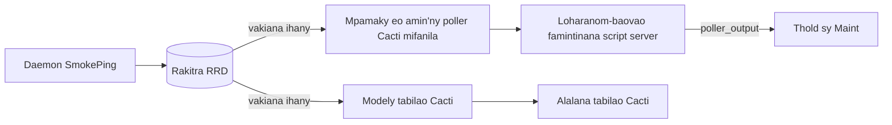

<!-- Source: README.md; SHA256: 17905aa1eac76a7d10dab526734605629fa3d1ada56397642ad4154c5be1feff -->

<!-- translations:start -->
[English](../../../README.md) | [简体中文](../zh-CN/README.md) | [हिन्दी](../hi-IN/README.md) | [Español (España)](../es-ES/README.md) | [Español (Latinoamérica)](../es-419/README.md) | [العربية (السعودية)](../ar-SA/README.md) | [Afrikaans](../af-ZA/README.md) | [አማርኛ](../am-ET/README.md) | [العربية (مصر)](../ar-EG/README.md) | [العربية (المغرب)](../ar-MA/README.md) | [বাংলা](../bn-BD/README.md) | [Bosanski](../bs-BA/README.md) | [Deutsch](../de-DE/README.md) | [فارسی](../fa-IR/README.md) | [Filipino](../fil-PH/README.md) | [Français](../fr-FR/README.md) | [Français (Maroc)](../fr-MA/README.md) | [Français (Sénégal)](../fr-SN/README.md) | [Hausa](../ha-NG/README.md) | [עברית](../he-IL/README.md) | [Hrvatski](../hr-HR/README.md) | [Bahasa Indonesia](../id-ID/README.md) | [Igbo](../ig-NG/README.md) | [Italiano](../it-IT/README.md) | [日本語](../ja-JP/README.md) | [한국어](../ko-KR/README.md) | [Malagasy](README.md) | [मराठी](../mr-IN/README.md) | [Bahasa Melayu](../ms-MY/README.md) | [Nederlands](../nl-NL/README.md) | [Polski](../pl-PL/README.md) | [Português (Brasil)](../pt-BR/README.md) | [Русский](../ru-RU/README.md) | [Kinyarwanda](../rw-RW/README.md) | [Soomaali](../so-SO/README.md) | [Српски](../sr-RS/README.md) | [Svenska](../sv-SE/README.md) | [Kiswahili](../sw-KE/README.md) | [தமிழ்](../ta-IN/README.md) | [తెలుగు](../te-IN/README.md) | [ไทย](../th-TH/README.md) | [Türkçe](../tr-TR/README.md) | [Українська](../uk-UA/README.md) | [اردو](../ur-PK/README.md) | [Tiếng Việt](../vi-VN/README.md) | [isiXhosa](../xh-ZA/README.md) | [Yorùbá](../yo-NG/README.md) | [繁體中文](../zh-TW/README.md) | [isiZulu](../zu-ZA/README.md)
<!-- translations:end -->

  <picture>
    <source media="(prefers-color-scheme: dark)" srcset="../../images/logo_dark.png">
    
  </picture>

# Plugin SmokePing ho an'ny Cacti

Plugin Cacti 1.2 izay mitondra ny fandrefesana ny fahatarana (latency) sy ny fahaverezan'ny fonosana (loss) avy amin'ny SmokePing ho ao amin'ny Cacti amin'ny endrika fitaovana (devices), loharanom-baovao (data sources), ary tabilao (graphs) mahazatra. Ny tabilaon'ny SmokePing avy eo dia mipetraka eo anilan'ny fitaovana tompony, eo ambany fifehezan'ny alalan'ny Cacti, ary afaka mandefa fampandrenesana na manakana izany ny Thold sy ny Maint. Fampiharana mahaleo tena ho an'ny Cacti ity ary tsy anisan'ny [SmokePing](https://oss.oetiker.ch/smokeping/) sady tsy ankatoaviny; i Tobias Oetiker sy i Niko Tyni no mpanoratra tany am-boalohany an'ny SmokePing. Tsy mampiditra na mandefa ny kaodin'ny SmokePing ity plugin ity: mamaky ny fikirakirana sy ny rakitra RRD soratan'ny SmokePing izy, ary namboarina mba hanoritra ny andiam-baovao mitovy amin'ny tabilaon'ny SmokePing ihany ny modely tabilaony.

> **Sata: eo am-panamboarana. Ny fomba fandinihana (Observe mode, dingana 1) dia efa voapetraka ao amin'ny `main` ary navoaka ho kinova savaranonando 1.0.0-rc.1.** Mamaky ny fikirakirana sy ny rakitra RRD an'ny SmokePing ny plugin, mampiseho ny satany, mamorona fitaovana, loharanom-baovao ary tabilao ao amin'ny Cacti ho azy ireo, ary mamahana ny Thold sy ny Maint. Tsy manoratra na inona na inona ao amin'ny SmokePing izy. Ny fomba fitantanana (Managed mode: ny plugin no manoratra ny fikirakirana SmokePing) sy ny mpangonina lavitra (remote collectors) dia dingana manaraka, mbola tsy natomboka, ary tsy tafiditra ao anatin'ity famoahana ity. Mbola misokatra ao amin'ny dingana faha-4 (milestone 4) ny fanandramana amin'ny fametrahana tena izy sy ny fampitoviana akaiky kokoa ny famantarana amin'ny tabilaon'ny SmokePing. Jereo ny [docs/install.md](../../install.md) hanombohana.

## Anjara asa sy alalana

| Sehatra (Realm) | Alalana |
| --- | --- |
| SmokePing View | Pejy fanaraha-maso efa misy. |
| SmokePing Operator | Fanaraha-maso miampy ny pejy Fampiasana (Operations) sy fanekena manokana momba ny fanasokajiana olana (triage acknowledgments). |
| SmokePing Admin | Alalan'ny Operator miampy ny fikirakirana efa misy sy ny hetsika fitantanana. |

Rehefa avy mandika ny rakitra fanavaozana, sokafy ny pejy Plugins amin'ny maha-mpitantana anao mba hisoratra anarana ny sehatra (realm) vaovao. Omeo mazava tsara ao amin'ny **Configuration > Users** na amin'ny vondron'ny mpampiasa ny sehatra Operator. Ny fanavaozana dia mitazona ny ID sy ny alalana efa misy ho an'ny View sy ny Admin. Ny alalan'ny Admin dia mandova ny alalan'ny Operator, ary ny alalan'ny Operator dia mandova ny alalan'ny View isaky ny fangatahana; tsy manampy alalana voatahiry ho an'ny mpampiasa na vondrona izany. Ny fikirakirana ny plugin koa dia mitaky alalana SmokePing Admin ankoatra ny alalana Settings ao amin'ny Cacti.

Mbola mametra ny andalana sy ny hetsika azon'ny mpampiasa tsirairay ampiasaina ny alalan'ny fitaovana Cacti; mila mpitantana ny zavatra tsy mbola mifandray (unmapped). Ny mombamomba ny fidirana, ny fikirakirana, ny fampifandraisana, ny famafana ary ny fanovana fitantanana hafa dia mijanona ao amin'ny pejy fitantanana. Ny fanekena (acknowledgments) dia tsy maharitra afa-tsy mandritra ny fivoriana (session) ankehitriny an'ilay mpampiasa, adiny iray raha be indrindra ary raha mbola vaovao io fandinihana io ihany. Ny fandinihana vaovao na niova dia manafoana azy ireo. Tsy manamarika na oviana na oviana ny fandrefesana tsy nahomby ho salama izy ireo ary tsy manakana ny fampandrenesana.

## Pikantsary

Nafarana avy amin'ny tambajotra SmokePing 2.8.2 miasa ao amin'ny Cacti 1.2.31, tao anatin'ny 12 ora farany. Ny fitaovan'ny lasibatra tsirairay dia manana tabilao smoke ho an'ny master ary iray avy ho an'ny slave tsirairay (`lon1`, `sgp1`), voasokajy eo ambanin'ny fizarana SmokePing ao amin'ny hazo tabilao (graph tree).

## Nahoana

Mandrefy tsara ny fitsinjaran'ny fahatarana sy ny fahaverezan'ny fonosana ny SmokePing, ary mampiseho ny fiovaovana izay afenin'ny tabilao misy salan'isa ihany ny tabilaony. Rehefa miaraka miasa amin'ny Cacti izy dia mamela banga telo:

- **Fitantanana alalana misaraka.** Tsy mahalala na inona na inona momba ny mpampiasa, ny vondrona, na ny alalan'ny fitaovana ao amin'ny Cacti ny CGI an'ny SmokePing.
- **Tsy misy tontolon'ny fitaovana.** Mipetraka amin'ny fitaovana samy hafa ny fahatarana sy ny kaontera fampifandraisana (interface counters) ho an'ny fitaovana iray ihany.
- **Tsy misy lalana mankany amin'ny fampandrenesana Cacti.** Miasa amin'ny loharanom-baovao sy fitaovana Cacti ny Thold sy ny Maint, ka voatery karakaraina sy sakanana misaraka ny fampandrenesana SmokePing.

Manidy ireo banga ireo ny plugin amin'ny alalan'ny fanehoana ny lasibatra SmokePing tsirairay ho toy ny zavatra Cacti manondro ny rakitra RRD efa misy an'ny SmokePing, miampy andiana sanda famintinana vitsivitsy angonina. Mampiasa indray ny fanamboarana tabilao, ny alalana, ny Thold ary ny Maint ao amin'ny Cacti izy fa tsy manangana kinova mifanitsy amin'izany. Kasaina hatao amin'ny dingana faha-3 ny fanohanana ny mpangonina angona lavitra Cacti (remote data collectors) ary tsy tafiditra ao anatin'ity famoahana ity.

## Sehatra sy sata

| Dingana | Sehatra | Dingana manan-danja (Milestones) | Sata |
|---|---|---|---|
| 0, fikarohana | Tabilao mifanentana, fanamarinana ny fitondran-tena upstream, fitsapana ny fahamarinan'ny tabilao | [M1](https://github.com/somethingwithproof/plugin_smokeping/milestone/1) | Vokatry ny fikarohana ao amin'ny `docs/research`; mbola misokatra ny olana fikarohana sasany |
| 1, fandinihana | Fampidirana ny lisitra (inventory), fitaovana Cacti, tabilao smoke sy famintinana, fampandrenesana Thold, fanakanana Maint, pejy momba ny fahasalamana | [M2](https://github.com/somethingwithproof/plugin_smokeping/milestone/2), [M3](https://github.com/somethingwithproof/plugin_smokeping/milestone/3), [M4](https://github.com/somethingwithproof/plugin_smokeping/milestone/4) | Navoaka ho 1.0.0-rc.1; misokatra ny fanandramana (pilots) |
| 2, fitantanana | Sehatra fikirakirana ananan'ny Cacti, mombamomba ny fanamarinana ICMP sy TCP, fanavaozana, fanamarinana, famerenana miasa, famerenana amin'ny teo aloha | [M5](https://github.com/somethingwithproof/plugin_smokeping/milestone/5) | Voalahatra, mbola tsy natomboka |
| 3, lavitra | SmokePing eo amin'ny mpangonina angona lavitra Cacti, ny slave ho toy ny toerana fandrefesana | [M6](https://github.com/somethingwithproof/plugin_smokeping/milestone/6) | Voalahatra, mbola tsy natomboka |

Tsy tafiditra ao anatin'ny sehatra: rafitra fampandrenesana ananan'ny plugin, rafitra fanaovana tatitra, daemon na prôtôkôla tambajotra manokana, fanamarinana HTTP/DNS/serivisy tantanana (sahanin'ny servcheck ireo), ary fanoratana ao amin'ny rakitra RRD an'ny SmokePing.

## Tanjona fifanentanana

| Singa | Tanjona |
|---|---|
| Cacti | 1.2.31 na vaovao kokoa ao amin'ny 1.2.x, tsy misy fanovana fototra (core patches) |
| PHP | 8.2 na vaovao kokoa; mijanona ho azo vakiana amin'ny 8.0 ny `setup.php` mba hahazoan'ny tontolo tsy tohana fandavana fa tsy interface Cacti simba |
| SmokePing | 2.9.0, 2.8.2, ary 2.7.3 (Ubuntu 22.04 ihany, hatramin'ny 2027-06-01) |
| Thold, Maint | Tsy mila fanovana |
| Andiam-baovao | 10 000 isaky ny fametrahana amin'ny ping 20 sy dingana 300 s ([fahombiazana](../../performance.md#supported-series-count)) |

## Tahirin-kevitra

| | |
|---|---|
| [Fametrahana](../../install.md) | Fepetra takiana, fampidirana vakiana ihany (read-only mount) ny lahatahiry angon'ny SmokePing, fametrahana, kaontenera, kinova tohana |
| [Fampiasana](../../operations.md) | Ny hevitry ny sata tsirairay sy ny porofony, fanamarinana ny fahasalamana, fitondran-tena rehefa tsy mandeha ny fidirana |
| [Manampy lasibatra amin'ny Cacti](../../provisioning.md) | Lasibatra iray, fitaovana maro, fampifandraisana indray, alalana |
| [Fampandrenesana](../../alerting.md) | Sanda famintinana, faharetan'ny Thold, fahanteran'ny angona (staleness), angona tara, fifanoherana amin'ny fampandrenesana SmokePing, Maint |
| [Endriky ny fikirakirana](../../configuration-format.md) | Fanondranana sy fampidirana YAML sy XML |
| [Fitehirizana sy famerenana](../../backup-restore.md) | Ny tokony hotehirizina sy ny fomba fanohizan'ny famerenana |
| [Fahombiazana](../../performance.md) | Fandrefesana eo an-toerana sy amin'ny mpandefa famoahana amin'ny andiam-baovao 100, 1 000, ary 10 000, ary ny isan'ny andiam-baovao tohana: 10 000 isaky ny fametrahana |
| [Fanombanana ny tsy fahatomombanana](../../failure-qualification.md) | Ny tranga tsy fahatomombanana sy ny fomba fitsapana ny tsirairay |
| [Famoahana kinova](../../RELEASING.md) | Ny fomba famoahana kinova: ny pull request, ny marika voasonia (signed tag), ny ataon'ny workflow, ny fomba fanamarinana ny vokatra |
| [Arsivan'ny famoahana](../../release.md) | Kinova, lisitry ny fanovana (changelog), ary ny arsivan'ny famoahana |
| [Fitsapana](../../testing.md) | Ny andiam-pitsapana, ny alefan'ny CI, ary ny fitsapana mivantana amin'ny SmokePing tena izy |

## Famolavolana

- [docs/PLAN.md](../../PLAN.md) no drafitra feno: maritrano, zava-misy upstream iankinany (miaraka amin'ny loharano), modely sata, fetran'ny fiarovana, kajy momba ny fahombiazana, fitsapana, ary loza mety hitranga.
- [docs/decisions/](../../decisions) no mitahiry ny firaketana fanapahan-kevitra ara-maritrano (ADR) ho an'ny safidy efa vita.
- [docs/REQUIREMENTS.md](../../REQUIREMENTS.md) no mampifandray ny ID-n'ny fepetra tsirairay amin'ny olana (issue) mifanaraka aminy.

## Fomba fanarahana ny asa

- **Milestones** dia manaraka ny dingana manan-danja ao amin'ny drafitra. Samy manana olana epic mitanisa ny zana-olana sy ny porofo famaranana ny tsirairay.
- **Issues** dia sokajiana amin'ny marika: `type: requirement`, `type: research`, `type: decision`, `type: epic`. Ny olana fepetra dia manambara fepetra misy laharana sy azo tsapaina (`REQ-AREA-NNN`) ary fepetra fanekena.
- **Labels** koa dia mitondra `area:`, `phase:`, `priority:`, ary `status:`. Jereo ny [CONTRIBUTING.md](../../../CONTRIBUTING.md#labels).
- Ny [tabilao fanarahana tetikasa](https://github.com/users/somethingwithproof/projects/6) dia mampiseho ny olana rehetra manerana ny milestones.

## Fandraisana anjara

Vakio ny [CONTRIBUTING.md](../../../CONTRIBUTING.md). Mila fanasoniavana DCO (DCO sign-off) ny commit. Ao amin'ny issues no atao ny adihevitra momba ny famolavolana; mitondra ny marika `type: decision` ny fanapahan-kevitra mbola misokatra.

## Fiarovana

Tatitrao an-takona ny olana ara-piarovana; jereo ny [SECURITY.md](../../../SECURITY.md).

## Fahazoan-dalana

GNU General Public License v2.0, fahazoan-dalana mitovy amin'ny an'ny Cacti sy ny plugin-ny. Jereo ny [LICENSE](../../../LICENSE).
