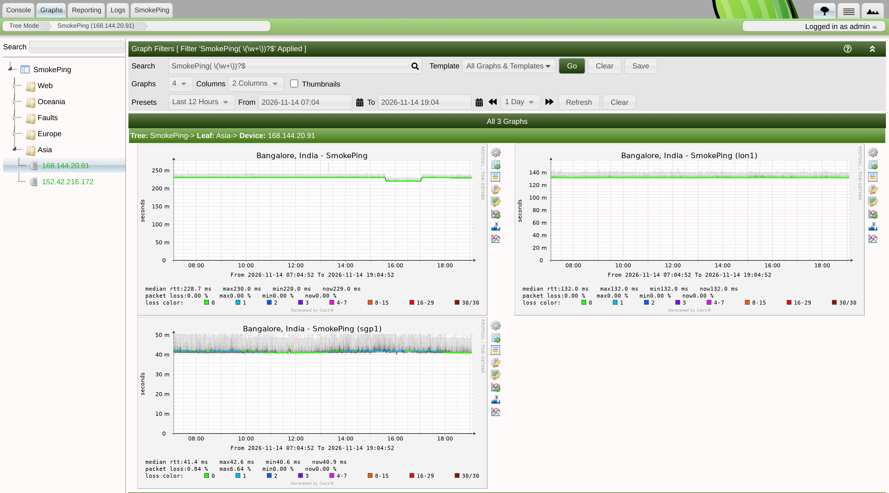
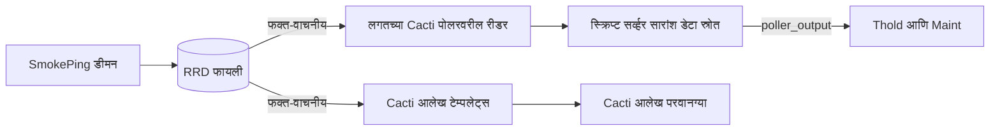

<!-- Source: README.md; SHA256: 17905aa1eac76a7d10dab526734605629fa3d1ada56397642ad4154c5be1feff -->

<!-- translations:start -->
[English](../../../README.md) | [简体中文](../zh-CN/README.md) | [हिन्दी](../hi-IN/README.md) | [Español (España)](../es-ES/README.md) | [Español (Latinoamérica)](../es-419/README.md) | [العربية (السعودية)](../ar-SA/README.md) | [Afrikaans](../af-ZA/README.md) | [አማርኛ](../am-ET/README.md) | [العربية (مصر)](../ar-EG/README.md) | [العربية (المغرب)](../ar-MA/README.md) | [বাংলা](../bn-BD/README.md) | [Deutsch](../de-DE/README.md) | [فارسی](../fa-IR/README.md) | [Filipino](../fil-PH/README.md) | [Français](../fr-FR/README.md) | [Français (Maroc)](../fr-MA/README.md) | [Français (Sénégal)](../fr-SN/README.md) | [Hausa](../ha-NG/README.md) | [עברית](../he-IL/README.md) | [Bahasa Indonesia](../id-ID/README.md) | [Igbo](../ig-NG/README.md) | [Italiano](../it-IT/README.md) | [日本語](../ja-JP/README.md) | [한국어](../ko-KR/README.md) | [Malagasy](../mg-MG/README.md) | [मराठी](README.md) | [Bahasa Melayu](../ms-MY/README.md) | [Nederlands](../nl-NL/README.md) | [Polski](../pl-PL/README.md) | [Português (Brasil)](../pt-BR/README.md) | [Русский](../ru-RU/README.md) | [Kinyarwanda](../rw-RW/README.md) | [Soomaali](../so-SO/README.md) | [Svenska](../sv-SE/README.md) | [Kiswahili](../sw-KE/README.md) | [தமிழ்](../ta-IN/README.md) | [తెలుగు](../te-IN/README.md) | [ไทย](../th-TH/README.md) | [Türkçe](../tr-TR/README.md) | [Українська](../uk-UA/README.md) | [اردو](../ur-PK/README.md) | [Tiếng Việt](../vi-VN/README.md) | [isiXhosa](../xh-ZA/README.md) | [Yorùbá](../yo-NG/README.md) | [繁體中文](../zh-TW/README.md) | [isiZulu](../zu-ZA/README.md)
<!-- translations:end -->

  <picture>
    <source media="(prefers-color-scheme: dark)" srcset="../../images/logo_dark.png">
    
  </picture>

# Cacti साठी SmokePing प्लगइन

Cacti 1.2 चे एक प्लगइन जे SmokePing ची लेटन्सी आणि पॅकेट लॉस मोजमापे Cacti मध्ये नेहमीची उपकरणे, डेटा स्रोत आणि आलेख म्हणून आणते. त्यानंतर स्मोक आलेख ते ज्या उपकरणाचे आहेत त्याच्या शेजारी, Cacti च्या परवानग्यांखाली राहतात आणि Thold व Maint त्यांवर अलर्ट देऊ शकतात आणि ते तात्पुरते बंद करू शकतात. हे Cacti साठी एक स्वतंत्र कार्यान्वयन आहे आणि ते [SmokePing](https://oss.oetiker.ch/smokeping/) चा भाग नाही किंवा त्यांच्याद्वारे प्रमाणित केलेले नाही; SmokePing चे मूळ लेखक Tobias Oetiker आणि Niko Tyni आहेत. या प्लगइनमध्ये SmokePing चा कोड समाविष्ट नाही आणि ते तो चालवतही नाही: ते SmokePing ने लिहिलेल्या कॉन्फिगरेशन आणि RRD फायली वाचते, आणि त्याचे आलेख टेम्पलेट्स SmokePing च्या स्वतःच्या आलेखांप्रमाणेच मालिका काढण्यासाठी तयार केले आहेत.

> **स्थिती: विकासाधीन. निरीक्षण मोड (टप्पा १) `main` वर कार्यान्वित केला आहे आणि 1.0.0-rc.1 पूर्व-प्रकाशन म्हणून प्रसिद्ध केला आहे.** हे प्लगइन SmokePing चे कॉन्फिगरेशन आणि RRD फायली वाचते, त्यांची स्थिती दाखवते, त्यांच्यासाठी Cacti उपकरणे, डेटा स्रोत आणि आलेख तयार करते आणि Thold व Maint ला डेटा पुरवते. ते SmokePing मध्ये काहीही लिहीत नाही. व्यवस्थापित मोड (प्लगइनद्वारे SmokePing कॉन्फिगरेशन लिहिणे) आणि दूरस्थ कलेक्टर्स हे पुढील टप्पे आहेत, जे अद्याप सुरू झालेले नाहीत आणि या प्रकाशनात समाविष्ट नाहीत. प्रत्यक्ष इन्स्टॉलेशन्सवरील प्रायोगिक चाचण्या आणि SmokePing च्या आलेख लेजंडशी अधिक अचूक जुळवणी हे माइलस्टोन ४ मध्ये अद्याप बाकी आहेत. सुरू करण्यासाठी [docs/install.md](../../install.md) पहा.

## प्रवेश भूमिका

| अधिकार क्षेत्र | प्रवेश |
| --- | --- |
| SmokePing View | विद्यमान देखरेख पृष्ठे. |
| SmokePing Operator | देखरेख पृष्ठांसह Operations पृष्ठ आणि वैयक्तिक ट्रायएज पोचपावत्या. |
| SmokePing Admin | Operator प्रवेशासह विद्यमान कॉन्फिगरेशन आणि प्रशासकीय कृती. |

अपग्रेड फायली कॉपी केल्यानंतर, नवीन अधिकार क्षेत्र नोंदवण्यासाठी प्रशासक म्हणून Plugins पृष्ठ उघडा.
**Configuration > Users** किंवा वापरकर्ता गटांखाली Operator अधिकार क्षेत्र स्पष्टपणे नेमून द्या.
अपग्रेडमध्ये विद्यमान View आणि Admin अधिकार क्षेत्र आयडी आणि अनुदाने कायम राहतात. प्रत्येक विनंतीवर Admin प्रवेशाला
Operator प्रवेश वारसाहक्काने मिळतो आणि Operator प्रवेशाला View प्रवेश वारसाहक्काने मिळतो;
यामुळे वापरकर्त्यांना किंवा गटांना साठवलेली अनुदाने जोडली जात नाहीत. प्लगइन सेटिंग्जसाठी
Cacti च्या Settings परवानगीव्यतिरिक्त SmokePing Admin प्रवेश देखील आवश्यक आहे.

Cacti उपकरण परवानग्या प्रत्येक वापरकर्त्यासाठी उपलब्ध असलेल्या ओळी आणि कृतींना मर्यादित ठेवतात; मॅप न केलेल्या ऑब्जेक्ट्ससाठी प्रशासकाची आवश्यकता असते.
क्रेडेन्शियल्स, कॉन्फिगरेशन, मॅपिंग, हटवणे आणि इतर प्रशासकीय बदल
प्रशासकीय पृष्ठांवरच राहतात. पोचपावत्या केवळ वर्तमान वापरकर्त्याच्या
सत्रापुरत्या, जास्तीत जास्त एक तासासाठी आणि केवळ तेच निरीक्षण ताजे
असेपर्यंतच टिकतात. नवीन किंवा बदललेली निरीक्षणे त्यांना अवैध ठरवतात. त्या अयशस्वी झालेल्या
मोजमापाला कधीही निरोगी ठरवत नाहीत किंवा अलर्ट दाबून ठेवत नाहीत.

## स्क्रीनशॉट्स

थेट SmokePing 2.8.2 नेटवर्कमधून Cacti 1.2.31 मध्ये आयात केलेले, मागील १२ तास. प्रत्येक लक्ष्याच्या उपकरणाकडे मास्टरसाठी एक आणि प्रत्येक स्लेव्ह (`lon1`, `sgp1`) साठी एक स्मोक आलेख आहे, जो आलेख ट्री मधील त्याच्या SmokePing विभागाखाली नोंदवलेला आहे.

## का वापरावे

SmokePing लेटन्सी वितरण आणि पॅकेट लॉस अचूकपणे मोजते, आणि त्याचे स्मोक आलेख अशी तफावत दाखवतात जी केवळ सरासरी दाखवणारा आलेख लपवतो. Cacti सोबत चालवल्यास, तीन उणिवा राहतात:

- **स्वतंत्र प्रवेश नियंत्रण.** SmokePing च्या CGI ला Cacti वापरकर्ते, गट किंवा उपकरण परवानग्यांबद्दल काहीही माहिती नसते.
- **उपकरणाचा संदर्भ नाही.** एकाच उपकरणाची लेटन्सी आणि इंटरफेस काउंटर्स वेगवेगळ्या टूल्समध्ये राहतात.
- **Cacti अलर्टिंगमध्ये मार्ग नाही.** Thold आणि Maint हे Cacti डेटा स्रोत आणि उपकरणांवर काम करतात, त्यामुळे SmokePing अलर्ट स्वतंत्रपणे कॉन्फिगर आणि बंद करावे लागतात.

हे प्लगइन प्रत्येक SmokePing लक्ष्याला SmokePing च्या विद्यमान RRD फायलींकडे निर्देश करणारे Cacti ऑब्जेक्ट्स म्हणून दर्शवून आणि पोल केलेल्या सारांश मूल्यांचा एक छोटा संच जोडून या उणिवा दूर करते. ते समांतर आवृत्त्या तयार करण्याऐवजी Cacti चे आलेख, परवानग्या, Thold आणि Maint पुन्हा वापरते. Cacti रिमोट डेटा कलेक्टर्ससाठी समर्थन टप्पा ३ साठी नियोजित आहे आणि या प्रकाशनात नाही.

## व्याप्ती आणि स्थिती

| टप्पा | व्याप्ती | माइलस्टोन्स | स्थिती |
|---|---|---|---|
| ०, संशोधन | सुसंगतता मॅट्रिक्स, अपस्ट्रीम वर्तन पुष्टीकरण, आलेख अचूकता चाचणी | [M1](https://github.com/somethingwithproof/plugin_smokeping/milestone/1) | निष्कर्ष `docs/research` मध्ये आहेत; काही संशोधन मुद्दे खुले आहेत |
| १, निरीक्षण | इन्व्हेंटरी आयात, Cacti उपकरणे, स्मोक आणि सारांश आलेख, Thold अलर्टिंग, Maint सप्रेशन, हेल्थ पृष्ठ | [M2](https://github.com/somethingwithproof/plugin_smokeping/milestone/2), [M3](https://github.com/somethingwithproof/plugin_smokeping/milestone/3), [M4](https://github.com/somethingwithproof/plugin_smokeping/milestone/4) | 1.0.0-rc.1 म्हणून प्रसिद्ध; प्रायोगिक चाचण्या खुल्या आहेत |
| २, व्यवस्थापित | Cacti-मालकीचे कॉन्फिगरेशन नेमस्पेस, ICMP आणि TCP प्रोब प्रोफाइल्स, सुधारणा, प्रमाणीकरण, रीलोड, रोलबॅक | [M5](https://github.com/somethingwithproof/plugin_smokeping/milestone/5) | नियोजित, अद्याप सुरू नाही |
| ३, रिमोट | Cacti रिमोट डेटा कलेक्टर्सवर SmokePing, मोजमाप स्थाने म्हणून स्लेव्ह | [M6](https://github.com/somethingwithproof/plugin_smokeping/milestone/6) | नियोजित, अद्याप सुरू नाही |

व्याप्तीबाहेर: प्लगइन-मालकीचे अलर्टिंग इंजिन, अहवाल इंजिन, कस्टम डीमन किंवा नेटवर्क प्रोटोकॉल, व्यवस्थापित HTTP/DNS/सेवा तपासण्या (servcheck त्या हाताळते), आणि SmokePing च्या RRD फायलींमध्ये लिहिणे.

## सुसंगतता लक्ष्ये

| घटक | लक्ष्य |
|---|---|
| Cacti | 1.2.x मधील 1.2.31 किंवा नंतरचे, कोणतेही कोर पॅचेस नाहीत |
| PHP | 8.2 किंवा नंतरचे; `setup.php` हे 8.0 वर पार्स करण्यायोग्य राहते जेणेकरून असमर्थित रनटाइमला तुटलेल्या Cacti UI ऐवजी नकार मिळतो |
| SmokePing | 2.9.0, 2.8.2, आणि 2.7.3 (फक्त Ubuntu 22.04, 2027-06-01 पर्यंत) |
| Thold, Maint | कोणत्याही बदलांची आवश्यकता नाही |
| मालिका | २० पिंग्स आणि ३०० सेकंद स्टेपसह प्रति इन्स्टॉलेशन १०,००० ([कामगिरी](../../performance.md#supported-series-count)) |

## दस्तऐवजीकरण

| | |
|---|---|
| [स्थापना](../../install.md) | आवश्यकता, SmokePing च्या डेटा डिरेक्टरीचे फक्त-वाचनीय माउंट, स्थापना, कंटेनर्स, समर्थित आवृत्त्या |
| [संचालन](../../operations.md) | प्रत्येक स्थितीचा अर्थ आणि तिचे पुरावे, हेल्थ तपासण्या, इनपुट अयशस्वी झाल्यावरचे वर्तन |
| [Cacti मध्ये लक्ष्ये जोडा](../../provisioning.md) | एक लक्ष्य, अनेक उपकरणे, री-लिंकिंग, परवानग्या |
| [अलर्टिंग](../../alerting.md) | सारांश मूल्ये, Thold कालावधी, शिळेपणा, उशिरा आलेला डेटा, SmokePing च्या अलर्ट्सशी आच्छादन, Maint |
| [कॉन्फिगरेशन स्वरूप](../../configuration-format.md) | YAML आणि XML निर्यात आणि आयात |
| [बॅकअप आणि पुनर्संचयित](../../backup-restore.md) | कशाचा बॅकअप घ्यावा आणि पुनर्संचयित केल्यावर कार्य पुन्हा कसे सुरू होते |
| [कामगिरी](../../performance.md) | १००, १,००० आणि १०,००० मालिकांवर स्थानिक आणि रिलीझ-रनर मोजमापे, आणि समर्थित मालिका संख्या: प्रति इन्स्टॉलेशन १०,००० |
| [अयशस्वी होण्याची पात्रता](../../failure-qualification.md) | अपयशाची परिस्थिती आणि प्रत्येकाची चाचणी कशी केली जाते |
| [प्रकाशन प्रक्रिया](../../RELEASING.md) | प्रकाशन प्रक्रिया: पुल रिक्वेस्ट, स्वाक्षरी केलेला टॅग, वर्कफ्लो काय करतो, परिणामाची पडताळणी कशी करावी |
| [प्रकाशन संग्रहण](../../release.md) | आवृत्ती, बदलनोंद, आणि प्रकाशन संग्रहण |
| [चाचणी](../../testing.md) | चाचणी संच, CI काय चालवते, आणि प्रत्यक्ष SmokePing विरुद्ध थेट चाचणी संच |

## रचना

- [docs/PLAN.md](../../PLAN.md) ही संपूर्ण योजना आहे: आर्किटेक्चर, ती अवलंबून असलेली अपस्ट्रीम तथ्ये (स्रोतांसह), स्थिती मॉडेल, सुरक्षा सीमा, कामगिरीचे गणित, चाचणी आणि जोखीम.
- [docs/decisions/](../../decisions) मध्ये आधीच घेतलेल्या निवडींसाठी आर्किटेक्चर निर्णय नोंदी आहेत.
- [docs/REQUIREMENTS.md](../../REQUIREMENTS.md) प्रत्येक आवश्यकता आयडीला त्याच्या मुद्द्याशी मॅप करते.

## कामाचा मागोवा कसा ठेवला जातो

- **माइलस्टोन्स** योजनेतील माइलस्टोन्सचे अनुसरण करतात. प्रत्येकाकडे त्याचे उप-मुद्दे आणि निर्गमन पुरावे सूचीबद्ध करणारा एक एपिक मुद्दा असतो.
- **मुद्दे** लेबलनुसार प्रकारबद्ध केले आहेत: `type: requirement`, `type: research`, `type: decision`, `type: epic`. आवश्यकता मुद्दे क्रमांकित, तपासण्यायोग्य आवश्यकता (`REQ-AREA-NNN`) आणि स्वीकृती निकष नमूद करतात.
- **लेबल्स** मध्ये `area:`, `phase:`, `priority:`, आणि `status:` देखील असतात. पहा [CONTRIBUTING.md](../../../CONTRIBUTING.md#labels).
- [प्रकल्प बोर्ड](https://github.com/users/somethingwithproof/projects/6) सर्व माइलस्टोन्समधील मुद्दे दर्शवितो.

## योगदान

[CONTRIBUTING.md](../../../CONTRIBUTING.md) वाचा. कमिट्ससाठी DCO साइन-ऑफ आवश्यक आहे. डिझाइन चर्चा मुद्द्यांवर होतात; खुल्या निर्णयांवर `type: decision` लेबल असते.

## सुरक्षा

असुरक्षितता खाजगीरीत्या कळवा; पहा [SECURITY.md](../../../SECURITY.md).

## परवाना

GNU General Public License v2.0, हाच परवाना Cacti आणि त्याच्या प्लगिन्ससाठी आहे. पहा [LICENSE](../../../LICENSE).
