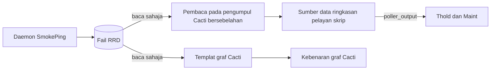

<!-- Source: README.md; SHA256: b41ec705327127cc34ff07d1514a141262752f99c5e2296fdc323d584a777b84 -->

<!-- translations:start -->
[English](../../../README.md) | [简体中文](../zh-CN/README.md) | [हिन्दी](../hi-IN/README.md) | [Español (España)](../es-ES/README.md) | [Español (Latinoamérica)](../es-419/README.md) | [العربية (السعودية)](../ar-SA/README.md) | [Afrikaans](../af-ZA/README.md) | [አማርኛ](../am-ET/README.md) | [العربية (مصر)](../ar-EG/README.md) | [العربية (المغرب)](../ar-MA/README.md) | [বাংলা](../bn-BD/README.md) | [Bosanski](../bs-BA/README.md) | [Deutsch](../de-DE/README.md) | [فارسی](../fa-IR/README.md) | [Filipino](../fil-PH/README.md) | [Français](../fr-FR/README.md) | [Français (Maroc)](../fr-MA/README.md) | [Français (Sénégal)](../fr-SN/README.md) | [Hausa](../ha-NG/README.md) | [עברית](../he-IL/README.md) | [Hrvatski](../hr-HR/README.md) | [Bahasa Indonesia](../id-ID/README.md) | [Igbo](../ig-NG/README.md) | [Italiano](../it-IT/README.md) | [日本語](../ja-JP/README.md) | [한국어](../ko-KR/README.md) | [Malagasy](../mg-MG/README.md) | [मराठी](../mr-IN/README.md) | [Bahasa Melayu](README.md) | [Nederlands](../nl-NL/README.md) | [Polski](../pl-PL/README.md) | [Português (Brasil)](../pt-BR/README.md) | [Русский](../ru-RU/README.md) | [Kinyarwanda](../rw-RW/README.md) | [Soomaali](../so-SO/README.md) | [Српски](../sr-RS/README.md) | [Svenska](../sv-SE/README.md) | [Kiswahili](../sw-KE/README.md) | [தமிழ்](../ta-IN/README.md) | [తెలుగు](../te-IN/README.md) | [ไทย](../th-TH/README.md) | [Türkçe](../tr-TR/README.md) | [Українська](../uk-UA/README.md) | [اردو](../ur-PK/README.md) | [Tiếng Việt](../vi-VN/README.md) | [isiXhosa](../xh-ZA/README.md) | [Yorùbá](../yo-NG/README.md) | [繁體中文](../zh-TW/README.md) | [isiZulu](../zu-ZA/README.md)
<!-- translations:end -->

  <picture>
    <source media="(prefers-color-scheme: dark)" srcset="../../images/logo_dark.png">
    
  </picture>

# Pemalam SmokePing untuk Cacti

Pemalam Cacti 1.2 yang membawa ukuran kependaman dan kehilangan paket SmokePing ke dalam Cacti sebagai peranti, sumber data, dan graf biasa. Graf asap kemudiannya diletakkan bersebelahan dengan peranti yang dimilikinya, di bawah kebenaran Cacti, serta Thold dan Maint boleh memberi amaran dan menyekat amaran tersebut. Ini ialah pelaksanaan bebas untuk Cacti dan bukan sebahagian daripada, atau disokong oleh, [SmokePing](https://oss.oetiker.ch/smokeping/), yang pengarang asalnya ialah Tobias Oetiker dan Niko Tyni. Pemalam ini tidak menyertakan atau menjalankan kod SmokePing: ia membaca fail konfigurasi dan fail RRD yang ditulis oleh SmokePing, dan templat grafnya dibina untuk melukis siri yang sama seperti graf SmokePing sendiri.

> **Status: dalam pembangunan. Mod pemerhatian (fasa 1) dilaksanakan pada `main` (1.0.0-rc.1) dengan penapisan pengendali, eksport CSV, pengesanan RRD yatim, terjemahan amaran Thold, cangkuk integrasi ekosistem dan replikasi pengumpul jauh.** Pemalam ini membaca fail konfigurasi dan fail RRD SmokePing, memaparkan keadaannya, mencipta peranti, sumber data, dan graf Cacti untuknya, serta menyalurkan data kepada Thold dan Maint. Ia tidak menulis apa-apa ke dalam SmokePing. Mod terurus (pemalam menulis konfigurasi SmokePing) ialah fasa seterusnya, belum dimulakan, dan tiada dalam keluaran ini. Ujian rintis pada pemasangan sebenar dan padanan yang lebih rapat dengan legenda graf SmokePing kekal terbuka dalam pencapaian 4. Lihat [docs/install.md](../../install.md) untuk bermula.

## Peranan akses

| Realm | Akses |
| --- | --- |
| SmokePing View | Halaman pemantauan sedia ada. |
| SmokePing Operator | Pemantauan berserta halaman Operasi dan pengakuan triaj peribadi. |
| SmokePing Admin | Akses Operator berserta konfigurasi dan tindakan pentadbiran sedia ada. |

Selepas menyalin fail naik taraf, buka halaman Plugins sebagai pentadbir untuk mendaftarkan
realm baharu. Tetapkan realm Operator secara eksplisit di bawah **Configuration > Users** atau kumpulan pengguna.
Naik taraf mengekalkan ID dan pemberian realm View dan Admin sedia ada. Akses Admin
mewarisi akses Operator, dan akses Operator mewarisi akses View pada setiap permintaan;
ini tidak menambah pemberian tersimpan kepada pengguna atau kumpulan. Tetapan pemalam juga memerlukan
akses SmokePing Admin selain kebenaran Settings Cacti.

Kebenaran peranti Cacti masih mengehadkan baris dan tindakan yang tersedia kepada setiap pengguna; objek yang belum dipetakan memerlukan pentadbir.
Kelayakan, konfigurasi, pemetaan, pemadaman dan perubahan pentadbiran lain
kekal dalam halaman pentadbiran. Pengakuan hanya bertahan dalam sesi pengguna
semasa, untuk paling lama satu jam dan hanya selagi pemerhatian yang sama kekal
segar. Pemerhatian baharu atau yang berubah akan membatalkannya. Ia tidak sekali-kali menandakan ukuran
yang gagal sebagai sihat atau menyekat amaran.

## Tangkapan skrin

Diimport daripada rangkaian SmokePing 2.8.2 langsung ke dalam Cacti 1.2.31, 12 jam terakhir. Peranti setiap sasaran mempunyai graf asap untuk induk dan satu untuk setiap hamba (`lon1`, `sgp1`), difailkan di bawah bahagian SmokePing masing-masing dalam pepohon graf.

## Mengapa

SmokePing mengukur taburan kependaman dan kehilangan paket dengan baik, dan graf asapnya menunjukkan variasi yang disembunyikan oleh graf purata sahaja. Apabila dijalankan bersama Cacti, ia meninggalkan tiga jurang:

- **Kawalan akses berasingan.** CGI SmokePing tidak mengetahui apa-apa tentang pengguna, kumpulan, atau kebenaran peranti Cacti.
- **Tiada konteks peranti.** Kependaman dan pembilang antara muka bagi peranti yang sama berada dalam alat yang berbeza.
- **Tiada laluan ke sistem amaran Cacti.** Thold dan Maint berfungsi pada sumber data dan peranti Cacti, maka amaran SmokePing dikonfigurasikan dan disekat secara berasingan.

Pemalam ini merapatkan jurang tersebut dengan mewakili setiap sasaran SmokePing sebagai objek Cacti yang menunjuk kepada fail RRD sedia ada milik SmokePing, serta satu set kecil nilai ringkasan yang dikumpul. Ia menggunakan semula keupayaan graf, kebenaran, Thold, dan Maint milik Cacti berbanding membina versi selari baginya. Replikasi konfigurasi berskop peninjau (`replicate_out`) menolak jadual konfigurasi peninjau jauh sambil memastikan mod setempat (peninjau 1) dan cache pemerhatian setempat pengumpul kekal terasing.

## Skop dan status

| Fasa | Skop | Pencapaian | Status |
|---|---|---|---|
| 0, penyelidikan | Matriks keserasian, pengesahan kelakuan huluan, kajian kesetiaan graf | [M1](https://github.com/somethingwithproof/plugin_smokeping/milestone/1) | Dapatan dalam `docs/research`; beberapa isu penyelidikan masih terbuka |
| 1, pemerhatian | Import inventori, peranti Cacti, graf asap dan ringkasan, amaran Thold dan terjemahan amaran, sekatan Maint, paparan bertapis, eksport CSV, pengesanan RRD yatim, cangkuk ekosistem | [M2](https://github.com/somethingwithproof/plugin_smokeping/milestone/2), [M3](https://github.com/somethingwithproof/plugin_smokeping/milestone/3), [M4](https://github.com/somethingwithproof/plugin_smokeping/milestone/4) | Dilaksanakan; ujian rintis dibuka |
| 2, terurus | Ruang nama konfigurasi milik Cacti, profil kuar ICMP dan TCP, semakan, pengesahan, muat semula, putar balik | [M5](https://github.com/somethingwithproof/plugin_smokeping/milestone/5) | Dirancang, belum dimulakan |
| 3, jauh | Pertanyaan berskop peninjau dan replikasi jadual `replicate_out` untuk pengumpul data jauh (`RemoteReplication`); kelayakan penggunaan SmokePing berbilang pengumpul sepenuhnya | [M6](https://github.com/somethingwithproof/plugin_smokeping/milestone/6) | Replikasi dan penskopan peninjau dilaksanakan; kelayakan penggunaan berbilang pengumpul terbuka |

Aliran kerja pengendali, arahan CLI dan cangkuk ekosistem yang telah dilaksanakan:

- **Penapisan inventori dan sasaran (`smokeping_inventory.php`, `smokeping.php`)**: `TargetFilter`, `TargetRepository::filteredForPoller()`, `InventoryPage` dan `ViewPage` menyediakan carian (`filter`), kuar (`probe`), kehadiran inventori (`presence`), status pemetaan (`mapping`), keadaan kesegaran (`state`) dan penomboran halaman saiz halaman pilihan (`rows`: `All`, `25`, `50`, `100`, `200`). Keterlihatan peranti dikuatkuasakan dalam SQL sebelum pengiraan supaya jumlah tidak pernah mendedahkan peranti tersembunyi.
- **Eksport CSV (`smokeping.php?action=export_csv`)**: `CsvExporter` menstrim output RFC 4180 CRLF bagi paparan bertapis aktif di bawah kebenaran peranti pemanggil, dengan meletakkan tanda koma atas di hadapan sel yang bermula dengan `=`, `+`, `-`, `@`, tab atau carriage return untuk meneutralkan formula hamparan.
- **Pengesanan RRD yatim (`smokeping_health.php`)**: `OrphanRrdScanner` dan `HealthCheck::orphanRrds()` melaksanakan imbasan terhad pada lekapan SmokePing pada peninjau pembaca, melangkau `__cgi`, `__sortercache` dan pautan simbolik, serta merujuk silang fail `.rrd` tanpa pemilik dengan cadangan pemautan semula yang terbuka.
- **Penukaran SmokePing ke Thold (`smokeping_health.php`, `cli/smokeping.php`)**: `TholdTranslator` dan `TholdGenerator` membaca takrifan `*** Alerts ***` SmokePing dan menterjemah corak kehilangan berturut-turut yang disokong kepada ambang Thold `loss_pct` yang setara tanpa mengubah fail konfigurasi SmokePing. Aliran web menggunakan pratonton GET (`action=thold_preview`, `HealthPage::renderTholdPreview()`) diikuti oleh POST yang dilindungi CSRF (`action=thold_create`). Corak yang tidak disokong (amaran RTT, susutan kad bebas, tahap bercampur) dilangkau tanpa menulis.
- **CLI Pentadbir (`cli/smokeping.php`)**: menyokong `provision <target path> [--device=ID] [--location=NAME]`, `relink <old target path> <new target path> [--location=NAME]`, `thold-generate <target path> [--alert=NAME] [--apply]`, `size-graphs`, `upgrade-graphs`, `export [--format=yaml|xml] [--file=PATH]`, `import --file=PATH [--format=yaml|xml] [--apply --confirm=PLAN]` dan `import-smokeping [--dry-run | --apply --confirm=PLAN] [--file=PATH] [--sections=A,B/C] [--device-per=host|target] [--device-template=ID] [--poller=ID] [--site=ID] [--tree=ID | --tree-name=NAME]`.
- **Cangkuk ekosistem (`setup.php`, `Schema::HOOKS`)**: mendaftarkan 21 cangkuk, termasuk `abilities_register` (`AbilitiesProvider`: `smokeping-list-targets` dan `smokeping-get-health` baca sahaja secara ketat, dikawal oleh alam View terhadap ID pengguna pemanggil, tidak memulangkan rahsia), `doctor_register_checks` (`DoctorChecks`: `smokeping_stale_targets`, `smokeping_freshness_breaches`, `smokeping_orphan_rrds`, `smokeping_config_path`), `casc_register_providers` (`CascProvider`: `export`, `validate`, `plan` dan `apply` YAML/XML `smokeping` disokong oleh `ConfigCodec` dan `ConfigService`), serta `replicate_out` (`RemoteReplication`: penyegerakan berskop peninjau bagi `plugin_smokeping_target`, `plugin_smokeping_mapping`, `plugin_smokeping_object` dan `plugin_smokeping_relink` untuk peninjau jauh dengan `poller_id > 1`).

Di luar skop: enjin amaran milik pemalam, enjin pelaporan, daemon atau protokol rangkaian tersuai, semakan HTTP/DNS/perkhidmatan terurus (servcheck menanganinya), dan menulis ke dalam fail RRD SmokePing.

## Sasaran keserasian

| Komponen | Sasaran |
|---|---|
| Cacti | 1.2.31 atau lebih baharu dalam 1.2.x, tiada tampalan teras |
| PHP | 8.2 atau lebih baharu; `setup.php` kekal boleh dihuraikan pada 8.0 supaya masa jalan yang tidak disokong menerima penolakan berbanding UI Cacti yang rosak |
| SmokePing | 2.9.0, 2.8.2, dan 2.7.3 (Ubuntu 22.04 sahaja, sehingga 2027-06-01) |
| Thold, Maint | Tiada perubahan diperlukan |
| Siri | 10,000 setiap pemasangan pada 20 ping dan selang 300 s ([prestasi](../../performance.md#supported-series-count)) |

## Dokumentasi

| | |
|---|---|
| [Pemasangan](../../install.md) | Keperluan, lekapan baca sahaja bagi direktori data SmokePing, pemasangan, bekas, versi yang disokong |
| [Operasi](../../operations.md) | Maksud setiap keadaan dan buktinya, semakan kesihatan, kelakuan apabila input gagal |
| [Tambah sasaran ke Cacti](../../provisioning.md) | Satu sasaran, banyak peranti, pemautan semula, kebenaran |
| [Amaran](../../alerting.md) | Nilai ringkasan, tempoh Thold, keusangan, data lewat, pertindihan dengan amaran SmokePing, Maint |
| [Format konfigurasi](../../configuration-format.md) | Eksport dan import YAML dan XML |
| [Sandaran dan pemulihan](../../backup-restore.md) | Perkara yang perlu disandarkan dan cara pemulihan disambung semula |
| [Prestasi](../../performance.md) | Ukuran setempat dan pelaksana keluaran pada 100, 1,000, dan 10,000 siri, serta kiraan siri yang disokong: 10,000 setiap pemasangan |
| [Kelayakan kegagalan](../../failure-qualification.md) | Senario kegagalan dan cara setiap satunya diuji |
| [Keluaran](../../RELEASING.md) | Prosedur keluaran: permintaan tarik, tag bertandatangan, perkara yang dilakukan oleh aliran kerja, cara mengesahkan hasilnya |
| [Arkib keluaran](../../release.md) | Versi, log perubahan, dan arkib keluaran |
| [Pengujian](../../testing.md) | Suit ujian, perkara yang dijalankan oleh CI, dan suit langsung terhadap SmokePing sebenar |

## Reka bentuk

- [docs/PLAN.md](../../PLAN.md) ialah pelan penuh: seni bina, fakta huluan yang menjadi pergantungannya (bersama sumber), model keadaan, sempadan keselamatan, aritmetik prestasi, pengujian, dan risiko.
- [docs/decisions/](../../decisions) menyimpan rekod keputusan seni bina bagi pilihan yang telah dibuat.
- [docs/REQUIREMENTS.md](../../REQUIREMENTS.md) memetakan setiap ID keperluan kepada isunya.
- Pengesahan setempat menjalankan semakan unit dan peraturan sumber Pest (`pest --configuration=phpunit.xml`), PHPStan Level 9 (`CACTI_PATH=<cacti-dir> phpstan analyse -c phpstan.neon --no-progress`), semakan sintaks titik masuk (`php -l` pada `*.php`, `include/*.php`, `scripts/*.php`, `cli/*.php`), dan semakan terjemahan (`sh locales/build_gettext.sh --check`). Lihat [docs/testing.md](../../testing.md) untuk suit integrasi dan hujung-ke-hujung bekas.

## Cara kerja dijejaki

- **Pencapaian** mengikut pencapaian pelan. Setiap satunya mempunyai isu epik yang menyenaraikan sub-isu dan bukti keluarnya.
- **Isu** dikelaskan mengikut label: `type: requirement`, `type: research`, `type: decision`, `type: epic`. Isu keperluan menyatakan keperluan bernombor yang boleh diuji (`REQ-AREA-NNN`) dan kriteria penerimaan.
- **Label** juga membawa `area:`, `phase:`, `priority:`, dan `status:`. Lihat [CONTRIBUTING.md](../../../CONTRIBUTING.md#labels).
- [Papan projek](https://github.com/users/somethingwithproof/projects/6) memaparkan semua isu merentas pencapaian.

## Sumbangan

Baca [CONTRIBUTING.md](../../../CONTRIBUTING.md). Komit memerlukan tandatangan DCO. Perbincangan reka bentuk berlaku pada isu; keputusan terbuka membawa label `type: decision`.

## Keselamatan

Laporkan kerentanan secara peribadi; lihat [SECURITY.md](../../../SECURITY.md).

## Lesen

GNU General Public License v2.0, lesen yang sama seperti Cacti dan pemalamnya. Lihat [LICENSE](../../../LICENSE).
