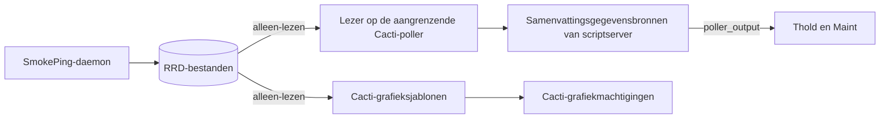

<!-- Source: README.md; SHA256: 17905aa1eac76a7d10dab526734605629fa3d1ada56397642ad4154c5be1feff -->

<!-- translations:start -->
[English](../../../README.md) | [简体中文](../zh-CN/README.md) | [हिन्दी](../hi-IN/README.md) | [Español (España)](../es-ES/README.md) | [Español (Latinoamérica)](../es-419/README.md) | [العربية (السعودية)](../ar-SA/README.md) | [Afrikaans](../af-ZA/README.md) | [አማርኛ](../am-ET/README.md) | [العربية (مصر)](../ar-EG/README.md) | [العربية (المغرب)](../ar-MA/README.md) | [বাংলা](../bn-BD/README.md) | [Bosanski](../bs-BA/README.md) | [Deutsch](../de-DE/README.md) | [فارسی](../fa-IR/README.md) | [Filipino](../fil-PH/README.md) | [Français](../fr-FR/README.md) | [Français (Maroc)](../fr-MA/README.md) | [Français (Sénégal)](../fr-SN/README.md) | [Hausa](../ha-NG/README.md) | [עברית](../he-IL/README.md) | [Hrvatski](../hr-HR/README.md) | [Bahasa Indonesia](../id-ID/README.md) | [Igbo](../ig-NG/README.md) | [Italiano](../it-IT/README.md) | [日本語](../ja-JP/README.md) | [한국어](../ko-KR/README.md) | [Malagasy](../mg-MG/README.md) | [मराठी](../mr-IN/README.md) | [Bahasa Melayu](../ms-MY/README.md) | [Nederlands](README.md) | [Polski](../pl-PL/README.md) | [Português (Brasil)](../pt-BR/README.md) | [Русский](../ru-RU/README.md) | [Kinyarwanda](../rw-RW/README.md) | [Soomaali](../so-SO/README.md) | [Српски](../sr-RS/README.md) | [Svenska](../sv-SE/README.md) | [Kiswahili](../sw-KE/README.md) | [தமிழ்](../ta-IN/README.md) | [తెలుగు](../te-IN/README.md) | [ไทย](../th-TH/README.md) | [Türkçe](../tr-TR/README.md) | [Українська](../uk-UA/README.md) | [اردو](../ur-PK/README.md) | [Tiếng Việt](../vi-VN/README.md) | [isiXhosa](../xh-ZA/README.md) | [Yorùbá](../yo-NG/README.md) | [繁體中文](../zh-TW/README.md) | [isiZulu](../zu-ZA/README.md)
<!-- translations:end -->

  <picture>
    <source media="(prefers-color-scheme: dark)" srcset="../../images/logo_dark.png">
    
  </picture>

# SmokePing-plugin voor Cacti

Een Cacti 1.2-plugin die SmokePing-latentie- en pakketverliesmetingen in Cacti onderbrengt als reguliere apparaten, gegevensbronnen en grafieken. Smokegrafieken staan daarmee direct naast het bijbehorende apparaat, vallen onder de machtigingen van Cacti en kunnen door Thold en Maint worden bewaakt en onderdrukt. Het betreft een onafhankelijke implementatie voor Cacti en maakt geen deel uit van, noch wordt onderschreven door, [SmokePing](https://oss.oetiker.ch/smokeping/), waarvan Tobias Oetiker en Niko Tyni de oorspronkelijke auteurs zijn. De plugin bevat noch draait code van SmokePing: de plugin leest de configuratie- en RRD-bestanden die SmokePing wegschrijft, en de grafieksjablonen zijn opgebouwd om dezelfde reeksen te tekenen als de eigen grafieken van SmokePing.

> **Status: in ontwikkeling. De observatiemodus (fase 1) is geïmplementeerd op `main` en uitgebracht als de pre-release 1.0.0-rc.1.** De plugin leest de configuratie- en RRD-bestanden van SmokePing, toont de status ervan, maakt er Cacti-apparaten, gegevensbronnen en grafieken voor aan en voedt Thold en Maint. De plugin schrijft niets naar SmokePing. De beheerde modus (waarin de plugin de SmokePing-configuratie schrijft) en externe collectors zijn latere fasen; deze zijn nog niet gestart en maken geen deel uit van deze release. Pilots op echte installaties en een nauwkeurigere aansluiting op de grafieklegenda van SmokePing staan nog open in mijlpaal 4. Zie [docs/install.md](../../install.md) om te beginnen.

## Toegangsrollen

| Realm | Toegang |
| --- | --- |
| SmokePing View | Bestaande monitoringpagina's. |
| SmokePing Operator | Monitoring plus de pagina Operations en persoonlijke triagebevestigingen. |
| SmokePing Admin | Operator-toegang plus de bestaande configuratie- en beheeracties. |

Na het kopiëren van de upgradebestanden opent u als beheerder de pagina Plugins om
de nieuwe realm te registreren. Wijs de realm Operator expliciet toe onder **Configuration > Users** of bij gebruikersgroepen.
Upgrades behouden de bestaande realm-ID's en machtigingen voor View en Admin. Admin-toegang
erft Operator-toegang en Operator-toegang erft View-toegang bij elke aanvraag;
dit voegt geen opgeslagen machtigingen toe aan gebruikers of groepen. Voor plugin-instellingen is
naast de Cacti-machtiging Settings ook SmokePing Admin-toegang vereist.

Cacti-apparaatmachtigingen blijven bepalen welke rijen en acties voor elke gebruiker beschikbaar zijn; voor niet-gekoppelde objecten is een beheerder vereist.
Inloggegevens, configuratie, koppelingen, verwijdering en andere beheerwijzigingen
blijven in de beheerpagina's. Bevestigingen gelden alleen binnen de huidige
gebruikerssessie, voor maximaal één uur en uitsluitend zolang dezelfde waarneming
actueel blijft. Nieuwe of gewijzigde waarnemingen maken ze ongeldig. Ze markeren een mislukte
meting nooit als gezond en onderdrukken geen meldingen.

## Schermafbeeldingen

Geïmporteerd vanuit een live SmokePing 2.8.2-netwerk naar Cacti 1.2.31, over de laatste 12 uur. Elk doelapparaat heeft een smokegrafiek voor de master en één voor elke slave (`lon1`, `sgp1`), ingedeeld onder de bijbehorende SmokePing-sectie in de grafiekenboom.

## Waarom

SmokePing meet de latentieverdeling en het pakketverlies nauwkeurig, en de smokegrafieken tonen variatie die op een grafiek met alleen gemiddelden verborgen blijft. Wanneer het naast Cacti draait, blijven er drie lacunes bestaan:

- **Gescheiden toegangsbeheer.** De CGI van SmokePing weet niets van Cacti-gebruikers, -groepen of -apparaatmachtigingen.
- **Geen apparaatcontext.** Latentie en interfacetellers voor hetzelfde apparaat bevinden zich in verschillende tools.
- **Geen koppeling naar Cacti-alarmering.** Thold en Maint werken op Cacti-gegevensbronnen en -apparaten, waardoor SmokePing-meldingen afzonderlijk geconfigureerd en onderdrukt worden.

De plugin dicht deze lacunes door elk SmokePing-doel weer te geven als Cacti-objecten die verwijzen naar de bestaande RRD-bestanden van SmokePing, aangevuld met een kleine reeks gepollde samenvattingswaarden. De plugin hergebruikt de grafieken, machtigingen, Thold en Maint van Cacti in plaats van daar parallelle varianten voor te bouwen. Ondersteuning voor externe Cacti-datacollectors staat gepland voor fase 3 en maakt geen deel uit van deze release.

## Reikwijdte en status

| Fase | Reikwijdte | Mijlpalen | Status |
|---|---|---|---|
| 0, onderzoek | Compatibiliteitsmatrix, verificatie van upstream-gedrag, onderzoek naar grafiekgetrouwheid | [M1](https://github.com/somethingwithproof/plugin_smokeping/milestone/1) | Bevindingen in `docs/research`; enkele onderzoekskwesties staan nog open |
| 1, observatie | Inventarisimport, Cacti-apparaten, smoke- en samenvattingsgrafieken, Thold-alarmering, Maint-onderdrukking, statuspagina | [M2](https://github.com/somethingwithproof/plugin_smokeping/milestone/2), [M3](https://github.com/somethingwithproof/plugin_smokeping/milestone/3), [M4](https://github.com/somethingwithproof/plugin_smokeping/milestone/4) | Uitgebracht als 1.0.0-rc.1; pilots open |
| 2, beheerd | Door Cacti beheerde configuratienaamruimte, ICMP- en TCP-probeprofielen, revisies, validatie, herladen, terugdraaien | [M5](https://github.com/somethingwithproof/plugin_smokeping/milestone/5) | Gepland, nog niet gestart |
| 3, extern | SmokePing op externe Cacti-datacollectors, slaves als meetlocaties | [M6](https://github.com/somethingwithproof/plugin_smokeping/milestone/6) | Gepland, nog niet gestart |

Buiten reikwijdte: een eigen alarmeringsengine in de plugin, een rapportage-engine, een eigen daemon of netwerkprotocol, beheerde HTTP-/DNS-/servicecontroles (servcheck dekt dit af) en het schrijven naar de RRD-bestanden van SmokePing.

## Compatibiliteitsdoelen

| Component | Doel |
|---|---|
| Cacti | 1.2.31 of hoger binnen 1.2.x, geen patches op de core |
| PHP | 8.2 of hoger; `setup.php` blijft parseerbaar op 8.0 zodat een niet-ondersteunde runtime een weigering krijgt in plaats van een defecte Cacti-UI |
| SmokePing | 2.9.0, 2.8.2 en 2.7.3 (alleen Ubuntu 22.04, tot 2027-06-01) |
| Thold, Maint | Geen wijzigingen vereist |
| Reeksen | 10.000 per installatie bij 20 pings en een stap van 300 s ([prestaties](../../performance.md#supported-series-count)) |

## Documentatie

| | |
|---|---|
| [Installatie](../../install.md) | Vereisten, de alleen-lezen mount van de gegevensmap van SmokePing, installatie, containers, ondersteunde versies |
| [Beheer](../../operations.md) | Betekenis van elke status en het bijbehorende bewijs, gezondheidscontroles, gedrag bij uitval van invoer |
| [Doelen toevoegen aan Cacti](../../provisioning.md) | Eén doel, meerdere apparaten, opnieuw koppelen, machtigingen |
| [Alarmering](../../alerting.md) | Samenvattingswaarden, Thold-duren, veroudering, verlate gegevens, overlap met SmokePing-meldingen, Maint |
| [Configuratieformaat](../../configuration-format.md) | Export en import in YAML en XML |
| [Back-up en herstel](../../backup-restore.md) | Wat u moet back-uppen en hoe het herstel wordt hervat |
| [Prestaties](../../performance.md) | Lokale en release-runner-metingen bij 100, 1.000 en 10.000 reeksen, en het ondersteunde aantal reeksen: 10.000 per installatie |
| [Foutkwalificatie](../../failure-qualification.md) | De faalscenario's en hoe elk scenario wordt getest |
| [Uitbrengen](../../RELEASING.md) | De releaseprocedure: de pull request, de ondertekende tag, wat de workflow doet, hoe het resultaat te verifiëren |
| [Releasearchief](../../release.md) | Versie, changelog en het releasearchief |
| [Testen](../../testing.md) | De testsuites, wat CI uitvoert en de live-suite tegen een echte SmokePing |

## Ontwerp

- [docs/PLAN.md](../../PLAN.md) is het volledige plan: architectuur, upstream-feiten waarop het steunt (met bronnen), statusmodel, beveiligingsgrenzen, prestatierekenwerk, testen en risico's.
- [docs/decisions/](../../decisions) bevat architecture decision records voor reeds genomen beslissingen.
- [docs/REQUIREMENTS.md](../../REQUIREMENTS.md) koppelt elk vereiste-ID aan het bijbehorende issue.

## Hoe het werk wordt bijgehouden

- **Mijlpalen** volgen de mijlpalen uit het plan. Elke mijlpaal heeft een epic-issue met daarin de sub-issues en het afsluitbewijs.
- **Issues** worden getypeerd via labels: `type: requirement`, `type: research`, `type: decision`, `type: epic`. Vereiste-issues bevatten genummerde, testbare vereisten (`REQ-AREA-NNN`) en acceptatiecriteria.
- **Labels** bevatten ook `area:`, `phase:`, `priority:` en `status:`. Zie [CONTRIBUTING.md](../../../CONTRIBUTING.md#labels).
- Het [projectbord](https://github.com/users/somethingwithproof/projects/6) toont alle issues over alle mijlpalen heen.

## Bijdragen

Lees [CONTRIBUTING.md](../../../CONTRIBUTING.md). Commits vereisen een DCO sign-off. Ontwerpdiscussies vinden plaats in issues; openstaande beslissingen dragen het label `type: decision`.

## Beveiliging

Meld kwetsbaarheden privé; zie [SECURITY.md](../../../SECURITY.md).

## Licentie

GNU General Public License v2.0, dezelfde licentie als Cacti en zijn plugins. Zie [LICENSE](../../../LICENSE).
