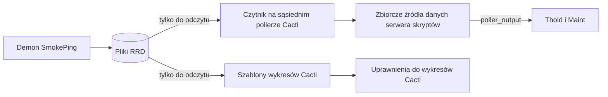

<!-- Source: README.md; SHA256: b41ec705327127cc34ff07d1514a141262752f99c5e2296fdc323d584a777b84 -->

<!-- translations:start -->
[English](../../../README.md) | [简体中文](../zh-CN/README.md) | [हिन्दी](../hi-IN/README.md) | [Español (España)](../es-ES/README.md) | [Español (Latinoamérica)](../es-419/README.md) | [العربية (السعودية)](../ar-SA/README.md) | [Afrikaans](../af-ZA/README.md) | [አማርኛ](../am-ET/README.md) | [العربية (مصر)](../ar-EG/README.md) | [العربية (المغرب)](../ar-MA/README.md) | [বাংলা](../bn-BD/README.md) | [Bosanski](../bs-BA/README.md) | [Deutsch](../de-DE/README.md) | [فارسی](../fa-IR/README.md) | [Filipino](../fil-PH/README.md) | [Français](../fr-FR/README.md) | [Français (Maroc)](../fr-MA/README.md) | [Français (Sénégal)](../fr-SN/README.md) | [Hausa](../ha-NG/README.md) | [עברית](../he-IL/README.md) | [Hrvatski](../hr-HR/README.md) | [Bahasa Indonesia](../id-ID/README.md) | [Igbo](../ig-NG/README.md) | [Italiano](../it-IT/README.md) | [日本語](../ja-JP/README.md) | [한국어](../ko-KR/README.md) | [Malagasy](../mg-MG/README.md) | [मराठी](../mr-IN/README.md) | [Bahasa Melayu](../ms-MY/README.md) | [Nederlands](../nl-NL/README.md) | [Polski](README.md) | [Português (Brasil)](../pt-BR/README.md) | [Русский](../ru-RU/README.md) | [Kinyarwanda](../rw-RW/README.md) | [Soomaali](../so-SO/README.md) | [Српски](../sr-RS/README.md) | [Svenska](../sv-SE/README.md) | [Kiswahili](../sw-KE/README.md) | [தமிழ்](../ta-IN/README.md) | [తెలుగు](../te-IN/README.md) | [ไทย](../th-TH/README.md) | [Türkçe](../tr-TR/README.md) | [Українська](../uk-UA/README.md) | [اردو](../ur-PK/README.md) | [Tiếng Việt](../vi-VN/README.md) | [isiXhosa](../xh-ZA/README.md) | [Yorùbá](../yo-NG/README.md) | [繁體中文](../zh-TW/README.md) | [isiZulu](../zu-ZA/README.md)
<!-- translations:end -->

  <picture>
    <source media="(prefers-color-scheme: dark)" srcset="../../images/logo_dark.png">
    
  </picture>

# Wtyczka SmokePing dla Cacti

Wtyczka dla Cacti 1.2 wprowadzająca pomiary opóźnień i strat pakietów z narzędzia SmokePing do Cacti jako standardowe urządzenia, źródła danych i wykresy. Wykresy Smoke są wówczas umieszczane obok powiązanego urządzenia, podlegają uprawnieniom Cacti, a wtyczki Thold i Maint mogą na ich podstawie generować alerty oraz je wyciszać. Jest to niezależna implementacja dla Cacti i nie stanowi części projektu [SmokePing](https://oss.oetiker.ch/smokeping/) (którego oryginalnymi autorami są Tobias Oetiker i Niko Tyni) ani nie jest przez niego wspierana. Wtyczka nie zawiera ani nie uruchamia kodu SmokePing: odczytuje konfigurację i pliki RRD zapisywane przez SmokePing, a jej szablony wykresów są skonstruowane tak, aby rysować te same serie danych co własne wykresy SmokePing.

> **Status: w trakcie rozwoju. Tryb obserwacji (faza 1) jest zaimplementowany na gałęzi `main` (1.0.0-rc.1) wraz z filtrowaniem dla operatora, eksportem CSV, wykrywaniem osieroconych plików RRD, translacją alertów Thold, punktami zaczepienia (hooks) integracji z ekosystemem oraz replikacją na zdalne kolektory.** Wtyczka odczytuje konfigurację i pliki RRD programu SmokePing, wyświetla ich stan, tworzy dla nich urządzenia, źródła danych i wykresy w Cacti oraz zasila wtyczki Thold i Maint. Nie zapisuje niczego do SmokePing. Tryb zarządzany (zapisywanie konfiguracji SmokePing przez wtyczkę) jest kolejną fazą, nie został jeszcze rozpoczęty i nie jest zawarty w tym wydaniu. Wdrożenia pilotażowe na rzeczywistych instalacjach oraz ściślejsze dopasowanie do legendy wykresów SmokePing pozostają otwarte w kamieniu milowym 4. Aby rozpocząć, zobacz [docs/install.md](../../install.md).

## Role dostępu

| Uprawnienie (Realm) | Dostęp |
| --- | --- |
| SmokePing View | Istniejące strony monitorowania. |
| SmokePing Operator | Monitorowanie oraz strona operacyjna (Operations) i osobiste potwierdzenia klasyfikacji incydentów (triage). |
| SmokePing Admin | Dostęp Operator oraz istniejąca konfiguracja i działania administracyjne. |

Po skopiowaniu plików aktualizacji należy otworzyć stronę wtyczek (Plugins) jako administrator, aby zarejestrować
nowe uprawnienie (realm). Uprawnienie Operator należy przypisać jawnie w sekcji **Configuration > Users** lub w grupach użytkowników.
Aktualizacje zachowują istniejące identyfikatory oraz nadania uprawnień View i Admin. Dostęp Admin
dziedziczy dostęp Operator, a dostęp Operator dziedziczy dostęp View przy każdym żądaniu;
nie powoduje to dopisywania trwałych nadań do użytkowników ani grup. Ustawienia wtyczki wymagają również
dostępu SmokePing Admin oprócz uprawnienia Settings w Cacti.

Uprawnienia do urządzeń w Cacti nadal ograniczają wiersze i działania dostępne dla każdego użytkownika; obiekty nieprzypisane (unmapped) wymagają uprawnień administratora.
Poświadczenia, konfiguracja, mapowanie, usuwanie oraz inne zmiany administracyjne
pozostają na stronach administracyjnych. Potwierdzenia (acknowledgments) obowiązują wyłącznie w bieżącej
sesji użytkownika, maksymalnie przez jedną godzinę i tylko tak długo, jak ta sama obserwacja pozostaje
aktualna. Nowe lub zmienione obserwacje unieważniają je. Nigdy nie oznaczają one nieudanego
pomiaru jako sprawnego ani nie wyciszają alertów.

## Zrzuty ekranu

Zaimportowano z działającej sieci SmokePing 2.8.2 do Cacti 1.2.31, ostatnie 12 godzin. Urządzenie każdego celu posiada wykres Smoke dla węzła nadrzędnego (master) oraz po jednym dla każdego węzła podrzędnego (`lon1`, `sgp1`), przypisane do odpowiedniej sekcji SmokePing w drzewie wykresów.

## Cel projektu

SmokePing dobrze mierzy rozkład opóźnień i straty pakietów, a jego wykresy typu smoke pokazują zmienność, którą wykres oparty wyłącznie na średniej ukrywa. Uruchomiony obok Cacti pozostawia jednak trzy luki:

- **Oddzielna kontrola dostępu.** Interfejs CGI programu SmokePing nie ma wiedzy o użytkownikach, grupach ani uprawnieniach do urządzeń w Cacti.
- **Brak kontekstu urządzenia.** Pomiary opóźnień i liczniki interfejsów dla tego samego urządzenia znajdują się w różnych narzędziach.
- **Brak ścieżki do alertowania w Cacti.** Wtyczki Thold i Maint działają na źródłach danych i urządzeniach Cacti, dlatego alerty SmokePing są konfigurowane i wyciszane osobno.

Wtyczka zamyka te luki, reprezentując każdy cel SmokePing jako obiekty Cacti wskazujące na istniejące pliki RRD programu SmokePing oraz niewielki zestaw odpytywanych wartości zbiorczych. Wykorzystuje mechanizmy rysowania wykresów, uprawnień, Thold i Maint w Cacti zamiast budowania ich równoległych odpowiedników. Replikacja konfiguracji w zakresie pollera (`replicate_out`) przesyła tabele konfiguracji zdalnych pollerów, utrzymując tryb lokalny (poller 1) oraz lokalne pamięci podręczne obserwacji kolektorów w izolacji.

## Zakres i status

| Faza | Zakres | Kamienie milowe | Status |
|---|---|---|---|
| 0, badania | Macierz zgodności, potwierdzenie zachowania projektu nadrzędnego, weryfikacja wierności wykresów | [M1](https://github.com/somethingwithproof/plugin_smokeping/milestone/1) | Wyniki w `docs/research`; część zagadnień badawczych jest otwarta |
| 1, obserwacja | Import inwentarza, urządzenia Cacti, wykresy smoke i zbiorcze, alertowanie i translacja alertów Thold, wyciszanie Maint, widoki filtrowane, eksport CSV, wykrywanie osieroconych plików RRD, punkty zaczepienia ekosystemu | [M2](https://github.com/somethingwithproof/plugin_smokeping/milestone/2), [M3](https://github.com/somethingwithproof/plugin_smokeping/milestone/3), [M4](https://github.com/somethingwithproof/plugin_smokeping/milestone/4) | Zaimplementowano; pilotaże otwarte |
| 2, zarządzanie | Przestrzeń nazw konfiguracji zarządzana przez Cacti, profile sond ICMP i TCP, rewizje, walidacja, przeładowanie, wycofywanie zmian | [M5](https://github.com/somethingwithproof/plugin_smokeping/milestone/5) | Planowana, nierozpoczęta |
| 3, zdalne kolektory | Zapytania w zakresie pollera oraz replikacja tabel `replicate_out` dla zdalnych kolektorów danych (`RemoteReplication`); pełna kwalifikacja wdrożeń SmokePing z wieloma kolektorami | [M6](https://github.com/somethingwithproof/plugin_smokeping/milestone/6) | Replikacja i ograniczanie do pollera zaimplementowane; kwalifikacja wdrożeń z wieloma kolektorami otwarta |

Zaimplementowane przepływy pracy operatora, polecenia CLI oraz punkty zaczepienia ekosystemu:

- **Filtrowanie inwentarza i celów (`smokeping_inventory.php`, `smokeping.php`)**: klasy `TargetFilter`, `TargetRepository::filteredForPoller()`, `InventoryPage` i `ViewPage` zapewniają wyszukiwanie (`filter`), wybór sondy (`probe`), obecność w inwentarzu (`presence`), status mapowania (`mapping`), stan aktualności (`state`) oraz opcjonalne stronicowanie rozmiarem strony (`rows`: `All`, `25`, `50`, `100`, `200`). Widoczność urządzeń jest wymuszana w SQL przed zliczaniem, dzięki czemu sumy nigdy nie ujawniają ukrytych urządzeń.
- **Eksport CSV (`smokeping.php?action=export_csv`)**: `CsvExporter` strumieniuje wyjście RFC 4180 CRLF dla aktywnego widoku filtrowanego z zachowaniem uprawnień wywołującego do urządzeń, poprzedzając apostrofem komórki zaczynające się od `=`, `+`, `-`, `@`, znaku tabulacji lub powrotu karetki, aby zneutralizować formuły arkuszy kalkulacyjnych.
- **Wykrywanie osieroconych plików RRD (`smokeping_health.php`)**: `OrphanRrdScanner` i `HealthCheck::orphanRrds()` wykonują ograniczone skanowanie punktu montowania SmokePing na pollerze odczytującym, pomijając `__cgi`, `__sortercache` oraz dowiązania symboliczne i zestawiając nieprzypisane pliki `.rrd` z otwartymi propozycjami ponownego powiązania.
- **Konwersja SmokePing na Thold (`smokeping_health.php`, `cli/smokeping.php`)**: `TholdTranslator` i `TholdGenerator` odczytują definicje SmokePing `*** Alerts ***` i tłumaczą obsługiwane wzorce kolejnych strat pakietów na równoważne progi `loss_pct` w Thold bez modyfikowania plików konfiguracyjnych SmokePing. Przepływ WWW używa podglądu GET (`action=thold_preview`, `HealthPage::renderTholdPreview()`), po którym następuje żądanie POST chronione tokenem CSRF (`action=thold_create`). Nieobsługiwane wzorce (alerty RTT, zanik z symbolami wieloznacznymi, poziomy mieszane) są pomijane bez zapisu.
- **Interfejs CLI administratora (`cli/smokeping.php`)**: obsługuje `provision <target path> [--device=ID] [--location=NAME]`, `relink <old target path> <new target path> [--location=NAME]`, `thold-generate <target path> [--alert=NAME] [--apply]`, `size-graphs`, `upgrade-graphs`, `export [--format=yaml|xml] [--file=PATH]`, `import --file=PATH [--format=yaml|xml] [--apply --confirm=PLAN]` oraz `import-smokeping [--dry-run | --apply --confirm=PLAN] [--file=PATH] [--sections=A,B/C] [--device-per=host|target] [--device-template=ID] [--poller=ID] [--site=ID] [--tree=ID | --tree-name=NAME]`.
- **Punkty zaczepienia ekosystemu (`setup.php`, `Schema::HOOKS`)**: rejestruje 21 punktów zaczepienia, w tym `abilities_register` (`AbilitiesProvider`: ściśle tylko do odczytu `smokeping-list-targets` i `smokeping-get-health`, weryfikowane uprawnieniem View względem identyfikatora użytkownika wywołującego, bez zwracania sekretów), `doctor_register_checks` (`DoctorChecks`: `smokeping_stale_targets`, `smokeping_freshness_breaches`, `smokeping_orphan_rrds`, `smokeping_config_path`), `casc_register_providers` (`CascProvider`: `export`, `validate`, `plan` oraz `apply` dla `smokeping` YAML/XML wspierane przez `ConfigCodec` i `ConfigService`) oraz `replicate_out` (`RemoteReplication`: synchronizacja w zakresie pollera dla tabel `plugin_smokeping_target`, `plugin_smokeping_mapping`, `plugin_smokeping_object` i `plugin_smokeping_relink` na zdalnych pollerach o `poller_id > 1`).

Poza zakresem: własny silnik alertowania wtyczki, silnik raportowania, niestandardowy demon lub protokół sieciowy, zarządzane testy HTTP/DNS/usług (obsługuje je servcheck) oraz zapisywanie do plików RRD programu SmokePing.

## Docelowa zgodność

| Komponent | Wersja docelowa |
|---|---|
| Cacti | 1.2.31 lub nowsza z gałęzi 1.2.x, bez łatek jądra |
| PHP | 8.2 lub nowsza; `setup.php` pozostaje poprawne składniowo w 8.0, aby nieobsługiwane środowisko zwróciło odmowę zamiast uszkodzenia interfejsu Cacti |
| SmokePing | 2.9.0, 2.8.2 oraz 2.7.3 (wyłącznie Ubuntu 22.04, do 2027-06-01) |
| Thold, Maint | Brak wymaganych zmian |
| Serie danych | 10 000 na instalację przy 20 pakietach ping i kroku 300 s ([wydajność](../../performance.md#supported-series-count)) |

## Dokumentacja

| | |
|---|---|
| [Instalacja](../../install.md) | Wymagania, montowanie katalogu danych SmokePing tylko do odczytu, instalacja, kontenery, obsługiwane wersje |
| [Eksploatacja](../../operations.md) | Znaczenie poszczególnych stanów i ich dowody, kontrole stanu, zachowanie w przypadku błędów danych wejściowych |
| [Dodawanie celów do Cacti](../../provisioning.md) | Jeden cel, wiele urządzeń, ponowne powiązanie, uprawnienia |
| [Alertowanie](../../alerting.md) | Wartości zbiorcze, czasy trwania Thold, nieaktualność danych, opóźnione dane, nakładanie się z alertami SmokePing, Maint |
| [Format konfiguracji](../../configuration-format.md) | Eksport i import w formatach YAML i XML |
| [Kopia zapasowa i odtwarzanie](../../backup-restore.md) | Co należy zabezpieczać w kopii zapasowej oraz jak wznawiane jest działanie po odtworzeniu |
| [Wydajność](../../performance.md) | Pomiary lokalne i na runnerach wydawniczych przy 100, 1 000 oraz 10 000 serii, a także obsługiwana liczba serii: 10 000 na instalację |
| [Kwalifikacja awarii](../../failure-qualification.md) | Scenariusze awarii i sposób testowania każdego z nich |
| [Wydawanie wersji](../../RELEASING.md) | Procedura wydania: pull request, podpisany tag, działania przepływu pracy, weryfikacja wyniku |
| [Archiwum wydań](../../release.md) | Wersja, lista zmian oraz archiwum wydań |
| [Testowanie](../../testing.md) | Zestawy testów, zakres uruchamiany w CI oraz zestaw testów na żywo z rzeczywistym SmokePing |

## Projekt i architektura

- [docs/PLAN.md](../../PLAN.md) zawiera pełny plan: architekturę, fakty dotyczące projektu nadrzędnego, od których zależy (wraz ze źródłami), model stanów, granice bezpieczeństwa, obliczenia wydajnościowe, testowanie i ryzyka.
- [docs/decisions/](../../decisions) zawiera rekordy decyzji architektonicznych (ADR) dla już podjętych wyborów.
- [docs/REQUIREMENTS.md](../../REQUIREMENTS.md) mapuje każdy identyfikator wymagania na odpowiadające mu zgłoszenie.
- Weryfikacja lokalna uruchamia testy jednostkowe i kontrole reguł kodu źródłowego w Pest (`pest --configuration=phpunit.xml`), analizę PHPStan Level 9 (`CACTI_PATH=<cacti-dir> phpstan analyse -c phpstan.neon --no-progress`), sprawdzanie składni punktów wejścia (`php -l` na `*.php`, `include/*.php`, `scripts/*.php`, `cli/*.php`) oraz sprawdzanie tłumaczeń (`sh locales/build_gettext.sh --check`). Zestawy testów integracyjnych oraz kompleksowych testów kontenerowych opisano w [docs/testing.md](../../testing.md).

## Śledzenie prac

- **Kamienie milowe** odpowiadają kamieniom milowym z planu. Każdy posiada nadrzędne zgłoszenie (epic) zawierające listę podzadań oraz kryteria zakończenia.
- **Zgłoszenia** są kategoryzowane etykietami: `type: requirement`, `type: research`, `type: decision`, `type: epic`. Zgłoszenia wymagań określają numerowane, testowalne wymagania (`REQ-AREA-NNN`) oraz kryteria akceptacji.
- **Etykiety** zawierają również prefiksy `area:`, `phase:`, `priority:` oraz `status:`. Zobacz [CONTRIBUTING.md](../../../CONTRIBUTING.md#labels).
- Wszystkie zgłoszenia w podziale na kamienie milowe są widoczne na [tablicy projektu](https://github.com/users/somethingwithproof/projects/6).

## Wkład w projekt

Zapoznaj się z [CONTRIBUTING.md](../../../CONTRIBUTING.md). Commity wymagają poświadczenia DCO (sign-off). Dyskusje projektowe odbywają się w zgłoszeniach; otwarte decyzje posiadają etykietę `type: decision`.

## Bezpieczeństwo

Podatności należy zgłaszać prywatnie; zobacz [SECURITY.md](../../../SECURITY.md).

## Licencja

GNU General Public License v2.0 — ta sama licencja, na której udostępniane jest Cacti i jego wtyczki. Zobacz [LICENSE](../../../LICENSE).
