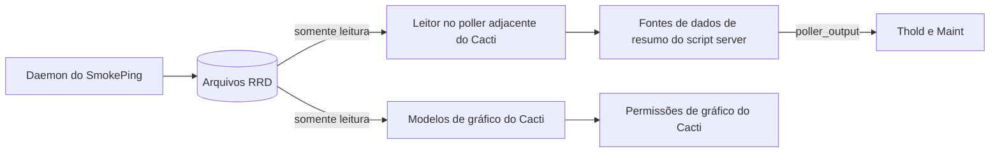

<!-- Source: README.md; SHA256: b41ec705327127cc34ff07d1514a141262752f99c5e2296fdc323d584a777b84 -->

<!-- translations:start -->
[English](../../../README.md) | [简体中文](../zh-CN/README.md) | [हिन्दी](../hi-IN/README.md) | [Español (España)](../es-ES/README.md) | [Español (Latinoamérica)](../es-419/README.md) | [العربية (السعودية)](../ar-SA/README.md) | [Afrikaans](../af-ZA/README.md) | [አማርኛ](../am-ET/README.md) | [العربية (مصر)](../ar-EG/README.md) | [العربية (المغرب)](../ar-MA/README.md) | [বাংলা](../bn-BD/README.md) | [Bosanski](../bs-BA/README.md) | [Deutsch](../de-DE/README.md) | [فارسی](../fa-IR/README.md) | [Filipino](../fil-PH/README.md) | [Français](../fr-FR/README.md) | [Français (Maroc)](../fr-MA/README.md) | [Français (Sénégal)](../fr-SN/README.md) | [Hausa](../ha-NG/README.md) | [עברית](../he-IL/README.md) | [Hrvatski](../hr-HR/README.md) | [Bahasa Indonesia](../id-ID/README.md) | [Igbo](../ig-NG/README.md) | [Italiano](../it-IT/README.md) | [日本語](../ja-JP/README.md) | [한국어](../ko-KR/README.md) | [Malagasy](../mg-MG/README.md) | [मराठी](../mr-IN/README.md) | [Bahasa Melayu](../ms-MY/README.md) | [Nederlands](../nl-NL/README.md) | [Polski](../pl-PL/README.md) | [Português (Brasil)](README.md) | [Русский](../ru-RU/README.md) | [Kinyarwanda](../rw-RW/README.md) | [Soomaali](../so-SO/README.md) | [Српски](../sr-RS/README.md) | [Svenska](../sv-SE/README.md) | [Kiswahili](../sw-KE/README.md) | [தமிழ்](../ta-IN/README.md) | [తెలుగు](../te-IN/README.md) | [ไทย](../th-TH/README.md) | [Türkçe](../tr-TR/README.md) | [Українська](../uk-UA/README.md) | [اردو](../ur-PK/README.md) | [Tiếng Việt](../vi-VN/README.md) | [isiXhosa](../xh-ZA/README.md) | [Yorùbá](../yo-NG/README.md) | [繁體中文](../zh-TW/README.md) | [isiZulu](../zu-ZA/README.md)
<!-- translations:end -->

  <picture>
    <source media="(prefers-color-scheme: dark)" srcset="../../images/logo_dark.png">
    
  </picture>

# Plugin SmokePing para Cacti

Um plugin do Cacti 1.2 que traz as medições de latência e perda do SmokePing para o Cacti como dispositivos, fontes de dados e gráficos comuns. Os gráficos de fumaça ficam então ao lado do dispositivo ao qual pertencem, sob as permissões do Cacti, e o Thold e o Maint podem gerar alertas e suprimi-los. Trata-se de uma implementação independente para o Cacti e não faz parte nem é endossada pelo [SmokePing](https://oss.oetiker.ch/smokeping/), cujos autores originais são Tobias Oetiker e Niko Tyni. O plugin não inclui nem executa o código do SmokePing: ele lê a configuração e os arquivos RRD que o SmokePing grava, e seus modelos de gráfico são construídos para desenhar as mesmas séries dos próprios gráficos do SmokePing.

> **Status: em desenvolvimento. O modo de observação (fase 1) está implementado na `main` (1.0.0-rc.1) com filtragem para operadores, exportação CSV, detecção de RRDs órfãos, tradução de alertas do Thold, hooks de integração do ecossistema e replicação para coletores remotos.** O plugin lê a configuração e os arquivos RRD do SmokePing, mostra o estado deles, cria dispositivos, fontes de dados e gráficos do Cacti para eles e alimenta o Thold e o Maint. Ele não grava nada no SmokePing. O modo gerenciado (o plugin gravando a configuração do SmokePing) é uma fase posterior, ainda não iniciada, e não está neste lançamento. Pilotos em instalações reais e uma correspondência mais próxima à legenda do gráfico do SmokePing permanecem em aberto no marco 4. Consulte [docs/install.md](../../install.md) para começar.

## Perfis de acesso

| Realm | Acesso |
| --- | --- |
| SmokePing View | Páginas de monitoramento existentes. |
| SmokePing Operator | Monitoramento mais a página de Operações e reconhecimentos pessoais de triagem. |
| SmokePing Admin | Acesso de Operator mais as ações administrativas e de configuração existentes. |

Após copiar os arquivos de atualização, abra a página Plugins como administrador para registrar
o novo realm. Atribua o realm Operator explicitamente em **Configuration > Users** ou nos grupos de usuários.
As atualizações mantêm os IDs de realm e as concessões existentes de View e Admin. O acesso Admin
herda o acesso Operator, e o acesso Operator herda o acesso View em cada requisição;
isso não adiciona concessões armazenadas a usuários ou grupos. As configurações do plugin também exigem
acesso SmokePing Admin além da permissão Settings do Cacti.

As permissões de dispositivo do Cacti ainda limitam as linhas e ações disponíveis para cada usuário; objetos não mapeados exigem um administrador.
Credenciais, configuração, mapeamento, exclusão e outras alterações administrativas
permanecem nas páginas administrativas. Os reconhecimentos duram apenas na sessão atual
do usuário, por no máximo uma hora e somente enquanto a mesma observação permanecer
recente. Observações novas ou alteradas os invalidam. Eles nunca marcam uma medição
com falha como saudável nem suprimem alertas.

## Capturas de tela

Importado de uma rede SmokePing 2.8.2 em produção para o Cacti 1.2.31, últimas 12 horas. O dispositivo de cada alvo possui um gráfico de fumaça para o master e um para cada slave (`lon1`, `sgp1`), organizado sob sua seção do SmokePing na árvore de gráficos.

## Por quê

O SmokePing mede bem a distribuição de latência e a perda de pacotes, e seus gráficos de fumaça mostram variações que um gráfico apenas com a média oculta. Executado em paralelo com o Cacti, ele deixa três lacunas:

- **Controle de acesso separado.** O CGI do SmokePing não sabe nada sobre usuários, grupos ou permissões de dispositivo do Cacti.
- **Sem contexto do dispositivo.** Contadores de latência e de interface do mesmo dispositivo vivem em ferramentas diferentes.
- **Sem caminho para os alertas do Cacti.** O Thold e o Maint funcionam em fontes de dados e dispositivos do Cacti, portanto os alertas do SmokePing são configurados e suprimidos separadamente.

O plugin preenche essas lacunas representando cada alvo do SmokePing como objetos do Cacti que apontam para os arquivos RRD existentes do SmokePing, além de um pequeno conjunto de valores resumidos coletados por polling. Ele reutiliza os gráficos, as permissões, o Thold e o Maint do Cacti em vez de construir versões paralelas deles. A replicação de configuração com escopo de poller (`replicate_out`) envia tabelas de configuração para pollers remotos mantendo isolados o modo local (poller 1) e os caches locais de observação dos coletores.

## Escopo e status

| Fase | Escopo | Marcos | Status |
|---|---|---|---|
| 0, pesquisa | Matriz de compatibilidade, confirmação de comportamento upstream, prova de conceito de fidelidade de gráfico | [M1](https://github.com/somethingwithproof/plugin_smokeping/milestone/1) | Achados em `docs/research`; algumas issues de pesquisa estão abertas |
| 1, observação | Importação de inventário, dispositivos do Cacti, gráficos de fumaça e resumo, alertas e tradução de alertas do Thold, supressão do Maint, visualizações filtradas, exportação CSV, detecção de RRDs órfãos, hooks do ecossistema | [M2](https://github.com/somethingwithproof/plugin_smokeping/milestone/2), [M3](https://github.com/somethingwithproof/plugin_smokeping/milestone/3), [M4](https://github.com/somethingwithproof/plugin_smokeping/milestone/4) | Implementado; pilotos em aberto |
| 2, gerenciado | Namespace de configuração pertencente ao Cacti, perfis de sonda ICMP e TCP, revisões, validação, recarregamento, reversão | [M5](https://github.com/somethingwithproof/plugin_smokeping/milestone/5) | Planejado, não iniciado |
| 3, remoto | Consultas com escopo de poller e replicação de tabelas `replicate_out` para coletores de dados remotos (`RemoteReplication`); qualificação completa de implantação do SmokePing com múltiplos coletores | [M6](https://github.com/somethingwithproof/plugin_smokeping/milestone/6) | Replicação e escopo de poller implementados; qualificação de implantação com múltiplos coletores em aberto |

Fluxos de trabalho de operador, comandos de CLI e hooks de ecossistema implementados:

- **Filtragem de inventário e alvos (`smokeping_inventory.php`, `smokeping.php`)**: `TargetFilter`, `TargetRepository::filteredForPoller()`, `InventoryPage` e `ViewPage` fornecem busca (`filter`), sonda (`probe`), presença no inventário (`presence`), status de mapeamento (`mapping`), estado de atualidade (`state`) e paginação opcional por tamanho de página (`rows`: `All`, `25`, `50`, `100`, `200`). A visibilidade de dispositivos é aplicada em SQL antes da contagem para que os totais nunca exponham dispositivos ocultos.
- **Exportação CSV (`smokeping.php?action=export_csv`)**: `CsvExporter` transmite saída RFC 4180 CRLF para a visualização filtrada ativa sob as permissões de dispositivo do chamador, prefixando células iniciadas por `=`, `+`, `-`, `@`, tabulação ou retorno de carro com um apóstrofo para neutralizar fórmulas de planilha.
- **Detecção de RRDs órfãos (`smokeping_health.php`)**: `OrphanRrdScanner` e `HealthCheck::orphanRrds()` realizam uma varredura limitada da montagem do SmokePing no poller leitor, ignorando `__cgi`, `__sortercache` e links simbólicos, e cruzando arquivos `.rrd` sem proprietário com propostas abertas de revinculação.
- **Conversão de SmokePing para Thold (`smokeping_health.php`, `cli/smokeping.php`)**: `TholdTranslator` e `TholdGenerator` leem definições `*** Alerts ***` do SmokePing e traduzem padrões consecutivos de perda suportados em limiares `loss_pct` equivalentes do Thold sem modificar os arquivos de configuração do SmokePing. O fluxo web usa uma prévia via GET (`action=thold_preview`, `HealthPage::renderTholdPreview()`) seguida de um POST protegido por CSRF (`action=thold_create`). Padrões não suportados (alertas de RTT, decaimento com curingas, níveis mistos) são ignorados sem gravação.
- **CLI do administrador (`cli/smokeping.php`)**: suporta `provision <target path> [--device=ID] [--location=NAME]`, `relink <old target path> <new target path> [--location=NAME]`, `thold-generate <target path> [--alert=NAME] [--apply]`, `size-graphs`, `upgrade-graphs`, `export [--format=yaml|xml] [--file=PATH]`, `import --file=PATH [--format=yaml|xml] [--apply --confirm=PLAN]` e `import-smokeping [--dry-run | --apply --confirm=PLAN] [--file=PATH] [--sections=A,B/C] [--device-per=host|target] [--device-template=ID] [--poller=ID] [--site=ID] [--tree=ID | --tree-name=NAME]`.
- **Hooks do ecossistema (`setup.php`, `Schema::HOOKS`)**: registra 21 hooks, incluindo `abilities_register` (`AbilitiesProvider`: `smokeping-list-targets` e `smokeping-get-health` estritamente somente leitura, restritos pelo realm View ao ID de usuário do chamador, sem retornar segredos), `doctor_register_checks` (`DoctorChecks`: `smokeping_stale_targets`, `smokeping_freshness_breaches`, `smokeping_orphan_rrds`, `smokeping_config_path`), `casc_register_providers` (`CascProvider`: `export`, `validate`, `plan` e `apply` de `smokeping` em YAML/XML apoiados por `ConfigCodec` e `ConfigService`) e `replicate_out` (`RemoteReplication`: sincronização com escopo de poller de `plugin_smokeping_target`, `plugin_smokeping_mapping`, `plugin_smokeping_object` e `plugin_smokeping_relink` para pollers remotos com `poller_id > 1`).

Fora do escopo: um mecanismo de alertas próprio do plugin, um mecanismo de relatórios, um daemon ou protocolo de rede personalizado, verificações gerenciadas de HTTP/DNS/serviço (o servcheck cobre isso) e gravação nos arquivos RRD do SmokePing.

## Metas de compatibilidade

| Componente | Alvo |
|---|---|
| Cacti | 1.2.31 ou posterior na série 1.2.x, sem patches no core |
| PHP | 8.2 ou posterior; `setup.php` permanece analisável no 8.0 para que um runtime sem suporte receba uma recusa em vez de uma interface do Cacti quebrada |
| SmokePing | 2.9.0, 2.8.2 e 2.7.3 (somente Ubuntu 22.04, até 2027-06-01) |
| Thold, Maint | Nenhuma alteração necessária |
| Séries | 10.000 por instalação com 20 pings e passo de 300 s ([desempenho](../../performance.md#supported-series-count)) |

## Documentação

| | |
|---|---|
| [Instalação](../../install.md) | Requisitos, montagem somente leitura do diretório de dados do SmokePing, instalação, contêineres, versões suportadas |
| [Operação](../../operations.md) | O que cada estado significa e suas evidências, verificações de integridade, comportamento quando as entradas falham |
| [Adicionar alvos ao Cacti](../../provisioning.md) | Um alvo, vários dispositivos, revinculação, permissões |
| [Alertas](../../alerting.md) | Valores resumidos, durações do Thold, obsolescência, dados atrasados, sobreposição com os alertas do SmokePing, Maint |
| [Formato de configuração](../../configuration-format.md) | Exportação e importação em YAML e XML |
| [Backup e restauração](../../backup-restore.md) | O que fazer backup e como uma restauração é retomada |
| [Desempenho](../../performance.md) | Medições locais e no runner de lançamento em 100, 1.000 e 10.000 séries, e a contagem de séries suportada: 10.000 por instalação |
| [Qualificação de falhas](../../failure-qualification.md) | Os cenários de falha e como cada um é testado |
| [Lançamento](../../RELEASING.md) | O procedimento de lançamento: o pull request, a tag assinada, o que o workflow faz, como verificar o resultado |
| [Arquivo de lançamentos](../../release.md) | Versão, changelog e o arquivo de lançamentos |
| [Testes](../../testing.md) | As suítes, o que a CI executa e a suíte ao vivo contra um SmokePing real |

## Design

- [docs/PLAN.md](../../PLAN.md) é o plano completo: arquitetura, fatos upstream dos quais depende (com fontes), modelo de estado, limites de segurança, aritmética de desempenho, testes e riscos.
- [docs/decisions/](../../decisions) contém registros de decisão de arquitetura para escolhas já feitas.
- [docs/REQUIREMENTS.md](../../REQUIREMENTS.md) mapeia cada ID de requisito para sua issue.
- A verificação local executa testes unitários e checagens de regras de código-fonte no Pest (`pest --configuration=phpunit.xml`), PHPStan Level 9 (`CACTI_PATH=<cacti-dir> phpstan analyse -c phpstan.neon --no-progress`), verificações de sintaxe nos pontos de entrada (`php -l` em `*.php`, `include/*.php`, `scripts/*.php`, `cli/*.php`) e verificações de tradução (`sh locales/build_gettext.sh --check`). Consulte [docs/testing.md](../../testing.md) para as suítes de integração e ponta a ponta em contêiner.

## Como o trabalho é acompanhado

- **Marcos** seguem os marcos do plano. Cada um possui uma issue épica listando suas sub-issues e evidências de saída.
- **Issues** são tipificadas por rótulo: `type: requirement`, `type: research`, `type: decision`, `type: epic`. As issues de requisito definem requisitos numerados e testáveis (`REQ-AREA-NNN`) e critérios de aceitação.
- **Rótulos** também carregam `area:`, `phase:`, `priority:` e `status:`. Consulte [CONTRIBUTING.md](../../../CONTRIBUTING.md#labels).
- O [quadro do projeto](https://github.com/users/somethingwithproof/projects/6) mostra todas as issues em todos os marcos.

## Contribuição

Leia [CONTRIBUTING.md](../../../CONTRIBUTING.md). Os commits precisam de uma assinatura DCO. A discussão de design acontece nas issues; decisões em aberto carregam o rótulo `type: decision`.

## Segurança

Relate vulnerabilidades de forma privada; consulte [SECURITY.md](../../../SECURITY.md).

## Licença

GNU General Public License v2.0, a mesma licença do Cacti e de seus plugins. Consulte [LICENSE](../../../LICENSE).
