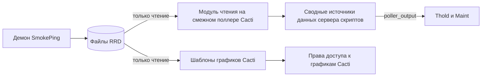

<!-- Source: README.md; SHA256: 17905aa1eac76a7d10dab526734605629fa3d1ada56397642ad4154c5be1feff -->

<!-- translations:start -->
[English](../../../README.md) | [简体中文](../zh-CN/README.md) | [हिन्दी](../hi-IN/README.md) | [Español (España)](../es-ES/README.md) | [Español (Latinoamérica)](../es-419/README.md) | [العربية (السعودية)](../ar-SA/README.md) | [Afrikaans](../af-ZA/README.md) | [አማርኛ](../am-ET/README.md) | [العربية (مصر)](../ar-EG/README.md) | [العربية (المغرب)](../ar-MA/README.md) | [বাংলা](../bn-BD/README.md) | [Bosanski](../bs-BA/README.md) | [Deutsch](../de-DE/README.md) | [فارسی](../fa-IR/README.md) | [Filipino](../fil-PH/README.md) | [Français](../fr-FR/README.md) | [Français (Maroc)](../fr-MA/README.md) | [Français (Sénégal)](../fr-SN/README.md) | [Hausa](../ha-NG/README.md) | [עברית](../he-IL/README.md) | [Hrvatski](../hr-HR/README.md) | [Bahasa Indonesia](../id-ID/README.md) | [Igbo](../ig-NG/README.md) | [Italiano](../it-IT/README.md) | [日本語](../ja-JP/README.md) | [한국어](../ko-KR/README.md) | [Malagasy](../mg-MG/README.md) | [मराठी](../mr-IN/README.md) | [Bahasa Melayu](../ms-MY/README.md) | [Nederlands](../nl-NL/README.md) | [Polski](../pl-PL/README.md) | [Português (Brasil)](../pt-BR/README.md) | [Русский](README.md) | [Kinyarwanda](../rw-RW/README.md) | [Soomaali](../so-SO/README.md) | [Српски](../sr-RS/README.md) | [Svenska](../sv-SE/README.md) | [Kiswahili](../sw-KE/README.md) | [தமிழ்](../ta-IN/README.md) | [తెలుగు](../te-IN/README.md) | [ไทย](../th-TH/README.md) | [Türkçe](../tr-TR/README.md) | [Українська](../uk-UA/README.md) | [اردو](../ur-PK/README.md) | [Tiếng Việt](../vi-VN/README.md) | [isiXhosa](../xh-ZA/README.md) | [Yorùbá](../yo-NG/README.md) | [繁體中文](../zh-TW/README.md) | [isiZulu](../zu-ZA/README.md)
<!-- translations:end -->

  <picture>
    <source media="(prefers-color-scheme: dark)" srcset="../../images/logo_dark.png">
    
  </picture>

# Плагин SmokePing для Cacti

Плагин для Cacti 1.2, который переносит измерения задержки и потерь пакетов из SmokePing в Cacti в виде обычных устройств, источников данных и графиков. Графики SmokePing располагаются рядом с соответствующим устройством под управлением прав доступа Cacti, а модули Thold и Maint могут формировать по ним оповещения и подавлять их. Это независимая реализация для Cacti, не входящая в состав [SmokePing](https://oss.oetiker.ch/smokeping/) (оригинальные авторы — Tobias Oetiker и Niko Tyni) и не одобренная его авторами. Плагин не включает в себя и не запускает код SmokePing: он считывает конфигурацию и RRD-файлы, записываемые SmokePing, а его шаблоны графиков построены так, чтобы отображать те же ряды данных, что и собственные графики SmokePing.

> **Статус: в разработке. Режим наблюдения (фаза 1) реализован в ветке `main` и выпущен в предварительном релизе 1.0.0-rc.1.** Плагин считывает конфигурацию и RRD-файлы SmokePing, отображает их состояние, создаёт для них устройства, источники данных и графики в Cacti, а также передаёт данные в Thold и Maint. Он ничего не записывает в SmokePing. Управляемый режим (запись конфигурации SmokePing самим плагином) и удалённые коллекторы запланированы на следующие фазы, ещё не начаты и отсутствуют в этом выпуске. Пилотные внедрения на реальных инсталляциях и более точное соответствие легенде графиков SmokePing всё ещё открыты в рамках вехи 4. Чтобы начать, см. [docs/install.md](../../install.md).

## Роли доступа

| Область доступа | Доступ |
| --- | --- |
| SmokePing View | Существующие страницы мониторинга. |
| SmokePing Operator | Мониторинг, а также страница Operations и персональные подтверждения при первичном разборе. |
| SmokePing Admin | Доступ оператора, а также существующая конфигурация и административные действия. |

После копирования файлов обновления откройте страницу Plugins от имени администратора,
чтобы зарегистрировать новую область доступа. Назначьте область Operator явно в разделе **Configuration > Users** или в группах пользователей.
При обновлении сохраняются существующие идентификаторы и выданные права областей View и Admin. Доступ Admin
наследует доступ Operator, а доступ Operator наследует доступ View при каждом запросе;
при этом в базу не добавляются сохранённые права для пользователей или групп. Для настройки параметров плагина также требуется
доступ SmokePing Admin в дополнение к праву Settings в Cacti.

Права доступа к устройствам в Cacti по-прежнему ограничивают строки и действия, доступные каждому пользователю; несопоставленные объекты требуют прав администратора.
Учётные данные, конфигурация, сопоставление, удаление и прочие административные изменения
остаются на административных страницах. Подтверждения действуют только в рамках текущей
сессии пользователя, не более одного часа и только пока остаётся актуальным то же самое
наблюдение. Новые или изменившиеся наблюдения аннулируют их. Они никогда не помечают сбойное
измерение как исправное и не подавляют оповещения.

## Скриншоты

Импортировано из рабочей сети SmokePing 2.8.2 в Cacti 1.2.31, данные за последние 12 часов. У устройства каждого целевого узла есть график Smoke для мастера и по одному для каждого подчинённого узла (`lon1`, `sgp1`), распределённые по соответствующему разделу SmokePing в дереве графиков.

## Зачем это нужно

SmokePing хорошо измеряет распределение задержки и потерю пакетов, а его графики разброса (smoke) показывают вариативность, которую скрывают графики с одним лишь средним значением. При совместной работе рядом с Cacti остаются три пробела:

- **Раздельное управление доступом.** CGI-интерфейс SmokePing ничего не знает о пользователях, группах и правах на устройства в Cacti.
- **Нет контекста устройства.** Данные о задержке и счётчики интерфейсов для одного и того же устройства находятся в разных инструментах.
- **Нет интеграции с оповещениями Cacti.** Модули Thold и Maint работают с источниками данных и устройствами Cacti, поэтому оповещения SmokePing приходится настраивать и подавлять отдельно.

Плагин устраняет эти пробелы, представляя каждый целевой узел SmokePing в виде объектов Cacti, указывающих на существующие RRD-файлы SmokePing, а также небольшого набора опрашиваемых сводных значений. Он повторно использует механизмы построения графиков, права доступа, Thold и Maint из Cacti вместо создания их параллельных аналогов. Поддержка удалённых сборщиков данных Cacti запланирована на фазу 3 и не входит в этот выпуск.

## Область применения и статус

| Фаза | Область работ | Вехи | Статус |
|---|---|---|---|
| 0, исследование | Матрица совместимости, подтверждение поведения upstream, прототип точности графиков | [M1](https://github.com/somethingwithproof/plugin_smokeping/milestone/1) | Результаты в `docs/research`; часть исследовательских задач открыта |
| 1, наблюдение | Импорт инвентаря, устройства Cacti, графики smoke и сводные графики, оповещения Thold, подавление Maint, страница состояния | [M2](https://github.com/somethingwithproof/plugin_smokeping/milestone/2), [M3](https://github.com/somethingwithproof/plugin_smokeping/milestone/3), [M4](https://github.com/somethingwithproof/plugin_smokeping/milestone/4) | Выпущено как 1.0.0-rc.1; пилотные внедрения открыты |
| 2, управление | Пространство имён конфигурации под управлением Cacti, профили ICMP- и TCP-проб, ревизии, валидация, перезагрузка, откат | [M5](https://github.com/somethingwithproof/plugin_smokeping/milestone/5) | Запланировано, не начато |
| 3, удалённый сбор | SmokePing на удалённых сборщиках данных Cacti, подчинённые узлы как точки измерения | [M6](https://github.com/somethingwithproof/plugin_smokeping/milestone/6) | Запланировано, не начато |

Вне рамок проекта: собственный движок оповещений плагина, движок отчётности, собственный демон или сетевой протокол, управляемые проверки HTTP/DNS/сервисов (их покрывает servcheck), а также запись в RRD-файлы SmokePing.

## Целевые параметры совместимости

| Компонент | Целевое значение |
|---|---|
| Cacti | 1.2.31 или новее в ветке 1.2.x, без патчей ядра |
| PHP | 8.2 или новее; `setup.php` остаётся синтаксически корректным для 8.0, чтобы неподдерживаемая среда выполнения получала отказ вместо поломки интерфейса Cacti |
| SmokePing | 2.9.0, 2.8.2 и 2.7.3 (только Ubuntu 22.04, до 2027-06-01) |
| Thold, Maint | Изменения не требуются |
| Ряды данных | 10 000 на инсталляцию при 20 пингах и шаге 300 с ([производительность](../../performance.md#supported-series-count)) |

## Документация

| | |
|---|---|
| [Установка](../../install.md) | Требования, монтирование каталога данных SmokePing только для чтения, установка, контейнеры, поддерживаемые версии |
| [Эксплуатация](../../operations.md) | Значение каждого состояния и его подтверждающие данные, проверки работоспособности, поведение при сбое входных данных |
| [Добавление целей в Cacti](../../provisioning.md) | Одна цель, несколько устройств, перепривязка, права доступа |
| [Оповещения](../../alerting.md) | Сводные значения, длительности Thold, устаревание данных, запоздалые данные, пересечение с оповещениями SmokePing, Maint |
| [Формат конфигурации](../../configuration-format.md) | Экспорт и импорт YAML и XML |
| [Резервное копирование и восстановление](../../backup-restore.md) | Что включать в резервную копию и как возобновляется работа после восстановления |
| [Производительность](../../performance.md) | Локальные замеры и замеры на раннере релизов при 100, 1 000 и 10 000 рядах, а также поддерживаемое число рядов: 10 000 на инсталляцию |
| [Квалификация сбоев](../../failure-qualification.md) | Сценарии сбоев и способы тестирования каждого из них |
| [Выпуск релизов](../../RELEASING.md) | Процедура релиза: pull request, подписанный тег, действия рабочего процесса, проверка результата |
| [Архив релизов](../../release.md) | Версия, журнал изменений и архив релизов |
| [Тестирование](../../testing.md) | Наборы тестов, проверки в CI и live-тесты против реального SmokePing |

## Архитектура

- [docs/PLAN.md](../../PLAN.md) — полный план: архитектура, факты об upstream, на которые она опирается (с указанием источников), модель состояний, границы безопасности, расчёты производительности, тестирование и риски.
- [docs/decisions/](../../decisions) содержит записи архитектурных решений (ADR) для уже принятых вариантов.
- [docs/REQUIREMENTS.md](../../REQUIREMENTS.md) сопоставляет каждый идентификатор требования с его задачей.

## Отслеживание работы

- **Вехи (Milestones)** соответствуют вехам плана. Для каждой создана эпик-задача со списком подзадач и критериями завершения.
- **Задачи (Issues)** классифицируются по меткам: `type: requirement`, `type: research`, `type: decision`, `type: epic`. Задачи требований содержат нумерованные, проверяемые требования (`REQ-AREA-NNN`) и критерии приёмки.
- **Метки (Labels)** также содержат префиксы `area:`, `phase:`, `priority:` и `status:`. См. [CONTRIBUTING.md](../../../CONTRIBUTING.md#labels).
- На [доске проекта](https://github.com/users/somethingwithproof/projects/6) отображаются все задачи по всем вехам.

## Участие в разработке

Прочтите [CONTRIBUTING.md](../../../CONTRIBUTING.md). Для коммитов требуется подпись DCO (sign-off). Обсуждение архитектуры ведётся в задачах (issues); открытые решения помечены меткой `type: decision`.

## Безопасность

Сообщайте об уязвимостях конфиденциально; см. [SECURITY.md](../../../SECURITY.md).

## Лицензия

GNU General Public License v2.0 — та же лицензия, что и у Cacti и его плагинов. См. [LICENSE](../../../LICENSE).
