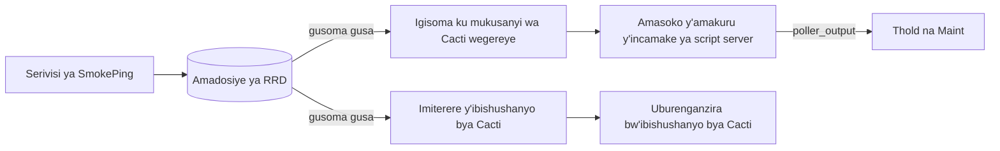

<!-- Source: README.md; SHA256: 17905aa1eac76a7d10dab526734605629fa3d1ada56397642ad4154c5be1feff -->

<!-- translations:start -->
[English](../../../README.md) | [简体中文](../zh-CN/README.md) | [हिन्दी](../hi-IN/README.md) | [Español (España)](../es-ES/README.md) | [Español (Latinoamérica)](../es-419/README.md) | [العربية (السعودية)](../ar-SA/README.md) | [Afrikaans](../af-ZA/README.md) | [አማርኛ](../am-ET/README.md) | [العربية (مصر)](../ar-EG/README.md) | [العربية (المغرب)](../ar-MA/README.md) | [বাংলা](../bn-BD/README.md) | [Deutsch](../de-DE/README.md) | [فارسی](../fa-IR/README.md) | [Filipino](../fil-PH/README.md) | [Français](../fr-FR/README.md) | [Français (Maroc)](../fr-MA/README.md) | [Français (Sénégal)](../fr-SN/README.md) | [Hausa](../ha-NG/README.md) | [עברית](../he-IL/README.md) | [Bahasa Indonesia](../id-ID/README.md) | [Igbo](../ig-NG/README.md) | [Italiano](../it-IT/README.md) | [日本語](../ja-JP/README.md) | [한국어](../ko-KR/README.md) | [Malagasy](../mg-MG/README.md) | [मराठी](../mr-IN/README.md) | [Bahasa Melayu](../ms-MY/README.md) | [Nederlands](../nl-NL/README.md) | [Polski](../pl-PL/README.md) | [Português (Brasil)](../pt-BR/README.md) | [Русский](../ru-RU/README.md) | [Kinyarwanda](README.md) | [Soomaali](../so-SO/README.md) | [Svenska](../sv-SE/README.md) | [Kiswahili](../sw-KE/README.md) | [தமிழ்](../ta-IN/README.md) | [తెలుగు](../te-IN/README.md) | [ไทย](../th-TH/README.md) | [Türkçe](../tr-TR/README.md) | [Українська](../uk-UA/README.md) | [اردو](../ur-PK/README.md) | [Tiếng Việt](../vi-VN/README.md) | [isiXhosa](../xh-ZA/README.md) | [Yorùbá](../yo-NG/README.md) | [繁體中文](../zh-TW/README.md) | [isiZulu](../zu-ZA/README.md)
<!-- translations:end -->

  <picture>
    <source media="(prefers-color-scheme: dark)" srcset="../../images/logo_dark.png">
    
  </picture>

# Umugereka wa SmokePing kuri Cacti

Umugereka wa Cacti 1.2 uzana ibipimo by'igihe cyo gutinda (latency) n'igihombo cy'amapaketi (loss) bya SmokePing muri Cacti nk'ibikoresho bisanzwe, amasoko y'amakuru, n'ibishushanyo. Ibishushanyo bya smoke bihita bijya iruhande rw'igikoresho bigenerwa, bigengwa n'uburenganzira bwa Cacti, kandi Thold na Maint bishobora gutanga impuruza no kuzihagarika by'agateganyo. Ni umushinga wigenga wakorewe Cacti kandi nturi mu bagize cyangwa ngo wemezwe na [SmokePing](https://oss.oetiker.ch/smokeping/), ifite abahanzi bayo b'umwimerere ari bo Tobias Oetiker na Niko Tyni. Uyu mugereka ntukubiyemo kandi ntukoresha kode ya SmokePing: usoma igenamiterere n'amadosiye ya RRD byandikwa na SmokePing, kandi imiterere y'ibishushanyo byawo yubatswe kugira ngo ishushe uruhererekane rumwe n'urw'ibishushanyo bya SmokePing ubwayo.

> **Imiterere: irimo gutunganywa. Uburyo bwo gukurikirana (icyiciro cya 1) bwashyizwe mu bikorwa kuri `main` kandi bwasohowe nka verisiyo y'ibanze ya 1.0.0-rc.1.** Uyu mugereka usoma igenamiterere n'amadosiye ya RRD bya SmokePing, ukagaragaza uko bihagaze, ugakora ibikoresho bya Cacti, amasoko y'amakuru, n'ibishushanyo bibigenewe, kandi ugatanga amakuru kuri Thold na Maint. Ntacyo wandika muri SmokePing. Uburyo bugenzurwa (aho umugereka wandika igenamiterere rya SmokePing) n'ibikusanya makuru biri kure ni ibyiciro bizakurikiraho, ntibiratangira, kandi ntibiri muri iyi verisiyo. Igerageza ku mishinga ikora koko no kunoza neza irangamiterere ry'ibishushanyo bya SmokePing biracyafunguye mu cyiciro cya 4. Reba [docs/install.md](../../install.md) kugira ngo utangire.

## Inshingano z'uburenganzira

| Urwego | Uburenganzira |
| --- | --- |
| SmokePing View | Amapaji yo gukurikirana asanzweho. |
| SmokePing Operator | Gukurikirana hiyongereyeho ipaji y'ibikorwa no kwemeza ko umuntu yitaye ku kibazo ku giti cye. |
| SmokePing Admin | Uburenganzira bwa Operator hiyongereyeho igenamiterere risanzweho n'ibikorwa by'ubuyobozi. |

Nyuma yo gukoporora amadosiye y'ivugurura, fungura ipaji ya Plugins nk'umuyobozi mukuru kugira ngo wandikishe urwego rushya. Tanga urwego rwa Operator ku buryo bweruye munsi ya **Configuration > Users** cyangwa amatsinda y'abakoresha.
Amavugurura agumana nimero z'inzego n'uburenganzira bya View na Admin bisanzweho. Uburenganzira bwa Admin buragura ubwa Operator, kandi ubwa Operator bukagura ubwa View kuri buri busabe; ibi ntibyiyongera ku burenganzira bubitswe ku bakoresha cyangwa amatsinda. Igenamiterere ry'umugereka na ryo risaba uburenganzira bwa SmokePing Admin hiyongereyeho uruhushya rwa Settings muri Cacti.

Uburenganzira bw'ibikoresho muri Cacti bukomeza kugena imirongo n'ibikorwa buri mukoresha yemerewe; ibikoresho bitarahuzwa bisaba umuyobozi mukuru.
Imyirondoro y'ibanga, igenamiterere, ihuza, gusiba n'izindi mpinduka z'ubuyobozi biguma mu mapaji y'ubuyobozi. Ibyemezo byo kwita ku kibazo bimara gusa igihe cy'isaha imwe mu gihe umukoresha akiri mu mukoro we kandi igihe igipimo kimwe gikiri gishya. Ibipimo bishya cyangwa byahindutse bihita bibitesha agaciro. Ntibishobora na rimwe kwerekana ko igipimo cyananiwe kimeze neza cyangwa ngo bihagarike impuruza.

## Amashusho y'imikorere

Byakuwe mu muyoboro ukora wa SmokePing 2.8.2 bijyanwa muri Cacti 1.2.31, mu masaha 12 ashize. Buri gikoresho cy'intego gifite igishushanyo cya smoke ku mukoresha mukuru n'ikindi kuri buri mugenzuzi wungirije (`lon1`, `sgp1`), kibikwa munsi y'igice cyacyo cya SmokePing mu giti cy'ibishushanyo.

## Impamvu

SmokePing ipima neza ikwirakwira ry'igihe cyo gutinda n'igihombo cy'amapaketi, kandi ibishushanyo byayo bya smoke bigaragaza ihindagurika igishushanyo kigaragaza impuzandengo gusa gihisha. Iyo ikorana na Cacti, hasigara ibyuho bitatu:

- **Igenzura ry'uburenganzira ritandukanye.** CGI ya SmokePing ntacyo izi ku bakoresha ba Cacti, amatsinda, cyangwa uburenganzira ku bikoresho.
- **Nta makuru ahuza n'igikoresho.** Igihe cyo gutinda n'ibipimo by'imiyoboro ku gikoresho kimwe biba mu bikoresho bitandukanye.
- **Nta nzira igana mu mpuruza za Cacti.** Thold na Maint bikorera ku masoko y'amakuru n'ibikoresho bya Cacti, bityo impuruza za SmokePing zigenwa kandi zigahagarikwa ukubiri.

Uyu mugereka ufunga ibi byuho uhagarariye buri ntego ya SmokePing nk'ibikoresho bya Cacti byerekeza ku madosiye ya RRD ya SmokePing asanzweho, hiyongereyeho umubare muto w'agaciro k'incamake gakusanywa. Wifashisha ibishushanyo bya Cacti, uburenganzira, Thold, na Maint aho kubaka ibindi bibisimbura. Inkunga y'ibikusanya makuru bya Cacti biri kure iteganyijwe mu cyiciro cya 3 kandi ntiri muri iyi verisiyo.

## Imiterere n'ibyo umushinga ugezeho

| Icyiciro | Ibikubiyemo | Intego z'ibyiciro | Uko bihagaze |
|---|---|---|---|
| 0, ubushakashatsi | Imbonerahamwe y'imikoranire, kwemeza imyitwarire y'umushinga w'umwimerere, igerageza ry'ubunyakuri bw'igishushanyo | [M1](https://github.com/somethingwithproof/plugin_smokeping/milestone/1) | Ibyavuyemo biri muri `docs/research`; ibibazo bimwe by'ubushakashatsi biracyafunguye |
| 1, gukurikirana | Kwinjiza urutonde rw'ibikoresho, ibikoresho bya Cacti, ibishushanyo bya smoke n'iby'incamake, impuruza za Thold, ihagarika rya Maint, ipaji y'ubuzima | [M2](https://github.com/somethingwithproof/plugin_smokeping/milestone/2), [M3](https://github.com/somethingwithproof/plugin_smokeping/milestone/3), [M4](https://github.com/somethingwithproof/plugin_smokeping/milestone/4) | Yasohotse nka 1.0.0-rc.1; amagerageza arafunguye |
| 2, kugenzurwa | Umwanya w'amazina y'igenamiterere ugengwa na Cacti, imiterere yo kugenzura ICMP na TCP, amavugurura, isuzuma, kongera gutangiza, gusubiza inyuma | [M5](https://github.com/somethingwithproof/plugin_smokeping/milestone/5) | Birateganyijwe, ntibiratangira |
| 3, kure | SmokePing ku bikusanya makuru bya Cacti biri kure, abagenzuzi bungirije nk'ahantu ho gupimira | [M6](https://github.com/somethingwithproof/plugin_smokeping/milestone/6) | Birateganyijwe, ntibiratangira |

Ibitari mu nshingano: moteri y'impuruza yihariye y'umugereka, moteri ya raporo, porogaramu yihariye cyangwa porotokole y'umuyoboro, igenzura rya HTTP/DNS/serivisi rigengwa (servcheck irabikora), no kwandika mu madosiye ya RRD ya SmokePing.

## Ibyo umugereka ugomba gukorana na byo

| Igice | Intego |
|---|---|
| Cacti | 1.2.31 cyangwa hejuru yayo muri 1.2.x, nta mpinduka mu mushinga fatizo |
| PHP | 8.2 cyangwa hejuru yayo; `setup.php` iguma isomeka kuri 8.0 kugira ngo verisiyo idashyigikiwe ihabwe ubutumwa bwo kwangwa aho kwangiza imigaragarire ya Cacti |
| SmokePing | 2.9.0, 2.8.2, na 2.7.3 (Ubuntu 22.04 gusa, kugeza ku ya 2027-06-01) |
| Thold, Maint | Nta mpinduka zisabwa |
| Uruhererekane | 10,000 kuri buri mushinga ku mipimire 20 n'intera y'amasegonda 300 ([imikorere](../../performance.md#supported-series-count)) |

## Inyandiko

| | |
|---|---|
| [Kwinjiza](../../install.md) | Ibisabwa, gucomeka ububiko bw'amakuru ya SmokePing mu buryo bwo gusoma gusa, iyinjiza, kontineri, verisiyo zishyigikiwe |
| [Gukoresha](../../operations.md) | Icyo buri miterere isobanura n'ibimenyetso byayo, isuzuma ry'ubuzima, imyitwarire iyo amakuru yinjizwa ananiwe |
| [Kongera intego muri Cacti](../../provisioning.md) | Intego imwe, ibikoresho byinshi, kongera guhuza, uburenganzira |
| [Impuruza](../../alerting.md) | Agaciro k'incamake, ibihe bya Thold, gusaza kw'amakuru, amakuru akererewe, guhura n'impuruza za SmokePing, Maint |
| [Imiterere y'igenamiterere](../../configuration-format.md) | Gusohora no kwinjiza YAML na XML |
| [Kubika no kugarura](../../backup-restore.md) | Ibyo kubika n'uko kugarura bikomeza |
| [Imikorere](../../performance.md) | Ibipimo byo ku rwego rw'aho bikorerwa n'ibyo mu gihe cyo gusohora ku ruhererekane 100, 1,000, na 10,000, n'umubare w'uruhererekane rushyigikiwe: 10,000 kuri buri mushinga |
| [Isuzuma ry'ikosa](../../failure-qualification.md) | Ibice by'ikosa n'uko buri kimwe gipimwa |
| [Gusohora verisiyo](../../RELEASING.md) | Uburyo bwo gusohora: ubusabe bwo guhuza impinduka, ikimenyetso gisinywe, icyo uruhererekane rw'imirimo rukora, uko wagenzura ibyavuyemo |
| [Ububiko bw'amasohoka](../../release.md) | Verisiyo, urutonde rw'impinduka, n'ububiko bw'amasohoka |
| [Isuzuma](../../testing.md) | Ibice by'isuzuma, ibyo CI ikoresha, n'isuzuma ritaziguye kuri SmokePing nyayo |

## Imiterere y'ubwubatsi

- [docs/PLAN.md](../../PLAN.md) ni igenamigambi ryuzuye: imiterere y'ubwubatsi, amakuru y'umushinga w'umwimerere rishingiyeho (hamwe n'amasoko), icyitegererezo cy'imiterere, imipaka y'umutekano, imibare y'imikorere, isuzuma, n'ibyago.
- [docs/decisions/](../../decisions) ibitse inyandiko z'ibyemezo by'ubwubatsi ku mahitamo yamaze gufatwa.
- [docs/REQUIREMENTS.md](../../REQUIREMENTS.md) ihuza buri nimero y'ibisabwa n'ikibazo cyayo.

## Uko imirimo ikurikiranwa

- **Intego z'ibyiciro** zikurikira intego z'igenamigambi. Buri imwe ifite ikibazo gikuru kigaragaza ibibazo bito biyigize n'ibimenyetso byo gusohokamo.
- **Ibibazo** bitondekwa hakoreshejwe uturango: `type: requirement`, `type: research`, `type: decision`, `type: epic`. Ibibazo by'ibisabwa bigaragaza ibisabwa bifite nimero bishobora gupimwa (`REQ-AREA-NNN`) n'ibipimo byo kwemerwa.
- **Uturango** tunafite `area:`, `phase:`, `priority:`, na `status:`. Reba [CONTRIBUTING.md](../../../CONTRIBUTING.md#labels).
- [Imbonerahamwe y'umushinga](https://github.com/users/somethingwithproof/projects/6) igaragaza ibibazo byose mu byiciro byose.

## Gutanga umusanzu

Soma [CONTRIBUTING.md](../../../CONTRIBUTING.md). Ibikorwa byoherezwa bisaba umukono wa DCO. Ibiganirwa ku miterere bibera ku bibazo; ibyemezo bitarafatwa bifite ikirango cya `type: decision`.

## Umutekano

Menyesha intege nke mu ibanga; reba [SECURITY.md](../../../SECURITY.md).

## Uruhushya

GNU General Public License v2.0, uruhushya rumwe n'urwa Cacti n'imigereka yayo. Reba [LICENSE](../../../LICENSE).
