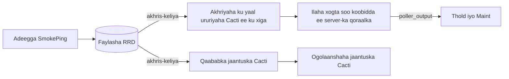

<!-- Source: README.md; SHA256: b41ec705327127cc34ff07d1514a141262752f99c5e2296fdc323d584a777b84 -->

<!-- translations:start -->
[English](../../../README.md) | [简体中文](../zh-CN/README.md) | [हिन्दी](../hi-IN/README.md) | [Español (España)](../es-ES/README.md) | [Español (Latinoamérica)](../es-419/README.md) | [العربية (السعودية)](../ar-SA/README.md) | [Afrikaans](../af-ZA/README.md) | [አማርኛ](../am-ET/README.md) | [العربية (مصر)](../ar-EG/README.md) | [العربية (المغرب)](../ar-MA/README.md) | [বাংলা](../bn-BD/README.md) | [Bosanski](../bs-BA/README.md) | [Deutsch](../de-DE/README.md) | [فارسی](../fa-IR/README.md) | [Filipino](../fil-PH/README.md) | [Français](../fr-FR/README.md) | [Français (Maroc)](../fr-MA/README.md) | [Français (Sénégal)](../fr-SN/README.md) | [Hausa](../ha-NG/README.md) | [עברית](../he-IL/README.md) | [Hrvatski](../hr-HR/README.md) | [Bahasa Indonesia](../id-ID/README.md) | [Igbo](../ig-NG/README.md) | [Italiano](../it-IT/README.md) | [日本語](../ja-JP/README.md) | [한국어](../ko-KR/README.md) | [Malagasy](../mg-MG/README.md) | [मराठी](../mr-IN/README.md) | [Bahasa Melayu](../ms-MY/README.md) | [Nederlands](../nl-NL/README.md) | [Polski](../pl-PL/README.md) | [Português (Brasil)](../pt-BR/README.md) | [Русский](../ru-RU/README.md) | [Kinyarwanda](../rw-RW/README.md) | [Soomaali](README.md) | [Српски](../sr-RS/README.md) | [Svenska](../sv-SE/README.md) | [Kiswahili](../sw-KE/README.md) | [தமிழ்](../ta-IN/README.md) | [తెలుగు](../te-IN/README.md) | [ไทย](../th-TH/README.md) | [Türkçe](../tr-TR/README.md) | [Українська](../uk-UA/README.md) | [اردو](../ur-PK/README.md) | [Tiếng Việt](../vi-VN/README.md) | [isiXhosa](../xh-ZA/README.md) | [Yorùbá](../yo-NG/README.md) | [繁體中文](../zh-TW/README.md) | [isiZulu](../zu-ZA/README.md)
<!-- translations:end -->

  <picture>
    <source media="(prefers-color-scheme: dark)" srcset="../../images/logo_dark.png">
    
  </picture>

# Ku-xiraha SmokePing ee Cacti

Ku-xire loogu talagalay Cacti 1.2 oo cabbiraadaha daahitaanka iyo lumista xogta ee SmokePing u keena gudaha Cacti iyagoo ah qalabyo caadi ah, ilo xogeed, iyo jaantusyo. Jaantusyada qiiqa waxay markaa ag fadhiisanayaan qalabka ay khuseeyaan, iyadoo la raacayo ogolaanshaha Cacti, waxaana Thold iyo Maint ay ka soo saari karaan digniino ama hakin karaan. Waa hirgelin madax-bannaan oo loogu talagalay Cacti mana aha qayb ka mid ah, mana taageero, [SmokePing](https://oss.oetiker.ch/smokeping/), oo qorayaashiisii asalka ahaa ay yihiin Tobias Oetiker iyo Niko Tyni. Ku-xiruhu kuma jiro mana socodsiiyo koodhka SmokePing: wuxuu akhriyaa faylasha qaabeynta iyo RRD ee SmokePing qoro, qaababka jaantuskiisuna waxay u dhisan yihiin inay sawiraan taxanaha la midka ah jaantusyada SmokePing.

> **Xaaladda: waa la horumarinayaa. Habka indha-indheynta (weji 1) waxaa lagu hirgeliyay `main` (1.0.0-rc.1) iyadoo leh shaandhaynta hawlwadeenka, dhoofinta CSV, ogaanshaha RRD-yada agoonta ah, tarjumaadda digniinta Thold, hooks-ka isdhexgalka nidaamka deegaanka, iyo koobiyaynta ururiyaha fog.** Ku-xiruhu wuxuu akhriyaa qaabeynta iyo faylasha RRD ee SmokePing, wuxuu muujiyaa xaaladdooda, wuxuu u abuuraa qalabyada Cacti, ilaha xogta, iyo jaantusyada, wuxuuna quudiyaa Thold iyo Maint. Waxba kuma qoro SmokePing. Habka la maamulo (ku-xiraha oo qoraya qaabeynta SmokePing) waa weji dambe, lama bilaabin, kumana jiro sii-deyntan. Tijaabooyinka rakibaadaha dhabta ah iyo iswaafajinta dhow ee calaamadaha jaantuska SmokePing wali way furan yihiin marxaladda 4. Eeg [docs/install.md](../../install.md) si aad u bilowdo.

## Doorka gelitaanka

| Aagga | Gelitaanka |
| --- | --- |
| SmokePing View | Boggaga kormeerka ee jira. |
| SmokePing Operator | Kormeerka oo lagu daray bogga Hawlgallada iyo qirashooyinka kala-soocidda shakhsi ahaaneed. |
| SmokePing Admin | Gelitaanka Operator oo lagu daray qaabeynta jirta iyo hawlaha maamulka. |

Ka dib marka aad koobiyeyso faylasha cusbooneysiinta, u fur bogga Plugins adigoo ah maamule si aad u diiwaangeliso
aagga cusub. Si cad u meel-mari aagga Operator hoostiisa **Configuration > Users** ama kooxaha isticmaalayaasha.
Cusbooneysiintu waxay ilaalisaa aqoonsiyada aagga View iyo Admin ee jira iyo ogolaanshaha. Gelitaanka Admin
wuxuu dhaxlaa gelitaanka Operator, gelitaanka Operator wuxuuna dhaxlaa gelitaanka View codsi kasta;
tani kuma kordhiso ogolaansho kaydsan isticmaalayaasha ama kooxaha. Dejinta ku-xiruhu waxay sidoo kale u baahan tahay
gelitaanka SmokePing Admin marka lagu daro ogolaanshaha Settings ee Cacti.

Ogolaanshaha qalabka Cacti wali waxay xaddidaan safafka iyo falalka u bannaan isticmaale kasta; walxaha aan la meeleyn waxay u baahan yihiin maamule.
Aqoonsiyada sirta ah, qaabeynta, meelaynta, tirtiridda iyo isbeddellada kale ee maamulka
waxay ku sii jiraan boggaga maamulka. Qirashooyinku waxay shaqeeyaan oo keliya fadhiga hadda ee
isticmaalaha, ugu badnaan hal saac iyo oo keliya inta isla indha-indheyntu ay tahay
mid cusub. Indha-indheynaha cusub ama isbeddelay way buriyaan iyaga. Waligood cabbiraad
fashilantay kama dhigaan mid caafimaad qabta mana joojiyaan digniinaha.

## Sawirrada shaashadda

Waxaa laga soo dejiyay shabakad SmokePing 2.8.2 ah oo shaqeyneysa laguna daray Cacti 1.2.31, 12-kii saac ee la soo dhaafay. Qalab kasta oo bartilmaameed ah wuxuu leeyahay jaantus qiiq ah oo loogu talagalay master-ka iyo mid kasta oo ka mid ah slave-yada (`lon1`, `sgp1`), oo lagu kaydiyay qaybta SmokePing ee geedka jaantuska.

## Sababta

SmokePing waxay si fiican u cabbirtaa qaybinta daahitaanka iyo lumista baakidhada, jaantusyadeeda qiiqana waxay muujiyaan kala duwanaanshaha uu qariyo jaantuska celceliska keliya ah. Marka lala socodsiiyo Cacti, wuxuu ka tagaa saddex dalool:

- **Xakamaynta gelitaanka oo kala duwan.** CGI-ga SmokePing waxba kama yaqaan isticmaalayaasha Cacti, kooxaha, ama ogolaanshaha qalabka.
- **Ma jiro macnaha guud ee qalabka.** Daahitaanka iyo tiriyeyaasha interface-ka ee isla qalabka waxay ku nool yihiin qalab kala duwan.
- **Ma jirto waddo u gasha digniinaha Cacti.** Thold iyo Maint waxay ka shaqeeyaan ilaha xogta iyo qalabyada Cacti, sidaa darteed digniinaha SmokePing si gooni ah ayaa loo qaabeeyaa loona joojiyaa.

Ku-xiruhu wuxuu xiraa dalooladan isagoo u metelaya bartilmaameed kasta oo SmokePing ah sida walxaha Cacti oo tilmaamaya faylasha RRD ee SmokePing ee jira, oo lagu daray tiro yar oo qiimayaal soo koobid ah oo la soo ururiyay. Wuxuu dib u isticmaalaa jaantusyada Cacti, ogolaanshaha, Thold, iyo Maint halkii uu ka dhisi lahaa noocyo isbarbar socda. Koobiyaynta qaabeynta ee baaxadda poller-ka ku xaddidan (`replicate_out`) waxay riixdaa miisaska qaabeynta poller-ka fog iyadoo ilaalinaysa habka gudaha (poller 1) iyo kaydka indha-indheynta gudaha ee ururiyaha inay kala go'an yihiin.

## Baaxadda iyo xaaladda

| Weji | Baaxadda | Marxaladaha | Xaaladda |
|---|---|---|---|
| 0, cilmi-baaris | Shaxda iswaafajinta, xaqiijinta hab-dhaqanka kore, tijaabada saxnaanta jaantuska | [M1](https://github.com/somethingwithproof/plugin_smokeping/milestone/1) | Natiijooyinku waxay ku jiraan `docs/research`; qaar ka mid ah arrimaha cilmi-baaristu way furan yihiin |
| 1, indha-indheyn | Soo dejinta liiska hantida, qalabyada Cacti, jaantusyada qiiqa iyo soo koobidda, digniinta Thold iyo tarjumaadda digniinta, xakamaynta Maint, muuqaallada la shaandheeyay, dhoofinta CSV, ogaanshaha RRD-yada agoonta ah, hooks-ka nidaamka deegaanka | [M2](https://github.com/somethingwithproof/plugin_smokeping/milestone/2), [M3](https://github.com/somethingwithproof/plugin_smokeping/milestone/3), [M4](https://github.com/somethingwithproof/plugin_smokeping/milestone/4) | Waa la hirgeliyay; tijaabooyinku way furan yihiin |
| 2, la maamulo | Goobta magaca qaabeynta ee Cacti leedahay, qaababka baaritaanka ICMP iyo TCP, dib-u-eegisyada, xaqiijinta, dib-u-dejinta, dib-u-celinta | [M5](https://github.com/somethingwithproof/plugin_smokeping/milestone/5) | Qorsheysan, lama bilaabin |
| 3, meel fog | Weydiimaha baaxadda poller-ka ku xaddidan iyo koobiyaynta miisaska `replicate_out` ee ururiyeyaasha xogta fog (`RemoteReplication`); xaqiijinta buuxda ee rakibaadda SmokePing ee ururiyeyaal badan | [M6](https://github.com/somethingwithproof/plugin_smokeping/milestone/6) | Koobiyaynta iyo baaxadda poller-ka waa la hirgeliyay; xaqiijinta rakibaadda ururiyeyaal badan way furan tahay |

Socodka shaqada ee hawlwadeenka, amarrada CLI, iyo hooks-ka nidaamka deegaanka ee la hirgeliyay:

- **Shaandhaynta liiska hantida iyo bartilmaameedyada (`smokeping_inventory.php`, `smokeping.php`)**: `TargetFilter`, `TargetRepository::filteredForPoller()`, `InventoryPage`, iyo `ViewPage` waxay bixiyaan raadin (`filter`), baaritaan (`probe`), joogitaanka liiska hantida (`presence`), xaaladda meelaynta (`mapping`), xaaladda cusboonaanta (`state`), iyo kala-qaybinta boggaga ikhtiyaariga ah (`rows`: `All`, `25`, `50`, `100`, `200`). Muuqashada qalabka waxaa lagu dhaqan-geliyaa SQL ka hor tirinta si wadartu aanay waligood u muujin qalabyo qarsoon.
- **Dhoofinta CSV (`smokeping.php?action=export_csv`)**: `CsvExporter` waxay soo saartaa wax-soo-saar RFC 4180 CRLF ah oo loogu talagalay muuqaalka la shaandheeyay ee firfircoon iyadoo la raacayo ogolaanshaha qalabka ee wacaha, iyadoo gelinaysa hakad sare (apostrophe) horraysa unugyada ku bilaabma `=`, `+`, `-`, `@`, tab, ama carriage return si looga hortago qaaciddooyinka xaashida xisaabta.
- **Ogaanshaha RRD-yada agoonta ah (`smokeping_health.php`)**: `OrphanRrdScanner` iyo `HealthCheck::orphanRrds()` waxay sameeyaan baaris xaddidan oo lagu sameeyo galka SmokePing ee ku xiran poller-ka akhrinta, iyagoo ka boodaya `__cgi`, `__sortercache`, iyo xiriiriyayaasha calaamadaha (symbolic links), isla markaana isku barbardhigaya faylasha `.rrd` ee aan lahayn milkiile iyo soo-jeedinta dib-u-xiridda ee furan.
- **U-beddelidda SmokePing ee Thold (`smokeping_health.php`, `cli/smokeping.php`)**: `TholdTranslator` iyo `TholdGenerator` waxay akhriyaan qeexitaannada SmokePing `*** Alerts ***` waxayna u tarjumaan qaababka lumista isdaba-joogga ah ee la taageero xadadka Thold `loss_pct` ee u dhigma iyaga oo aan wax ka beddelin faylasha qaabeynta SmokePing. Socodka shabakadu wuxuu isticmaalaa hor-u-eegis GET (`action=thold_preview`, `HealthPage::renderTholdPreview()`) oo ay ku xigto POST uu ilaaliyo CSRF (`action=thold_create`). Qaababka aan la taageerin (digniinaha RTT, hoos u dhaca wildcard, heerar isku dhafan) waa laga boodaa iyadoo aan waxba la qorin.
- **CLI-ga maamulaha (`cli/smokeping.php`)**: wuxuu taageeraa `provision <target path> [--device=ID] [--location=NAME]`, `relink <old target path> <new target path> [--location=NAME]`, `thold-generate <target path> [--alert=NAME] [--apply]`, `size-graphs`, `upgrade-graphs`, `export [--format=yaml|xml] [--file=PATH]`, `import --file=PATH [--format=yaml|xml] [--apply --confirm=PLAN]`, iyo `import-smokeping [--dry-run | --apply --confirm=PLAN] [--file=PATH] [--sections=A,B/C] [--device-per=host|target] [--device-template=ID] [--poller=ID] [--site=ID] [--tree=ID | --tree-name=NAME]`.
- **Hooks-ka nidaamka deegaanka (`setup.php`, `Schema::HOOKS`)**: waxay diiwaangeliyaan 21 hooks, oo ay ku jiraan `abilities_register` (`AbilitiesProvider`: `smokeping-list-targets` iyo `smokeping-get-health` oo akhris-keliya ah, oo ku xaddidan goobta View iyadoo la eegayo aqoonsiga isticmaalaha wacaha, aan soo celinayn wax sir ah), `doctor_register_checks` (`DoctorChecks`: `smokeping_stale_targets`, `smokeping_freshness_breaches`, `smokeping_orphan_rrds`, `smokeping_config_path`), `casc_register_providers` (`CascProvider`: `export`, `validate`, `plan`, iyo `apply` ee `smokeping` YAML/XML oo ay taageerayaan `ConfigCodec` iyo `ConfigService`), iyo `replicate_out` (`RemoteReplication`: isku-dubbaridka baaxadda poller-ka ee `plugin_smokeping_target`, `plugin_smokeping_mapping`, `plugin_smokeping_object`, iyo `plugin_smokeping_relink` ee poller-rada fog ee leh `poller_id > 1`).

Baxsan baaxadda: mashiin digniin oo ku-xiruhu leeyahay, mashiin warbixin, borotokool shabakad ama adeeg gaar ah, hubinno HTTP/DNS/adeeg oo la maamulo (servcheck ayaa daboola), iyo wax ka qoridda faylasha RRD ee SmokePing.

## Bartilmaameedyada iswaafajinta

| Qaybta | Bartilmaameedka |
|---|---|
| Cacti | 1.2.31 ama ka dambeeya ee 1.2.x, ma jiraan wax ka beddel xudunta ah |
| PHP | 8.2 ama ka dambeeya; `setup.php` wuxuu ku sii jiri karaa mid la fasiri karo 8.0 si deegaanka aan la taageerin uu u helo diidmo halkii uu ka heli lahaa Cacti UI jaban |
| SmokePing | 2.9.0, 2.8.2, iyo 2.7.3 (Ubuntu 22.04 keliya, ilaa 2027-06-01) |
| Thold, Maint | Looma baahna wax isbeddel ah |
| Taxanaha | 10,000 halkii rakibaadba iyadoo la adeegsanayo 20 ping iyo tallaabo 300 s ah ([waxqabadka](../../performance.md#supported-series-count)) |

## Dukumentiyada

| | |
|---|---|
| [Rakib](../../install.md) | Shuruudaha, ku-xiridda akhriska-keliya ee galka xogta SmokePing, rakibidda, weelasha, noocyada la taageero |
| [Hawl-geli](../../operations.md) | Waxa xaalad kastaa ka dhigan tahay iyo caddaynteeda, hubinta caafimaadka, hab-dhaqanka marka xogta gelintu fashilanto |
| [Ku dar bartilmaameedyo Cacti](../../provisioning.md) | Hal bartilmaameed, qalabyo badan, dib-u-xirid, ogolaansho |
| [Digniinta](../../alerting.md) | Qiimayaasha soo koobidda, muddooyinka Thold, duugoobidda, xogta daahday, is-dulsaarka digniinaha SmokePing, Maint |
| [Qaabka qaabeynta](../../configuration-format.md) | Dhoofinta iyo soo dejinta YAML iyo XML |
| [Kaydinta iyo soo celinta](../../backup-restore.md) | Waxa la kaydinayo iyo sida soo celintu u sii socoto |
| [Waxqabadka](../../performance.md) | Cabbiraadaha gudaha iyo kuwa sii-deynta ee 100, 1,000, iyo 10,000 taxane, iyo tirada taxanaha la taageero: 10,000 halkii rakibaadba |
| [Xaqiijinta fashilka](../../failure-qualification.md) | Xaaladaha fashilka iyo sida mid kasta loo tijaabiyo |
| [Sii-deynta](../../RELEASING.md) | Habraaca sii-deynta: codsiga jiidista, calaamadda saxiixan, waxa habka shaqadu qabto, sida loo xaqiijiyo natiijada |
| [Kaydka sii-deynta](../../release.md) | Nooca, diiwaanka isbeddellada, iyo kaydka sii-deynta |
| [Tijaabinta](../../testing.md) | Qaybaha tijaabada, waxa CI socodsiiso, iyo tijaabada tooska ah ee ka dhanka ah SmokePing dhabta ah |

## Naqshadda

- [docs/PLAN.md](../../PLAN.md) waa qorshaha buuxa: qaab-dhismeedka, xaqiiqooyinka kore ee uu ku tiirsan yahay (oo leh ilo), qaabka xaaladda, xuduudaha amniga, xisaabinta waxqabadka, tijaabinta, iyo khataraha.
- [docs/decisions/](../../decisions) wuxuu hayaa diiwaannada go'aannada qaab-dhismeedka ee doorashooyinka hore loo sameeyay.
- [docs/REQUIREMENTS.md](../../REQUIREMENTS.md) wuxuu ku xiraa aqoonsi kasta oo shuruud ah arrintiisa.
- Xaqiijinta gudaha waxay socodsiisaa hubinta cutubka iyo xeerarka isha ee Pest (`pest --configuration=phpunit.xml`), PHPStan Level 9 (`CACTI_PATH=<cacti-dir> phpstan analyse -c phpstan.neon --no-progress`), hubinta naxwaha barta gelitaanka (`php -l` ee `*.php`, `include/*.php`, `scripts/*.php`, `cli/*.php`), iyo hubinta tarjumaadda (`sh locales/build_gettext.sh --check`). Eeg [docs/testing.md](../../testing.md) wixii ku saabsan qaybaha isdhexgalka iyo kuwa dhammaad-ka-dhammaad ee weelka.

## Sida shaqada loola socdo

- **Marxaladaha** waxay raacaan marxaladaha qorshaha. Mid kastaa wuxuu leeyahay arrin weyn oo taxaysa arrimaha hoose iyo caddaynta ka bixitaanka.
- **Arrimaha** waxaa lagu kala soocaa calaamad: `type: requirement`, `type: research`, `type: decision`, `type: epic`. Arrimaha shuruudaha waxay sheegaan shuruudo tiro leh oo la tijaabin karo (`REQ-AREA-NNN`) iyo shuruudaha oggolaanshaha.
- **Calaamaduhu** waxay sidoo kale sitaan `area:`, `phase:`, `priority:`, iyo `status:`. Eeg [CONTRIBUTING.md](../../../CONTRIBUTING.md#labels).
- [Guddiga mashruuca](https://github.com/users/somethingwithproof/projects/6) wuxuu muujinayaa dhammaan arrimaha marxaladaha oo dhan.

## Wax-ku-biirinta

Akhri [CONTRIBUTING.md](../../../CONTRIBUTING.md). Gudbinta koodhku waxay u baahan tahay saxiix DCO ah. Doodda naqshaddu waxay ka dhacdaa arrimaha dushooda; go'aannada furan waxay sitaan calaamadda `type: decision`.

## Amniga

U soo sheeg dayacanka si qarsoodi ah; eeg [SECURITY.md](../../../SECURITY.md).

## Shatiga

GNU General Public License v2.0, waa isla shatiga ay leeyihiin Cacti iyo ku-xirayaashiisa. Eeg [LICENSE](../../../LICENSE).
