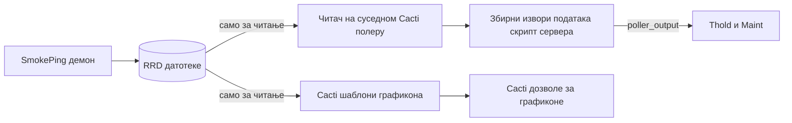

<!-- Source: README.md; SHA256: b41ec705327127cc34ff07d1514a141262752f99c5e2296fdc323d584a777b84 -->

<!-- translations:start -->
[English](../../../README.md) | [简体中文](../zh-CN/README.md) | [हिन्दी](../hi-IN/README.md) | [Español (España)](../es-ES/README.md) | [Español (Latinoamérica)](../es-419/README.md) | [العربية (السعودية)](../ar-SA/README.md) | [Afrikaans](../af-ZA/README.md) | [አማርኛ](../am-ET/README.md) | [العربية (مصر)](../ar-EG/README.md) | [العربية (المغرب)](../ar-MA/README.md) | [বাংলা](../bn-BD/README.md) | [Bosanski](../bs-BA/README.md) | [Deutsch](../de-DE/README.md) | [فارسی](../fa-IR/README.md) | [Filipino](../fil-PH/README.md) | [Français](../fr-FR/README.md) | [Français (Maroc)](../fr-MA/README.md) | [Français (Sénégal)](../fr-SN/README.md) | [Hausa](../ha-NG/README.md) | [עברית](../he-IL/README.md) | [Hrvatski](../hr-HR/README.md) | [Bahasa Indonesia](../id-ID/README.md) | [Igbo](../ig-NG/README.md) | [Italiano](../it-IT/README.md) | [日本語](../ja-JP/README.md) | [한국어](../ko-KR/README.md) | [Malagasy](../mg-MG/README.md) | [मराठी](../mr-IN/README.md) | [Bahasa Melayu](../ms-MY/README.md) | [Nederlands](../nl-NL/README.md) | [Polski](../pl-PL/README.md) | [Português (Brasil)](../pt-BR/README.md) | [Русский](../ru-RU/README.md) | [Kinyarwanda](../rw-RW/README.md) | [Soomaali](../so-SO/README.md) | [Српски](README.md) | [Svenska](../sv-SE/README.md) | [Kiswahili](../sw-KE/README.md) | [தமிழ்](../ta-IN/README.md) | [తెలుగు](../te-IN/README.md) | [ไทย](../th-TH/README.md) | [Türkçe](../tr-TR/README.md) | [Українська](../uk-UA/README.md) | [اردو](../ur-PK/README.md) | [Tiếng Việt](../vi-VN/README.md) | [isiXhosa](../xh-ZA/README.md) | [Yorùbá](../yo-NG/README.md) | [繁體中文](../zh-TW/README.md) | [isiZulu](../zu-ZA/README.md)
<!-- translations:end -->

  <picture>
    <source media="(prefers-color-scheme: dark)" srcset="../../images/logo_dark.png">
    
  </picture>

# SmokePing додатак за Cacti

Додатак за Cacti 1.2 који доноси SmokePing мерења кашњења и губитка пакета у Cacti као стандардне уређаје, изворе података и графиконе. Smoke графикони тада стоје одмах поред уређаја којем припадају, под Cacti дозволама, док Thold и Maint могу да шаљу упозорења на основу њих и привремено их пригушују. Ово је независна имплементација за Cacti и није део пројекта [SmokePing](https://oss.oetiker.ch/smokeping/), чији су изворни аутори Tobias Oetiker и Niko Tyni, нити има његову званичну подршку. Додатак не садржи нити покреће SmokePing код: чита конфигурационе и RRD датотеке које записује SmokePing, а његови шаблони графикона направљени су тако да цртају исте серије као и сопствени графикони SmokePing-а.

> **Статус: у развоју. Режим посматрања (фаза 1) имплементиран је на грани `main` и објављен као предиздање 1.0.0-rc.1.** Додатак чита SmokePing конфигурационе и RRD датотеке, приказује њихово стање, креира Cacti уређаје, изворе података и графиконе за њих и доставља податке додацима Thold и Maint. Не уписује ништа у SmokePing. Управљани режим (где додатак уписује SmokePing конфигурацију) и удаљени колектори представљају касније фазе, још нису започети и нису укључени у ово издање. Пилот тестирања на стварним инсталацијама и још ближе подударање са SmokePing легендом графикона још су отворени у прекретници 4. За почетак погледајте [docs/install.md](../../install.md).

## Улоге приступа

| Област (Realm) | Приступ |
| --- | --- |
| SmokePing View | Постојеће странице за надзор. |
| SmokePing Operator | Надзор, страница Операције и личне потврде при тријажи. |
| SmokePing Admin | Приступ оператера плус постојећа конфигурација и административне акције. |

Након копирања датотека за надоградњу, отворите страницу Plugins као администратор да региструјете
нову област. Доделите област Operator изричито у одељку **Configuration > Users** или корисничким групама.
Надоградње задржавају постојеће идентификаторе и доделе за области View и Admin. Admin приступ
наслеђује Operator приступ, а Operator приступ наслеђује View приступ при сваком захтеву;
ово не додаје сачуване доделе корисницима ни групама. Подешавања додатка такође захтевају
SmokePing Admin приступ поред Cacti дозволе Settings.

Cacti дозволе за уређаје и даље ограничавају редове и акције доступне сваком кориснику; немапирани објекти захтевају администратора.
Приступни подаци, конфигурација, мапирање, брисање и друге административне измене
остају на административним страницама. Потврде трају само у тренутној
корисничкој сесији, највише један сат и само док исто запажање остаје
актуелно. Нова или измењена запажања их поништавају. Оне никада не означавају неуспешно
мерење као исправно нити пригушују упозорења.

## Снимци екрана

Увезено из живе SmokePing 2.8.2 мреже у Cacti 1.2.31, последњих 12 сати. Уређај сваког циља има smoke графикон за главни чвор и по један за сваки подређени чвор (`lon1`, `sgp1`), смештен под одговарајућом SmokePing секцијом у стаблу графикона.

## Зашто

SmokePing поуздано мери расподелу кашњења и губитак пакета, а његови smoke графикони откривају одступања која графикон са само просечном вредношћу сакрива. Када ради паралелно уз Cacti, оставља три празнине:

- **Одвојена контрола приступа.** SmokePing CGI не зна ништа о Cacti корисницима, групама ни дозволама за уређаје.
- **Недостатак контекста уређаја.** Подаци о кашњењу и бројачи интерфејса за исти уређај налазе се у различитим алатима.
- **Нема пута до Cacti упозорења.** Thold и Maint раде са Cacti изворима података и уређајима, па се SmokePing упозорења конфигуришу и пригушују одвојено.

Додатак затвара ове празнине тако што сваки SmokePing циљ представља као Cacti објекте који показују на постојеће SmokePing RRD датотеке, уз мали скуп прикупљених збирних вредности. Поново користи Cacti графиконе, дозволе, Thold и Maint уместо да гради паралелне замене. Подршка за Cacti удаљене колекторе података планирана је за фазу 3 и није део овог издања.

## Опсег и статус

| Фаза | Опсег | Прекретнице | Статус |
|---|---|---|---|
| 0, истраживање | Матрица компатибилности, потврда понашања изворног пројекта, провера верности графикона | [M1](https://github.com/somethingwithproof/plugin_smokeping/milestone/1) | Налази у `docs/research`; нека истраживачка питања су још отворена |
| 1, посматрање | Увоз инвентара, Cacti уређаји, smoke и збирни графикони, Thold упозорења, Maint пригушивање, страница исправности | [M2](https://github.com/somethingwithproof/plugin_smokeping/milestone/2), [M3](https://github.com/somethingwithproof/plugin_smokeping/milestone/3), [M4](https://github.com/somethingwithproof/plugin_smokeping/milestone/4) | Објављено као 1.0.0-rc.1; пилот тестирања отворена |
| 2, управљано | Конфигурациони простор имена под управом Cacti система, профили ICMP и TCP сонди, ревизије, валидација, поновно учитавање, враћање | [M5](https://github.com/somethingwithproof/plugin_smokeping/milestone/5) | Планирано, није започето |
| 3, удаљено | SmokePing на Cacti удаљеним колекторима података, подређени чворови као локације мерења | [M6](https://github.com/somethingwithproof/plugin_smokeping/milestone/6) | Планирано, није започето |

Изван опсега: сопствени систем упозоравања у додатку, систем за извештаје, прилагођени демон или мрежни протокол, управљане HTTP/DNS/сервисне провере (њих покрива servcheck) и писање у SmokePing RRD датотеке.

## Циљеви компатибилности

| Компонента | Циљ |
|---|---|
| Cacti | 1.2.31 или новији у грани 1.2.x, без закрпа језгра |
| PHP | 8.2 или новији; `setup.php` остаје синтаксно исправан на верзији 8.0 како би неподржано окружење добило одбијање уместо оштећеног Cacti интерфејса |
| SmokePing | 2.9.0, 2.8.2 и 2.7.3 (само Ubuntu 22.04, до 2027-06-01) |
| Thold, Maint | Нису потребне измене |
| Серије | 10.000 по инсталацији уз 20 пингова и корак од 300 s ([перформансе](../../performance.md#supported-series-count)) |

## Документација

| | |
|---|---|
| [Инсталација](../../install.md) | Захтеви, монтирање SmokePing директоријума са подацима само за читање, инсталација, контејнери, подржане верзије |
| [Рад и одржавање](../../operations.md) | Значење сваког стања и припадајући докази, провере исправности, понашање када улази закажу |
| [Додавање циљева у Cacti](../../provisioning.md) | Један циљ, више уређаја, поновно повезивање, дозволе |
| [Упозоравање](../../alerting.md) | Збирне вредности, трајања у Thold-у, застарелост, закаснели подаци, преклапање са SmokePing упозорењима, Maint |
| [Формат конфигурације](../../configuration-format.md) | YAML и XML извоз и увоз |
| [Резервна копија и враћање](../../backup-restore.md) | Шта треба сачувати у резервној копији и како се рад наставља након враћања |
| [Перформансе](../../performance.md) | Локална мерења и мерења на серверу за издања при 100, 1.000 и 10.000 серија и подржани број серија: 10.000 по инсталацији |
| [Квалификација кварова](../../failure-qualification.md) | Сценарији кварова и начин тестирања сваког од њих |
| [Објављивање издања](../../RELEASING.md) | Процедура издања: pull захтев, потписана ознака, кораци радног тока, провера резултата |
| [Архива издања](../../release.md) | Верзија, дневник измена и архива издања |
| [Тестирање](../../testing.md) | Тестни скупови, шта CI покреће и живи тестни скуп против стварног SmokePing-а |

## Дизајн

- [docs/PLAN.md](../../PLAN.md) представља потпуни план: архитектуру, чињенице изворног пројекта на које се ослања (са изворима), модел стања, безбедносне границе, прорачуне перформанси, тестирање и ризике.
- [docs/decisions/](../../decisions) садржи записе архитектонских одлука (ADR) за већ донете изборе.
- [docs/REQUIREMENTS.md](../../REQUIREMENTS.md) мапира сваки идентификатор захтева на одговарајући проблем (issue).

## Како се прати рад

- **Прекретнице (Milestones)** прате прекретнице из плана. Свака има кровни задатак (epic) са списком подзадатака и излазних доказа.
- **Задаци (Issues)** означени су ознакама типа: `type: requirement`, `type: research`, `type: decision`, `type: epic`. Задаци захтева наводе нумерисане, проверљиве захтеве (`REQ-AREA-NNN`) и критеријуме прихватања.
- **Ознаке (Labels)** такође носе префиксе `area:`, `phase:`, `priority:` и `status:`. Погледајте [CONTRIBUTING.md](../../../CONTRIBUTING.md#labels).
- [Табла пројекта](https://github.com/users/somethingwithproof/projects/6) приказује све задатке кроз све прекретнице.

## Допринос пројекту

Прочитајте [CONTRIBUTING.md](../../../CONTRIBUTING.md). Комитови захтевају DCO потпис (sign-off). Расправе о дизајну воде се на задацима (issues); отворене одлуке носе ознаку `type: decision`.

## Безбедност

Безбедносне рањивости пријавите приватно; погледајте [SECURITY.md](../../../SECURITY.md).

## Лиценца

GNU General Public License v2.0, иста лиценца као Cacti и његови додаци. Погледајте [LICENSE](../../../LICENSE).
