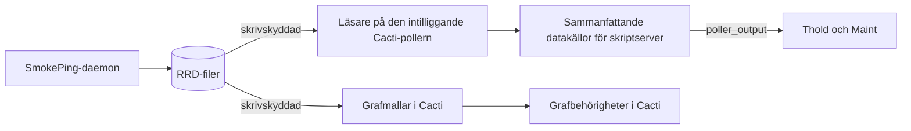

<!-- Source: README.md; SHA256: b41ec705327127cc34ff07d1514a141262752f99c5e2296fdc323d584a777b84 -->

<!-- translations:start -->
[English](../../../README.md) | [简体中文](../zh-CN/README.md) | [हिन्दी](../hi-IN/README.md) | [Español (España)](../es-ES/README.md) | [Español (Latinoamérica)](../es-419/README.md) | [العربية (السعودية)](../ar-SA/README.md) | [Afrikaans](../af-ZA/README.md) | [አማርኛ](../am-ET/README.md) | [العربية (مصر)](../ar-EG/README.md) | [العربية (المغرب)](../ar-MA/README.md) | [বাংলা](../bn-BD/README.md) | [Bosanski](../bs-BA/README.md) | [Deutsch](../de-DE/README.md) | [فارسی](../fa-IR/README.md) | [Filipino](../fil-PH/README.md) | [Français](../fr-FR/README.md) | [Français (Maroc)](../fr-MA/README.md) | [Français (Sénégal)](../fr-SN/README.md) | [Hausa](../ha-NG/README.md) | [עברית](../he-IL/README.md) | [Hrvatski](../hr-HR/README.md) | [Bahasa Indonesia](../id-ID/README.md) | [Igbo](../ig-NG/README.md) | [Italiano](../it-IT/README.md) | [日本語](../ja-JP/README.md) | [한국어](../ko-KR/README.md) | [Malagasy](../mg-MG/README.md) | [मराठी](../mr-IN/README.md) | [Bahasa Melayu](../ms-MY/README.md) | [Nederlands](../nl-NL/README.md) | [Polski](../pl-PL/README.md) | [Português (Brasil)](../pt-BR/README.md) | [Русский](../ru-RU/README.md) | [Kinyarwanda](../rw-RW/README.md) | [Soomaali](../so-SO/README.md) | [Српски](../sr-RS/README.md) | [Svenska](README.md) | [Kiswahili](../sw-KE/README.md) | [தமிழ்](../ta-IN/README.md) | [తెలుగు](../te-IN/README.md) | [ไทย](../th-TH/README.md) | [Türkçe](../tr-TR/README.md) | [Українська](../uk-UA/README.md) | [اردو](../ur-PK/README.md) | [Tiếng Việt](../vi-VN/README.md) | [isiXhosa](../xh-ZA/README.md) | [Yorùbá](../yo-NG/README.md) | [繁體中文](../zh-TW/README.md) | [isiZulu](../zu-ZA/README.md)
<!-- translations:end -->

  <picture>
    <source media="(prefers-color-scheme: dark)" srcset="../../images/logo_dark.png">
    
  </picture>

# SmokePing-insticksmodul för Cacti

En insticksmodul för Cacti 1.2 som för in latens- och paketförlustmätningar från SmokePing i Cacti som vanliga enheter, datakällor och grafer. Smoke-grafer hamnar då bredvid den enhet de tillhör, under Cactis behörighetssystem, och Thold och Maint kan larma på och undertrycka dem. Det är en oberoende implementering för Cacti och ingår inte i, och stöds inte av, [SmokePing](https://oss.oetiker.ch/smokeping/), vars ursprungliga upphovspersoner är Tobias Oetiker och Niko Tyni. Insticksmodulen varken innehåller eller kör SmokePings kod: den läser konfigurationen och de RRD-filer som SmokePing skriver, och dess grafmallar är byggda för att rita samma dataserier som SmokePings egna grafer.

> **Status: under utveckling. Observationsläget (fas 1) är implementerat på `main` (1.0.0-rc.1) med operatörsfiltrering, CSV-export, upptäckt av föräldralösa RRD-filer, översättning av Thold-larm, integrationshooks för ekosystemet och replikering till fjärrinsamlare.** Insticksmodulen läser SmokePings konfiguration och RRD-filer, visar deras tillstånd, skapar Cacti-enheter, datakällor och grafer för dem samt matar Thold och Maint. Den skriver ingenting till SmokePing. Hanterat läge (där insticksmodulen skriver SmokePing-konfiguration) är en senare fas som inte har påbörjats och inte ingår i denna version. Pilotkörningar i verkliga installationer och närmare överensstämmelse med SmokePings grafförklaring kvarstår i milstolpe 4. Se [docs/install.md](../../install.md) för att komma igång.

## Åtkomstroller

| Roll (Realm) | Åtkomst |
| --- | --- |
| SmokePing View | Befintliga övervakningssidor. |
| SmokePing Operator | Övervakning samt sidan Operations och personliga triage-kvittenser. |
| SmokePing Admin | Operatörsåtkomst samt befintliga konfigurations- och administrationsåtgärder. |

Efter att uppgraderingsfilerna har kopierats öppnar du sidan Plugins som administratör för att registrera den nya rollen. Tilldela rollen SmokePing Operator explicit under **Configuration > Users** eller användargrupper. Uppgraderingar behåller befintliga roll-ID:n och tilldelningar för View och Admin. Admin-åtkomst ärver Operator-åtkomst, och Operator-åtkomst ärver View-åtkomst vid varje begäran; detta lägger inte till lagrade behörigheter hos användare eller grupper. Inställningar för insticksmodulen kräver även SmokePing Admin-åtkomst utöver Cactis behörighet Settings.

Enhetsbehörigheter i Cacti begränsar fortfarande vilka rader och åtgärder som är tillgängliga för varje användare; omappade objekt kräver en administratör. Inloggningsuppgifter, konfiguration, mappning, borttagning och andra administrativa ändringar ligger kvar på administrationssidorna. Kvittenser gäller endast i den aktuella användarens session, i högst en timme och bara så länge samma observation förblir färsk. Nya eller ändrade observationer gör dem ogiltiga. De markerar aldrig en misslyckad mätning som frisk och undertrycker aldrig larm.

## Skärmbilder

Importerat från ett aktivt SmokePing 2.8.2-nätverk till Cacti 1.2.31, senaste 12 timmarna. Varje målenhet har en smoke-graf för mastern och en för varje slav (`lon1`, `sgp1`), placerade under sin SmokePing-sektion i grafträdet.

## Varför

SmokePing mäter latensfördelning och paketförlust väl, och dess smoke-grafer visar variationer som en graf med enbart medelvärden döljer. När det körs sida vid sida med Cacti uppstår tre luckor:

- **Separat åtkomstkontroll.** SmokePings CGI känner inte till Cactis användare, grupper eller enhetsbehörigheter.
- **Ingen enhetskontext.** Latens och gränssnittsräknare för samma enhet finns i olika verktyg.
- **Ingen väg in i Cactis larmsystem.** Thold och Maint arbetar på Cactis datakällor och enheter, så SmokePing-larm konfigureras och undertrycks separat.

Insticksmodulen stänger dessa luckor genom att representera varje SmokePing-mål som Cacti-objekt som pekar på SmokePings befintliga RRD-filer, plus en liten uppsättning pollade sammanfattningsvärden. Den återanvänder Cactis grafer, behörigheter, Thold och Maint i stället för att bygga parallella versioner av dem. Poller-avgränsad konfigurationsreplikering (`replicate_out`) skickar konfigurationstabeller för fjärrpollers samtidigt som lokalt läge (poller 1) och insamlarlokala observationscacher hålls isolerade.

## Omfattning och status

| Fas | Omfattning | Milstolpar | Status |
|---|---|---|---|
| 0, research | Kompatibilitetsmatris, bekräftelse av uppströmsbeteende, förstudie av graftrohet | [M1](https://github.com/somethingwithproof/plugin_smokeping/milestone/1) | Resultat i `docs/research`; vissa research-ärenden är öppna |
| 1, observation | Inventeringsimport, Cacti-enheter, smoke- och sammanfattningsgrafer, Thold-larm och larmöversättning, Maint-undertryckning, filtrerade vyer, CSV-export, upptäckt av föräldralösa RRD-filer, ekosystemhooks | [M2](https://github.com/somethingwithproof/plugin_smokeping/milestone/2), [M3](https://github.com/somethingwithproof/plugin_smokeping/milestone/3), [M4](https://github.com/somethingwithproof/plugin_smokeping/milestone/4) | Implementerad; pilotkörningar öppna |
| 2, hanterat läge | Cacti-ägd konfigurationsnamnrymd, ICMP- och TCP-probprofiler, revisioner, validering, omladdning, återställning | [M5](https://github.com/somethingwithproof/plugin_smokeping/milestone/5) | Planerad, ej påbörjad |
| 3, fjärrinsamling | Poller-avgränsade frågor och `replicate_out`-tabellreplikering för fjärrdatainsamlare (`RemoteReplication`); fullständig driftsättningskvalificering av SmokePing med flera insamlare | [M6](https://github.com/somethingwithproof/plugin_smokeping/milestone/6) | Replikering och poller-avgränsning implementerad; kvalificering för driftsättning med flera insamlare öppen |

Implementerade operatörsarbetsflöden, CLI-kommandon och ekosystemhooks:

- **Inventerings- och målfiltrering (`smokeping_inventory.php`, `smokeping.php`)**: `TargetFilter`, `TargetRepository::filteredForPoller()`, `InventoryPage` och `ViewPage` tillhandahåller sökning (`filter`), prob (`probe`), inventeringsnärvaro (`presence`), mappningsstatus (`mapping`), aktualitetstillstånd (`state`) och valfri sidstorlekspaginering (`rows`: `All`, `25`, `50`, `100`, `200`). Enhetssynlighet tvingas i SQL före räkning så att summor aldrig avslöjar dolda enheter.
- **CSV-export (`smokeping.php?action=export_csv`)**: `CsvExporter` strömmar RFC 4180 CRLF-utdata för den aktiva filtrerade vyn under anroparens enhetsbehörigheter, och sätter en apostrof framför celler som börjar med `=`, `+`, `-`, `@`, tabb eller vagnretur för att oskadliggöra kalkylbladsformler.
- **Upptäckt av föräldralösa RRD-filer (`smokeping_health.php`)**: `OrphanRrdScanner` och `HealthCheck::orphanRrds()` utför en avgränsad genomsökning av SmokePing-monteringen på läsarpollern, hoppar över `__cgi`, `__sortercache` och symboliska länkar samt korsrefererar oägda `.rrd`-filer mot öppna omlänkningsförslag.
- **Konvertering från SmokePing till Thold (`smokeping_health.php`, `cli/smokeping.php`)**: `TholdTranslator` och `TholdGenerator` läser SmokePings `*** Alerts ***`-definitioner och översätter stödda mönster för på varandra följande förluster till motsvarande `loss_pct`-tröskelvärden i Thold utan att ändra SmokePings konfigurationsfiler. Webbflödet använder en GET-förhandsgranskning (`action=thold_preview`, `HealthPage::renderTholdPreview()`) följt av en CSRF-skyddad POST (`action=thold_create`). Mönster som inte stöds (RTT-larm, jokerteckenavklingning, blandade nivåer) hoppas över utan att skriva.
- **Administratörs-CLI (`cli/smokeping.php`)**: stöder `provision <target path> [--device=ID] [--location=NAME]`, `relink <old target path> <new target path> [--location=NAME]`, `thold-generate <target path> [--alert=NAME] [--apply]`, `size-graphs`, `upgrade-graphs`, `export [--format=yaml|xml] [--file=PATH]`, `import --file=PATH [--format=yaml|xml] [--apply --confirm=PLAN]` och `import-smokeping [--dry-run | --apply --confirm=PLAN] [--file=PATH] [--sections=A,B/C] [--device-per=host|target] [--device-template=ID] [--poller=ID] [--site=ID] [--tree=ID | --tree-name=NAME]`.
- **Ekosystemhooks (`setup.php`, `Schema::HOOKS`)**: registrerar 21 hooks, inklusive `abilities_register` (`AbilitiesProvider`: strikt skrivskyddade `smokeping-list-targets` och `smokeping-get-health`, avgränsade med View-behörigheten mot anroparens användar-ID, utan att returnera hemligheter), `doctor_register_checks` (`DoctorChecks`: `smokeping_stale_targets`, `smokeping_freshness_breaches`, `smokeping_orphan_rrds`, `smokeping_config_path`), `casc_register_providers` (`CascProvider`: `smokeping` YAML/XML `export`, `validate`, `plan` och `apply` som stöds av `ConfigCodec` och `ConfigService`), samt `replicate_out` (`RemoteReplication`: poller-avgränsad synkronisering av `plugin_smokeping_target`, `plugin_smokeping_mapping`, `plugin_smokeping_object` och `plugin_smokeping_relink` för fjärrpollers med `poller_id > 1`).

Utanför omfattningen: en egen larmmotor i insticksmodulen, en rapportmotor, en egen daemon eller ett eget nätverksprotokoll, hanterade HTTP-/DNS-/tjänstekontroller (servcheck täcker dessa) samt skrivning till SmokePings RRD-filer.

## Kompatibilitetsmål

| Komponent | Mål |
|---|---|
| Cacti | 1.2.31 eller senare i 1.2.x, inga ändringar i kärnkoden |
| PHP | 8.2 eller senare; `setup.php` förblir tolkningsbar på 8.0 så att en körtid som inte stöds får ett avslag i stället för ett trasigt Cacti-gränssnitt |
| SmokePing | 2.9.0, 2.8.2 och 2.7.3 (endast Ubuntu 22.04, fram till 2027-06-01) |
| Thold, Maint | Inga ändringar krävs |
| Serier | 10 000 per installation med 20 pingar och ett steg på 300 s ([prestanda](../../performance.md#supported-series-count)) |

## Dokumentation

| | |
|---|---|
| [Installation](../../install.md) | Krav, skrivskyddad montering av SmokePings datakatalog, installation, containrar, versioner som stöds |
| [Drift](../../operations.md) | Vad varje tillstånd betyder och dess evidens, hälsokontroller, beteende när indata fallerar |
| [Lägg till mål i Cacti](../../provisioning.md) | Ett mål, många enheter, återlänkning, behörigheter |
| [Larm](../../alerting.md) | Sammanfattningsvärden, Thold-varaktigheter, föråldrade data, sena data, överlappning med SmokePings larm, Maint |
| [Konfigurationsformat](../../configuration-format.md) | Export och import i YAML och XML |
| [Säkerhetskopiering och återställning](../../backup-restore.md) | Vad som ska säkerhetskopieras och hur en återställning återupptas |
| [Prestanda](../../performance.md) | Mätningar lokalt och på release-runner vid 100, 1 000 och 10 000 serier samt maximalt antal serier som stöds: 10 000 per installation |
| [Felkvalificering](../../failure-qualification.md) | Felscenarierna och hur varje scenario testas |
| [Utgivning](../../RELEASING.md) | Utgivningsrutinen: pull request, signerad tagg, vad arbetsflödet gör, hur resultatet verifieras |
| [Utgivningsarkiv](../../release.md) | Version, ändringslogg och utgivningsarkivet |
| [Testning](../../testing.md) | Testsviterna, vad CI kör och livesviten mot en riktig SmokePing-instans |

## Design

- [docs/PLAN.md](../../PLAN.md) är den fullständiga planen: arkitektur, uppströmsfakta som den bygger på (med källor), tillståndsmodell, säkerhetsgränser, prestandaberäkningar, testning och risker.
- [docs/decisions/](../../decisions) innehåller arkitekturbeslut (ADR) för val som redan gjorts.
- [docs/REQUIREMENTS.md](../../REQUIREMENTS.md) mappar varje krav-ID till dess ärende.
- Lokal verifiering kör Pest-enhets- och källregelskontroller (`pest --configuration=phpunit.xml`), PHPStan Level 9 (`CACTI_PATH=<cacti-dir> phpstan analyse -c phpstan.neon --no-progress`), syntaxkontroller av startpunkter (`php -l` på `*.php`, `include/*.php`, `scripts/*.php`, `cli/*.php`) och översättningskontroller (`sh locales/build_gettext.sh --check`). Se [docs/testing.md](../../testing.md) för integrations- och container-end-to-end-sviterna.

## Hur arbetet följs upp

- **Milstolpar** följer planens milstolpar. Var och en har ett epic-ärende som listar dess delärenden och slutbevis.
- **Ärenden** typas med etiketter: `type: requirement`, `type: research`, `type: decision`, `type: epic`. Kravärenden anger numrerade, testbara krav (`REQ-AREA-NNN`) och acceptanskriterier.
- **Etiketter** anger även `area:`, `phase:`, `priority:` och `status:`. Se [CONTRIBUTING.md](../../../CONTRIBUTING.md#labels).
- [Projekttavlan](https://github.com/users/somethingwithproof/projects/6) visar alla ärenden över alla milstolpar.

## Bidra

Läs [CONTRIBUTING.md](../../../CONTRIBUTING.md). Commits kräver en DCO-signatur (`DCO sign-off`). Designdiskussioner sker i ärenden; öppna beslut har etiketten `type: decision`.

## Säkerhet

Rapportera sårbarheter privat; se [SECURITY.md](../../../SECURITY.md).

## Licens

GNU General Public License v2.0, samma licens som Cacti och dess insticksmoduler. Se [LICENSE](../../../LICENSE).
