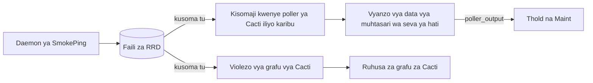

<!-- Source: README.md; SHA256: b41ec705327127cc34ff07d1514a141262752f99c5e2296fdc323d584a777b84 -->

<!-- translations:start -->
[English](../../../README.md) | [简体中文](../zh-CN/README.md) | [हिन्दी](../hi-IN/README.md) | [Español (España)](../es-ES/README.md) | [Español (Latinoamérica)](../es-419/README.md) | [العربية (السعودية)](../ar-SA/README.md) | [Afrikaans](../af-ZA/README.md) | [አማርኛ](../am-ET/README.md) | [العربية (مصر)](../ar-EG/README.md) | [العربية (المغرب)](../ar-MA/README.md) | [বাংলা](../bn-BD/README.md) | [Bosanski](../bs-BA/README.md) | [Deutsch](../de-DE/README.md) | [فارسی](../fa-IR/README.md) | [Filipino](../fil-PH/README.md) | [Français](../fr-FR/README.md) | [Français (Maroc)](../fr-MA/README.md) | [Français (Sénégal)](../fr-SN/README.md) | [Hausa](../ha-NG/README.md) | [עברית](../he-IL/README.md) | [Hrvatski](../hr-HR/README.md) | [Bahasa Indonesia](../id-ID/README.md) | [Igbo](../ig-NG/README.md) | [Italiano](../it-IT/README.md) | [日本語](../ja-JP/README.md) | [한국어](../ko-KR/README.md) | [Malagasy](../mg-MG/README.md) | [मराठी](../mr-IN/README.md) | [Bahasa Melayu](../ms-MY/README.md) | [Nederlands](../nl-NL/README.md) | [Polski](../pl-PL/README.md) | [Português (Brasil)](../pt-BR/README.md) | [Русский](../ru-RU/README.md) | [Kinyarwanda](../rw-RW/README.md) | [Soomaali](../so-SO/README.md) | [Српски](../sr-RS/README.md) | [Svenska](../sv-SE/README.md) | [Kiswahili](README.md) | [தமிழ்](../ta-IN/README.md) | [తెలుగు](../te-IN/README.md) | [ไทย](../th-TH/README.md) | [Türkçe](../tr-TR/README.md) | [Українська](../uk-UA/README.md) | [اردو](../ur-PK/README.md) | [Tiếng Việt](../vi-VN/README.md) | [isiXhosa](../xh-ZA/README.md) | [Yorùbá](../yo-NG/README.md) | [繁體中文](../zh-TW/README.md) | [isiZulu](../zu-ZA/README.md)
<!-- translations:end -->

  <picture>
    <source media="(prefers-color-scheme: dark)" srcset="../../images/logo_dark.png">
    
  </picture>

# Programu-jalizi ya SmokePing kwa Cacti

Programu-jalizi ya Cacti 1.2 inayoleta vipimo vya ucheleweshaji (latency) na upotevu wa pakiti vya SmokePing katika Cacti kama vifaa vya kawaida, vyanzo vya data, na grafu. Grafu za smoke huwekwa karibu na kifaa zinachomiliki, chini ya ruhusa za Cacti, na Thold na Maint zinaweza kutoa tahadhari na kuzinyamazisha. Ni utekelezaji huru kwa ajili ya Cacti na si sehemu ya, wala haijaidhinishwa na, [SmokePing](https://oss.oetiker.ch/smokeping/), ambao waandishi wake wa awali ni Tobias Oetiker na Niko Tyni. Programu-jalizi hii haijumuishi wala haiendeshi msimbo wa SmokePing: inasoma usanidi na faili za RRD ambazo SmokePing huandika, na violezo vyake vya grafu vimejengwa kuchora mfululizo uleule kama grafu za SmokePing yenyewe.

> **Hali: inaendelea kutengenezwa. Hali ya uchunguzi (awamu ya 1) imetekelezwa kwenye `main` na kutolewa kama toleo la awali la 1.0.0-rc.1.** Programu-jalizi hii inasoma usanidi wa SmokePing na faili za RRD, inaonyesha hali yake, inaunda vifaa vya Cacti, vyanzo vya data, na grafu kwa ajili yake, na kulisha Thold na Maint. Haiandiki chochote kwenye SmokePing. Hali ya usimamizi (programu-jalizi kuandika usanidi wa SmokePing) na wakusanyaji wa mbali ni awamu za baadaye, hazijaanza, na hazipo katika toleo hili. Majaribio kwenye mifumo halisi na ulinganifu wa karibu zaidi na maelezo ya grafu ya SmokePing bado yako wazi katika hatua ya 4. Tazama [docs/install.md](../../install.md) ili kuanza.

## Majukumu ya ufikiaji

| Eneo | Ufikiaji |
| --- | --- |
| SmokePing View | Kurasa zilizopo za ufuatiliaji. |
| SmokePing Operator | Ufuatiliaji pamoja na ukurasa wa Uendeshaji na uthibitisho wa kibinafsi wa uchambuzi wa awali. |
| SmokePing Admin | Ufikiaji wa Operator pamoja na usanidi uliopo na vitendo vya kiutawala. |

Baada ya kunakili faili za uboreshaji, fungua ukurasa wa Plugins kama msimamizi ili kusajili
eneo jipya. Gawa eneo la Operator waziwazi chini ya **Configuration > Users** au vikundi vya watumiaji.
Uboreshaji huhifadhi vitambulisho na ruhusa zilizopo za maeneo ya View na Admin. Ufikiaji wa Admin
hurithi ufikiaji wa Operator, na ufikiaji wa Operator hurithi ufikiaji wa View kwa kila ombi;
hii haiongezi ruhusa zilizohifadhiwa kwa watumiaji au vikundi. Mipangilio ya programu-jalizi pia inahitaji
ufikiaji wa SmokePing Admin pamoja na ruhusa ya Settings ya Cacti.

Ruhusa za vifaa vya Cacti bado zinazuia safumlalo na vitendo vinavyopatikana kwa kila mtumiaji; vipengee visivyohusishwa vinahitaji msimamizi.
Vitambulisho vya kuingia, usanidi, ulinganishaji, ufutaji na mabadiliko mengine ya kiutawala
hubaki katika kurasa za kiutawala. Uthibitisho wa utambuzi hudumu tu katika kipindi cha sasa
cha mtumiaji, kwa muda usiozidi saa moja na tu mradi uchunguzi uleule unasalia kuwa
mpya. Uchunguzi mpya au uliobadilika hubatilisha uthibitisho huo. Kamwe hauashirii kipimo kilichoshindwa
kuwa kizima wala haunyimizi tahadhari.

## Picha za skrini

Imeingizwa kutoka mtandao halisi wa SmokePing 2.8.2 hadi Cacti 1.2.31, saa 12 zilizopita. Kila kifaa lengwa kina grafu ya smoke kwa master na moja kwa kila slave (`lon1`, `sgp1`), zikiwa zimepangwa chini ya sehemu yake ya SmokePing kwenye mti wa grafu.

## Kwa nini

SmokePing hupima usambazaji wa ucheleweshaji na upotevu wa pakiti vizuri, na grafu zake za smoke huonyesha mabadiliko ambayo grafu ya wastani pekee huficha. Ikiendeshwa sambamba na Cacti, huacha mapengo matatu:

- **Udhibiti tofauti wa ufikiaji.** CGI ya SmokePing haijui chochote kuhusu watumiaji, vikundi, au ruhusa za vifaa za Cacti.
- **Hakuna muktadha wa kifaa.** Ucheleweshaji na vihesabu vya kiolesura vya kifaa kilekile huishi katika zana tofauti.
- **Hakuna njia ya kuingia kwenye tahadhari za Cacti.** Thold na Maint hufanya kazi kwenye vyanzo vya data na vifaa vya Cacti, kwa hivyo tahadhari za SmokePing husanidiwa na kunyamazishwa kando.

Programu-jalizi hii huziba mapengo haya kwa kuwakilisha kila lengo la SmokePing kama vipengee vya Cacti vinavyoelekeza kwenye faili za RRD zilizopo za SmokePing, pamoja na seti ndogo ya thamani za muhtasari zilizokusanywa. Inatumia tena uchoraji wa grafu, ruhusa, Thold, na Maint za Cacti badala ya kujenga matoleo sambamba ya zana hizo. Usaidizi wa wakusanyaji wa data wa mbali wa Cacti umepangwa kwa awamu ya 3 na haupo katika toleo hili.

## Wigo na hali

| Awamu | Wigo | Hatua muhimu | Hali |
|---|---|---|---|
| 0, utafiti | Jedwali la uoanifu, uthibitishaji wa tabia ya mfumo mama, jaribio la usahihi wa grafu | [M1](https://github.com/somethingwithproof/plugin_smokeping/milestone/1) | Matokeo katika `docs/research`; baadhi ya masuala ya utafiti yako wazi |
| 1, uchunguzi | Uingizaji wa orodha ya vipengee, vifaa vya Cacti, grafu za smoke na muhtasari, tahadhari za Thold, unyamazishaji wa Maint, ukurasa wa afya | [M2](https://github.com/somethingwithproof/plugin_smokeping/milestone/2), [M3](https://github.com/somethingwithproof/plugin_smokeping/milestone/3), [M4](https://github.com/somethingwithproof/plugin_smokeping/milestone/4) | Imetolewa kama 1.0.0-rc.1; majaribio yako wazi |
| 2, usimamizi | Eneo la majina la usanidi linalomilikiwa na Cacti, wasifu wa probe za ICMP na TCP, marekebisho, uthibitishaji, upakiaji upya, urejeshaji nyuma | [M5](https://github.com/somethingwithproof/plugin_smokeping/milestone/5) | Imepangwa, haijaanza |
| 3, mbali | SmokePing kwenye wakusanyaji wa data wa mbali wa Cacti, slave kama maeneo ya upimaji | [M6](https://github.com/somethingwithproof/plugin_smokeping/milestone/6) | Imepangwa, haijaanza |

Nje ya wigo: injini ya tahadhari inayomilikiwa na programu-jalizi, injini ya ripoti, huduma ya usuli (daemon) au itifaki maalum ya mtandao, ukaguzi unaosimamiwa wa HTTP/DNS/huduma (servcheck hushughulikia hayo), na kuandika kwenye faili za RRD za SmokePing.

## Malengo ya uoanifu

| Kipengele | Lengo |
|---|---|
| Cacti | 1.2.31 au mpya zaidi katika 1.2.x, bila viraka vya msingi |
| PHP | 8.2 au mpya zaidi; `setup.php` hubaki ikichanganulika kwenye 8.0 ili mazingira ya uendeshaji yasiyotumika yapate katazo badala ya kuharibu kiolesura cha Cacti |
| SmokePing | 2.9.0, 2.8.2, na 2.7.3 (Ubuntu 22.04 pekee, hadi 2027-06-01) |
| Thold, Maint | Hakuna mabadiliko yanayohitajika |
| Mfululizo | 10,000 kwa kila usakinishaji kwa ping 20 na hatua ya 300 s ([utendaji](../../performance.md#supported-series-count)) |

## Nyaraka

| | |
|---|---|
| [Sakinisha](../../install.md) | Mahitaji, uunganishaji wa kusoma tu wa saraka ya data ya SmokePing, usakinishaji, kontena, matoleo yanayotumika |
| [Endesha](../../operations.md) | Maana ya kila hali na ushahidi wake, ukaguzi wa afya, tabia wakati ingizo linaposhindwa |
| [Ongeza malengo kwenye Cacti](../../provisioning.md) | Lengo moja, vifaa vingi, kuunganisha tena, ruhusa |
| [Tahadhari](../../alerting.md) | Thamani za muhtasari, muda wa Thold, uchakavu wa data, data iliyochelewa, mwingiliano na tahadhari za SmokePing, Maint |
| [Umbizo la usanidi](../../configuration-format.md) | Uhamishaji na uingizaji wa YAML na XML |
| [Nakala rudufu na urejeshaji](../../backup-restore.md) | Nini cha kuwekea nakala rudufu na jinsi urejeshaji unavyoendelea |
| [Utendaji](../../performance.md) | Vipimo vya ndani na vya mazingira ya utoaji katika mfululizo 100, 1,000, na 10,000, na idadi ya mfululizo inayotumika: 10,000 kwa kila usakinishaji |
| [Uthibitishaji wa kushindwa](../../failure-qualification.md) | Hali za kushindwa na jinsi kila moja inavyojaribiwa |
| [Utoaji wa matoleo](../../RELEASING.md) | Utaratibu wa utoaji: pull request, lebo iliyosainiwa, kile ambacho mtiririko wa kazi hufanya, jinsi ya kuthibitisha matokeo |
| [Kumbukumbu ya matoleo](../../release.md) | Toleo, orodha ya mabadiliko, na kumbukumbu ya matoleo |
| [Majaribio](../../testing.md) | Seti za majaribio, kile ambacho CI huendesha, na seti ya moja kwa moja dhidi ya SmokePing halisi |

## Muundo

- [docs/PLAN.md](../../PLAN.md) ni mpango kamili: usanifu wa mfumo, ukweli wa mfumo mama unaotegemewa (pamoja na vyanzo), muundo wa hali, mipaka ya usalama, hesabu za utendaji, majaribio, na hatari.
- [docs/decisions/](../../decisions) huhifadhi rekodi za maamuzi ya usanifu kwa chaguo ambazo tayari zimefanywa.
- [docs/REQUIREMENTS.md](../../REQUIREMENTS.md) huunganisha kila kitambulisho cha hitaji na suala lake.

## Jinsi kazi inavyofuatiliwa

- **Hatua muhimu (Milestones)** hufuata hatua za mpango. Kila moja ina suala kuu (epic) linaloorodhesha masuala yake madogo na ushahidi wa kukamilika.
- **Masuala** yanaainishwa kwa lebo: `type: requirement`, `type: research`, `type: decision`, `type: epic`. Masuala ya mahitaji hubainisha mahitaji yenye nambari yanayoweza kujaribiwa (`REQ-AREA-NNN`) na vigezo vya kukubalika.
- **Lebo** pia hubeba `area:`, `phase:`, `priority:`, na `status:`. Tazama [CONTRIBUTING.md](../../../CONTRIBUTING.md#labels).
- [Ubao wa mradi](https://github.com/users/somethingwithproof/projects/6) unaonyesha masuala yote katika hatua zote muhimu.

## Kuchangia

Soma [CONTRIBUTING.md](../../../CONTRIBUTING.md). Commit zinahitaji sahihi ya DCO. Majadiliano ya muundo hufanyika kwenye masuala; maamuzi yaliyo wazi hubeba lebo ya `type: decision`.

## Usalama

Ripoti udhaifu wa kiusalama kwa faragha; tazama [SECURITY.md](../../../SECURITY.md).

## Leseni

GNU General Public License v2.0, leseni ileile na ya Cacti na programu-jalizi zake. Tazama [LICENSE](../../../LICENSE).
