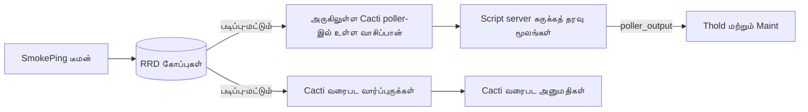

<!-- Source: README.md; SHA256: 17905aa1eac76a7d10dab526734605629fa3d1ada56397642ad4154c5be1feff -->

<!-- translations:start -->
[English](../../../README.md) | [简体中文](../zh-CN/README.md) | [हिन्दी](../hi-IN/README.md) | [Español (España)](../es-ES/README.md) | [Español (Latinoamérica)](../es-419/README.md) | [العربية (السعودية)](../ar-SA/README.md) | [Afrikaans](../af-ZA/README.md) | [አማርኛ](../am-ET/README.md) | [العربية (مصر)](../ar-EG/README.md) | [العربية (المغرب)](../ar-MA/README.md) | [বাংলা](../bn-BD/README.md) | [Bosanski](../bs-BA/README.md) | [Deutsch](../de-DE/README.md) | [فارسی](../fa-IR/README.md) | [Filipino](../fil-PH/README.md) | [Français](../fr-FR/README.md) | [Français (Maroc)](../fr-MA/README.md) | [Français (Sénégal)](../fr-SN/README.md) | [Hausa](../ha-NG/README.md) | [עברית](../he-IL/README.md) | [Hrvatski](../hr-HR/README.md) | [Bahasa Indonesia](../id-ID/README.md) | [Igbo](../ig-NG/README.md) | [Italiano](../it-IT/README.md) | [日本語](../ja-JP/README.md) | [한국어](../ko-KR/README.md) | [Malagasy](../mg-MG/README.md) | [मराठी](../mr-IN/README.md) | [Bahasa Melayu](../ms-MY/README.md) | [Nederlands](../nl-NL/README.md) | [Polski](../pl-PL/README.md) | [Português (Brasil)](../pt-BR/README.md) | [Русский](../ru-RU/README.md) | [Kinyarwanda](../rw-RW/README.md) | [Soomaali](../so-SO/README.md) | [Српски](../sr-RS/README.md) | [Svenska](../sv-SE/README.md) | [Kiswahili](../sw-KE/README.md) | [தமிழ்](README.md) | [తెలుగు](../te-IN/README.md) | [ไทย](../th-TH/README.md) | [Türkçe](../tr-TR/README.md) | [Українська](../uk-UA/README.md) | [اردو](../ur-PK/README.md) | [Tiếng Việt](../vi-VN/README.md) | [isiXhosa](../xh-ZA/README.md) | [Yorùbá](../yo-NG/README.md) | [繁體中文](../zh-TW/README.md) | [isiZulu](../zu-ZA/README.md)
<!-- translations:end -->

  <picture>
    <source media="(prefers-color-scheme: dark)" srcset="../../images/logo_dark.png">
    
  </picture>

# Cacti-க்கான SmokePing செருகுநிரல்

SmokePing தாமதம் மற்றும் பாக்கெட் இழப்பு அளவீடுகளை Cacti-க்குள் சாதாரண சாதனங்கள், தரவு மூலங்கள் மற்றும் வரைபடங்களாகக் கொண்டுவரும் ஒரு Cacti 1.2 செருகுநிரல் இதுவாகும். இதன் மூலம் புகை வரைபடங்கள் (smoke graphs) அவை சார்ந்த சாதனத்திற்கு அருகிலேயே, Cacti-இன் அனுமதிகளுக்கு உட்பட்டு அமைகின்றன; மேலும் Thold மற்றும் Maint ஆகியவை அவற்றின் மீது எச்சரிக்கைகளை அனுப்பவும் கட்டுப்படுத்தவும் முடியும். இது Cacti-க்கான ஒரு தனிப்பட்ட செயலாக்கமாகும்; Tobias Oetiker மற்றும் Niko Tyni ஆகியோரால் உருவாக்கப்பட்ட [SmokePing](https://oss.oetiker.ch/smokeping/) திட்டத்தின் பகுதியோ அல்லது அதனால் அங்கீகரிக்கப்பட்டதோ அல்ல. இந்தச் செருகுநிரல் SmokePing-இன் குறியீட்டை உள்ளடக்கவில்லை, இயக்கவுமில்லை: இது SmokePing எழுதும் கட்டமைப்பு மற்றும் RRD கோப்புகளைப் படிக்கிறது; மேலும் SmokePing-இன் சொந்த வரைபடங்களைப் போலவே அதே தரவுத் தொடர்களை வரையும் வகையில் இதன் வரைபட வார்ப்புருக்கள் உருவாக்கப்பட்டுள்ளன.

> **நிலை: வளர்ச்சியில் உள்ளது. கண்காணிப்புப் பயன்முறை (கட்டம் 1) `main` கிளையில் செயல்படுத்தப்பட்டு, 1.0.0-rc.1 முன்-வெளியீடாக வெளியிடப்பட்டுள்ளது.** இந்தச் செருகுநிரல் SmokePing-இன் கட்டமைப்பு மற்றும் RRD கோப்புகளைப் படித்து, அவற்றின் நிலையைக் காட்டி, அவற்றிற்கான Cacti சாதனங்கள், தரவு மூலங்கள் மற்றும் வரைபடங்களை உருவாக்கி, Thold மற்றும் Maint ஆகியவற்றிற்குத் தரவை வழங்குகிறது. இது SmokePing-இல் எதையும் எழுதுவதில்லை. நிர்வகிக்கப்பட்ட பயன்முறை (செருகுநிரலே SmokePing கட்டமைப்பை எழுதுவது) மற்றும் தொலைநிலை சேகரிப்பான்கள் (remote collectors) ஆகியவை பிற்காலக் கட்டங்களாகும்; அவை இன்னும் தொடங்கப்படவில்லை மற்றும் இந்த வெளியீட்டில் இல்லை. உண்மையான நிறுவல்களில் முன்னோட்டச் சோதனைகளும், SmokePing-இன் வரைபடக் குறிப்புடன் (legend) நெருக்கமான பொருத்தமும் மைல்கல் 4-இல் இன்னும் நிலுவையில் உள்ளன. தொடங்குவதற்கு [docs/install.md](../../install.md)-ஐப் பார்க்கவும்.

## அணுகல் பாத்திரங்கள்

| அணுகல் மண்டலம் | அணுகல் |
| --- | --- |
| SmokePing பார்வை | ஏற்கனவே உள்ள கண்காணிப்புப் பக்கங்கள். |
| SmokePing இயக்குநர் | கண்காணிப்புடன் செயல்பாடுகள் பக்கம் மற்றும் தனிப்பட்ட முன்னுரிமை ஒப்புதல்கள். |
| SmokePing நிர்வாகி | இயக்குநர் அணுகலுடன் ஏற்கனவே உள்ள கட்டமைப்பு மற்றும் நிர்வாகச் செயல்கள். |

மேம்படுத்தல் கோப்புகளை நகலெடுத்த பிறகு, புதிய அணுகல் மண்டலத்தைப் பதிவு செய்ய நிர்வாகியாகச் செருகுநிரல்கள் (Plugins) பக்கத்தைத் திறக்கவும். **Configuration > Users** அல்லது பயனர் குழுக்களின் கீழ் இயக்குநர் (Operator) அணுகல் மண்டலத்தைத் தனியே ஒதுக்கவும்.
மேம்படுத்தல்கள் ஏற்கனவே உள்ள பார்வை (View) மற்றும் நிர்வாகி (Admin) மண்டல அடையாள எண்களையும் அனுமதிகளையும் தக்கவைத்துக் கொள்கின்றன. ஒவ்வொரு கோரிக்கையிலும் நிர்வாகி அணுகல் இயக்குநர் அணுகலைப் பெறுகிறது, மேலும் இயக்குநர் அணுகல் பார்வை அணுகலைப் பெறுகிறது; இது பயனர்கள் அல்லது குழுக்களுக்குச் சேமிக்கப்பட்ட அனுமதிகளைச் சேர்க்காது. செருகுநிரல் அமைப்புகளுக்கு Cacti-இன் Settings அனுமதியுடன் கூடுதலாக SmokePing நிர்வாகி அணுகலும் தேவை.

Cacti சாதன அனுமதிகள் ஒவ்வொரு பயனருக்கும் கிடைக்கும் வரிசைகளையும் செயல்களையும் தொடர்ந்து கட்டுப்படுத்துகின்றன; இணைக்கப்படாத (unmapped) பொருள்களுக்கு நிர்வாகி தேவை.
சான்றுகள், கட்டமைப்பு, இணைப்பு (mapping), நீக்கம் மற்றும் பிற நிர்வாக மாற்றங்கள் நிர்வாகப் பக்கங்களிலேயே இருக்கும். ஒப்புதல்கள் (Acknowledgments) தற்போதைய பயனரின் அமர்வில் மட்டுமே, அதிகபட்சம் ஒரு மணி நேரத்திற்கு மற்றும் அதே கவனிப்புப் புதுப்பிக்கப்படாமல் இருக்கும் வரை மட்டுமே நீடிக்கும். புதிய அல்லது மாற்றியமைக்கப்பட்ட கவனிப்புகள் அவற்றைச் செல்லாததாக்கும். அவை ஒருபோதும் தோல்வியுற்ற அளவீட்டைச் சீரானதாகக் குறிக்காது அல்லது எச்சரிக்கைகளைத் தடுக்காது.

## திரைக்காட்சிகள்

நேரடி SmokePing 2.8.2 பிணையத்திலிருந்து Cacti 1.2.31-க்கு இறக்குமதி செய்யப்பட்டது, கடந்த 12 மணிநேரம். ஒவ்வொரு இலக்கின் சாதனமும் முதன்மைக்கு (master) ஒரு புகை வரைபடத்தையும், ஒவ்வொரு துணைக்கும் (`lon1`, `sgp1`) ஒரு புகை வரைபடத்தையும் கொண்டுள்ளது; இவை வரைபட மரத்தில் (graph tree) அதன் SmokePing பிரிவின் கீழ் அமைக்கப்பட்டுள்ளன.

## ஏன்

SmokePing தாமதப் பரவலையும் பாக்கெட் இழப்பையும் சிறப்பாக அளவிடுகிறது; மேலும் சராசரியை மட்டுமே காட்டும் வரைபடம் மறைக்கும் மாறுபாடுகளை அதன் புகை வரைபடங்கள் காட்டுகின்றன. Cacti உடன் இணைந்து இயங்கும்போது, அது மூன்று இடைவெளிகளை விட்டுச்செல்கிறது:

- **தனிப்பட்ட அணுகல் கட்டுப்பாடு.** SmokePing-இன் CGI-க்கு Cacti பயனர்கள், குழுக்கள் அல்லது சாதன அனுமதிகள் பற்றி எதுவும் தெரியாது.
- **சாதனச் சூழல் இல்லாமை.** ஒரே சாதனத்திற்கான தாமதம் மற்றும் இடைமுக எண்ணிகள் வெவ்வேறு கருவிகளில் உள்ளன.
- **Cacti எச்சரிக்கைகளுக்கான வழி இல்லாமை.** Thold மற்றும் Maint ஆகியவை Cacti தரவு மூலங்கள் மற்றும் சாதனங்களில் செயல்படுவதால், SmokePing எச்சரிக்கைகள் தனியே கட்டமைக்கப்பட்டுக் கட்டுப்படுத்தப்படுகின்றன.

SmokePing-இன் ஏற்கனவே உள்ள RRD கோப்புகளைச் சுட்டிக்காட்டும் Cacti பொருள்களாக ஒவ்வொரு SmokePing இலக்கையும் பிரதிநிதித்துவப்படுத்துவதன் மூலமும், சிறிய அளவிலான சேகரிக்கப்பட்ட சுருக்க மதிப்புகள் மூலமும் இந்தச் செருகுநிரல் இடைவெளிகளை நிரப்புகிறது. இது Cacti-இன் வரைபடமாக்கல், அனுமதிகள், Thold மற்றும் Maint ஆகியவற்றிற்கு இணையான பதிப்புகளை உருவாக்குவதற்குப் பதிலாக அவற்றையே மீண்டும் பயன்படுத்துகிறது. Cacti தொலைநிலைத் தரவு சேகரிப்பான்களுக்கான ஆதரவு கட்டம் 3-இல் திட்டமிடப்பட்டுள்ளது; அது இந்த வெளியீட்டில் இல்லை.

## வரம்பு மற்றும் நிலை

| கட்டம் | வரம்பு | மைல்கற்கள் | நிலை |
|---|---|---|---|
| 0, ஆராய்ச்சி | இணக்கத்தன்மை அணி, மூல அமைப்பு நடத்தை உறுதிப்படுத்தல், வரைபடத் துல்லிய ஆய்வு | [M1](https://github.com/somethingwithproof/plugin_smokeping/milestone/1) | கண்டுபிடிப்புகள் `docs/research`-இல் உள்ளன; சில ஆராய்ச்சிச் சிக்கல்கள் திறந்துள்ளன |
| 1, கண்காணிப்பு | இருப்பு இறக்குமதி, Cacti சாதனங்கள், புகை மற்றும் சுருக்க வரைபடங்கள், Thold எச்சரிக்கை, Maint தடுப்பு, நலப் பக்கம் | [M2](https://github.com/somethingwithproof/plugin_smokeping/milestone/2), [M3](https://github.com/somethingwithproof/plugin_smokeping/milestone/3), [M4](https://github.com/somethingwithproof/plugin_smokeping/milestone/4) | 1.0.0-rc.1 ஆக வெளியிடப்பட்டது; முன்னோட்டங்கள் திறந்துள்ளன |
| 2, நிர்வகிக்கப்பட்டது | Cacti-க்கு சொந்தமான கட்டமைப்புப் பெயர்வெளி, ICMP மற்றும் TCP ஆய்வுச் சுயவிவரங்கள், திருத்தங்கள், சரிபார்ப்பு, மறுஏற்றம், மீள்தல் | [M5](https://github.com/somethingwithproof/plugin_smokeping/milestone/5) | திட்டமிடப்பட்டது, தொடங்கப்படவில்லை |
| 3, தொலைநிலை | Cacti தொலைநிலைத் தரவு சேகரிப்பான்களில் SmokePing, அளவீட்டு இடங்களாகத் துணைகள் | [M6](https://github.com/somethingwithproof/plugin_smokeping/milestone/6) | திட்டமிடப்பட்டது, தொடங்கப்படவில்லை |

வரம்பிற்கு அப்பாற்பட்டவை: செருகுநிரலுக்குச் சொந்தமான எச்சரிக்கைப் பொறி, அறிக்கையிடல் பொறி, தனிப்பயன் டீமன் அல்லது பிணைய நெறிமுறை, நிர்வகிக்கப்பட்ட HTTP/DNS/சேவைச் சோதனைகள் (servcheck அவற்றைக் கையாளுகிறது), மற்றும் SmokePing-இன் RRD கோப்புகளில் எழுதுதல்.

## இணக்கத்தன்மை இலக்குகள்

| கூறு | இலக்கு |
|---|---|
| Cacti | 1.2.x-இல் 1.2.31 அல்லது அதற்குப் பிந்தையது, மைய மாற்றங்கள் (core patches) ஏதுமில்லை |
| PHP | 8.2 அல்லது அதற்குப் பிந்தையது; ஆதரிக்கப்படாத இயக்க நேரத்தில் Cacti பயனர் இடைமுகம் உடைவதற்குப் பதிலாக மறுப்புச் செய்தி கிடைக்குமாறு `setup.php` 8.0-இல் பாகுபடுத்தக்கூடியதாக இருக்கும் |
| SmokePing | 2.9.0, 2.8.2, மற்றும் 2.7.3 (Ubuntu 22.04 மட்டும், 2027-06-01 வரை) |
| Thold, Maint | மாற்றங்கள் ஏதும் தேவையில்லை |
| தொடர்கள் | 20 பிங்குகள் மற்றும் 300 விநாடி இடைவெளியில் ஒரு நிறுவலுக்கு 10,000 ([செயல்திறன்](../../performance.md#supported-series-count)) |

## ஆவணங்கள்

| | |
|---|---|
| [நிறுவல்](../../install.md) | தேவைகள், SmokePing-இன் தரவு அடைவைப் படிப்பு-மட்டும் நிலையில் இணைத்தல், நிறுவல், கொள்கலன்கள் (containers), ஆதரிக்கப்படும் பதிப்புகள் |
| [செயல்பாடுகள்](../../operations.md) | ஒவ்வொரு நிலையின் பொருளும் அதன் சான்றும், நலச் சோதனைகள், உள்ளீடுகள் தோல்வியடையும்போது ஏற்படும் நடத்தை |
| [Cacti-இல் இலக்குகளைச் சேர்த்தல்](../../provisioning.md) | ஒரு இலக்கு, பல சாதனங்கள், மறு-இணைப்பு, அனுமதிகள் |
| [எச்சரிக்கைகள்](../../alerting.md) | சுருக்க மதிப்புகள், Thold கால அளவுகள், பழமைத் தன்மை (staleness), தாமதமான தரவு, SmokePing எச்சரிக்கைகளுடன் பொருந்துதல், Maint |
| [கட்டமைப்பு வடிவம்](../../configuration-format.md) | YAML மற்றும் XML ஏற்றுமதி மற்றும் இறக்குமதி |
| [காப்பு மற்றும் மீட்டெடுப்பு](../../backup-restore.md) | எதைக் காப்பு எடுக்க வேண்டும் மற்றும் மீட்டெடுப்பு எவ்வாறு தொடர்கிறது |
| [செயல்திறன்](../../performance.md) | 100, 1,000, மற்றும் 10,000 தொடர்களில் உள்ளூர் மற்றும் வெளியீட்டு-இயக்கி அளவீடுகள், மற்றும் ஆதரிக்கப்படும் தொடர் எண்ணிக்கை: ஒரு நிறுவலுக்கு 10,000 |
| [தோல்வித் தகுதி](../../failure-qualification.md) | தோல்விச் சூழல்கள் மற்றும் ஒவ்வொன்றும் எவ்வாறு சோதிக்கப்படுகின்றன |
| [வெளியீடு செய்தல்](../../RELEASING.md) | வெளியீட்டு நடைமுறை: pull request, கையொப்பமிடப்பட்ட tag, பணிப்பாய்வு என்ன செய்கிறது, முடிவை எவ்வாறு சரிபார்ப்பது |
| [வெளியீட்டு ஆவணக் காப்பகம்](../../release.md) | பதிப்பு, மாற்றப் பதிவு மற்றும் வெளியீட்டு ஆவணக் காப்பகம் |
| [சோதனை](../../testing.md) | சோதனைத் தொகுப்புகள், CI இயக்குபவை, மற்றும் உண்மையான SmokePing-க்கு எதிரான நேரடிச் சோதனைத் தொகுப்பு |

## வடிவமைப்பு

- [docs/PLAN.md](../../PLAN.md) என்பது முழுத் திட்டமாகும்: கட்டமைப்பு, அது சார்ந்திருக்கும் மூல உண்மைகள் (ஆதாரங்களுடன்), நிலை மாதிரி, பாதுகாப்பு எல்லைகள், செயல்திறன் கணக்கீடுகள், சோதனை மற்றும் இடர்கள்.
- [docs/decisions/](../../decisions) ஏற்கனவே எடுக்கப்பட்ட தேர்வுகளுக்கான கட்டமைப்பு முடிவுப் பதிவுகளைக் கொண்டுள்ளது.
- [docs/REQUIREMENTS.md](../../REQUIREMENTS.md) ஒவ்வொரு தேவை அடையாள எண்ணையும் அதன் சிக்கலுடன் இணைக்கிறது.

## பணி கண்காணிப்பு முறை

- **மைல்கற்கள்** திட்டத்தின் மைல்கற்களைப் பின்பற்றுகின்றன. ஒவ்வொன்றும் அதன் துணைச் சிக்கல்களையும் வெளியேறுவதற்கான சான்றுகளையும் பட்டியலிடும் ஒரு பெருஞ்சிக்கலைக் (epic issue) கொண்டுள்ளது.
- **சிக்கல்கள்** அடையாளச்சீட்டுகளால் வகைப்படுத்தப்படுகின்றன: `type: requirement`, `type: research`, `type: decision`, `type: epic`. தேவைச் சிக்கல்கள் எண்ணிடப்பட்ட, சோதிக்கக்கூடிய தேவைகளையும் (`REQ-AREA-NNN`) ஏற்பு அளவுகோல்களையும் குறிப்பிடுகின்றன.
- **அடையாளச்சீட்டுகள்** `area:`, `phase:`, `priority:`, மற்றும் `status:` ஆகியவற்றையும் கொண்டுள்ளன. [CONTRIBUTING.md](../../../CONTRIBUTING.md#labels)-ஐப் பார்க்கவும்.
- [திட்டப் பலகை](https://github.com/users/somethingwithproof/projects/6) அனைத்து மைல்கற்களிலும் உள்ள சிக்கல்களைக் காட்டுகிறது.

## பங்களிப்பு

[CONTRIBUTING.md](../../../CONTRIBUTING.md)-ஐப் படிக்கவும். பதிவுகளுக்கு (commits) DCO கையொப்பம் (sign-off) தேவை. வடிவமைப்பு விவாதங்கள் சிக்கல்களில் (issues) நடைபெறுகின்றன; திறந்த முடிவுகள் `type: decision` அடையாளச்சீட்டைக் கொண்டிருக்கும்.

## பாதுகாப்பு

பாதுகாப்புக் குறைபாடுகளைத் தனிப்பட்ட முறையில் புகாரளிக்கவும்; [SECURITY.md](../../../SECURITY.md)-ஐப் பார்க்கவும்.

## உரிமம்

GNU General Public License v2.0, இது Cacti மற்றும் அதன் செருகுநிரல்களின் அதே உரிமமாகும். [LICENSE](../../../LICENSE)-ஐப் பார்க்கவும்.
