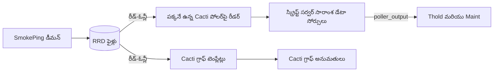

<!-- Source: README.md; SHA256: b41ec705327127cc34ff07d1514a141262752f99c5e2296fdc323d584a777b84 -->

<!-- translations:start -->
[English](../../../README.md) | [简体中文](../zh-CN/README.md) | [हिन्दी](../hi-IN/README.md) | [Español (España)](../es-ES/README.md) | [Español (Latinoamérica)](../es-419/README.md) | [العربية (السعودية)](../ar-SA/README.md) | [Afrikaans](../af-ZA/README.md) | [አማርኛ](../am-ET/README.md) | [العربية (مصر)](../ar-EG/README.md) | [العربية (المغرب)](../ar-MA/README.md) | [বাংলা](../bn-BD/README.md) | [Bosanski](../bs-BA/README.md) | [Deutsch](../de-DE/README.md) | [فارسی](../fa-IR/README.md) | [Filipino](../fil-PH/README.md) | [Français](../fr-FR/README.md) | [Français (Maroc)](../fr-MA/README.md) | [Français (Sénégal)](../fr-SN/README.md) | [Hausa](../ha-NG/README.md) | [עברית](../he-IL/README.md) | [Hrvatski](../hr-HR/README.md) | [Bahasa Indonesia](../id-ID/README.md) | [Igbo](../ig-NG/README.md) | [Italiano](../it-IT/README.md) | [日本語](../ja-JP/README.md) | [한국어](../ko-KR/README.md) | [Malagasy](../mg-MG/README.md) | [मराठी](../mr-IN/README.md) | [Bahasa Melayu](../ms-MY/README.md) | [Nederlands](../nl-NL/README.md) | [Polski](../pl-PL/README.md) | [Português (Brasil)](../pt-BR/README.md) | [Русский](../ru-RU/README.md) | [Kinyarwanda](../rw-RW/README.md) | [Soomaali](../so-SO/README.md) | [Српски](../sr-RS/README.md) | [Svenska](../sv-SE/README.md) | [Kiswahili](../sw-KE/README.md) | [தமிழ்](../ta-IN/README.md) | [తెలుగు](README.md) | [ไทย](../th-TH/README.md) | [Türkçe](../tr-TR/README.md) | [Українська](../uk-UA/README.md) | [اردو](../ur-PK/README.md) | [Tiếng Việt](../vi-VN/README.md) | [isiXhosa](../xh-ZA/README.md) | [Yorùbá](../yo-NG/README.md) | [繁體中文](../zh-TW/README.md) | [isiZulu](../zu-ZA/README.md)
<!-- translations:end -->

  <picture>
    <source media="(prefers-color-scheme: dark)" srcset="../../images/logo_dark.png">
    
  </picture>

# Cacti కోసం SmokePing ప్లగిన్

SmokePing లేటెన్సీ మరియు ప్యాకెట్ లాస్ కొలతలను సాధారణ డివైస్‌లు, డేటా సోర్సులు మరియు గ్రాఫ్‌లుగా Cacti లోకి తీసుకువచ్చే Cacti 1.2 ప్లగిన్ ఇది. తద్వారా స్మోక్ గ్రాఫ్‌లు అవి చెందిన డివైస్ పక్కనే, Cacti అనుమతుల కింద ఉంటాయి, మరియు Thold ఇంకా Maint వాటిపై అలర్ట్‌లు ఇవ్వగలవు మరియు వాటిని సప్రెస్ చేయగలవు. ఇది Cacti కోసం స్వతంత్రంగా రూపొందించిన అమలు మరియు Tobias Oetiker మరియు Niko Tyni అసలు రచయితలుగా ఉన్న [SmokePing](https://oss.oetiker.ch/smokeping/) లో భాగం కాదు లేదా దానిచే ఆమోదించబడలేదు. ఈ ప్లగిన్ SmokePing కోడ్‌ను కలిగి ఉండదు లేదా అమలు చేయదు: ఇది SmokePing రాసే కాన్ఫిగరేషన్ మరియు RRD ఫైళ్లను చదువుతుంది, మరియు దీని గ్రాఫ్ టెంప్లేట్లు SmokePing స్వంత గ్రాఫ్‌ల మాదిరిగానే శ్రేణులను గీయడానికి నిర్మించబడ్డాయి.

> **స్థితి: అభివృద్ధిలో ఉంది. అబ్జర్వ్ మోడ్ (దశ 1) `main` పై (1.0.0-rc.1) ఆపరేటర్ ఫిల్టరింగ్, CSV ఎగుమతి, ఆర్ఫన్ RRD గుర్తింపు, Thold అలర్ట్ అనువాదం, పర్యావరణ వ్యవస్థ ఏకీకరణ హుక్స్ మరియు రిమోట్ కలెక్టర్ ప్రతిరూపణతో అమలు చేయబడింది.** ఈ ప్లగిన్ SmokePing కాన్ఫిగరేషన్ మరియు RRD ఫైళ్లను చదువుతుంది, వాటి స్థితిని చూపుతుంది, వాటి కోసం Cacti డివైస్‌లు, డేటా సోర్సులు మరియు గ్రాఫ్‌లను సృష్టిస్తుంది, మరియు Thold ఇంకా Maint కు డేటాను అందిస్తుంది. ఇది SmokePing కు ఏమీ రాయదు. మేనేజ్డ్ మోడ్ (ప్లగిన్ SmokePing కాన్ఫిగరేషన్‌ను రాయడం) తరువాతి దశ, ఇంకా ప్రారంభించబడలేదు మరియు ఈ విడుదలలో లేదు. వాస్తవ ఇన్‌స్టాలేషన్‌లపై పైలట్‌లు మరియు SmokePing గ్రాఫ్ లెజెండ్‌తో మరింత దగ్గరగా సరిపోల్చడం మైల్‌స్టోన్ 4 లో ఇంకా తెరిచి ఉన్నాయి. ప్రారంభించడానికి [docs/install.md](../../install.md) చూడండి.

## యాక్సెస్ పాత్రలు

| రెల్మ్ | యాక్సెస్ |
| --- | --- |
| SmokePing View | ప్రస్తుతం ఉన్న మానిటరింగ్ పేజీలు. |
| SmokePing Operator | మానిటరింగ్‌తో పాటు ఆపరేషన్స్ పేజీ మరియు వ్యక్తిగత ట్రయాజ్ అక్నాలెడ్జ్‌మెంట్లు. |
| SmokePing Admin | ఆపరేటర్ యాక్సెస్‌తో పాటు ప్రస్తుతం ఉన్న కాన్ఫిగరేషన్ మరియు అడ్మినిస్ట్రేటివ్ చర్యలు. |

అప్‌గ్రేడ్ ఫైళ్లను కాపీ చేసిన తర్వాత, కొత్త రెల్మ్‌ను నమోదు చేయడానికి అడ్మినిస్ట్రేటర్‌గా Plugins పేజీని తెరవండి. **Configuration > Users** లేదా యూజర్ గ్రూపుల కింద Operator రెల్మ్‌ను స్పష్టంగా కేటాయించండి. అప్‌గ్రేడ్‌లు ప్రస్తుతం ఉన్న View మరియు Admin రెల్మ్ IDలను మరియు అనుమతులను అలాగే ఉంచుతాయి. Admin యాక్సెస్ ప్రతి అభ్యర్థనపై Operator యాక్సెస్‌ను వారసత్వంగా పొందుతుంది, మరియు Operator యాక్సెస్ View యాక్సెస్‌ను వారసత్వంగా పొందుతుంది; ఇది యూజర్లకు లేదా గ్రూపులకు నిల్వ చేసిన అనుమతులను జోడించదు. ప్లగిన్ సెట్టింగ్‌లకు Cacti యొక్క Settings అనుమతితో పాటు SmokePing Admin యాక్సెస్ కూడా అవసరం.

Cacti డివైస్ అనుమతులు ఇప్పటికీ ప్రతి యూజర్‌కు అందుబాటులో ఉన్న వరుసలను మరియు చర్యలను పరిమితం చేస్తాయి; మ్యాప్ చేయని ఆబ్జెక్టులకు అడ్మినిస్ట్రేటర్ అవసరం. క్రెడెన్షియల్స్, కాన్ఫిగరేషన్, మ్యాపింగ్, తొలగింపు మరియు ఇతర అడ్మినిస్ట్రేటివ్ మార్పులు అడ్మినిస్ట్రేటివ్ పేజీలలోనే ఉంటాయి. అక్నాలెడ్జ్‌మెంట్లు ప్రస్తుత యూజర్ సెషన్‌లో మాత్రమే, గరిష్టంగా ఒక గంట పాటు మరియు అదే పరిశీలన తాజాగా ఉన్నంత వరకు మాత్రమే ఉంటాయి. కొత్త లేదా మారిన పరిశీలనలు వాటిని చెల్లనివిగా చేస్తాయి. అవి విఫలమైన కొలతను ఎప్పుడూ ఆరోగ్యకరమైనదిగా గుర్తించవు లేదా అలర్ట్‌లను సప్రెస్ చేయవు.

## స్క్రీన్‌షాట్లు

లైవ్ SmokePing 2.8.2 నెట్‌వర్క్ నుండి Cacti 1.2.31 లోకి దిగుమతి చేయబడినవి, చివరి 12 గంటలు. ప్రతి టార్గెట్ డివైస్‌కు మాస్టర్ కోసం ఒక స్మోక్ గ్రాఫ్ మరియు ప్రతి స్లేవ్ (`lon1`, `sgp1`) కోసం ఒకటి ఉంటాయి, ఇవి గ్రాఫ్ ట్రీలోని దాని SmokePing విభాగం కింద అమర్చబడి ఉంటాయి.

## ఎందుకు

SmokePing లేటెన్సీ పంపిణీని మరియు ప్యాకెట్ లాస్‌ను బాగా కొలుస్తుంది, మరియు సగటు-మాత్రమే చూపే గ్రాఫ్ దాచిపెట్టే వ్యత్యాసాన్ని దాని స్మోక్ గ్రాఫ్‌లు చూపుతాయి. Cacti తో పాటు సమాంతరంగా నడిపినప్పుడు, అది మూడు అంతరాలను వదులుతుంది:

- **వేరు యాక్సెస్ నియంత్రణ.** SmokePing యొక్క CGI కు Cacti యూజర్లు, గ్రూపులు లేదా డివైస్ అనుమతుల గురించి ఏమీ తెలియదు.
- **డివైస్ సందర్భం లేదు.** ఒకే డివైస్ యొక్క లేటెన్సీ మరియు ఇంటర్‌ఫేస్ కౌంటర్లు వేర్వేరు సాధనాలలో ఉంటాయి.
- **Cacti అలర్టింగ్‌లోకి మార్గం లేదు.** Thold మరియు Maint Cacti డేటా సోర్సులు మరియు డివైస్‌లపై పనిచేస్తాయి, కాబట్టి SmokePing అలర్ట్‌లు విడిగా కాన్ఫిగర్ చేయబడతాయి మరియు సప్రెస్ చేయబడతాయి.

ఈ ప్లగిన్ ప్రతి SmokePing టార్గెట్‌ను SmokePing యొక్క ప్రస్తుత RRD ఫైళ్లను సూచించే Cacti ఆబ్జెక్టులుగా, అలాగే పోల్ చేయబడిన సారాంశ విలువల యొక్క చిన్న సమితిగా సూచించడం ద్వారా ఈ అంతరాలను పూరిస్తుంది. ఇది సమాంతర సంస్కరణలను నిర్మించడానికి బదులుగా Cacti యొక్క గ్రాఫింగ్, అనుమతులు, Thold మరియు Maint లను తిరిగి ఉపయోగిస్తుంది. పోలర్-పరిధి కాన్ఫిగరేషన్ ప్రతిరూపణ (`replicate_out`) స్థానిక మోడ్ (poller 1) మరియు కలెక్టర్-స్థానిక పరిశీలన క్యాష్‌లను వేరుగా ఉంచుతూ రిమోట్ పోలర్ కాన్ఫిగరేషన్ టేబుల్‌లను పంపుతుంది.

## పరిధి మరియు స్థితి

| దశ | పరిధి | మైల్‌స్టోన్‌లు | స్థితి |
|---|---|---|---|
| 0, పరిశోధన | అనుకూలత మ్యాట్రిక్స్, అప్‌స్ట్రీమ్ ప్రవర్తన నిర్ధారణ, గ్రాఫ్ ఖచ్చితత్వ పరిశీలన | [M1](https://github.com/somethingwithproof/plugin_smokeping/milestone/1) | ఫలితాలు `docs/research` లో ఉన్నాయి; కొన్ని పరిశోధన సమస్యలు తెరిచి ఉన్నాయి |
| 1, అబ్జర్వ్ | ఇన్వెంటరీ దిగుమతి, Cacti డివైస్‌లు, స్మోక్ మరియు సారాంశ గ్రాఫ్‌లు, Thold అలర్టింగ్ మరియు అలర్ట్ అనువాదం, Maint సప్రెషన్, ఫిల్టర్ చేసిన వీక్షణలు, CSV ఎగుమతి, ఆర్ఫన్ RRD గుర్తింపు, పర్యావరణ వ్యవస్థ హుక్స్ | [M2](https://github.com/somethingwithproof/plugin_smokeping/milestone/2), [M3](https://github.com/somethingwithproof/plugin_smokeping/milestone/3), [M4](https://github.com/somethingwithproof/plugin_smokeping/milestone/4) | అమలు చేయబడింది; పైలట్‌లు తెరిచి ఉన్నాయి |
| 2, మేనేజ్డ్ | Cacti-యాజమాన్య కాన్ఫిగరేషన్ నేమ్‌స్పేస్, ICMP మరియు TCP ప్రోబ్ ప్రొఫైళ్లు, రివిజన్లు, ధృవీకరణ, రీలోడ్, రోల్‌బ్యాక్ | [M5](https://github.com/somethingwithproof/plugin_smokeping/milestone/5) | ప్రణాళిక చేయబడింది, ప్రారంభించబడలేదు |
| 3, రిమోట్ | రిమోట్ డేటా కలెక్టర్ల కోసం పోలర్-పరిధి క్వెరీలు మరియు `replicate_out` టేబుల్ ప్రతిరూపణ (`RemoteReplication`); పూర్తి మల్టీ-కలెక్టర్ SmokePing డిప్లాయ్‌మెంట్ అర్హత | [M6](https://github.com/somethingwithproof/plugin_smokeping/milestone/6) | ప్రతిరూపణ మరియు పోలర్ పరిధి అమలు చేయబడ్డాయి; మల్టీ-కలెక్టర్ డిప్లాయ్‌మెంట్ అర్హత తెరిచి ఉంది |

అమలు చేయబడిన ఆపరేటర్ వర్క్‌ఫ్లోలు, CLI కమాండ్‌లు మరియు పర్యావరణ వ్యవస్థ హుక్స్:

- **ఇన్వెంటరీ మరియు టార్గెట్ ఫిల్టరింగ్ (`smokeping_inventory.php`, `smokeping.php`)**: `TargetFilter`, `TargetRepository::filteredForPoller()`, `InventoryPage`, మరియు `ViewPage` శోధన (`filter`), ప్రోబ్ (`probe`), ఇన్వెంటరీ ఉనికి (`presence`), మ్యాపింగ్ స్థితి (`mapping`), తాజాదనం స్థితి (`state`), మరియు ఐచ్ఛిక పేజీ-పరిమాణ విభజన (`rows`: `All`, `25`, `50`, `100`, `200`) అందిస్తాయి. మొత్తాలు దాచిన డివైస్‌లను ఎప్పుడూ బహిర్గతం చేయకుండా లెక్కించే ముందే SQL లో డివైస్ దృశ్యమానత అమలు చేయబడుతుంది.
- **CSV ఎగుమతి (`smokeping.php?action=export_csv`)**: `CsvExporter` కాలర్ యొక్క డివైస్ అనుమతుల కింద క్రియాశీల ఫిల్టర్ చేసిన వీక్షణ కోసం RFC 4180 CRLF అవుట్‌పుట్‌ను స్ట్రీమ్ చేస్తుంది, స్ప్రెడ్‌షీట్ ఫార్ములాలను నిష్క్రియం చేయడానికి `=`, `+`, `-`, `@`, ట్యాబ్ లేదా క్యారేజ్ రిటర్న్‌తో ప్రారంభమయ్యే సెల్‌లకు ముందు అపోస్ట్రఫీని జోడిస్తుంది.
- **ఆర్ఫన్ RRD గుర్తింపు (`smokeping_health.php`)**: `OrphanRrdScanner` మరియు `HealthCheck::orphanRrds()` రీడర్ పోలర్‌లోని SmokePing మౌంట్ యొక్క పరిమిత స్కాన్‌ను నిర్వహిస్తాయి, `__cgi`, `__sortercache`, మరియు సింబాలిక్ లింక్‌లను దాటవేస్తాయి, మరియు యజమాని లేని `.rrd` ఫైళ్లను తెరిచి ఉన్న రీ-లింక్ ప్రతిపాదనలతో సరిపోల్చుతాయి.
- **SmokePing నుండి Thold కు మార్పిడి (`smokeping_health.php`, `cli/smokeping.php`)**: `TholdTranslator` మరియు `TholdGenerator` SmokePing `*** Alerts ***` నిర్వచనాలను చదువుతాయి మరియు SmokePing కాన్ఫిగరేషన్ ఫైళ్లను సవరించకుండా మద్దతు ఉన్న వరుస ప్యాకెట్ లాస్ నమూనాలను సమానమైన `loss_pct` Thold పరిమితులకు అనువదిస్తాయి. వెబ్ ప్రవాహం GET ప్రివ్యూను (`action=thold_preview`, `HealthPage::renderTholdPreview()`) ఆపై CSRF-రక్షిత POST ను (`action=thold_create`) ఉపయోగిస్తుంది. మద్దతు లేని నమూనాలు (RTT అలర్ట్‌లు, వైల్డ్‌కార్డ్ క్షయం, మిశ్రమ స్థాయిలు) రాయకుండా దాటవేయబడతాయి.
- **అడ్మినిస్ట్రేటర్ CLI (`cli/smokeping.php`)**: `provision <target path> [--device=ID] [--location=NAME]`, `relink <old target path> <new target path> [--location=NAME]`, `thold-generate <target path> [--alert=NAME] [--apply]`, `size-graphs`, `upgrade-graphs`, `export [--format=yaml|xml] [--file=PATH]`, `import --file=PATH [--format=yaml|xml] [--apply --confirm=PLAN]`, మరియు `import-smokeping [--dry-run | --apply --confirm=PLAN] [--file=PATH] [--sections=A,B/C] [--device-per=host|target] [--device-template=ID] [--poller=ID] [--site=ID] [--tree=ID | --tree-name=NAME]` లకు మద్దతు ఇస్తుంది.
- **పర్యావరణ వ్యవస్థ హుక్స్ (`setup.php`, `Schema::HOOKS`)**: 21 హుక్స్‌ను నమోదు చేస్తుంది, ఇందులో `abilities_register` (`AbilitiesProvider`: కచ్చితంగా రీడ్-ఓన్లీ `smokeping-list-targets` మరియు `smokeping-get-health`, కాలర్ యూజర్ ID పై View రెల్మ్ నియంత్రణతో, ఎటువంటి రహస్యాలను తిరిగి ఇవ్వదు), `doctor_register_checks` (`DoctorChecks`: `smokeping_stale_targets`, `smokeping_freshness_breaches`, `smokeping_orphan_rrds`, `smokeping_config_path`), `casc_register_providers` (`CascProvider`: `ConfigCodec` మరియు `ConfigService` ఆధారిత `smokeping` YAML/XML `export`, `validate`, `plan`, మరియు `apply`), మరియు `replicate_out` (`RemoteReplication`: `poller_id > 1` ఉన్న రిమోట్ పోలర్ల కోసం `plugin_smokeping_target`, `plugin_smokeping_mapping`, `plugin_smokeping_object`, మరియు `plugin_smokeping_relink` ల పోలర్-పరిధి సమకాలీకరణ) ఉన్నాయి.

పరిధి వెలుపల ఉన్నవి: ప్లగిన్-యాజమాన్య అలర్టింగ్ ఇంజిన్, రిపోర్టింగ్ ఇంజిన్, కస్టమ్ డీమన్ లేదా నెట్‌వర్క్ ప్రోటోకాల్, మేనేజ్డ్ HTTP/DNS/సర్వీస్ తనిఖీలు (servcheck వాటిని కవర్ చేస్తుంది), మరియు SmokePing యొక్క RRD ఫైళ్లకు రాయడం.

## అనుకూలత లక్ష్యాలు

| భాగం | లక్ష్యం |
|---|---|
| Cacti | 1.2.x లో 1.2.31 లేదా ఆపై వెర్షన్, కోర్ ప్యాచ్‌లు లేవు |
| PHP | 8.2 లేదా ఆపై వెర్షన్; మద్దతు లేని రన్‌టైమ్ విరిగిన Cacti UI కు బదులుగా తిరస్కరణను పొందేలా `setup.php` 8.0 పై పార్స్ చేయగలిగేదిగా ఉంటుంది |
| SmokePing | 2.9.0, 2.8.2, మరియు 2.7.3 (Ubuntu 22.04 మాత్రమే, 2027-06-01 వరకు) |
| Thold, Maint | ఎటువంటి మార్పులు అవసరం లేదు |
| శ్రేణులు | 20 పింగ్‌లు మరియు 300 s స్టెప్ వద్ద ఇన్‌స్టాలేషన్‌కు 10,000 ([పనితీరు](../../performance.md#supported-series-count)) |

## డాక్యుమెంటేషన్

| | |
|---|---|
| [ఇన్‌స్టాల్](../../install.md) | అవసరాలు, SmokePing డేటా డైరెక్టరీ యొక్క రీడ్-ఓన్లీ మౌంట్, ఇన్‌స్టాలేషన్, కంటైనర్లు, మద్దతు ఉన్న వెర్షన్లు |
| [నిర్వహణ](../../operations.md) | ప్రతి స్థితి అర్థం మరియు దాని ఆధారాలు, హెల్త్ తనిఖీలు, ఇన్‌పుట్‌లు విఫలమైనప్పుడు ప్రవర్తన |
| [Cacti కి టార్గెట్‌లను జోడించండి](../../provisioning.md) | ఒక టార్గెట్, అనేక డివైస్‌లు, రీ-లింకింగ్, అనుమతులు |
| [అలర్టింగ్](../../alerting.md) | సారాంశ విలువలు, Thold వ్యవధులు, పాతబడిన డేటా, ఆలస్య డేటా, SmokePing అలర్ట్‌లతో అతివ్యాప్తి, Maint |
| [కాన్ఫిగరేషన్ ఫార్మాట్](../../configuration-format.md) | YAML మరియు XML ఎగుమతి మరియు దిగుమతి |
| [బ్యాకప్ మరియు పునరుద్ధరణ](../../backup-restore.md) | దేనిని బ్యాకప్ చేయాలి మరియు పునరుద్ధరణ ఎలా కొనసాగుతుంది |
| [పనితీరు](../../performance.md) | 100, 1,000, మరియు 10,000 శ్రేణుల వద్ద స్థానిక మరియు రిలీజ్-రన్నర్ కొలతలు, మరియు మద్దతు ఉన్న శ్రేణుల సంఖ్య: ఇన్‌స్టాలేషన్‌కు 10,000 |
| [వైఫల్య అర్హత](../../failure-qualification.md) | వైఫల్య దృశ్యాలు మరియు ప్రతి ఒక్కటి ఎలా పరీక్షించబడుతుంది |
| [విడుదల చేయడం](../../RELEASING.md) | విడుదల ప్రక్రియ: పుల్ రిక్వెస్ట్, సంతకం చేసిన ట్యాగ్, వర్క్‌ఫ్లో ఏమి చేస్తుంది, ఫలితాన్ని ఎలా ధృవీకరించాలి |
| [విడుదల ఆర్కైవ్](../../release.md) | వెర్షన్, చేంజ్‌లాగ్ మరియు విడుదల ఆర్కైవ్ |
| [పరీక్షలు](../../testing.md) | సూట్‌లు, CI ఏమి నడుపుతుంది, మరియు నిజమైన SmokePing పై లైవ్ సూట్ |

## డిజైన్

- పూర్తి ప్రణాళిక కోసం [docs/PLAN.md](../../PLAN.md) చూడండి: ఆర్కిటెక్చర్, అది ఆధారపడే అప్‌స్ట్రీమ్ వాస్తవాలు (ఆధారాలతో), స్థితి మోడల్, భద్రతా సరిహద్దులు, పనితీరు గణనలు, పరీక్షలు మరియు ప్రమాదాలు.
- ఇప్పటికే తీసుకున్న ఎంపికల కోసం ఆర్కిటెక్చర్ నిర్ణయ రికార్డులు [docs/decisions/](../../decisions) లో ఉన్నాయి.
- [docs/REQUIREMENTS.md](../../REQUIREMENTS.md) ప్రతి అవసర ID ని దాని సమస్యకు మ్యాప్ చేస్తుంది.
- స్థానిక ధృవీకరణ Pest యూనిట్ మరియు సోర్స్-రూల్ తనిఖీలను (`pest --configuration=phpunit.xml`), PHPStan స్థాయి 9 (`CACTI_PATH=<cacti-dir> phpstan analyse -c phpstan.neon --no-progress`), ఎంట్రీ-పాయింట్ సింటాక్స్ తనిఖీలను (`*.php`, `include/*.php`, `scripts/*.php`, `cli/*.php` లపై `php -l`), మరియు అనువాద తనిఖీలను (`sh locales/build_gettext.sh --check`) నడుపుతుంది. ఇంటిగ్రేషన్ మరియు కంటైనర్ ఎండ్-టు-ఎండ్ సూట్‌ల కోసం [docs/testing.md](../../testing.md) చూడండి.

## పని ఎలా ట్రాక్ చేయబడుతుంది

- **మైల్‌స్టోన్‌లు** ప్రణాళిక యొక్క మైల్‌స్టోన్‌లను అనుసరిస్తాయి. ప్రతి ఒక్కటి దాని ఉప-సమస్యలు మరియు నిష్క్రమణ ఆధారాలను జాబితా చేసే ఎపిక్ సమస్యను కలిగి ఉంటుంది.
- **సమస్యలు** లేబుల్ ద్వారా వర్గీకరించబడ్డాయి: `type: requirement`, `type: research`, `type: decision`, `type: epic`. అవసర సమస్యలు సంఖ్యాబద్ధమైన, పరీక్షించదగిన అవసరాలను (`REQ-AREA-NNN`) మరియు ఆమోద ప్రమాణాలను పేర్కొంటాయి.
- **లేబుల్స్** `area:`, `phase:`, `priority:`, మరియు `status:` లను కూడా కలిగి ఉంటాయి. [CONTRIBUTING.md](../../../CONTRIBUTING.md#labels) చూడండి.
- [ప్రాజెక్ట్ బోర్డు](https://github.com/users/somethingwithproof/projects/6) మైల్‌స్టోన్‌ల అంతటా అన్ని సమస్యలను చూపుతుంది.

## సహకారం

[CONTRIBUTING.md](../../../CONTRIBUTING.md) చదవండి. కమిట్‌లకు DCO సైన్-ఆఫ్ అవసరం. డిజైన్ చర్చ సమస్యలపై జరుగుతుంది; తెరిచి ఉన్న నిర్ణయాలు `type: decision` లేబుల్‌ను కలిగి ఉంటాయి.

## భద్రత

దుర్బలత్వాలను ప్రైవేట్‌గా నివేదించండి; [SECURITY.md](../../../SECURITY.md) చూడండి.

## లైసెన్స్

GNU జనరల్ పబ్లిక్ లైసెన్స్ v2.0, Cacti మరియు దాని ప్లగిన్‌ల మాదిరిగానే అదే లైసెన్స్. [LICENSE](../../../LICENSE) చూడండి.
