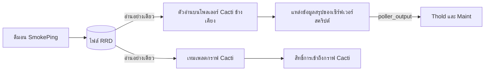

<!-- Source: README.md; SHA256: 17905aa1eac76a7d10dab526734605629fa3d1ada56397642ad4154c5be1feff -->

<!-- translations:start -->
[English](../../../README.md) | [简体中文](../zh-CN/README.md) | [हिन्दी](../hi-IN/README.md) | [Español (España)](../es-ES/README.md) | [Español (Latinoamérica)](../es-419/README.md) | [العربية (السعودية)](../ar-SA/README.md) | [Afrikaans](../af-ZA/README.md) | [አማርኛ](../am-ET/README.md) | [العربية (مصر)](../ar-EG/README.md) | [العربية (المغرب)](../ar-MA/README.md) | [বাংলা](../bn-BD/README.md) | [Bosanski](../bs-BA/README.md) | [Deutsch](../de-DE/README.md) | [فارسی](../fa-IR/README.md) | [Filipino](../fil-PH/README.md) | [Français](../fr-FR/README.md) | [Français (Maroc)](../fr-MA/README.md) | [Français (Sénégal)](../fr-SN/README.md) | [Hausa](../ha-NG/README.md) | [עברית](../he-IL/README.md) | [Hrvatski](../hr-HR/README.md) | [Bahasa Indonesia](../id-ID/README.md) | [Igbo](../ig-NG/README.md) | [Italiano](../it-IT/README.md) | [日本語](../ja-JP/README.md) | [한국어](../ko-KR/README.md) | [Malagasy](../mg-MG/README.md) | [मराठी](../mr-IN/README.md) | [Bahasa Melayu](../ms-MY/README.md) | [Nederlands](../nl-NL/README.md) | [Polski](../pl-PL/README.md) | [Português (Brasil)](../pt-BR/README.md) | [Русский](../ru-RU/README.md) | [Kinyarwanda](../rw-RW/README.md) | [Soomaali](../so-SO/README.md) | [Српски](../sr-RS/README.md) | [Svenska](../sv-SE/README.md) | [Kiswahili](../sw-KE/README.md) | [தமிழ்](../ta-IN/README.md) | [తెలుగు](../te-IN/README.md) | [ไทย](README.md) | [Türkçe](../tr-TR/README.md) | [Українська](../uk-UA/README.md) | [اردو](../ur-PK/README.md) | [Tiếng Việt](../vi-VN/README.md) | [isiXhosa](../xh-ZA/README.md) | [Yorùbá](../yo-NG/README.md) | [繁體中文](../zh-TW/README.md) | [isiZulu](../zu-ZA/README.md)
<!-- translations:end -->

  <picture>
    <source media="(prefers-color-scheme: dark)" srcset="../../images/logo_dark.png">
    
  </picture>

# ปลั๊กอิน SmokePing สำหรับ Cacti

ปลั๊กอินสำหรับ Cacti 1.2 ที่นำค่าการวัดความหน่วงและการสูญเสียแพ็กเก็ตจาก SmokePing เข้ามาใน Cacti ในรูปแบบของอุปกรณ์ แหล่งข้อมูล และกราฟทั่วไป ทำให้กราฟแบบ smoke อยู่เคียงข้างกับอุปกรณ์ที่เกี่ยวข้องภายใต้ระบบสิทธิ์ของ Cacti และให้ Thold กับ Maint สามารถแจ้งเตือนและระงับการแจ้งเตือนได้ ปลั๊กอินนี้เป็นการพัฒนาขึ้นอย่างอิสระสำหรับ Cacti และไม่ได้เป็นส่วนหนึ่งของหรือได้รับการรับรองจาก [SmokePing](https://oss.oetiker.ch/smokeping/) ซึ่งผู้เขียนดั้งเดิมคือ Tobias Oetiker และ Niko Tyni ตัวปลั๊กอินไม่ได้รวมหรือรันโค้ดของ SmokePing แต่จะอ่านไฟล์การตั้งค่าและไฟล์ RRD ที่ SmokePing เขียนไว้ และเทมเพลตกราฟถูกสร้างขึ้นเพื่อวาดชุดข้อมูลเดียวกันกับกราฟของ SmokePing เอง

> **สถานะ: กำลังพัฒนา โหมดสังเกตการณ์ (ระยะที่ 1) ได้ถูกพัฒนาลงใน `main` และเผยแพร่เป็นรุ่นก่อนเปิดตัว 1.0.0-rc.1 แล้ว** ปลั๊กอินจะอ่านไฟล์การตั้งค่าและไฟล์ RRD ของ SmokePing แสดงสถานะ สร้างอุปกรณ์ แหล่งข้อมูล และกราฟใน Cacti รวมถึงส่งข้อมูลไปยัง Thold และ Maint โดยไม่มีการเขียนข้อมูลใด ๆ ลงใน SmokePing ส่วนโหมดจัดการ (ที่ปลั๊กอินเป็นผู้เขียนไฟล์การตั้งค่า SmokePing) และตัวรวบรวมระยะไกลเป็นระยะถัดไปที่ยังไม่เริ่มพัฒนาและยังไม่รวมอยู่ในรุ่นนี้ การทดลองใช้งานจริงบนระบบติดตั้งจริงและการปรับคำอธิบายสัญลักษณ์กราฟให้ใกล้เคียงกับ SmokePing มากขึ้นยังคงเปิดดำเนินการอยู่ในไมล์สโตน 4 ดู [docs/install.md](../../install.md) เพื่อเริ่มต้นใช้งาน

## บทบาทการเข้าถึง

| สิทธิ์ (Realm) | การเข้าถึง |
| --- | --- |
| SmokePing View | หน้าติดตามสถานะที่มีอยู่ |
| SmokePing Operator | การติดตามสถานะ รวมถึงหน้าการดำเนินงานและการรับทราบปัญหาเฉพาะบุคคลเพื่อคัดแยก |
| SmokePing Admin | สิทธิ์ของ Operator รวมถึงหน้าตั้งค่าและการดำเนินการระดับผู้ดูแลระบบที่มีอยู่ |

หลังจากคัดลอกไฟล์อัปเกรดแล้ว ให้เปิดหน้า Plugins ในฐานะผู้ดูแลระบบเพื่อลงทะเบียนสิทธิ์ใหม่ กำหนดสิทธิ์ Operator อย่างชัดเจนภายใต้ **Configuration > Users** หรือกลุ่มผู้ใช้ การอัปเกรดจะคงรหัสสิทธิ์และการให้สิทธิ์ของ View และ Admin เดิมไว้ สิทธิ์ Admin จะสืบทอดสิทธิ์จาก Operator และสิทธิ์ Operator จะสืบทอดสิทธิ์จาก View ในแต่ละคำขอ โดยวิธีนี้ไม่ได้เพิ่มการบันทึกสิทธิ์ลงในผู้ใช้หรือกลุ่ม นอกจากนี้ การตั้งค่าปลั๊กอินยังต้องใช้สิทธิ์ SmokePing Admin เพิ่มเติมจากสิทธิ์ Settings ของ Cacti ด้วย

สิทธิ์ระดับอุปกรณ์ของ Cacti ยังคงจำกัดแถวและการดำเนินการที่ผู้ใช้แต่ละรายเข้าถึงได้ ส่วนออบเจ็กต์ที่ยังไม่ได้จับคู่จะต้องดำเนินการโดยผู้ดูแลระบบ ข้อมูลรับรอง การตั้งค่า การจับคู่ การลบ และการเปลี่ยนแปลงเชิงบริหารจัดการอื่น ๆ ยังคงอยู่ในหน้าของผู้ดูแลระบบ การรับทราบปัญหาจะคงอยู่เฉพาะในเซสชันปัจจุบันของผู้ใช้ นานสูงสุดไม่เกินหนึ่งชั่วโมง และเฉพาะตราบใดที่ผลสังเกตเดิมยังคงเป็นข้อมูลล่าสุดเท่านั้น ผลสังเกตใหม่หรือผลสังเกตที่เปลี่ยนแปลงจะทำให้การรับทราบสิ้นสุดลงทันที และจะไม่มีผลทำให้การวัดที่ล้มเหลวกลายเป็นสถานะปกติหรือระงับการแจ้งเตือนแต่อย่างใด

## ภาพหน้าจอ

นำเข้าจากเครือข่าย SmokePing 2.8.2 ที่ใช้งานจริงเข้าสู่ Cacti 1.2.31 ย้อนหลัง 12 ชั่วโมง อุปกรณ์ของแต่ละเป้าหมายจะมีกราฟ smoke สำหรับ master หนึ่งกราฟ และสำหรับ slave แต่ละตัว (`lon1`, `sgp1`) อย่างละหนึ่งกราฟ โดยจัดเก็บไว้ภายใต้หมวดหมู่ SmokePing ของตนเองในโครงสร้างต้นไม้กราฟ

## เหตุผลในการพัฒนา

SmokePing สามารถวัดการกระจายตัวของความหน่วงและการสูญเสียแพ็กเก็ตได้ดี และกราฟแบบ smoke ของมันยังแสดงความแปรปรวนที่กราฟซึ่งแสดงเพียงค่าเฉลี่ยไม่สามารถมองเห็นได้ แต่เมื่อใช้งานควบคู่ไปกับ Cacti จะเกิดช่องว่างอยู่ 3 ประการ ได้แก่

- **การควบคุมสิทธิ์การเข้าถึงแยกจากกัน** CGI ของ SmokePing ไม่รู้จักผู้ใช้ กลุ่ม หรือสิทธิ์ระดับอุปกรณ์ของ Cacti
- **ไม่มีบริบทของอุปกรณ์** ค่าความหน่วงและตัวนับอินเทอร์เฟซของอุปกรณ์เดียวกันอยู่คนละเครื่องมือ
- **ไม่มีเส้นทางเชื่อมต่อเข้าสู่ระบบแจ้งเตือนของ Cacti** Thold และ Maint ทำงานบนแหล่งข้อมูลและอุปกรณ์ของ Cacti ดังนั้นจึงต้องตั้งค่าและระงับการแจ้งเตือนของ SmokePing แยกต่างหาก

ปลั๊กอินนี้ช่วยปิดช่องว่างดังกล่าวโดยแทนที่แต่ละเป้าหมายของ SmokePing ด้วยออบเจ็กต์ใน Cacti ที่ชี้ไปยังไฟล์ RRD เดิมของ SmokePing พร้อมด้วยชุดค่าสรุปขนาดเล็กที่ได้จากการโพล ปลั๊กอินใช้ระบบกราฟ สิทธิ์การใช้งาน Thold และ Maint ที่มีอยู่เดิมของ Cacti แทนการสร้างระบบคู่ขนานขึ้นมาใหม่ ส่วนการรองรับตัวรวบรวมข้อมูลระยะไกลของ Cacti มีแผนจะพัฒนาในระยะที่ 3 และยังไม่รวมอยู่ในรุ่นนี้

## ขอบเขตและสถานะ

| ระยะ | ขอบเขต | ไมล์สโตน | สถานะ |
|---|---|---|---|
| 0, การวิจัย | เมทริกซ์ความเข้ากันได้, การยืนยันพฤติกรรมต้นน้ำ, การทดสอบความแม่นยำของกราฟ | [M1](https://github.com/somethingwithproof/plugin_smokeping/milestone/1) | ผลการศึกษาอยู่ใน `docs/research`; ยังมีประเด็นวิจัยบางส่วนที่เปิดอยู่ |
| 1, สังเกตการณ์ | การนำเข้าคลังข้อมูล, อุปกรณ์ Cacti, กราฟ smoke และกราฟสรุป, การแจ้งเตือนผ่าน Thold, การระงับผ่าน Maint, หน้าตรวจสอบสถานะระบบ | [M2](https://github.com/somethingwithproof/plugin_smokeping/milestone/2), [M3](https://github.com/somethingwithproof/plugin_smokeping/milestone/3), [M4](https://github.com/somethingwithproof/plugin_smokeping/milestone/4) | เผยแพร่เป็นรุ่น 1.0.0-rc.1; เปิดรับการทดลองใช้งานจริง |
| 2, จัดการ | เนมสเปซการตั้งค่าที่ Cacti เป็นเจ้าของ, โปรไฟล์โพรบ ICMP และ TCP, การจัดการเวอร์ชัน, การตรวจสอบความถูกต้อง, การโหลดซ้ำ, การย้อนกลับ | [M5](https://github.com/somethingwithproof/plugin_smokeping/milestone/5) | วางแผนไว้แล้ว ยังไม่เริ่มดำเนินการ |
| 3, ระยะไกล | SmokePing บนตัวรวบรวมข้อมูลระยะไกลของ Cacti, slave ในฐานะจุดวัดผล | [M6](https://github.com/somethingwithproof/plugin_smokeping/milestone/6) | วางแผนไว้แล้ว ยังไม่เริ่มดำเนินการ |

สิ่งที่อยู่นอกขอบเขต: ระบบแจ้งเตือนของปลั๊กอินเอง ระบบออกรายงาน ดีมอนหรือโปรโตคอลเครือข่ายที่สร้างขึ้นเอง การตรวจสอบบริการ HTTP/DNS/service แบบจัดการ (ซึ่ง servcheck ครอบคลุมอยู่แล้ว) และการเขียนข้อมูลลงในไฟล์ RRD ของ SmokePing

## เป้าหมายความเข้ากันได้

| องค์ประกอบ | เป้าหมาย |
|---|---|
| Cacti | 1.2.31 หรือใหม่กว่าในสาย 1.2.x โดยไม่ต้องแพตช์คอร์ |
| PHP | 8.2 หรือใหม่กว่า; `setup.php` ยังคงสามารถพาร์สได้บน 8.0 เพื่อให้อินเทอร์เฟซ Cacti ปฏิเสธการทำงานได้อย่างถูกต้องแทนที่จะพังเมื่อรันบนสภาพแวดล้อมที่ไม่รองรับ |
| SmokePing | 2.9.0, 2.8.2 และ 2.7.3 (เฉพาะ Ubuntu 22.04 เท่านั้น จนถึง 2027-06-01) |
| Thold, Maint | ไม่จำเป็นต้องแก้ไขใด ๆ |
| ชุดข้อมูล | 10,000 ชุดต่อการติดตั้ง ที่ 20 ping และช่วงเวลา 300 วินาที ([ประสิทธิภาพ](../../performance.md#supported-series-count)) |

## เอกสารประกอบ

| | |
|---|---|
| [การติดตั้ง](../../install.md) | ข้อกำหนดของระบบ การเมานต์ไดเรกทอรีข้อมูลของ SmokePing แบบอ่านอย่างเดียว การติดตั้ง คอนเทนเนอร์ และเวอร์ชันที่รองรับ |
| [การดำเนินงาน](../../operations.md) | ความหมายและหลักฐานของแต่ละสถานะ การตรวจสอบความสมบูรณ์ของระบบ และพฤติกรรมเมื่อข้อมูลนำเข้าล้มเหลว |
| [การเพิ่มเป้าหมายเข้าสู่ Cacti](../../provisioning.md) | หนึ่งเป้าหมาย หลายอุปกรณ์ การเชื่อมโยงใหม่ และสิทธิ์การใช้งาน |
| [การแจ้งเตือน](../../alerting.md) | ค่าสรุป ระยะเวลาของ Thold ความเก่าของข้อมูล ข้อมูลที่มาช้า ความซ้ำซ้อนกับการแจ้งเตือนของ SmokePing และ Maint |
| [รูปแบบการตั้งค่า](../../configuration-format.md) | การส่งออกและนำเข้าไฟล์ YAML และ XML |
| [การสำรองและกู้คืนข้อมูล](../../backup-restore.md) | สิ่งที่ต้องสำรองและวิธีที่ระบบกลับมาทำงานต่อหลังการกู้คืน |
| [ประสิทธิภาพ](../../performance.md) | ผลการวัดบนเครื่องท้องถิ่นและเครื่องรันรีลีสที่ 100, 1,000 และ 10,000 ชุดข้อมูล รวมถึงจำนวนชุดข้อมูลที่รองรับ: 10,000 ชุดต่อการติดตั้ง |
| [การทดสอบกรณีล้มเหลว](../../failure-qualification.md) | สถานการณ์ความล้มเหลวต่าง ๆ และวิธีทดสอบแต่ละกรณี |
| [การออกรุ่น](../../RELEASING.md) | ขั้นตอนการออกรุ่น: pull request, แท็กที่ลงนาม, สิ่งที่เวิร์กโฟลว์ทำ และวิธีตรวจสอบผลลัพธ์ |
| [คลังรุ่นที่เผยแพร่](../../release.md) | เวอร์ชัน บันทึกการเปลี่ยนแปลง และคลังไฟล์รุ่นที่เผยแพร่ |
| [การทดสอบ](../../testing.md) | ชุดการทดสอบ สิ่งที่ CI รัน และชุดทดสอบจริงกับ SmokePing ของจริง |

## การออกแบบ

- [docs/PLAN.md](../../PLAN.md) คือแผนฉบับเต็ม: สถาปัตยกรรม ข้อเท็จจริงต้นน้ำที่ระบบพึ่งพา (พร้อมแหล่งอ้างอิง) โมเดลสถานะ ขอบเขตความปลอดภัย การคำนวณด้านประสิทธิภาพ การทดสอบ และความเสี่ยง
- [docs/decisions/](../../decisions) เก็บบันทึกการตัดสินใจด้านสถาปัตยกรรมสำหรับทางเลือกที่ได้ตัดสินใจไปแล้ว
- [docs/REQUIREMENTS.md](../../REQUIREMENTS.md) จับคู่รหัสข้อกำหนดแต่ละรายการเข้ากับ issue ที่เกี่ยวข้อง

## วิธีติดตามงาน

- **ไมล์สโตน** เป็นไปตามไมล์สโตนในแผน แต่ละรายการจะมี epic issue ที่ระบุ sub-issue และหลักฐานการปิดงาน
- **Issue** ถูกจำแนกประเภทด้วยป้ายกำกับ: `type: requirement`, `type: research`, `type: decision`, `type: epic` โดย issue ข้อกำหนดจะระบุข้อกำหนดที่มีหมายเลขและทดสอบได้ (`REQ-AREA-NNN`) พร้อมเกณฑ์การยอมรับ
- **ป้ายกำกับ** ยังระบุ `area:`, `phase:`, `priority:` และ `status:` ดู [CONTRIBUTING.md](../../../CONTRIBUTING.md#labels)
- [บอร์ดโปรเจกต์](https://github.com/users/somethingwithproof/projects/6) แสดง issue ทั้งหมดในทุกไมล์สโตน

## การมีส่วนร่วม

อ่าน [CONTRIBUTING.md](../../../CONTRIBUTING.md) การคอมมิตต้องมี DCO sign-off การอภิปรายด้านการออกแบบเกิดขึ้นใน issue โดยการตัดสินใจที่ยังเปิดอยู่จะมีป้ายกำกับ `type: decision`

## ความปลอดภัย

รายงานช่องโหว่แบบส่วนตัว; ดู [SECURITY.md](../../../SECURITY.md)

## สัญญาอนุญาต

GNU General Public License v2.0 ซึ่งเป็นสัญญาอนุญาตเดียวกับ Cacti และปลั๊กอินของระบบ ดู [LICENSE](../../../LICENSE)
