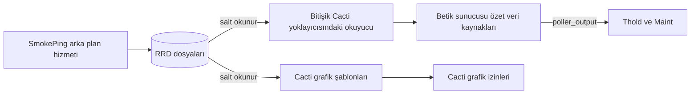

<!-- Source: README.md; SHA256: b41ec705327127cc34ff07d1514a141262752f99c5e2296fdc323d584a777b84 -->

<!-- translations:start -->
[English](../../../README.md) | [简体中文](../zh-CN/README.md) | [हिन्दी](../hi-IN/README.md) | [Español (España)](../es-ES/README.md) | [Español (Latinoamérica)](../es-419/README.md) | [العربية (السعودية)](../ar-SA/README.md) | [Afrikaans](../af-ZA/README.md) | [አማርኛ](../am-ET/README.md) | [العربية (مصر)](../ar-EG/README.md) | [العربية (المغرب)](../ar-MA/README.md) | [বাংলা](../bn-BD/README.md) | [Bosanski](../bs-BA/README.md) | [Deutsch](../de-DE/README.md) | [فارسی](../fa-IR/README.md) | [Filipino](../fil-PH/README.md) | [Français](../fr-FR/README.md) | [Français (Maroc)](../fr-MA/README.md) | [Français (Sénégal)](../fr-SN/README.md) | [Hausa](../ha-NG/README.md) | [עברית](../he-IL/README.md) | [Hrvatski](../hr-HR/README.md) | [Bahasa Indonesia](../id-ID/README.md) | [Igbo](../ig-NG/README.md) | [Italiano](../it-IT/README.md) | [日本語](../ja-JP/README.md) | [한국어](../ko-KR/README.md) | [Malagasy](../mg-MG/README.md) | [मराठी](../mr-IN/README.md) | [Bahasa Melayu](../ms-MY/README.md) | [Nederlands](../nl-NL/README.md) | [Polski](../pl-PL/README.md) | [Português (Brasil)](../pt-BR/README.md) | [Русский](../ru-RU/README.md) | [Kinyarwanda](../rw-RW/README.md) | [Soomaali](../so-SO/README.md) | [Српски](../sr-RS/README.md) | [Svenska](../sv-SE/README.md) | [Kiswahili](../sw-KE/README.md) | [தமிழ்](../ta-IN/README.md) | [తెలుగు](../te-IN/README.md) | [ไทย](../th-TH/README.md) | [Türkçe](README.md) | [Українська](../uk-UA/README.md) | [اردو](../ur-PK/README.md) | [Tiếng Việt](../vi-VN/README.md) | [isiXhosa](../xh-ZA/README.md) | [Yorùbá](../yo-NG/README.md) | [繁體中文](../zh-TW/README.md) | [isiZulu](../zu-ZA/README.md)
<!-- translations:end -->

  <picture>
    <source media="(prefers-color-scheme: dark)" srcset="../../images/logo_dark.png">
    
  </picture>

# Cacti için SmokePing eklentisi

SmokePing gecikme ve paket kaybı ölçümlerini Cacti'ye standart aygıtlar, veri kaynakları ve grafikler olarak aktaran bir Cacti 1.2 eklentisidir. Smoke grafikleri böylece ait oldukları aygıtın yanında, Cacti izinleri altında yer alır; Thold ve Maint bu grafikler üzerinden uyarı üretebilir ve uyarıları bastırabilir. Bu eklenti Cacti için bağımsız bir uygulamadır; özgün yazarları Tobias Oetiker ve Niko Tyni olan [SmokePing](https://oss.oetiker.ch/smokeping/) projesinin bir parçası değildir ve onun tarafından onaylanmamıştır. Eklenti SmokePing kodunu içermez veya çalıştırmaz: SmokePing'in yazdığı yapılandırma ve RRD dosyalarını okur ve grafik şablonları SmokePing'in kendi grafikleriyle aynı serileri çizecek şekilde oluşturulmuştur.

> **Durum: geliştirme aşamasında. Gözlem modu (1. aşama), operatör filtreleme, CSV dışa aktarma, sahipsiz RRD algılama, Thold uyarı çevirisi, ekosistem tümleştirme kancaları ve uzak toplayıcı çoğaltması ile `main` dalında (1.0.0-rc.1) uygulanmıştır.** Eklenti SmokePing'in yapılandırma ve RRD dosyalarını okur, durumlarını gösterir, bunlar için Cacti aygıtları, veri kaynakları ve grafikleri oluşturur ve Thold ile Maint'i besler. SmokePing'e hiçbir şey yazmaz. Yönetilen mod (eklentinin SmokePing yapılandırmasını yazması) sonraki bir aşamadır, henüz başlanmamıştır ve bu sürümde yer almaz. Gerçek kurulumlardaki pilot uygulamalar ve SmokePing grafik göstergesiyle daha yakın uyum 4. kilometre taşında hâlâ açıktır. Başlamak için [docs/install.md](../../install.md) dosyasına bakın.

## Erişim rolleri

| Yetki alanı | Erişim |
| --- | --- |
| SmokePing View | Mevcut izleme sayfaları. |
| SmokePing Operator | İzleme sayfalarına ek olarak İşlemler sayfası ve kişisel önceliklendirme onayları. |
| SmokePing Admin | Operator erişimine ek olarak mevcut yapılandırma ve yönetim işlemleri. |

Yükseltme dosyalarını kopyaladıktan sonra yeni yetki alanını kaydetmek için yönetici olarak Eklentiler (Plugins) sayfasını açın. Operator yetki alanını **Configuration > Users** veya kullanıcı grupları altında açıkça atayın.
Yükseltmeler mevcut View ve Admin yetki alanı kimliklerini ve izinlerini korur. Admin erişimi her istekte Operator erişimini, Operator erişimi ise View erişimini devralır; bu durum kullanıcılara veya gruplara depolanmış ek izinler eklemez. Eklenti ayarları, Cacti'nin Ayarlar (Settings) iznine ek olarak SmokePing Admin erişimi de gerektirir.

Cacti aygıt izinleri her kullanıcıya sunulan satırları ve eylemleri sınırlandırmaya devam eder; eşleştirilmemiş nesneler için yönetici gerekir.
Kimlik bilgileri, yapılandırma, eşleştirme, silme ve diğer yönetim değişiklikleri yönetim sayfalarında kalır. Onaylar yalnızca geçerli kullanıcının oturumunda, en fazla bir saat boyunca ve yalnızca aynı gözlem güncel kaldığı sürece geçerlidir. Yeni veya değişen gözlemler bunları geçersiz kılar. Onaylar başarısız bir ölçümü asla sağlıklı olarak işaretlemez veya uyarıları bastırmaz.

## Ekran görüntüleri

Canlı bir SmokePing 2.8.2 ağından Cacti 1.2.31'e aktarılmıştır, son 12 saat. Her hedefin aygıtı, grafik ağacındaki kendi SmokePing bölümü altında dosyalanmış olarak ana sunucu için bir ve her ikincil düğüm (`lon1`, `sgp1`) için birer smoke grafiğine sahiptir.

## Neden

SmokePing gecikme dağılımını ve paket kaybını iyi ölçer; smoke grafikleri ise yalnızca ortalama gösteren bir grafiğin gizlediği değişkenliği ortaya koyar. Cacti ile yan yana çalıştırıldığında üç boşluk bırakır:

- **Ayrı erişim denetimi.** SmokePing'in CGI arayüzü Cacti kullanıcıları, grupları veya aygıt izinleri hakkında hiçbir şey bilmez.
- **Aygıt bağlamı eksikliği.** Aynı aygıta ait gecikme ve arayüz sayaçları farklı araçlarda bulunur.
- **Cacti uyarı sistemine giden bir yol olmaması.** Thold ve Maint, Cacti veri kaynakları ve aygıtları üzerinde çalışır; bu nedenle SmokePing uyarıları ayrı olarak yapılandırılır ve bastırılır.

Eklenti, her SmokePing hedefini SmokePing'in mevcut RRD dosyalarına işaret eden Cacti nesneleri ve az sayıda yoklanan özet değer olarak temsil ederek bu boşlukları kapatır. Cacti'nin grafik, izin, Thold ve Maint özelliklerinin paralel sürümlerini geliştirmek yerine bunları yeniden kullanır. Yoklayıcı kapsamlı yapılandırma çoğaltması (`replicate_out`), yerel modu (poller 1) ve toplayıcıya özgü gözlem önbelleklerini yalıtılmış tutarken uzak yoklayıcı yapılandırma tablolarını iletir.

## Kapsam ve durum

| Aşama | Kapsam | Kilometre taşları | Durum |
|---|---|---|---|
| 0, araştırma | Uyumluluk matrisi, üst kaynak davranış doğrulaması, grafik sadakati ön çalışması | [M1](https://github.com/somethingwithproof/plugin_smokeping/milestone/1) | Bulgular `docs/research` içinde; bazı araştırma konuları açık |
| 1, gözlem | Envanter içe aktarma, Cacti aygıtları, smoke ve özet grafikleri, Thold uyarısı ve uyarı çevirisi, Maint bastırma, filtrelenmiş görünümler, CSV dışa aktarma, sahipsiz RRD algılama, ekosistem kancaları | [M2](https://github.com/somethingwithproof/plugin_smokeping/milestone/2), [M3](https://github.com/somethingwithproof/plugin_smokeping/milestone/3), [M4](https://github.com/somethingwithproof/plugin_smokeping/milestone/4) | Uygulandı; pilot uygulamalar açık |
| 2, yönetilen | Cacti'ye ait yapılandırma ad alanı, ICMP ve TCP yoklama profilleri, revizyonlar, doğrulama, yeniden yükleme, geri alma | [M5](https://github.com/somethingwithproof/plugin_smokeping/milestone/5) | Planlandı, başlanmadı |
| 3, uzak | Uzak veri toplayıcıları için yoklayıcı kapsamlı sorgular ve `replicate_out` tablo çoğaltması (`RemoteReplication`); tam çoklu toplayıcılı SmokePing dağıtım yeterliliği | [M6](https://github.com/somethingwithproof/plugin_smokeping/milestone/6) | Çoğaltma ve yoklayıcı kapsamı uygulandı; çoklu toplayıcılı dağıtım yeterliliği açık |

Uygulanan operatör iş akışları, CLI komutları ve ekosistem kancaları:

- **Envanter ve hedef filtreleme (`smokeping_inventory.php`, `smokeping.php`)**: `TargetFilter`, `TargetRepository::filteredForPoller()`, `InventoryPage` ve `ViewPage`; arama (`filter`), yoklama (`probe`), envanter varlığı (`presence`), eşleme durumu (`mapping`), güncellik durumu (`state`) ve isteğe bağlı sayfa boyutu sayfalama (`rows`: `All`, `25`, `50`, `100`, `200`) sağlar. Aygıt görünürlüğü saymadan önce SQL içinde uygulanır, böylece toplamlar gizli aygıtları asla açığa çıkarmaz.
- **CSV dışa aktarma (`smokeping.php?action=export_csv`)**: `CsvExporter`, çağıranın aygıt izinleri altında etkin filtrelenmiş görünüm için RFC 4180 CRLF çıktısı akıtır; elektronik tablo formüllerini etkisizleştirmek için `=`, `+`, `-`, `@`, sekme veya satır başı ile başlayan hücrelerin başına kesme işareti ekler.
- **Sahipsiz RRD algılama (`smokeping_health.php`)**: `OrphanRrdScanner` ve `HealthCheck::orphanRrds()`, okuyucu yoklayıcıdaki SmokePing bağlama noktasında sınırlı bir tarama gerçekleştirir; `__cgi`, `__sortercache` ve sembolik bağlantıları atlar ve sahipsiz `.rrd` dosyalarını açık yeniden bağlama önerileriyle çapraz referanslar.
- **SmokePing'den Thold'a dönüştürme (`smokeping_health.php`, `cli/smokeping.php`)**: `TholdTranslator` ve `TholdGenerator`, SmokePing `*** Alerts ***` tanımlarını okur ve SmokePing yapılandırma dosyalarını değiştirmeden desteklenen ardışık kayıp örüntülerini eşdeğer `loss_pct` Thold eşiklerine çevirir. Web akışı bir GET önizlemesi (`action=thold_preview`, `HealthPage::renderTholdPreview()`) ve ardından CSRF korumalı bir POST (`action=thold_create`) kullanır. Desteklenmeyen örüntüler (RTT uyarıları, joker azalma, karma düzeyler) yazılmadan atlanır.
- **Yönetici CLI (`cli/smokeping.php`)**: `provision <target path> [--device=ID] [--location=NAME]`, `relink <old target path> <new target path> [--location=NAME]`, `thold-generate <target path> [--alert=NAME] [--apply]`, `size-graphs`, `upgrade-graphs`, `export [--format=yaml|xml] [--file=PATH]`, `import --file=PATH [--format=yaml|xml] [--apply --confirm=PLAN]` ve `import-smokeping [--dry-run | --apply --confirm=PLAN] [--file=PATH] [--sections=A,B/C] [--device-per=host|target] [--device-template=ID] [--poller=ID] [--site=ID] [--tree=ID | --tree-name=NAME]` komutlarını destekler.
- **Ekosistem kancaları (`setup.php`, `Schema::HOOKS`)**: 21 kanca kaydeder; bunlar arasında `abilities_register` (`AbilitiesProvider`: kesinlikle salt okunur `smokeping-list-targets` ve `smokeping-get-health`, çağıranın kullanıcı kimliğine karşı View yetki alanıyla denetlenir ve gizli bilgi döndürmez), `doctor_register_checks` (`DoctorChecks`: `smokeping_stale_targets`, `smokeping_freshness_breaches`, `smokeping_orphan_rrds`, `smokeping_config_path`), `casc_register_providers` (`CascProvider`: `ConfigCodec` ve `ConfigService` destekli `smokeping` YAML/XML `export`, `validate`, `plan` ve `apply`) ve `replicate_out` (`RemoteReplication`: `poller_id > 1` olan uzak yoklayıcılar için `plugin_smokeping_target`, `plugin_smokeping_mapping`, `plugin_smokeping_object` ve `plugin_smokeping_relink` tablolarının yoklayıcı kapsamlı eşitlemesi) bulunur.

Kapsam dışı: eklentiye ait bir uyarı motoru, bir raporlama motoru, özel bir arka plan hizmeti veya ağ protokolü, yönetilen HTTP/DNS/servis denetimleri (bunları servcheck karşılar) ve SmokePing'in RRD dosyalarına yazma.

## Uyumluluk hedefleri

| Bileşen | Hedef |
|---|---|
| Cacti | 1.2.x serisinde 1.2.31 veya üzeri, çekirdek yaması gerekmez |
| PHP | 8.2 veya üzeri; desteklenmeyen bir çalışma zamanının bozuk bir Cacti arayüzü yerine ret yanıtı alması için `setup.php` 8.0 üzerinde ayrıştırılabilir kalır |
| SmokePing | 2.9.0, 2.8.2 ve 2.7.3 (yalnızca Ubuntu 22.04, 2027-06-01 tarihine kadar) |
| Thold, Maint | Değişiklik gerekmez |
| Seri | 20 ping ve 300 sn adımla kurulum başına 10.000 ([performans](../../performance.md#supported-series-count)) |

## Belgelendirme

| | |
|---|---|
| [Kurulum](../../install.md) | Gereksinimler, SmokePing veri dizininin salt okunur bağlanması, kurulum, kapsayıcılar, desteklenen sürümler |
| [İşletim](../../operations.md) | Her durumun anlamı ve kanıtları, sağlık denetimleri, girdiler başarısız olduğundaki davranış |
| [Cacti'ye hedef ekleme](../../provisioning.md) | Tek hedef, çoklu aygıtlar, yeniden bağlama, izinler |
| [Uyarılar](../../alerting.md) | Özet değerler, Thold süreleri, bayatlama, gecikmeli veriler, SmokePing uyarılarıyla örtüşme, Maint |
| [Yapılandırma biçimi](../../configuration-format.md) | YAML ve XML dışa ve içe aktarma |
| [Yedekleme ve geri yükleme](../../backup-restore.md) | Nelerin yedekleneceği ve geri yüklemenin nasıl devam edeceği |
| [Performans](../../performance.md) | 100, 1.000 ve 10.000 seride yerel ve sürüm çalıştırıcısı ölçümleri ve desteklenen seri sayısı: kurulum başına 10.000 |
| [Hata yeterliliği](../../failure-qualification.md) | Hata senaryoları ve her birinin nasıl test edildiği |
| [Sürüm yayımlama](../../RELEASING.md) | Sürüm yayımlama prosedürü: pull request, imzalı etiket, iş akışının yaptıkları, sonucun nasıl doğrulanacağı |
| [Sürüm arşivi](../../release.md) | Sürüm, değişiklik günlüğü ve sürüm arşivi |
| [Test](../../testing.md) | Test paketleri, CI'ın çalıştırdıkları ve gerçek bir SmokePing'e karşı canlı test paketi |

## Tasarım

- [docs/PLAN.md](../../PLAN.md) tam plandır: mimari, dayandığı üst kaynak gerçekleri (kaynaklarıyla birlikte), durum modeli, güvenlik sınırları, performans aritmetiği, test ve riskler.
- [docs/decisions/](../../decisions) hâlihazırda alınmış seçimler için mimari karar kayıtlarını barındırır.
- [docs/REQUIREMENTS.md](../../REQUIREMENTS.md) her gereksinim kimliğini ilgili konuyla eşleştirir.
- Yerel doğrulama; Pest birim ve kaynak-kuralı denetimlerini (`pest --configuration=phpunit.xml`), PHPStan Düzey 9'u (`CACTI_PATH=<cacti-dir> phpstan analyse -c phpstan.neon --no-progress`), giriş noktası sözdizimi denetimlerini (`*.php`, `include/*.php`, `scripts/*.php`, `cli/*.php` üzerinde `php -l`) ve çeviri denetimlerini (`sh locales/build_gettext.sh --check`) çalıştırır. Tümleştirme ve kapsayıcı uçtan uca test paketleri için [docs/testing.md](../../testing.md) dosyasına bakın.

## Çalışmalar nasıl takip edilir

- **Kilometre taşları** plandaki kilometre taşlarını izler. Her birinin, alt konuları ve çıkış kanıtlarını listeleyen bir epik konusu vardır.
- **Konular** etiketlerle türlere ayrılır: `type: requirement`, `type: research`, `type: decision`, `type: epic`. Gereksinim konuları numaralandırılmış, test edilebilir gereksinimleri (`REQ-AREA-NNN`) ve kabul ölçütlerini belirtir.
- **Etiketler** ayrıca `area:`, `phase:`, `priority:` ve `status:` öneklerini taşır. Bkz. [CONTRIBUTING.md](../../../CONTRIBUTING.md#labels).
- [Proje panosu](https://github.com/users/somethingwithproof/projects/6) kilometre taşları genelindeki tüm konuları gösterir.

## Katkıda bulunma

[CONTRIBUTING.md](../../../CONTRIBUTING.md) dosyasını okuyun. Commit'ler DCO imzası gerektirir. Tasarım tartışmaları konular üzerinde yapılır; açık kararlar `type: decision` etiketini taşır.

## Güvenlik

Güvenlik açıklarını gizli olarak bildirin; bkz. [SECURITY.md](../../../SECURITY.md).

## Lisans

GNU Genel Kamu Lisansı v2.0, Cacti ve eklentileriyle aynı lisans. Bkz. [LICENSE](../../../LICENSE).
