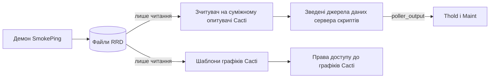

<!-- Source: README.md; SHA256: 17905aa1eac76a7d10dab526734605629fa3d1ada56397642ad4154c5be1feff -->

<!-- translations:start -->
[English](../../../README.md) | [简体中文](../zh-CN/README.md) | [हिन्दी](../hi-IN/README.md) | [Español (España)](../es-ES/README.md) | [Español (Latinoamérica)](../es-419/README.md) | [العربية (السعودية)](../ar-SA/README.md) | [Afrikaans](../af-ZA/README.md) | [አማርኛ](../am-ET/README.md) | [العربية (مصر)](../ar-EG/README.md) | [العربية (المغرب)](../ar-MA/README.md) | [বাংলা](../bn-BD/README.md) | [Bosanski](../bs-BA/README.md) | [Deutsch](../de-DE/README.md) | [فارسی](../fa-IR/README.md) | [Filipino](../fil-PH/README.md) | [Français](../fr-FR/README.md) | [Français (Maroc)](../fr-MA/README.md) | [Français (Sénégal)](../fr-SN/README.md) | [Hausa](../ha-NG/README.md) | [עברית](../he-IL/README.md) | [Hrvatski](../hr-HR/README.md) | [Bahasa Indonesia](../id-ID/README.md) | [Igbo](../ig-NG/README.md) | [Italiano](../it-IT/README.md) | [日本語](../ja-JP/README.md) | [한국어](../ko-KR/README.md) | [Malagasy](../mg-MG/README.md) | [मराठी](../mr-IN/README.md) | [Bahasa Melayu](../ms-MY/README.md) | [Nederlands](../nl-NL/README.md) | [Polski](../pl-PL/README.md) | [Português (Brasil)](../pt-BR/README.md) | [Русский](../ru-RU/README.md) | [Kinyarwanda](../rw-RW/README.md) | [Soomaali](../so-SO/README.md) | [Српски](../sr-RS/README.md) | [Svenska](../sv-SE/README.md) | [Kiswahili](../sw-KE/README.md) | [தமிழ்](../ta-IN/README.md) | [తెలుగు](../te-IN/README.md) | [ไทย](../th-TH/README.md) | [Türkçe](../tr-TR/README.md) | [Українська](README.md) | [اردو](../ur-PK/README.md) | [Tiếng Việt](../vi-VN/README.md) | [isiXhosa](../xh-ZA/README.md) | [Yorùbá](../yo-NG/README.md) | [繁體中文](../zh-TW/README.md) | [isiZulu](../zu-ZA/README.md)
<!-- translations:end -->

  <picture>
    <source media="(prefers-color-scheme: dark)" srcset="../../images/logo_dark.png">
    
  </picture>

# Плагін SmokePing для Cacti

Плагін для Cacti 1.2, який переносить вимірювання затримки та втрат пакетів із SmokePing до Cacti як звичайні пристрої, джерела даних і графіки. У результаті графіки SmokePing розташовуються поруч із пристроєм, до якого вони належать, підпорядковуються правам доступу Cacti, а Thold і Maint можуть створювати для них сповіщення та приглушувати їх. Це незалежна реалізація для Cacti, яка не є частиною проєкту [SmokePing](https://oss.oetiker.ch/smokeping/), початковими авторами якого є Tobias Oetiker і Niko Tyni, і не схвалена ним. Плагін не містить коду SmokePing і не виконує його: він читає конфігурацію та файли RRD, які записує SmokePing, а його шаблони графіків побудовані так, щоб відображати ті самі ряди даних, що й власні графіки SmokePing.

> **Статус: у розробці. Режим спостереження (фаза 1) реалізований у гілці `main` і випущений як попередній випуск 1.0.0-rc.1.** Плагін читає конфігурацію та файли RRD SmokePing, показує їхній стан, створює для них пристрої, джерела даних і графіки Cacti, а також передає дані до Thold і Maint. Він нічого не записує до SmokePing. Керований режим (коли плагін записує конфігурацію SmokePing) і віддалені збирачі даних є пізнішими фазами, їхня розробка ще не розпочата, і вони не входять до цього випуску. Пілотні впровадження на реальних інсталяціях і точніша відповідність легенді графіків SmokePing ще залишаються відкритими у межах віхи 4. Щоб розпочати, див. [docs/install.md](../../install.md).

## Ролі доступу

| Область прав | Доступ |
| --- | --- |
| SmokePing View | Наявні сторінки моніторингу. |
| SmokePing Operator | Моніторинг, а також сторінка Operations і персональні підтвердження під час первинного аналізу. |
| SmokePing Admin | Доступ Operator, а також наявна конфігурація й адміністративні дії. |

Після копіювання файлів оновлення відкрийте сторінку Plugins з обліковим записом адміністратора, щоб зареєструвати нову область прав. Призначте область прав Operator явно в розділі **Configuration > Users** або для груп користувачів. Під час оновлення зберігаються наявні ідентифікатори та призначення областей прав View і Admin. Доступ Admin успадковує доступ Operator, а доступ Operator успадковує доступ View на кожному запиті; це не додає збережених призначень користувачам або групам. Для налаштувань плагіна також потрібен доступ SmokePing Admin на додачу до дозволу Settings у Cacti.

Права доступу до пристроїв у Cacti, як і раніше, обмежують рядки та дії, доступні кожному користувачеві; для незіставлених об'єктів потрібні права адміністратора. Облікові дані, конфігурація, зіставлення, видалення та інші адміністративні зміни залишаються на адміністративних сторінках. Підтвердження діють лише в поточній сесії користувача, щонайбільше одну годину і лише доти, доки те саме спостереження залишається актуальним. Нові або змінені спостереження роблять їх недійсними. Вони ніколи не позначають невдале вимірювання як справне й не приглушують сповіщення.

## Знімки екрана

Імпортовано з робочої мережі SmokePing 2.8.2 до Cacti 1.2.31, за останні 12 годин. Пристрій кожної цілі має графік диму для головного вузла та по одному для кожного підлеглого вузла (`lon1`, `sgp1`), розташовані в його розділі SmokePing у дереві графіків.

## Навіщо потрібен плагін

SmokePing добре вимірює розподіл затримок і втрати пакетів, а його графіки диму показують розкид значень, який приховують графіки лише із середнім значенням. Якщо використовувати його поруч із Cacti, виникають три прогалини:

- **Окреме керування доступом.** CGI-інтерфейс SmokePing нічого не знає про користувачів, групи або права доступу до пристроїв у Cacti.
- **Відсутність контексту пристрою.** Затримка та лічильники інтерфейсів для одного й того самого пристрою містяться в різних інструментах.
- **Відсутність інтеграції зі сповіщеннями Cacti.** Thold і Maint працюють із джерелами даних і пристроями Cacti, тому сповіщення SmokePing доводиться налаштовувати та приглушувати окремо.

Плагін усуває ці прогалини, подаючи кожну ціль SmokePing як об'єкти Cacti, що вказують на наявні файли RRD SmokePing, разом із невеликим набором опитуваних зведених значень. Він повторно використовує графіки Cacti, права доступу, Thold і Maint замість створення їхніх паралельних аналогів. Підтримку віддалених збирачів даних Cacti заплановано на фазу 3, і в цьому випуску її немає.

## Обсяг робіт і статус

| Фаза | Обсяг робіт | Віхи | Статус |
|---|---|---|---|
| 0, дослідження | Матриця сумісності, підтвердження поведінки основного проєкту, експеримент із точністю відтворення графіків | [M1](https://github.com/somethingwithproof/plugin_smokeping/milestone/1) | Висновки в `docs/research`; частина дослідницьких завдань відкрита |
| 1, спостереження | Імпорт інвентарю, пристрої Cacti, графіки диму та зведені графіки, сповіщення Thold, приглушення Maint, сторінка стану | [M2](https://github.com/somethingwithproof/plugin_smokeping/milestone/2), [M3](https://github.com/somethingwithproof/plugin_smokeping/milestone/3), [M4](https://github.com/somethingwithproof/plugin_smokeping/milestone/4) | Випущено як 1.0.0-rc.1; пілотні впровадження відкриті |
| 2, керування | Простір імен конфігурації під керуванням Cacti, профілі зондів ICMP і TCP, ревізії, валідація, перезавантаження, відкат | [M5](https://github.com/somethingwithproof/plugin_smokeping/milestone/5) | Заплановано, не розпочато |
| 3, віддалена робота | SmokePing на віддалених збирачах даних Cacti, підлеглі вузли як точки вимірювання | [M6](https://github.com/somethingwithproof/plugin_smokeping/milestone/6) | Заплановано, не розпочато |

Поза межами проєкту: власний рушій сповіщень у плагіні, рушій звітності, власний демон або мережевий протокол, керовані перевірки HTTP/DNS/сервісів (їх покриває servcheck) і запис до файлів RRD SmokePing.

## Цільові параметри сумісності

| Компонент | Цільовий параметр |
|---|---|
| Cacti | 1.2.31 або новіша версія в гілці 1.2.x, без патчів ядра |
| PHP | 8.2 або новіша версія; `setup.php` залишається придатним для розбору на 8.0, щоб непідтримуване середовище виконання видавало відмову замість зламаного інтерфейсу Cacti |
| SmokePing | 2.9.0, 2.8.2 та 2.7.3 (лише Ubuntu 22.04, до 2027-06-01) |
| Thold, Maint | Змін не потрібно |
| Ряди даних | 10 000 на інсталяцію за 20 пінгів і кроку 300 с ([продуктивність](../../performance.md#supported-series-count)) |

## Документація

| | |
|---|---|
| [Установлення](../../install.md) | Вимоги, монтування каталогу даних SmokePing у режимі лише для читання, встановлення, контейнери, підтримувані версії |
| [Експлуатація](../../operations.md) | Значення кожного стану та його підтвердження, перевірки справності, поведінка в разі збоїв вхідних даних |
| [Додавання цілей до Cacti](../../provisioning.md) | Одна ціль, кілька пристроїв, повторне прив'язування, права доступу |
| [Сповіщення](../../alerting.md) | Зведені значення, тривалість Thold, застарілість даних, запізнілі дані, перетин зі сповіщеннями SmokePing, Maint |
| [Формат конфігурації](../../configuration-format.md) | Експорт та імпорт у YAML і XML |
| [Резервне копіювання та відновлення](../../backup-restore.md) | Що саме потрібно резервувати та як відновлюється робота після відновлення |
| [Продуктивність](../../performance.md) | Локальні вимірювання та вимірювання на середовищах виконання випусків за 100, 1 000 і 10 000 рядів, а також підтримувана кількість рядів: 10 000 на інсталяцію |
| [Кваліфікація відмов](../../failure-qualification.md) | Сценарії відмов і спосіб тестування кожного з них |
| [Випуск версій](../../RELEASING.md) | Процедура випуску: pull request, підписаний тег, дії робочого процесу та перевірка результату |
| [Архів випусків](../../release.md) | Версія, журнал змін і архів випусків |
| [Тестування](../../testing.md) | Набори тестів, перевірки в CI та набір інтеграційних тестів на реальному SmokePing |

## Архітектура

- [docs/PLAN.md](../../PLAN.md) — повний план: архітектура, залежні факти основного проєкту (із джерелами), модель станів, межі безпеки, розрахунки продуктивності, тестування та ризики.
- [docs/decisions/](../../decisions) містить записи архітектурних рішень для вже прийнятих рішень.
- [docs/REQUIREMENTS.md](../../REQUIREMENTS.md) зіставляє кожен ідентифікатор вимоги з відповідним завданням.

## Відстеження роботи

- **Віхи** відповідають віхам плану. Кожна має епік із переліком підзавдань і критеріїв завершення.
- **Завдання** типізуються мітками: `type: requirement`, `type: research`, `type: decision`, `type: epic`. Завдання вимог визначають нумеровані тестовані вимоги (`REQ-AREA-NNN`) і критерії прийняття.
- **Мітки** також містять `area:`, `phase:`, `priority:` і `status:`. Див. [CONTRIBUTING.md](../../../CONTRIBUTING.md#labels).
- На [дошці проєкту](https://github.com/users/somethingwithproof/projects/6) відображено всі завдання в межах усіх віх.

## Участь у розробці

Прочитайте [CONTRIBUTING.md](../../../CONTRIBUTING.md). Коміти повинні мати підпис DCO. Обговорення архітектурних питань відбувається в завданнях; відкриті рішення позначаються міткою `type: decision`.

## Безпека

Повідомляйте про вразливості приватно; див. [SECURITY.md](../../../SECURITY.md).

## Ліцензія

GNU General Public License v2.0 — та сама ліцензія, що й у Cacti та її плагінів. Див. [LICENSE](../../../LICENSE).
