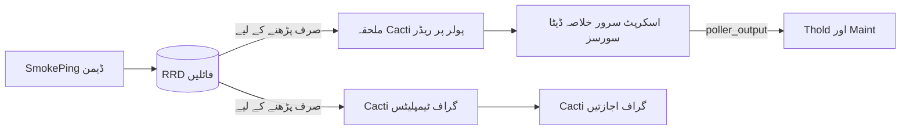

<!-- Source: README.md; SHA256: b41ec705327127cc34ff07d1514a141262752f99c5e2296fdc323d584a777b84 -->

<!-- translations:start -->
[English](../../../README.md) | [简体中文](../zh-CN/README.md) | [हिन्दी](../hi-IN/README.md) | [Español (España)](../es-ES/README.md) | [Español (Latinoamérica)](../es-419/README.md) | [العربية (السعودية)](../ar-SA/README.md) | [Afrikaans](../af-ZA/README.md) | [አማርኛ](../am-ET/README.md) | [العربية (مصر)](../ar-EG/README.md) | [العربية (المغرب)](../ar-MA/README.md) | [বাংলা](../bn-BD/README.md) | [Bosanski](../bs-BA/README.md) | [Deutsch](../de-DE/README.md) | [فارسی](../fa-IR/README.md) | [Filipino](../fil-PH/README.md) | [Français](../fr-FR/README.md) | [Français (Maroc)](../fr-MA/README.md) | [Français (Sénégal)](../fr-SN/README.md) | [Hausa](../ha-NG/README.md) | [עברית](../he-IL/README.md) | [Hrvatski](../hr-HR/README.md) | [Bahasa Indonesia](../id-ID/README.md) | [Igbo](../ig-NG/README.md) | [Italiano](../it-IT/README.md) | [日本語](../ja-JP/README.md) | [한국어](../ko-KR/README.md) | [Malagasy](../mg-MG/README.md) | [मराठी](../mr-IN/README.md) | [Bahasa Melayu](../ms-MY/README.md) | [Nederlands](../nl-NL/README.md) | [Polski](../pl-PL/README.md) | [Português (Brasil)](../pt-BR/README.md) | [Русский](../ru-RU/README.md) | [Kinyarwanda](../rw-RW/README.md) | [Soomaali](../so-SO/README.md) | [Српски](../sr-RS/README.md) | [Svenska](../sv-SE/README.md) | [Kiswahili](../sw-KE/README.md) | [தமிழ்](../ta-IN/README.md) | [తెలుగు](../te-IN/README.md) | [ไทย](../th-TH/README.md) | [Türkçe](../tr-TR/README.md) | [Українська](../uk-UA/README.md) | [اردو](README.md) | [Tiếng Việt](../vi-VN/README.md) | [isiXhosa](../xh-ZA/README.md) | [Yorùbá](../yo-NG/README.md) | [繁體中文](../zh-TW/README.md) | [isiZulu](../zu-ZA/README.md)
<!-- translations:end -->

  <picture>
    <source media="(prefers-color-scheme: dark)" srcset="../../images/logo_dark.png">
    
  </picture>

# Cacti کے لیے SmokePing پلگ ان

یہ Cacti 1.2 کا ایک پلگ ان ہے جو SmokePing کی لیٹینسی اور پیکٹ لاس پیمائشوں کو Cacti میں عام ڈیوائسز، ڈیٹا سورسز اور گراف کی صورت میں شامل کرتا ہے۔ اس کے بعد اسموک گراف متعلقہ ڈیوائس کے ساتھ ہی Cacti کی اجازتوں کے تحت نظر آتے ہیں، اور Thold نیز Maint ان پر الرٹ جاری کر سکتے ہیں اور انہیں دبا (suppress) سکتے ہیں۔ یہ Cacti کے لیے ایک آزادانہ نفاذ (implementation) ہے اور [SmokePing](https://oss.oetiker.ch/smokeping/) کا حصہ یا اس کی جانب سے توثیق شدہ نہیں ہے، جس کے اصل مصنفین Tobias Oetiker اور Niko Tyni ہیں۔ یہ پلگ ان نہ تو SmokePing کا کوڈ شامل کرتا ہے اور نہ ہی اسے چلاتا ہے: یہ ان کنفیگریشن اور RRD فائلوں کو پڑھتا ہے جو SmokePing لکھتا ہے، اور اس کے گراف ٹیمپلیٹس SmokePing کے اپنے گراف جیسی ہی سیریز بنانے کے لیے تیار کیے گئے ہیں۔

> **حیثیت: زیرِ تعمیر۔ مشاہداتی موڈ (مرحلہ 1) `main` پر (1.0.0-rc.1) آپریٹر فلٹرنگ، CSV ایکسپورٹ، لاوارث RRD کی تشخیص، Thold الرٹ ترجمہ، ماحولیاتی نظام کے انضمام کے ہکس، اور ریموٹ کلیکٹر ریپلیکیشن کے ساتھ نافذ کر دیا گیا ہے۔** یہ پلگ ان SmokePing کی کنفیگریشن اور RRD فائلیں پڑھتا ہے، ان کی حالت دکھاتا ہے، ان کے لیے Cacti ڈیوائسز، ڈیٹا سورسز اور گراف بناتا ہے، اور Thold نیز Maint کو ڈیٹا فراہم کرتا ہے۔ یہ SmokePing میں کچھ بھی نہیں لکھتا۔ منظم موڈ (پلگ ان کا SmokePing کنفیگریشن لکھنا) ایک بعد کا مرحلہ ہے، جو ابھی شروع نہیں ہوا اور اس ریلیز میں شامل نہیں ہے۔ حقیقی تنصیبات پر پائلٹ تجربات اور SmokePing کے گراف لیجنڈ سے مزید قریبی مطابقت ابھی سنگِ میل 4 میں کھلے ہیں۔ آغاز کے لیے [docs/install.md](../../install.md) دیکھیں۔

## رسائی کے کردار

| دائرہ اختیار (Realm) | رسائی |
| --- | --- |
| SmokePing View | موجودہ مانیٹرنگ صفحات۔ |
| SmokePing Operator | مانیٹرنگ کے علاوہ آپریشنز کا صفحہ اور ذاتی ٹرائیاج (triage) توثیقات۔ |
| SmokePing Admin | آپریٹر کی رسائی کے علاوہ موجودہ کنفیگریشن اور انتظامی کارروائیاں۔ |

اپ گریڈ فائلیں کاپی کرنے کے بعد، نیا دائرہ اختیار (realm) رجسٹر کرنے کے لیے ایڈمنسٹریٹر کے طور پر Plugins صفحہ کھولیں۔ **Configuration > Users** یا یوزر گروپس کے تحت Operator دائرہ اختیار کو واضح طور پر تفویض کریں۔
اپ گریڈز موجودہ View اور Admin دائرہ اختیار کی IDs اور عطا کردہ حقوق برقرار رکھتے ہیں۔ Admin رسائی ہر درخواست پر Operator رسائی وراثت میں لیتی ہے، اور Operator رسائی View رسائی وراثت میں لیتی ہے؛
اس سے صارفین یا گروپس میں محفوظ شدہ حقوق کا اضافہ نہیں ہوتا۔ پلگ ان کی ترتیبات کے لیے Cacti کی Settings اجازت کے علاوہ
SmokePing Admin رسائی بھی درکار ہوتی ہے۔

Cacti کی ڈیوائس اجازتیں اب بھی ہر صارف کو دستیاب قطاروں اور کارروائیوں کو محدود کرتی ہیں؛ غیر میپ شدہ اشیاء (unmapped objects) کے لیے ایڈمنسٹریٹر درکار ہوتا ہے۔
اسناد، کنفیگریشن، میپنگ، حذف کرنے اور دیگر انتظامی تبدیلیاں
انتظامی صفحات ہی میں رہتی ہیں۔ توثیقات صرف موجودہ صارف کے سیشن میں، زیادہ سے زیادہ ایک گھنٹے کے لیے اور صرف اس وقت تک برقرار رہتی ہیں جب تک وہی مشاہدہ تازہ رہے۔ نئے یا تبدیل شدہ مشاہدات انہیں باطل کر دیتے ہیں۔ یہ کبھی بھی ناکام پیمائش کو صحت مند قرار نہیں دیتیں اور نہ ہی الرٹس کو روکتی ہیں۔

## اسکرین شاٹس

لائیو SmokePing 2.8.2 نیٹ ورک سے Cacti 1.2.31 میں درآمد شدہ، گزشتہ 12 گھنٹے۔ ہر ہدف کی ڈیوائس میں ماسٹر کے لیے ایک اسموک گراف اور ہر سلیو (`lon1`، `sgp1`) کے لیے ایک گراف موجود ہے، جو گراف ٹری میں اس کے SmokePing سیکشن کے تحت درج ہے۔

## وجہ

SmokePing لیٹینسی کی تقسیم اور پیکٹ لاس کی عمدہ پیمائش کرتا ہے، اور اس کے اسموک گراف وہ تغیر دکھاتے ہیں جو صرف اوسط پر مبنی گراف چھپا دیتا ہے۔ Cacti کے ساتھ چلائے جانے پر یہ تین خلا چھوڑتا ہے:

- **الگ رسائی کنٹرول۔** SmokePing کا CGI نظام Cacti کے صارفین، گروپس یا ڈیوائس اجازتوں کے بارے میں کچھ نہیں جانتا۔
- **ڈیوائس کے سیاق و سباق کا فقدان۔** ایک ہی ڈیوائس کے لیے لیٹینسی اور انٹرفیس کاؤنٹرز الگ الگ ٹولز میں رہتے ہیں۔
- **Cacti الرٹنگ کا کوئی راستہ نہیں۔** Thold اور Maint نظام Cacti ڈیٹا سورسز اور ڈیوائسز پر کام کرتے ہیں، اس لیے SmokePing کے الرٹس الگ سے ترتیب دیے اور دبائے جاتے ہیں۔

یہ پلگ ان ہر SmokePing ہدف کو Cacti اشیاء کے طور پر ظاہر کر کے ان خلا کو پُر کرتا ہے جو SmokePing کی موجودہ RRD فائلوں کی طرف اشارہ کرتی ہیں، ساتھ ہی پول کی گئی خلاصہ اقدار کا ایک چھوٹا سیٹ بھی فراہم کرتا ہے۔ یہ متوازی نظام بنانے کے بجائے Cacti کی گرافنگ، اجازتوں، Thold اور Maint کو دوبارہ استعمال کرتا ہے۔ پولر کے دائرہ کار میں کنفیگریشن ریپلیکیشن (`replicate_out`) مقامی موڈ (poller 1) اور کلیکٹر کے مقامی مشاہداتی کیشز کو الگ تھلگ رکھتے ہوئے ریموٹ پولر کنفیگریشن ٹیبلز کو آگے بھیجتی ہے۔

## دائرہ کار اور حیثیت

| مرحلہ | دائرہ کار | سنگِ میل | حیثیت |
|---|---|---|---|
| 0، تحقیق | مطابقت کا جدول، اپ اسٹریم رویے کی تصدیق، گراف کی درستگی کا تجربہ | [M1](https://github.com/somethingwithproof/plugin_smokeping/milestone/1) | نتائج `docs/research` میں موجود ہیں؛ کچھ تحقیقی مسائل ابھی کھلے ہیں |
| 1، مشاہدہ | انوینٹری کی درآمد، Cacti ڈیوائسز، اسموک اور خلاصہ گرافس، Thold الرٹنگ اور الرٹ ترجمہ، Maint دباؤ (suppression)، فلٹر شدہ مناظر، CSV ایکسپورٹ، لاوارث RRD کی تشخیص، ماحولیاتی نظام کے ہکس | [M2](https://github.com/somethingwithproof/plugin_smokeping/milestone/2)، [M3](https://github.com/somethingwithproof/plugin_smokeping/milestone/3)، [M4](https://github.com/somethingwithproof/plugin_smokeping/milestone/4) | نافذ شدہ؛ پائلٹ تجربات کھلے ہیں |
| 2، منظم | Cacti کے زیرِ ملکیت کنفیگریشن نیم اسپیس، ICMP اور TCP پروب پروفائلز، نظرثانیاں، توثیق، ری لوڈ، رول بیک | [M5](https://github.com/somethingwithproof/plugin_smokeping/milestone/5) | منصوبہ بند، ابھی شروع نہیں ہوا |
| 3، ریموٹ | ریموٹ ڈیٹا کلیکٹرز کے لیے پولر کے دائرہ کار کی استفسارات اور `replicate_out` ٹیبل ریپلیکیشن (`RemoteReplication`)؛ مکمل ملٹی کلیکٹر SmokePing تعیناتی کی اہلیت | [M6](https://github.com/somethingwithproof/plugin_smokeping/milestone/6) | ریپلیکیشن اور پولر اسکوپنگ نافذ شدہ؛ ملٹی کلیکٹر تعیناتی کی اہلیت کھلی ہے |

نافذ شدہ آپریٹر ورک فلو، CLI کمانڈز، اور ماحولیاتی نظام کے ہکس:

- **انوینٹری اور ہدف کی فلٹرنگ (`smokeping_inventory.php`، `smokeping.php`)**: `TargetFilter`، `TargetRepository::filteredForPoller()`، `InventoryPage`، اور `ViewPage` تلاش (`filter`)، پروب (`probe`)، انوینٹری میں موجودگی (`presence`)، میپنگ کی حالت (`mapping`)، تازگی کی حالت (`state`)، اور اختیاری صفحہ کے سائز کی تقسیم (`rows`: `All`، `25`، `50`، `100`، `200`) فراہم کرتے ہیں۔ گنتی سے پہلے SQL میں ڈیوائس کی مرئیت نافذ کی جاتی ہے تاکہ کل تعداد کبھی خفیہ ڈیوائسز کو ظاہر نہ کرے۔
- **CSV ایکسپورٹ (`smokeping.php?action=export_csv`)**: `CsvExporter` کالر کی ڈیوائس اجازتوں کے تحت فعال فلٹر شدہ منظر کے لیے RFC 4180 CRLF آؤٹ پٹ اسٹریم کرتا ہے، اور اسپریڈشیٹ فارمولوں کو بے اثر کرنے کے لیے `=`، `+`، `-`، `@`، ٹیب، یا کیریج ریٹرن سے شروع ہونے والے سیلز کے آگے اپوسٹروفی کا اضافہ کرتا ہے۔
- **لاوارث RRD کی تشخیص (`smokeping_health.php`)**: `OrphanRrdScanner` اور `HealthCheck::orphanRrds()` ریڈر پولر پر SmokePing ماؤنٹ کا محدود اسکین کرتے ہیں، `__cgi`، `__sortercache`، اور علامتی روابط (symbolic links) کو نظر انداز کرتے ہیں، اور بغیر مالک `.rrd` فائلوں کو کھلی ری لنک تجاویز سے ملاتے ہیں۔
- **SmokePing سے Thold میں تبدیلی (`smokeping_health.php`، `cli/smokeping.php`)**: `TholdTranslator` اور `TholdGenerator` SmokePing کی `*** Alerts ***` تعریفیں پڑھتے ہیں اور SmokePing کنفیگریشن فائلوں میں ترمیم کیے بغیر معاونت یافتہ مسلسل نقصان کے پیٹرنز کو مساوی `loss_pct` Thold حدوں میں ترجمہ کرتے ہیں۔ ویب فلو GET پیش نظارہ (`action=thold_preview`، `HealthPage::renderTholdPreview()`) کے بعد CSRF سے محفوظ POST (`action=thold_create`) استعمال کرتا ہے۔ غیر معاونت یافتہ پیٹرنز (RTT الرٹس، وائلڈ کارڈ زوال، مخلوط سطحیں) لکھے بغیر چھوڑ دیے جاتے ہیں۔
- **ایڈمنسٹریٹر CLI (`cli/smokeping.php`)**: `provision <target path> [--device=ID] [--location=NAME]`، `relink <old target path> <new target path> [--location=NAME]`، `thold-generate <target path> [--alert=NAME] [--apply]`، `size-graphs`، `upgrade-graphs`، `export [--format=yaml|xml] [--file=PATH]`، `import --file=PATH [--format=yaml|xml] [--apply --confirm=PLAN]`، اور `import-smokeping [--dry-run | --apply --confirm=PLAN] [--file=PATH] [--sections=A,B/C] [--device-per=host|target] [--device-template=ID] [--poller=ID] [--site=ID] [--tree=ID | --tree-name=NAME]` کی معاونت کرتا ہے۔
- **ماحولیاتی نظام کے ہکس (`setup.php`، `Schema::HOOKS`)**: 21 ہکس رجسٹر کرتا ہے، جن میں `abilities_register` (`AbilitiesProvider`: کالر کی یوزر ID کے خلاف View دائرہ کار پر محدود اور خفیہ معلومات کے بغیر خالصتاً صرف پڑھنے کے لیے `smokeping-list-targets` اور `smokeping-get-health`)، `doctor_register_checks` (`DoctorChecks`: `smokeping_stale_targets`، `smokeping_freshness_breaches`، `smokeping_orphan_rrds`، `smokeping_config_path`)، `casc_register_providers` (`CascProvider`: `ConfigCodec` اور `ConfigService` پر مبنی `smokeping` YAML/XML `export`، `validate`، `plan`، اور `apply`)، اور `replicate_out` (`RemoteReplication`: `poller_id > 1` والے ریموٹ پولرز کے لیے `plugin_smokeping_target`، `plugin_smokeping_mapping`، `plugin_smokeping_object`، اور `plugin_smokeping_relink` کی پولر کے دائرہ کار میں ہم آہنگی) شامل ہیں۔

دائرہ کار سے باہر: پلگ ان کے زیرِ ملکیت الرٹنگ انجن، رپورٹنگ انجن، حسبِ ضرورت ڈیمن یا نیٹ ورک پروٹوکول، منظم HTTP/DNS/سروس چیکس (servcheck ان کا احاطہ کرتا ہے)، اور SmokePing کی RRD فائلوں میں لکھنا۔

## مطابقت کے اہداف

| جزو | ہدف |
|---|---|
| Cacti | 1.2.x میں 1.2.31 یا اس کے بعد کا ورژن، کور میں کسی تبدیلی کے بغیر |
| PHP | 8.2 یا اس کے بعد کا ورژن؛ `setup.php` ورژن 8.0 پر بھی پارس ہونے کے قابل رہتا ہے تاکہ غیر معاون رن ٹائم پر Cacti UI ٹوٹنے کے بجائے انکار کا پیغام ملے |
| SmokePing | 2.9.0، 2.8.2، اور 2.7.3 (صرف Ubuntu 22.04 پر، 2027-06-01 تک) |
| Thold، Maint | کسی تبدیلی کی ضرورت نہیں |
| سیریز | فی تنصیب 10,000، 20 پنگز اور 300 سیکنڈ کے اسٹیپ پر ([کارکردگی](../../performance.md#supported-series-count)) |

## دستاویزات

| | |
|---|---|
| [تنصیب](../../install.md) | تقاضے، SmokePing کی ڈیٹا ڈائریکٹری کا صرف پڑھنے کے لیے ماؤنٹ، تنصیب، کنٹینرز، معاون ورژنز |
| [آپریشن](../../operations.md) | ہر حالت کا مفہوم اور اس کے شواہد، صحت کی جانچ، ان پٹ ناکام ہونے پر رویہ |
| [Cacti میں اہداف شامل کریں](../../provisioning.md) | ایک ہدف، متعدد ڈیوائسز، دوبارہ لنک کرنا، اجازتیں |
| [الرٹنگ](../../alerting.md) | خلاصہ اقدار، Thold کے دورانیے، پرانا ڈیٹا، تاخیر سے آنے والا ڈیٹا، SmokePing کے الرٹس کے ساتھ باہمی تداخل، Maint |
| [کنفیگریشن فارمیٹ](../../configuration-format.md) | YAML اور XML ایکسپورٹ اور امپورٹ |
| [بیک اپ اور بحالی](../../backup-restore.md) | کن چیزوں کا بیک اپ لیا جائے اور بحالی کیسے دوبارہ شروع ہوتی ہے |
| [کارکردگی](../../performance.md) | 100، 1,000 اور 10,000 سیریز پر مقامی اور ریلیز رنر پیمائشیں، اور معاون سیریز کی تعداد: فی تنصیب 10,000 |
| [ناکامی کی جانچ](../../failure-qualification.md) | ناکامی کے منظرنامے اور ہر ایک کی جانچ کا طریقہ کار |
| [ریلیز کا طریقہ](../../RELEASING.md) | ریلیز کا طریقہ کار: پل ریکوئسٹ، دستخط شدہ ٹیگ، ورک فلو کیا کرتا ہے، نتیجے کی تصدیق کیسے کی جائے |
| [ریلیز آرکائیو](../../release.md) | ورژن، تبدیلیوں کا ریکارڈ (changelog)، اور ریلیز آرکائیو |
| [ٹیسٹنگ](../../testing.md) | ٹیسٹ سویٹس، CI کیا چلاتا ہے، اور حقیقی SmokePing کے خلاف لائیو ٹیسٹ سویٹ |

## ڈیزائن

- [docs/PLAN.md](../../PLAN.md) مکمل منصوبہ ہے: فنِ تعمیر (architecture)، وہ اپ اسٹریم حقائق جن پر یہ منحصر ہے (مآخذ سمیت)، اسٹیٹ ماڈل، سیکیورٹی حدود، کارکردگی کا حساب کتاب، ٹیسٹنگ، اور خطرات۔
- [docs/decisions/](../../decisions) میں پہلے سے کیے گئے فیصلوں کے لیے آرکیٹیکچر ڈسیژن ریکارڈز موجود ہیں۔
- [docs/REQUIREMENTS.md](../../REQUIREMENTS.md) ہر تقاضے کی ID کو اس کے متعلقہ مسئلے (issue) سے جوڑتا ہے۔
- مقامی تصدیق Pest یونٹ اور سورس رول چیکس (`pest --configuration=phpunit.xml`)، PHPStan لیول 9 (`CACTI_PATH=<cacti-dir> phpstan analyse -c phpstan.neon --no-progress`)، اینٹری پوائنٹ سنٹیکس چیکس (`*.php`، `include/*.php`، `scripts/*.php`، `cli/*.php` پر `php -l`)، اور ترجمے کے چیکس (`sh locales/build_gettext.sh --check`) چلاتی ہے۔ انٹیگریشن اور کنٹینر اینڈ ٹو اینڈ سویٹس کے لیے [docs/testing.md](../../testing.md) دیکھیں۔

## کام کی نگرانی کا طریقہ

- **سنگِ میل (Milestones)** منصوبے کے سنگِ میلوں کی پیروی کرتے ہیں۔ ہر ایک میں ایک ایپک ایشو ہوتا ہے جو اس کے ذیلی مسائل اور اختتامی شواہد کی فہرست فراہم کرتا ہے۔
- **مسائل (Issues)** کی درجہ بندی لیبلز کے ذریعے کی جاتی ہے: `type: requirement`، `type: research`، `type: decision`، `type: epic`۔ تقاضوں کے مسائل میں نمبر شدہ اور قابلِ جانچ تقاضے (`REQ-AREA-NNN`) اور قبولیت کے معیارات بیان کیے جاتے ہیں۔
- **لیبلز** میں `area:`، `phase:`، `priority:`، اور `status:` بھی شامل ہوتے ہیں۔ [CONTRIBUTING.md](../../../CONTRIBUTING.md#labels) دیکھیں۔
- [پروجیکٹ بورڈ](https://github.com/users/somethingwithproof/projects/6) تمام سنگِ میلوں کے تمام مسائل دکھاتا ہے۔

## شراکت داری

[CONTRIBUTING.md](../../../CONTRIBUTING.md) پڑھیں۔ کمٹس کے لیے DCO دستخط (sign-off) درکار ہوتا ہے۔ ڈیزائن پر بحث مسائل (issues) پر ہوتی ہے؛ کھلے فیصلوں پر `type: decision` لیبل لگا ہوتا ہے۔

## سیکیورٹی

کمزوریوں کی اطلاع نجی طور پر دیں؛ [SECURITY.md](../../../SECURITY.md) دیکھیں۔

## لائسنس

GNU General Public License v2.0، جو Cacti اور اس کے پلگ انز کا لائسنس ہے۔ [LICENSE](../../../LICENSE) دیکھیں۔
