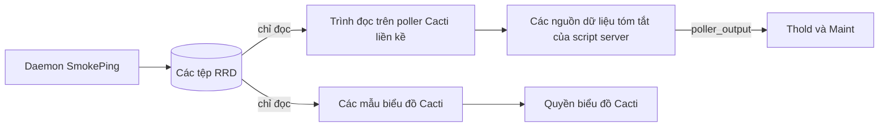

<!-- Source: README.md; SHA256: b41ec705327127cc34ff07d1514a141262752f99c5e2296fdc323d584a777b84 -->

<!-- translations:start -->
[English](../../../README.md) | [简体中文](../zh-CN/README.md) | [हिन्दी](../hi-IN/README.md) | [Español (España)](../es-ES/README.md) | [Español (Latinoamérica)](../es-419/README.md) | [العربية (السعودية)](../ar-SA/README.md) | [Afrikaans](../af-ZA/README.md) | [አማርኛ](../am-ET/README.md) | [العربية (مصر)](../ar-EG/README.md) | [العربية (المغرب)](../ar-MA/README.md) | [বাংলা](../bn-BD/README.md) | [Bosanski](../bs-BA/README.md) | [Deutsch](../de-DE/README.md) | [فارسی](../fa-IR/README.md) | [Filipino](../fil-PH/README.md) | [Français](../fr-FR/README.md) | [Français (Maroc)](../fr-MA/README.md) | [Français (Sénégal)](../fr-SN/README.md) | [Hausa](../ha-NG/README.md) | [עברית](../he-IL/README.md) | [Hrvatski](../hr-HR/README.md) | [Bahasa Indonesia](../id-ID/README.md) | [Igbo](../ig-NG/README.md) | [Italiano](../it-IT/README.md) | [日本語](../ja-JP/README.md) | [한국어](../ko-KR/README.md) | [Malagasy](../mg-MG/README.md) | [मराठी](../mr-IN/README.md) | [Bahasa Melayu](../ms-MY/README.md) | [Nederlands](../nl-NL/README.md) | [Polski](../pl-PL/README.md) | [Português (Brasil)](../pt-BR/README.md) | [Русский](../ru-RU/README.md) | [Kinyarwanda](../rw-RW/README.md) | [Soomaali](../so-SO/README.md) | [Српски](../sr-RS/README.md) | [Svenska](../sv-SE/README.md) | [Kiswahili](../sw-KE/README.md) | [தமிழ்](../ta-IN/README.md) | [తెలుగు](../te-IN/README.md) | [ไทย](../th-TH/README.md) | [Türkçe](../tr-TR/README.md) | [Українська](../uk-UA/README.md) | [اردو](../ur-PK/README.md) | [Tiếng Việt](README.md) | [isiXhosa](../xh-ZA/README.md) | [Yorùbá](../yo-NG/README.md) | [繁體中文](../zh-TW/README.md) | [isiZulu](../zu-ZA/README.md)
<!-- translations:end -->

  <picture>
    <source media="(prefers-color-scheme: dark)" srcset="../../images/logo_dark.png">
    
  </picture>

# Plugin SmokePing cho Cacti

Một plugin cho Cacti 1.2 giúp đưa các số đo độ trễ và mất gói của SmokePing vào Cacti dưới dạng thiết bị, nguồn dữ liệu và biểu đồ thông thường. Khi đó, biểu đồ dạng smoke nằm ngay cạnh thiết bị tương ứng, tuân theo phân quyền của Cacti, và Thold cùng Maint có thể cảnh báo cũng như tạm ẩn cảnh báo trên chúng. Đây là một bản triển khai độc lập cho Cacti, không thuộc về và không được xác nhận bởi [SmokePing](https://oss.oetiker.ch/smokeping/), với hai tác giả gốc là Tobias Oetiker và Niko Tyni. Plugin không bao gồm và cũng không chạy mã nguồn của SmokePing: nó đọc các tệp cấu hình và tệp RRD mà SmokePing ghi ra, còn các mẫu biểu đồ được xây dựng để vẽ cùng các chuỗi dữ liệu như biểu đồ gốc của SmokePing.

> **Trạng thái: đang phát triển. Chế độ quan sát (giai đoạn 1) đã được triển khai trên `main` (1.0.0-rc.1) với tính năng lọc cho người vận hành, xuất CSV, phát hiện RRD mồ côi, chuyển đổi cảnh báo Thold, các hook tích hợp hệ sinh thái và sao chép cho bộ thu thập từ xa.** Plugin đọc các tệp cấu hình và tệp RRD của SmokePing, hiển thị trạng thái của chúng, tạo các thiết bị, nguồn dữ liệu và biểu đồ Cacti tương ứng, đồng thời cấp dữ liệu cho Thold và Maint. Plugin không ghi bất cứ thứ gì vào SmokePing. Chế độ quản lý (plugin ghi cấu hình SmokePing) là giai đoạn sau, chưa bắt đầu và không có trong bản phát hành này. Các thử nghiệm thực tế trên hệ thống đang vận hành và việc khớp sát hơn với chú giải biểu đồ của SmokePing vẫn đang mở ở cột mốc 4. Xem [docs/install.md](../../install.md) để bắt đầu.

## Vai trò truy cập

| Phạm vi quyền | Quyền truy cập |
| --- | --- |
| SmokePing View | Các trang giám sát hiện có. |
| SmokePing Operator | Giám sát cộng thêm trang Vận hành và xác nhận phân loại cá nhân. |
| SmokePing Admin | Quyền Operator cộng thêm các thao tác cấu hình và quản trị hiện có. |

Sau khi sao chép các tệp nâng cấp, hãy mở trang Plugins với quyền quản trị viên để đăng ký
phạm vi quyền mới. Gán phạm vi quyền Operator một cách tường minh trong mục **Configuration > Users** hoặc các nhóm người dùng.
Quá trình nâng cấp vẫn giữ nguyên ID phạm vi quyền và các quyền đã cấp của View và Admin. Quyền Admin
kế thừa quyền Operator, và quyền Operator kế thừa quyền View trên mỗi yêu cầu;
việc này không thêm quyền được lưu trữ cho người dùng hoặc nhóm. Phần cài đặt plugin cũng yêu cầu
quyền SmokePing Admin bên cạnh quyền Settings của Cacti.

Quyền thiết bị của Cacti vẫn giới hạn các hàng và thao tác khả dụng đối với từng người dùng; các đối tượng chưa ánh xạ yêu cầu quyền quản trị viên.
Thông tin xác thực, cấu hình, ánh xạ, thao tác xóa và các thay đổi quản trị khác
vẫn nằm trong các trang quản trị. Các xác nhận chỉ tồn tại trong phiên làm việc hiện tại của người dùng,
tối đa một giờ và chỉ khi cùng một quan sát đó vẫn còn mới.
Các quan sát mới hoặc đã thay đổi sẽ làm mất hiệu lực xác nhận. Chúng không bao giờ đánh dấu một phép đo
bị lỗi là bình thường hay tạm ẩn cảnh báo.

## Ảnh chụp màn hình

Được nhập từ một mạng SmokePing 2.8.2 đang chạy vào Cacti 1.2.31 trong 12 giờ gần nhất. Thiết bị của mỗi mục tiêu có một biểu đồ smoke cho master và một biểu đồ cho mỗi slave (`lon1`, `sgp1`), được sắp xếp dưới mục SmokePing tương ứng trong cây biểu đồ.

## Lý do

SmokePing đo lường phân phối độ trễ và tỷ lệ mất gói rất tốt, và các biểu đồ smoke của nó thể hiện được độ biến thiên mà biểu đồ chỉ vẽ giá trị trung bình thường che khuất. Khi chạy song song với Cacti, nó để lại ba khoảng trống:

- **Kiểm soát truy cập tách biệt.** CGI của SmokePing không biết gì về người dùng, nhóm hay quyền thiết bị của Cacti.
- **Thiếu ngữ cảnh thiết bị.** Độ trễ và bộ đếm giao diện của cùng một thiết bị nằm ở các công cụ khác nhau.
- **Không có đường dẫn vào hệ thống cảnh báo của Cacti.** Thold và Maint hoạt động trên các nguồn dữ liệu và thiết bị của Cacti, nên cảnh báo của SmokePing phải được cấu hình và tạm ẩn riêng biệt.

Plugin lấp đầy các khoảng trống này bằng cách biểu diễn mỗi mục tiêu SmokePing thành các đối tượng Cacti trỏ tới các tệp RRD hiện có của SmokePing, cộng thêm một tập nhỏ các giá trị tóm tắt được thu thập định kỳ. Nó tái sử dụng cơ chế vẽ biểu đồ, phân quyền, Thold và Maint của Cacti thay vì xây dựng các phiên bản song song. Cơ chế sao chép cấu hình theo phạm vi poller (`replicate_out`) đẩy các bảng cấu hình poller từ xa trong khi giữ chế độ cục bộ (poller 1) và các bộ nhớ đệm quan sát cục bộ của bộ thu thập tách biệt nhau.

## Phạm vi và trạng thái

| Giai đoạn | Phạm vi | Cột mốc | Trạng thái |
|---|---|---|---|
| 0, nghiên cứu | Ma trận tương thích, xác nhận hành vi từ dự án gốc, thử nghiệm độ trung thực của biểu đồ | [M1](https://github.com/somethingwithproof/plugin_smokeping/milestone/1) | Kết quả nằm trong `docs/research`; một số issue nghiên cứu vẫn đang mở |
| 1, quan sát | Nhập danh mục, thiết bị Cacti, biểu đồ smoke và tóm tắt, cảnh báo và chuyển đổi cảnh báo Thold, tạm ẩn Maint, chế độ xem có bộ lọc, xuất CSV, phát hiện RRD mồ côi, các hook hệ sinh thái | [M2](https://github.com/somethingwithproof/plugin_smokeping/milestone/2), [M3](https://github.com/somethingwithproof/plugin_smokeping/milestone/3), [M4](https://github.com/somethingwithproof/plugin_smokeping/milestone/4) | Đã triển khai; đang mở thử nghiệm thực tế |
| 2, quản lý | Không gian tên cấu hình do Cacti sở hữu, hồ sơ probe ICMP và TCP, phiên bản sửa đổi, kiểm tra hợp lệ, tải lại, khôi phục | [M5](https://github.com/somethingwithproof/plugin_smokeping/milestone/5) | Đã lên kế hoạch, chưa bắt đầu |
| 3, từ xa | Truy vấn theo phạm vi poller và sao chép bảng `replicate_out` cho các bộ thu thập dữ liệu từ xa (`RemoteReplication`); kiểm định triển khai SmokePing đa bộ thu thập đầy đủ | [M6](https://github.com/somethingwithproof/plugin_smokeping/milestone/6) | Đã triển khai sao chép và phân phạm vi poller; kiểm định triển khai đa bộ thu thập vẫn đang mở |

Các quy trình vận hành, lệnh CLI và hook hệ sinh thái đã triển khai:

- **Danh mục và lọc mục tiêu (`smokeping_inventory.php`, `smokeping.php`)**: `TargetFilter`, `TargetRepository::filteredForPoller()`, `InventoryPage` và `ViewPage` cung cấp tìm kiếm (`filter`), probe (`probe`), trạng thái hiện diện trong danh mục (`presence`), trạng thái ánh xạ (`mapping`), trạng thái độ mới (`state`) và phân trang tùy chọn theo kích thước trang (`rows`: `All`, `25`, `50`, `100`, `200`). Quyền hiển thị thiết bị được thực thi trong SQL trước khi đếm để các tổng số không bao giờ làm lộ thiết bị ẩn.
- **Xuất CSV (`smokeping.php?action=export_csv`)**: `CsvExporter` truyền trực tiếp dữ liệu RFC 4180 CRLF cho chế độ xem đang được lọc theo quyền thiết bị của người gọi, thêm dấu nháy đơn vào đầu các ô bắt đầu bằng `=`, `+`, `-`, `@`, ký tự tab hoặc ký tự xuống dòng về đầu dòng nhằm vô hiệu hóa công thức bảng tính.
- **Phát hiện RRD mồ côi (`smokeping_health.php`)**: `OrphanRrdScanner` và `HealthCheck::orphanRrds()` thực hiện quét có giới hạn thư mục gắn kết SmokePing trên poller đọc, bỏ qua `__cgi`, `__sortercache` và liên kết tượng trưng, đồng thời đối chiếu các tệp `.rrd` không có chủ sở hữu với các đề xuất liên kết lại đang mở.
- **Chuyển đổi SmokePing sang Thold (`smokeping_health.php`, `cli/smokeping.php`)**: `TholdTranslator` và `TholdGenerator` đọc các định nghĩa `*** Alerts ***` của SmokePing và chuyển đổi các mẫu mất gói liên tiếp được hỗ trợ thành ngưỡng `loss_pct` tương đương trong Thold mà không chỉnh sửa tệp cấu hình SmokePing. Luồng web sử dụng bản xem trước GET (`action=thold_preview`, `HealthPage::renderTholdPreview()`) theo sau là POST có bảo vệ CSRF (`action=thold_create`). Các mẫu không được hỗ trợ (cảnh báo RTT, suy giảm ký tự đại diện, nhiều mức hỗn hợp) bị bỏ qua mà không ghi dữ liệu.
- **CLI cho quản trị viên (`cli/smokeping.php`)**: hỗ trợ `provision <target path> [--device=ID] [--location=NAME]`, `relink <old target path> <new target path> [--location=NAME]`, `thold-generate <target path> [--alert=NAME] [--apply]`, `size-graphs`, `upgrade-graphs`, `export [--format=yaml|xml] [--file=PATH]`, `import --file=PATH [--format=yaml|xml] [--apply --confirm=PLAN]` và `import-smokeping [--dry-run | --apply --confirm=PLAN] [--file=PATH] [--sections=A,B/C] [--device-per=host|target] [--device-template=ID] [--poller=ID] [--site=ID] [--tree=ID | --tree-name=NAME]`.
- **Các hook hệ sinh thái (`setup.php`, `Schema::HOOKS`)**: đăng ký 21 hook, bao gồm `abilities_register` (`AbilitiesProvider`: `smokeping-list-targets` và `smokeping-get-health` hoàn toàn chỉ đọc, kiểm soát quyền View theo ID người dùng gọi và không trả về bí mật nào), `doctor_register_checks` (`DoctorChecks`: `smokeping_stale_targets`, `smokeping_freshness_breaches`, `smokeping_orphan_rrds`, `smokeping_config_path`), `casc_register_providers` (`CascProvider`: `export`, `validate`, `plan` và `apply` ở định dạng YAML/XML cho `smokeping` dựa trên `ConfigCodec` và `ConfigService`) và `replicate_out` (`RemoteReplication`: đồng bộ theo phạm vi poller cho `plugin_smokeping_target`, `plugin_smokeping_mapping`, `plugin_smokeping_object` và `plugin_smokeping_relink` tới các poller từ xa có `poller_id > 1`).

Ngoài phạm vi: công cụ cảnh báo riêng do plugin sở hữu, công cụ báo cáo, daemon hoặc giao thức mạng tùy chỉnh, các kiểm tra HTTP/DNS/dịch vụ được quản lý (đã có servcheck đảm nhiệm) và việc ghi vào các tệp RRD của SmokePing.

## Mục tiêu tương thích

| Thành phần | Mục tiêu |
|---|---|
| Cacti | 1.2.31 trở lên trong nhánh 1.2.x, không cần vá mã nguồn lõi |
| PHP | 8.2 trở lên; `setup.php` vẫn phân tích cú pháp được trên 8.0 để môi trường chạy không được hỗ trợ nhận thông báo từ chối thay vì làm hỏng giao diện Cacti |
| SmokePing | 2.9.0, 2.8.2 và 2.7.3 (chỉ trên Ubuntu 22.04, đến ngày 2027-06-01) |
| Thold, Maint | Không cần thay đổi |
| Chuỗi dữ liệu | 10.000 mỗi bản cài đặt ở mức 20 ping và chu kỳ 300 giây ([hiệu năng](../../performance.md#supported-series-count)) |

## Tài liệu

| | |
|---|---|
| [Cài đặt](../../install.md) | Yêu cầu hệ thống, gắn kết chỉ đọc thư mục dữ liệu của SmokePing, cài đặt, container, các phiên bản được hỗ trợ |
| [Vận hành](../../operations.md) | Ý nghĩa của từng trạng thái và bằng chứng đi kèm, kiểm tra sức khỏe, hành vi khi đầu vào gặp lỗi |
| [Thêm mục tiêu vào Cacti](../../provisioning.md) | Một mục tiêu, nhiều thiết bị, liên kết lại, phân quyền |
| [Cảnh báo](../../alerting.md) | Giá trị tóm tắt, thời lượng Thold, dữ liệu cũ, dữ liệu đến muộn, chồng lấn với cảnh báo của SmokePing, Maint |
| [Định dạng cấu hình](../../configuration-format.md) | Xuất và nhập YAML và XML |
| [Sao lưu và khôi phục](../../backup-restore.md) | Cần sao lưu những gì và cách quá trình khôi phục tiếp tục |
| [Hiệu năng](../../performance.md) | Kết quả đo cục bộ và trên runner phát hành ở mức 100, 1.000 và 10.000 chuỗi dữ liệu, cùng số chuỗi được hỗ trợ: 10.000 mỗi bản cài đặt |
| [Đánh giá kịch bản lỗi](../../failure-qualification.md) | Các kịch bản lỗi và cách kiểm thử từng kịch bản |
| [Phát hành](../../RELEASING.md) | Quy trình phát hành: pull request, thẻ ký số, những gì workflow thực hiện, cách xác minh kết quả |
| [Kho lưu trữ bản phát hành](../../release.md) | Phiên bản, nhật ký thay đổi và kho lưu trữ bản phát hành |
| [Kiểm thử](../../testing.md) | Các bộ kiểm thử, những gì CI chạy và bộ kiểm thử trực tiếp trên một SmokePing thực tế |

## Thiết kế

- [docs/PLAN.md](../../PLAN.md) là bản kế hoạch đầy đủ: kiến trúc, các dữ kiện từ dự án gốc mà plugin phụ thuộc vào (kèm nguồn tham chiếu), mô hình trạng thái, ranh giới bảo mật, phép tính hiệu năng, kiểm thử và rủi ro.
- [docs/decisions/](../../decisions) lưu giữ các bản ghi quyết định kiến trúc cho những lựa chọn đã được đưa ra.
- [docs/REQUIREMENTS.md](../../REQUIREMENTS.md) ánh xạ từng mã yêu cầu tới issue tương ứng.
- Quy trình kiểm chứng cục bộ chạy các bài kiểm thử đơn vị và kiểm tra quy tắc mã nguồn Pest (`pest --configuration=phpunit.xml`), PHPStan Mức 9 (`CACTI_PATH=<cacti-dir> phpstan analyse -c phpstan.neon --no-progress`), kiểm tra cú pháp điểm vào (`php -l` trên `*.php`, `include/*.php`, `scripts/*.php`, `cli/*.php`), và kiểm tra bản dịch (`sh locales/build_gettext.sh --check`). Xem [docs/testing.md](../../testing.md) để biết các bộ kiểm thử tích hợp và kiểm thử đầu-cuối trong container.

## Cách theo dõi công việc

- **Cột mốc** bám theo các cột mốc trong kế hoạch. Mỗi cột mốc có một epic issue liệt kê các issue con và bằng chứng hoàn thành.
- **Issue** được phân loại theo nhãn: `type: requirement`, `type: research`, `type: decision`, `type: epic`. Các issue yêu cầu nêu rõ các yêu cầu được đánh số và có thể kiểm thử (`REQ-AREA-NNN`) cùng tiêu chí nghiệm thu.
- **Nhãn** cũng mang các tiền tố `area:`, `phase:`, `priority:` và `status:`. Xem [CONTRIBUTING.md](../../../CONTRIBUTING.md#labels).
- [Bảng dự án](https://github.com/users/somethingwithproof/projects/6) hiển thị toàn bộ các issue qua các cột mốc.

## Đóng góp

Đọc [CONTRIBUTING.md](../../../CONTRIBUTING.md). Các commit cần có xác nhận ký tên DCO (DCO sign-off). Thảo luận thiết kế diễn ra trên các issue; các quyết định đang mở mang nhãn `type: decision`.

## Bảo mật

Vui lòng báo cáo lỗ hổng bảo mật một cách riêng tư; xem [SECURITY.md](../../../SECURITY.md).

## Giấy phép

Giấy phép Công cộng GNU phiên bản 2.0 (GNU General Public License v2.0), cùng giấy phép với Cacti và các plugin của Cacti. Xem [LICENSE](../../../LICENSE).
