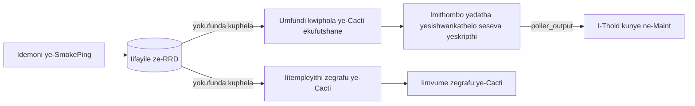

<!-- Source: README.md; SHA256: b41ec705327127cc34ff07d1514a141262752f99c5e2296fdc323d584a777b84 -->

<!-- translations:start -->
[English](../../../README.md) | [简体中文](../zh-CN/README.md) | [हिन्दी](../hi-IN/README.md) | [Español (España)](../es-ES/README.md) | [Español (Latinoamérica)](../es-419/README.md) | [العربية (السعودية)](../ar-SA/README.md) | [Afrikaans](../af-ZA/README.md) | [አማርኛ](../am-ET/README.md) | [العربية (مصر)](../ar-EG/README.md) | [العربية (المغرب)](../ar-MA/README.md) | [বাংলা](../bn-BD/README.md) | [Bosanski](../bs-BA/README.md) | [Deutsch](../de-DE/README.md) | [فارسی](../fa-IR/README.md) | [Filipino](../fil-PH/README.md) | [Français](../fr-FR/README.md) | [Français (Maroc)](../fr-MA/README.md) | [Français (Sénégal)](../fr-SN/README.md) | [Hausa](../ha-NG/README.md) | [עברית](../he-IL/README.md) | [Hrvatski](../hr-HR/README.md) | [Bahasa Indonesia](../id-ID/README.md) | [Igbo](../ig-NG/README.md) | [Italiano](../it-IT/README.md) | [日本語](../ja-JP/README.md) | [한국어](../ko-KR/README.md) | [Malagasy](../mg-MG/README.md) | [मराठी](../mr-IN/README.md) | [Bahasa Melayu](../ms-MY/README.md) | [Nederlands](../nl-NL/README.md) | [Polski](../pl-PL/README.md) | [Português (Brasil)](../pt-BR/README.md) | [Русский](../ru-RU/README.md) | [Kinyarwanda](../rw-RW/README.md) | [Soomaali](../so-SO/README.md) | [Српски](../sr-RS/README.md) | [Svenska](../sv-SE/README.md) | [Kiswahili](../sw-KE/README.md) | [தமிழ்](../ta-IN/README.md) | [తెలుగు](../te-IN/README.md) | [ไทย](../th-TH/README.md) | [Türkçe](../tr-TR/README.md) | [Українська](../uk-UA/README.md) | [اردو](../ur-PK/README.md) | [Tiếng Việt](../vi-VN/README.md) | [isiXhosa](README.md) | [Yorùbá](../yo-NG/README.md) | [繁體中文](../zh-TW/README.md) | [isiZulu](../zu-ZA/README.md)
<!-- translations:end -->

  <picture>
    <source media="(prefers-color-scheme: dark)" srcset="../../images/logo_dark.png">
    
  </picture>

# Iplagini ye-SmokePing ye-Cacti

Iplagini ye-Cacti 1.2 ezisa imilinganiselo yokulibaziseka kunye nelahleko yeephakhethi ye-SmokePing kwi-Cacti njengezixhobo eziqhelekileyo, imithombo yedatha, kunye neegrafu. Iigrafu zomsi ziye zihlale ecaleni kwesixhobo ezikuso, phantsi kweemvume ze-Cacti, kwaye i-Thold ne-Maint zinokuvusa izilumkiso kwaye zizibambe. Olu luphumezo oluzimeleyo lwe-Cacti kwaye ayisiyiyo inxalenye ye-[SmokePing](https://oss.oetiker.ch/smokeping/), okanye ayivunyelwanga yiyo, ababhali bayo bokuqala ingooTobias Oetiker noNiko Tyni. Le plagini ayibandakanyi kwaye ayiqhubi khowudi ye-SmokePing: ifunda uqwalaselo kunye neefayile ze-RRD ezibhalwa yi-SmokePing, kwaye iitempleyithi zayo zegrafu zakhelwe ukuzoba uthotho olufanayo nolweegrafu ze-SmokePing ngokwayo.

> **Imeko: isaphuhliswa. Imowudi yokujonga (isigaba 1) iphunyezwe kwi-`main` (1.0.0-rc.1) kunye nokucoca komqhubi, ukuthunyelwa ngaphandle kwe-CSV, ukufunyanwa kwe-RRD ezingenamnini, ukuguqulelwa kwezilumkiso ze-Thold, ii-hook zokudibanisa kwendalo eqhelekileyo, kunye nokuphindaphinda kwabaqokeleli abakude.** Iplagini ifunda uqwalaselo lwe-SmokePing kunye neefayile ze-RRD, ibonise imeko yazo, yenza izixhobo ze-Cacti, imithombo yedatha, kunye neegrafu zazo, kwaye ibonelela i-Thold ne-Maint ngedatha. Ayibhali nto kwi-SmokePing. Imowudi elawulwayo (iplagini ebhala uqwalaselo lwe-SmokePing) sisigaba esilandelayo, ayikaqaliswa, kwaye ayikho kolu khupho. Uvavanyo kwiifakelo zokwenyani kunye nokufana okusondeleyo kwincwadi yentsingiselo yegrafu ye-SmokePing zisavuliwe kwinqanaba lesi-4. Jonga ku-[docs/install.md](../../install.md) ukuze uqalise.

## Iindima zofikelelo

| Ummandla | Ufikelelo |
| --- | --- |
| SmokePing View | Amaphepha okubeka iliso asele ekho. |
| SmokePing Operator | Ukubeka iliso kunye nephepha leMisebenzi (Operations) kunye nolwamkelo lokuqatshelwa komntu siqu. |
| SmokePing Admin | Ufikelelo lwe-Operator kunye noqwalaselo olukhoyo nezenzo zolawulo. |

Emva kokukopa iifayile zokuphucula, vula iphepha le-Plugins njengomlawuli ukuze ubhalise
ummandla omtsha. Yabela ummandla we-Operator ngokucacileyo phantsi kwe-**Configuration > Users** okanye amaqela abasebenzisi.
Uphuculo lugcina ii-ID zemimandla ye-View ne-Admin ezikhoyo kunye nezibonelelo. Ufikelelo lwe-Admin
lufumana ufikelelo lwe-Operator njengelifa, kwaye ufikelelo lwe-Operator lufumana ufikelelo lwe-View njengelifa kwisicelo ngasinye;
oku akongezi izibonelelo ezigciniweyo kubasebenzisi okanye kumaqela. Iisetingi zeplagini nazo zifuna
ufikelelo lwe-SmokePing Admin ukongeza kwimvume ye-Settings ye-Cacti.

Iimvume zesixhobo ze-Cacti zisayinciphisa imiqolo nezenzo ezifumanekayo kumsebenzisi ngamnye; izinto ezingadityaniswanga zifuna umlawuli.
Iziqinisekiso, uqwalaselo, ukudibanisa, ukucima kunye nolunye utshintsho lolawulo
zihlala kumaphepha olawulo. Ulwamkelo luhlala kuphela kwiseshoni yomsebenzisi wangoku,
ubuninzi iyure enye kwaye kuphela ngelixa uqaphelo olufanayo lusemtsha.
Uqaphelo olutsha okanye olutshintshileyo luyaluphelisa. Azize ziphawule umlinganiselo
ohlulekileyo njengosempilweni okanye zibambe izilumkiso.

## Imifanekiso yesikrini

Ithunyelwe ngaphakathi ukusuka kwinethiwekhi ephilayo ye-SmokePing 2.8.2 ukuya kwi-Cacti 1.2.31, iiyure ezili-12 zokugqibela. Isixhobo sendawo ekujoliswe kuyo ngasinye sinegrafu yomsi ye-master kunye neye-slave nganye (`lon1`, `sgp1`), ezifakwe phantsi kwecandelo layo le-SmokePing kumthi wegrafu.

## Kutheni

I-SmokePing ilinganisa ukusasazeka kokulibaziseka kunye nelahleko yeephakhethi kakuhle, kwaye iigrafu zayo zomsi zibonisa ukuguquguquka okufihlwa yigrafu ye-avareji kuphela. Xa iqhubeka ecaleni kwe-Cacti, ishiya izikhewu ezithathu:

- **Ulawulo lofikelelo olwahlukileyo.** I-CGI ye-SmokePing ayazi nto ngabasebenzisi be-Cacti, amaqela, okanye iimvume zezixhobo.
- **Akukho mvelaphi yesixhobo.** Ukulibaziseka kunye nee-counter zojongano zesixhobo esifanayo zihlala kwizixhobo ezahlukeneyo.
- **Akukho ndlela iya kwizilumkiso ze-Cacti.** I-Thold ne-Maint zisebenza kwimithombo yedatha ye-Cacti nakwizixhobo, ngoko ke izilumkiso ze-SmokePing ziqwalaselwa kwaye zibanjwe ngokwahlukeneyo.

Iplagini iyazivala ezi zikhewu ngokumela indawo ekujoliswe kuyo nganye ye-SmokePing njengezinto ze-Cacti ezikhomba kwiifayile ze-RRD ze-SmokePing ezikhoyo, kunye neseti encinci yamaxabiso esishwankathelo apholiweyo. Isebenzisa kwakhona ukuzoba iigrafu, iimvume, i-Thold, kunye ne-Maint ze-Cacti endaweni yokwakha iinguqulelo zazo ezihambelanayo. Ukuphindaphinda uqwalaselo olugxile kwi-poller (`replicate_out`) kutyhala iitheyibhile zoqwalaselo lwe-poller ekude ngelixa kugcinwa imowudi yasekhaya (poller 1) kunye neekheshe zokujonga zomqokeleli wasekhaya zizimele zodwa.

## Umda kunye nemeko

| Isigaba | Umda | Amanqanaba | Imeko |
|---|---|---|---|
| 0, uphando | Imatriki yokuhambelana, ukuqinisekiswa kokuziphatha kwe-upstream, uvavanyo lokuchaneka kwegrafu | [M1](https://github.com/somethingwithproof/plugin_smokeping/milestone/1) | Iziphumo zikwi-`docs/research`; eminye imiba yophando isavuliwe |
| 1, ukujonga | Ukungeniswa kwe-inventory, izixhobo ze-Cacti, iigrafu zomsi nezesishwankathelo, izilumkiso ze-Thold nokuguqulelwa kwezilumkiso, ukubamba kwe-Maint, iimbono ezihluzyiweyo, ukuthunyelwa ngaphandle kwe-CSV, ukufunyanwa kwe-RRD ezingenamnini, ii-hook zendalo eqhelekileyo | [M2](https://github.com/somethingwithproof/plugin_smokeping/milestone/2), [M3](https://github.com/somethingwithproof/plugin_smokeping/milestone/3), [M4](https://github.com/somethingwithproof/plugin_smokeping/milestone/4) | Iphunyeziwe; uvavanyo luvuliwe |
| 2, elawulwayo | Indawo yamagama yoqwalaselo ephethwe yi-Cacti, iiprofayile ze-ICMP ne-TCP probe, uhlaziyo, ukuqinisekisa, ukulayisha kwakhona, ukubuyisela umva | [M5](https://github.com/somethingwithproof/plugin_smokeping/milestone/5) | Icetyiwe, ayikaqaliswa |
| 3, ekude | Imibuzo egxile kwi-poller kunye nokuphindaphinda kwetheyibhile ye-`replicate_out` kubaqokeleli bedatha abakude (`RemoteReplication`); ukuqinisekiswa okupheleleyo kofakelo lwe-SmokePing olunabaqokeleli abaninzi | [M6](https://github.com/somethingwithproof/plugin_smokeping/milestone/6) | Ukuphindaphinda nokugxila kwi-poller kuphunyeziwe; ukuqinisekiswa kofakelo olunabaqokeleli abaninzi kuvuliwe |

Iinkqubo zomqhubi eziphunyeziweyo, imiyalelo ye-CLI, kunye nee-hook zendalo eqhelekileyo:

- **I-inventory nokucocwa kwendawo ekujoliswe kuyo (`smokeping_inventory.php`, `smokeping.php`)**: I-`TargetFilter`, i-`TargetRepository::filteredForPoller()`, i-`InventoryPage`, kunye ne-`ViewPage` zibonelela ngokukhangela (`filter`), i-probe (`probe`), ubukho kwi-inventory (`presence`), imeko yokudibanisa (`mapping`), imeko yobutsha (`state`), kunye nokwahlulwa kwamaphepha ngokobungakanani (`rows`: `All`, `25`, `50`, `100`, `200`). Ukubonakala kwesixhobo kunyanzeliswa kwi-SQL phambi kokubala ukuze iitotali zingaze zityhile izixhobo ezifihliweyo.
- **Ukuthunyelwa ngaphandle kwe-CSV (`smokeping.php?action=export_csv`)**: I-`CsvExporter` ithumela isiphumo se-RFC 4180 CRLF sombono ohluziweyo osebenzayo phantsi kweemvume zesixhobo zombizi, ifaka i-apostrophe phambi kweeseli eziqala ngo-`=`, `+`, `-`, `@`, i-tab, okanye i-carriage return ukungasebenzisi iifomyula zespredishithi.
- **Ukufunyanwa kwe-RRD ezingenamnini (`smokeping_health.php`)**: I-`OrphanRrdScanner` kunye ne-`HealthCheck::orphanRrds()` zenza uskino olunomda lwe-mount ye-SmokePing kwi-poller yomfundi, zitsiba i-`__cgi`, i-`__sortercache`, kunye nee-symbolic links, kwaye zithelekisa iifayile ze-`.rrd` ezingenamnini nezindululo ezivuliweyo zokudibanisa kwakhona.
- **Ukuguqulwa kwe-SmokePing ukuya kwi-Thold (`smokeping_health.php`, `cli/smokeping.php`)**: I-`TholdTranslator` kunye ne-`TholdGenerator` zifunda iinkcazo ze-SmokePing `*** Alerts ***` kwaye ziguqulela iipateni ezixhaswayo zelahleko elandelelanayo zibe yimida elinganayo ye-`loss_pct` ye-Thold ngaphandle kokutshintsha iifayile zoqwalaselo lwe-SmokePing. Ukuhamba kwewebhu kusebenzisa imbono yangaphambili ye-GET (`action=thold_preview`, `HealthPage::renderTholdPreview()`) ilandelwa yi-POST ekhuselwe yi-CSRF (`action=thold_create`). Iipateni ezingaxhaswayo (izilumkiso ze-RTT, ukubola kwe-wildcard, amanqanaba axubeneyo) ziyatsitywa ngaphandle kokubhala.
- **I-CLI yomlawuli (`cli/smokeping.php`)**: ixhasa `provision <target path> [--device=ID] [--location=NAME]`, `relink <old target path> <new target path> [--location=NAME]`, `thold-generate <target path> [--alert=NAME] [--apply]`, `size-graphs`, `upgrade-graphs`, `export [--format=yaml|xml] [--file=PATH]`, `import --file=PATH [--format=yaml|xml] [--apply --confirm=PLAN]`, kunye ne-`import-smokeping [--dry-run | --apply --confirm=PLAN] [--file=PATH] [--sections=A,B/C] [--device-per=host|target] [--device-template=ID] [--poller=ID] [--site=ID] [--tree=ID | --tree-name=NAME]`.
- **Ii-hook zendalo eqhelekileyo (`setup.php`, `Schema::HOOKS`)**: ibhalisa ii-hook ezingama-21, kuquka i-`abilities_register` (`AbilitiesProvider`: `smokeping-list-targets` kunye ne-`smokeping-get-health` ezifundwayo kuphela, zilawulwa ngummandla we-View ngokuchasene ne-ID yomsebenzisi obizayo, azibuyiseli zimfihlo), i-`doctor_register_checks` (`DoctorChecks`: `smokeping_stale_targets`, `smokeping_freshness_breaches`, `smokeping_orphan_rrds`, `smokeping_config_path`), i-`casc_register_providers` (`CascProvider`: `smokeping` YAML/XML `export`, `validate`, `plan`, kunye ne-`apply` exhaswa yi-`ConfigCodec` ne-`ConfigService`), kunye ne-`replicate_out` (`RemoteReplication`: ungqamaniso olugxile kwi-poller lwe-`plugin_smokeping_target`, `plugin_smokeping_mapping`, `plugin_smokeping_object`, kunye ne-`plugin_smokeping_relink` kwii-poller ezikude ezinazo `poller_id > 1`).

Ngaphandle komda: injini yezilumkiso ephethwe yiplagini, injini yokunika ingxelo, idemoni yesiko okanye iprothokholi yenethiwekhi, uhlolo lwe-HTTP/DNS/lweenkonzo olulawulwayo (i-servcheck iyazigubungela), kunye nokubhala kwiifayile ze-RRD ze-SmokePing.

## Iinjongo zokuhambelana

| Inxalenye | Injongo |
|---|---|
| Cacti | 1.2.31 okanye kamva kwi-1.2.x, akukho ziphetshi zengundoqo |
| PHP | 8.2 okanye kamva; i-`setup.php` ihlala icazululeka kwi-8.0 ukuze ixesha lokuqhuba elingaxhaswayo lifumane ukwaliwa endaweni ye-UI ye-Cacti eyaphukileyo |
| SmokePing | 2.9.0, 2.8.2, kunye ne-2.7.3 (Ubuntu 22.04 kuphela, kude kube ngu-2027-06-01) |
| Thold, Maint | Akukho lutshintsho lufunekayo |
| Uthotho | 10,000 ngofakelo ngalunye kwii-ping ezingama-20 kunye nenyathelo le-300 s ([ukusebenza](../../performance.md#supported-series-count)) |

## Amaxwebhu

| | |
|---|---|
| [Faka](../../install.md) | Iimfuno, ufakelo lokufunda kuphela lolawulo lwedatha ye-SmokePing, ukufakela, ii-container, iinguqulelo ezixhaswayo |
| [Sebenzisa](../../operations.md) | Okuthethwa yimeko nganye nobungqina bayo, uhlolo lwempilo, ukuziphatha xa igalelo lihluleka |
| [Yongeza iindawo ekujoliswe kuzo kwi-Cacti](../../provisioning.md) | Indawo ekujoliswe kuyo enye, izixhobo ezininzi, ukudibanisa kwakhona, iimvume |
| [Izilumkiso](../../alerting.md) | Amaxabiso esishwankathelo, ixesha le-Thold, ukuphelelwa lixesha, idatha efika kade, ukugqagqana nezilumkiso ze-SmokePing, i-Maint |
| [Ifomathi yoqwalaselo](../../configuration-format.md) | Ukuthumela ngaphandle nokungenisa nge-YAML ne-XML |
| [Ugcino nokubuyisela](../../backup-restore.md) | Yintoni omawuyigcine kunye nendlela ukubuyisela okuqhubeka ngayo |
| [Ukusebenza](../../performance.md) | Imilinganiselo yasekhaya neye-release-runner kuthotho oluyi-100, 1,000, kunye ne-10,000, kunye nenani lothotho oluxhaswayo: 10,000 ngofakelo ngalunye |
| [Ukuqinisekiswa kokusilela](../../failure-qualification.md) | Iimeko zokusilela kunye nendlela nganye evavanywa ngayo |
| [Ukukhupha](../../RELEASING.md) | Inkqubo yokukhupha: isicelo sokutsala, ithegi esayiniweyo, okwenziwa yinkqubo yokusebenza, indlela yokuqinisekisa isiphumo |
| [Uvimba wokukhupha](../../release.md) | Inguqulelo, irekhodi lotshintsho, kunye novimba wokukhupha |
| [Uvavanyo](../../testing.md) | Iisuti zovavanyo, okuqhutywa yi-CI, kunye nesuti ephilayo ngokuchasene ne-SmokePing yokwenyani |

## Uyilo

- [docs/PLAN.md](../../PLAN.md) sisicwangciso esipheleleyo: uyilo lolwakhiwo, iinyani ze-upstream elixhomekeke kuzo (kunye nemithombo), imodeli yemeko, imida yokhuseleko, ukubala kokusebenza, uvavanyo, kunye nemingcipheko.
- [docs/decisions/](../../decisions) igcina iirekhodi zezigqibo zoyilo lolwakhiwo zeenketho esele zenziwe.
- [docs/REQUIREMENTS.md](../../REQUIREMENTS.md) idibanisa i-ID yemfuneko nganye kumba wayo.
- Ukuqinisekiswa kwasekhaya kuqhuba uhlolo lweyunithi ye-Pest kunye nomthetho womthombo (`pest --configuration=phpunit.xml`), i-PHPStan Inqanaba le-9 (`CACTI_PATH=<cacti-dir> phpstan analyse -c phpstan.neon --no-progress`), uhlolo lwesintaksi yendawo yokungena (`php -l` kwi-`*.php`, `include/*.php`, `scripts/*.php`, `cli/*.php`), kunye nohlolo loguqulelo (`sh locales/build_gettext.sh --check`). Jonga ku-[docs/testing.md](../../testing.md) ukufumana iisuti zokudibanisa kunye nezokuphela-ukuya-ekupheleni kwe-container.
- Ukuqinisekiswa kwasekhaya kuqhuba uhlolo lweyunithi ye-Pest kunye nomthetho womthombo (`pest --configuration=phpunit.xml`), i-PHPStan Inqanaba le-9 (`CACTI_PATH=<cacti-dir> phpstan analyse -c phpstan.neon --no-progress`), uhlolo lwesintaksi yendawo yokungena (`php -l` kwi-`*.php`, `include/*.php`, `scripts/*.php`, `cli/*.php`), kunye nohlolo loguqulelo (`sh locales/build_gettext.sh --check`). Jonga ku-[docs/testing.md](../../testing.md) ukufumana iisuti zokudibanisa kunye nezokuphela-ukuya-ekupheleni kwe-container.
- Ukuqinisekiswa kwasekhaya kuqhuba uhlolo lweyunithi ye-Pest kunye nomthetho womthombo (`pest --configuration=phpunit.xml`), i-PHPStan Inqanaba le-9 (`CACTI_PATH=<cacti-dir> phpstan analyse -c phpstan.neon --no-progress`), uhlolo lwesintaksi yendawo yokungena (`php -l` kwi-`*.php`, `include/*.php`, `scripts/*.php`, `cli/*.php`), kunye nohlolo loguqulelo (`sh locales/build_gettext.sh --check`). Jonga ku-[docs/testing.md](../../testing.md) ukufumana iisuti zokudibanisa kunye nezokuphela-ukuya-ekupheleni kwe-container.

## Indlela umsebenzi olandelwa ngayo

- **Amanqanaba** alandela amanqanaba esicwangciso. Elinye ngalinye linomba omkhulu odwelisa imiba yawo engaphantsi nobungqina bokuphuma.
- **Imiba** ihlelwa ngelebhile: `type: requirement`, `type: research`, `type: decision`, `type: epic`. Imiba yeemfuno ichaza iimfuno ezinamanani nezinokuvavanywa (`REQ-AREA-NNN`) kunye neendlela zokwamkela.
- **Iilebhile** nazo zithwala `area:`, `phase:`, `priority:`, kunye ne-`status:`. Jonga ku-[CONTRIBUTING.md](../../../CONTRIBUTING.md#labels).
- I-[bhodi yeprojekthi](https://github.com/users/somethingwithproof/projects/6) ibonisa yonke imiba kuwo onke amanqanaba.

## Ukufaka isandla

Funda i-[CONTRIBUTING.md](../../../CONTRIBUTING.md). Iikhomithi zifuna ukusayinwa kwe-DCO. Ingxoxo yoyilo yenzeka kwimiba; izigqibo ezivuliweyo zithwala ilebhile ethi `type: decision`.

## Ukhuseleko

Xela ubuthathaka bokhuseleko ngasese; jonga ku-[SECURITY.md](../../../SECURITY.md).

## Ilayisensi

I-GNU General Public License v2.0, ilayisensi efanayo neye-Cacti kunye neeplagini zayo. Jonga ku-[LICENSE](../../../LICENSE).
