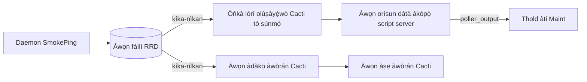

<!-- Source: README.md; SHA256: 17905aa1eac76a7d10dab526734605629fa3d1ada56397642ad4154c5be1feff -->

<!-- translations:start -->
[English](../../../README.md) | [简体中文](../zh-CN/README.md) | [हिन्दी](../hi-IN/README.md) | [Español (España)](../es-ES/README.md) | [Español (Latinoamérica)](../es-419/README.md) | [العربية (السعودية)](../ar-SA/README.md) | [Afrikaans](../af-ZA/README.md) | [አማርኛ](../am-ET/README.md) | [العربية (مصر)](../ar-EG/README.md) | [العربية (المغرب)](../ar-MA/README.md) | [বাংলা](../bn-BD/README.md) | [Bosanski](../bs-BA/README.md) | [Deutsch](../de-DE/README.md) | [فارسی](../fa-IR/README.md) | [Filipino](../fil-PH/README.md) | [Français](../fr-FR/README.md) | [Français (Maroc)](../fr-MA/README.md) | [Français (Sénégal)](../fr-SN/README.md) | [Hausa](../ha-NG/README.md) | [עברית](../he-IL/README.md) | [Hrvatski](../hr-HR/README.md) | [Bahasa Indonesia](../id-ID/README.md) | [Igbo](../ig-NG/README.md) | [Italiano](../it-IT/README.md) | [日本語](../ja-JP/README.md) | [한국어](../ko-KR/README.md) | [Malagasy](../mg-MG/README.md) | [मराठी](../mr-IN/README.md) | [Bahasa Melayu](../ms-MY/README.md) | [Nederlands](../nl-NL/README.md) | [Polski](../pl-PL/README.md) | [Português (Brasil)](../pt-BR/README.md) | [Русский](../ru-RU/README.md) | [Kinyarwanda](../rw-RW/README.md) | [Soomaali](../so-SO/README.md) | [Српски](../sr-RS/README.md) | [Svenska](../sv-SE/README.md) | [Kiswahili](../sw-KE/README.md) | [தமிழ்](../ta-IN/README.md) | [తెలుగు](../te-IN/README.md) | [ไทย](../th-TH/README.md) | [Türkçe](../tr-TR/README.md) | [Українська](../uk-UA/README.md) | [اردو](../ur-PK/README.md) | [Tiếng Việt](../vi-VN/README.md) | [isiXhosa](../xh-ZA/README.md) | [Yorùbá](README.md) | [繁體中文](../zh-TW/README.md) | [isiZulu](../zu-ZA/README.md)
<!-- translations:end -->

  <picture>
    <source media="(prefers-color-scheme: dark)" srcset="../../images/logo_dark.png">
    
  </picture>

# Àfikún SmokePing fún Cacti

Àfikún Cacti 1.2 kan tí ó ń mú ìwọ̀n ìdádúró (latency) àti ìpàdánù ìpín-ìsọfúnni (loss) SmokePing wọ inú Cacti gẹ́gẹ́ bí ẹ̀rọ, orísun dátà, àti àwòrán lásán. Àwọn àwòrán èéfín (smoke graphs) á sì jókòó lẹ́gbẹ̀ẹ́ ẹ̀rọ tí wọ́n jẹ́ tiẹ̀, lábẹ́ àṣẹ Cacti, bẹ́ẹ̀ sì ni Thold àti Maint lè fi ìkìlọ̀ ránṣẹ́ lórí wọn tàbí dẹ́kun wọn. Èyí jẹ́ ìṣàgbékalẹ̀ aládàáni fún Cacti, kì í sì í ṣe apá kan tàbí ohun tí [SmokePing](https://oss.oetiker.ch/smokeping/) fọwọ́ sí, èyí tí Tobias Oetiker àti Niko Tyni jẹ́ olùpilẹ̀ṣẹ̀ rẹ̀. Àfikún náà kò kó kóòdù SmokePing sínú, bẹ́ẹ̀ ni kò ṣiṣẹ́ rẹ̀: ó kàn ń ka ìṣètò àti àwọn fáìlì RRD tí SmokePing kọ, a sì kọ́ àwọn àdàkọ àwòrán rẹ̀ láti ya àwọn ìtẹ̀lé kan náà bíi ti àwòrán SmokePing fúnra rẹ̀.

> **Ipò: ó ń lọ lọ́wọ́. A ti ṣe àgbékalẹ̀ ipò àkíyèsí (ìpele 1) lórí `main`, a sì ti tú u jáde gẹ́gẹ́ bí ìtújáde àkọ́kọ́ 1.0.0-rc.1.** Àfikún náà ń ka ìṣètò àti àwọn fáìlì RRD ti SmokePing, ó ń fi ipò wọn hàn, ó ń ṣẹ̀dá àwọn ẹ̀rọ Cacti, orísun dátà, àti àwòrán fún wọn, ó sì ń pèsè dátà fún Thold àti Maint. Kò kọ ohunkóhun sí SmokePing. Ipò ìṣàkóso (tí àfikún yóò ti kọ ìṣètò SmokePing) àti àwọn olùkójọpọ̀ òkèèrè jẹ́ àwọn ìpele tó tẹ̀lé e, a kò tíì bẹ̀rẹ̀ wọn, wọn kò sì sí nínú ìtújáde yìí. Àwọn àyẹ̀wò lórí ìfisílẹ̀ gidi àti ìbámu tó súnmọ́ jù lọ pẹ̀lú àlàyé àmì àwòrán SmokePing ṣì ṣí sílẹ̀ nínú ìpele-àṣeyọrí 4. Wo [docs/install.md](../../install.md) láti bẹ̀rẹ̀.

## Àwọn ipa àṣẹ ìwọlé

| Ẹ̀ka Àṣẹ | Ìwọlé |
| --- | --- |
| SmokePing View | Àwọn ojú-ewé ìṣọ́wò tó wà tẹ́lẹ̀. |
| SmokePing Operator | Ìṣọ́wò pẹ̀lú ojú-ewé Operations àti ìfọwọ́sí ìṣàyẹ̀wò àdáni (triage acknowledgments). |
| SmokePing Admin | Ìwọlé Operator pẹ̀lú ìṣètò tó wà tẹ́lẹ̀ àti àwọn ìgbésẹ̀ ìṣàkóso. |

Lẹ́yìn tí o bá ti ṣe àdàkọ àwọn fáìlì ìgbéga, ṣí ojú-ewé Plugins gẹ́gẹ́ bí alámòójútó láti forúkọsílẹ̀ ẹ̀ka àṣẹ tuntun náà. Yan ẹ̀ka àṣẹ Operator ní pàtó lábẹ́ **Configuration > Users** tàbí àwọn ẹgbẹ́ olùlò. Àwọn ìgbéga ń pa àwọn ID ẹ̀ka àṣẹ View àti Admin tó wà tẹ́lẹ̀ mọ́ pẹ̀lú àwọn àṣẹ tí a ti fúnni. Ìwọlé Admin ń jogún ìwọlé Operator, ìwọlé Operator sì ń jogún ìwọlé View lórí ìbéèrè kọ̀ọ̀kan; èyí kò fi àwọn àṣẹ tí a pamọ́ kún un fún àwọn olùlò tàbí àwọn ẹgbẹ́. Àwọn ètò àfikún náà tún nílò ìwọlé SmokePing Admin ní àfikún sí àṣẹ Settings ti Cacti.

Àwọn àṣẹ ẹ̀rọ Cacti ṣì ń fi òpin sí àwọn ìlà àti ìgbésẹ̀ tó wà fún olùlò kọ̀ọ̀kan; àwọn ohun tí kò ní ìsopọ̀ nílò alámòójútó. Àwọn ìwé-ẹ̀rí, ìṣètò, ìsopọ̀, ìparẹ́ àti àwọn àtúnṣe ìṣàkóso mìíràn wà ní àwọn ojú-ewé ìṣàkóso. Àwọn ìfọwọ́sí (acknowledgments) ń wà nínú ìgbà ìṣe olùlò lọ́wọ́lọ́wọ́ nìkan, fún wákàtí kan ní pọ́ọ̀kọ́ àti níwọ̀n ìgbà tí àkíyèsí kan náà bá ṣì jẹ́ tuntun. Àwọn àkíyèsí tuntun tàbí tí a yí padà máa ń sọ wọ́n di asán. Wọn kì í fi hàn rárá pé ìwọ̀n tó kùnà wà ní ìlera tàbí kí wọ́n dẹ́kun àwọn ìkìlọ̀.

## Àwọn àwòrán ojú-ìbòjú

A kó o wọlé láti inú nẹ́tíwọ́ọ̀kì SmokePing 2.8.2 tó ń ṣiṣẹ́ lọ́wọ́ sí inú Cacti 1.2.31, fún wákàtí 12 tó kọjá. Ẹ̀rọ ìfọkànsí kọ̀ọ̀kan ní àwòrán èéfín (smoke graph) fún master àti ọ̀kan fún slave kọ̀ọ̀kan (`lon1`, `sgp1`), tí a tò sábẹ́ apá SmokePing rẹ̀ nínú igi àwòrán.

## Ìdí rẹ̀

SmokePing ń wọ̀n ìpínkiri ìdádúró àti ìpàdánù ìpín-ìsọfúnni dáadáa, àwọn àwòrán èéfín rẹ̀ sì ń fi ìyàtọ̀ tí àwòrán àpínkárí-ìwọ̀n nìkan máa ń fi pamọ́ hàn. Nígbà tí a bá ń lò ó lẹ́gbẹ̀ẹ́ Cacti, ó máa ń fi àlàfo mẹ́ta sílẹ̀:

- **Ìṣàkóso ìwọlé ọ̀tọ̀ọ̀tọ̀.** CGI ti SmokePing kò mọ ohunkóhun nípa àwọn olùlò Cacti, àwọn ẹgbẹ́, tàbí àwọn àṣẹ ẹ̀rọ.
- **Kò sí àyíká ẹ̀rọ.** Ìdádúró àti àwọn òǹkà ojú-ìsopọ̀ fún ẹ̀rọ kan náà wà nínú àwọn irinṣẹ́ ọ̀tọ̀ọ̀tọ̀.
- **Kò sí ọ̀nà sínú ìkìlọ̀ Cacti.** Thold àti Maint ń ṣiṣẹ́ lórí àwọn orísun dátà àti ẹ̀rọ Cacti, nítorí náà a máa ń ṣètò àti dẹ́kun àwọn ìkìlọ̀ SmokePing lọ́tọ̀.

Àfikún náà ń di àwọn àlàfo wọ̀nyí nípa ṣíṣe àpèjúwe ìfọkànsí SmokePing kọ̀ọ̀kan gẹ́gẹ́ bí àwọn ohun Cacti tó tọ́ka sí àwọn fáìlì RRD SmokePing tó wà tẹ́lẹ̀, pẹ̀lú ìwọ̀nba díẹ̀ àwọn iye àkópọ̀ tí a ṣàyẹ̀wò. Ó ń tún àwòrán yíya Cacti, àwọn àṣẹ, Thold, àti Maint lò dípò kíkọ́ àwọn ẹ̀dà ẹlẹgbẹ́ wọn. A ti ṣètò ìtìlẹ́yìn fún àwọn olùkójọpọ̀ dátà òkèèrè ti Cacti fún ìpele 3, kò sì sí nínú ìtújáde yìí.

## Ààlà àti ipò iṣẹ́

| Ìpele | Ààlà | Àwọn Àṣeyọrí | Ipò |
|---|---|---|---|
| 0, ìwádìí | Àtòjọ ìbáramu, ìfìdí-múlẹ̀ ìhùwàsí upstream, àyẹ̀wò òótọ́ àwòrán | [M1](https://github.com/somethingwithproof/plugin_smokeping/milestone/1) | Àwọn àwárí wà nínú `docs/research`; díẹ̀ nínú àwọn ọ̀rọ̀ ìwádìí ṣì ṣí sílẹ̀ |
| 1, àkíyèsí | Ìkówọlé àkójọpọ̀, àwọn ẹ̀rọ Cacti, àwọn àwòrán èéfín àti àkópọ̀, ìkìlọ̀ Thold, ìdẹ́kun Maint, ojú-ewé ìlera | [M2](https://github.com/somethingwithproof/plugin_smokeping/milestone/2), [M3](https://github.com/somethingwithproof/plugin_smokeping/milestone/3), [M4](https://github.com/somethingwithproof/plugin_smokeping/milestone/4) | A tú u jáde gẹ́gẹ́ bí 1.0.0-rc.1; àwọn àyẹ̀wò ṣì ṣí sílẹ̀ |
| 2, ìṣàkóso | Ààyè-orúkọ ìṣètò tí Cacti ni, àwọn profaili ìwádìí ICMP àti TCP, àwọn àtúnyẹ̀wò, ìfìdí-múlẹ̀, ìtúnṣiṣẹ́, ìpadà-sẹ́yìn | [M5](https://github.com/somethingwithproof/plugin_smokeping/milestone/5) | A ti ṣètò rẹ̀, kò tíì bẹ̀rẹ̀ |
| 3, òkèèrè | SmokePing lórí àwọn olùkójọpọ̀ dátà òkèèrè ti Cacti, àwọn slave gẹ́gẹ́ bí ibi ìwọ̀n | [M6](https://github.com/somethingwithproof/plugin_smokeping/milestone/6) | A ti ṣètò rẹ̀, kò tíì bẹ̀rẹ̀ |

Àwọn ohun tí kò sí ní ààlà: ẹ̀rọ ìkìlọ̀ tí àfikún ni, ẹ̀rọ ìjábọ̀, daemon àdáni tàbí ìlànà nẹ́tíwọ́ọ̀kì, àwọn àyẹ̀wò HTTP/DNS/iṣẹ́ tí a ṣàkóso (servcheck ń bo àwọn wọ̀nyẹn), àti kíkọ sínú àwọn fáìlì RRD ti SmokePing.

## Àwọn àfojúsùn ìbáramu

| Ẹ̀yà | Àfojúsùn |
|---|---|
| Cacti | 1.2.31 tàbí tuntun jù bẹ́ẹ̀ lọ nínú 1.2.x, kò sí àtúnṣe pàtàkì |
| PHP | 8.2 tàbí tuntun jù bẹ́ẹ̀ lọ; `setup.php` máa ń ṣe é kà lórí 8.0 kí àyíká ìṣiṣẹ́ tí kò ní ìtìlẹ́yìn lè gba ìkọ̀sílẹ̀ dípò UI Cacti tó bàjẹ́ |
| SmokePing | 2.9.0, 2.8.2, àti 2.7.3 (Ubuntu 22.04 nìkan, títí di 2027-06-01) |
| Thold, Maint | Kò nílò àyípadà kankan |
| Àwọn ìtẹ̀lé | 10,000 fún ìfisílẹ̀ kọ̀ọ̀kan ní ìfi-ránsẹ́ 20 àti ìgbésẹ̀ 300 s ([iṣẹ́ àti iyára](../../performance.md#supported-series-count)) |

## Ìwé àkọsílẹ̀

| | |
|---|---|
| [Ìfisílẹ̀](../../install.md) | Àwọn ohun tí a nílò, ìsopọ̀ kíka-nìkan ti àpò dátà SmokePing, ìfisílẹ̀, àwọn kóńtéénà, àwọn ẹ̀dà tó ní ìtìlẹ́yìn |
| [Ìṣiṣẹ́](../../operations.md) | Ohun tí ipò kọ̀ọ̀kan túmọ̀ sí àti ẹ̀rí rẹ̀, àwọn àyẹ̀wò ìlera, ìhùwàsí nígbà tí àwọn ìtẹ̀wọlé bá kùnà |
| [Fi àwọn ìfọkànsí kún Cacti](../../provisioning.md) | Ìfọkànsí kan, ọ̀pọ̀ ẹ̀rọ, títún-so, àwọn àṣẹ |
| [Ìkìlọ̀](../../alerting.md) | Àwọn iye àkópọ̀, àkókò Thold, ìpẹ́jù dátà, dátà tó pẹ́ dé, ìsopọ̀ pẹ̀lú àwọn ìkìlọ̀ SmokePing, Maint |
| [Ìlànà ìṣètò](../../configuration-format.md) | Ìkówọlé àti ìkójáde YAML àti XML |
| [Ìpamọ́ àti ìdápadà](../../backup-restore.md) | Ohun tí a ó pamọ́ àti bí ìdápadà ṣe ń tẹ̀síwájú |
| [Iṣẹ́ àti iyára](../../performance.md) | Àwọn ìwọ̀n agbègbè àti ti olùṣiṣẹ́ ìtújáde ní 100, 1,000, àti 10,000 ìtẹ̀lé, àti iye ìtẹ̀lé tó ní ìtìlẹ́yìn: 10,000 fún ìfisílẹ̀ kọ̀ọ̀kan |
| [Ìdánilójú ìkùnà](../../failure-qualification.md) | Àwọn ìṣẹ̀lẹ̀ ìkùnà àti bí a ṣe ń dán ọ̀kọ̀ọ̀kan wò |
| [Ìtújáde](../../RELEASING.md) | Ìlànà ìtújáde: ìbéèrè ìfàsẹ́yìn (pull request), àmì tí a fọwọ́ sí, ohun tí iṣẹ́ ìṣàkóso ń ṣe, bí a ṣe ń fìdí èsì múlẹ̀ |
| [Àkójọ ìtújáde](../../release.md) | Ẹ̀dà, àkọsílẹ̀ àtúnṣe, àti àkójọ ìtújáde |
| [Ìdánwò](../../testing.md) | Àwọn àkójọ ìdánwò, ohun tí CI ń ṣe, àti ìdánwò láàyè lòdì sí SmokePing gidi |

## Àpẹẹrẹ ètò

- [docs/PLAN.md](../../PLAN.md) ni ètò kíkún: àpẹẹrẹ ètò, àwọn òtítọ́ upstream tí ó gbẹ́kẹ̀ lé (pẹ̀lú àwọn orísun), àpẹẹrẹ ipò, ààlà ààbò, ìṣirò iṣẹ́ àti iyára, ìdánwò, àti àwọn ewu.
- [docs/decisions/](../../decisions) ní àwọn àkọsílẹ̀ ìpinnu àpẹẹrẹ ètò fún àwọn yíyàn tí a ti ṣe tẹ́lẹ̀.
- [docs/REQUIREMENTS.md](../../REQUIREMENTS.md) ń so ID ohun-ìbéèrè kọ̀ọ̀kan pọ̀ mọ́ ọ̀rọ̀ rẹ̀.

## Bí a ṣe ń tọ́pa iṣẹ́

- **Àwọn àṣeyọrí** tẹ̀lé àwọn àṣeyọrí ètò náà. Ọ̀kọ̀ọ̀kan ní ọ̀rọ̀ àkójọpọ̀ (epic issue) tó ṣe àkójọ àwọn ọ̀rọ̀ abẹ́ rẹ̀ àti ẹ̀rí ìparí.
- **Àwọn ọ̀rọ̀** ni a pín sí ìsọ̀rí nípa àmì: `type: requirement`, `type: research`, `type: decision`, `type: epic`. Àwọn ọ̀rọ̀ ohun-ìbéèrè ń sọ àwọn ohun-ìbéèrè tí a nọ́mbà tí a sì lè dán wò (`REQ-AREA-NNN`) àti àwọn ìlànà ìtẹ́wọ́gbà.
- **Àwọn àmì** tún gbé `area:`, `phase:`, `priority:`, àti `status:`. Wo [CONTRIBUTING.md](../../../CONTRIBUTING.md#labels).
- [Pátákó iṣẹ́](https://github.com/users/somethingwithproof/projects/6) ń fi gbogbo àwọn ọ̀rọ̀ hàn káàkiri àwọn àṣeyọrí.

## Ìkópa

Ka [CONTRIBUTING.md](../../../CONTRIBUTING.md). Àwọn ìfìpamọ́ nílò ìfọwọ́sowọ́pọ̀ DCO. Ìjíròrò àpẹẹrẹ ètò máa ń wáyé lórí àwọn ọ̀rọ̀; àwọn ìpinnu tó ṣí sílẹ̀ gbé àmì `type: decision`.

## Ààbò

Jábọ̀ àwọn àléébù ní ìkọ̀kọ̀; wo [SECURITY.md](../../../SECURITY.md).

## Ìwé-àṣẹ

GNU General Public License v2.0, ìwé-àṣẹ kan náà pẹ̀lú Cacti àti àwọn àfikún rẹ̀. Wo [LICENSE](../../../LICENSE).
