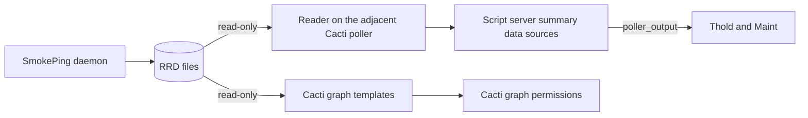

<!-- Source: README.md; SHA256: b41ec705327127cc34ff07d1514a141262752f99c5e2296fdc323d584a777b84 -->

<!-- translations:start -->
[English](../../../README.md) | [简体中文](README.md) | [हिन्दी](../hi-IN/README.md) | [Español (España)](../es-ES/README.md) | [Español (Latinoamérica)](../es-419/README.md) | [العربية (السعودية)](../ar-SA/README.md) | [Afrikaans](../af-ZA/README.md) | [አማርኛ](../am-ET/README.md) | [العربية (مصر)](../ar-EG/README.md) | [العربية (المغرب)](../ar-MA/README.md) | [বাংলা](../bn-BD/README.md) | [Bosanski](../bs-BA/README.md) | [Deutsch](../de-DE/README.md) | [فارسی](../fa-IR/README.md) | [Filipino](../fil-PH/README.md) | [Français](../fr-FR/README.md) | [Français (Maroc)](../fr-MA/README.md) | [Français (Sénégal)](../fr-SN/README.md) | [Hausa](../ha-NG/README.md) | [עברית](../he-IL/README.md) | [Hrvatski](../hr-HR/README.md) | [Bahasa Indonesia](../id-ID/README.md) | [Igbo](../ig-NG/README.md) | [Italiano](../it-IT/README.md) | [日本語](../ja-JP/README.md) | [한국어](../ko-KR/README.md) | [Malagasy](../mg-MG/README.md) | [मराठी](../mr-IN/README.md) | [Bahasa Melayu](../ms-MY/README.md) | [Nederlands](../nl-NL/README.md) | [Polski](../pl-PL/README.md) | [Português (Brasil)](../pt-BR/README.md) | [Русский](../ru-RU/README.md) | [Kinyarwanda](../rw-RW/README.md) | [Soomaali](../so-SO/README.md) | [Српски](../sr-RS/README.md) | [Svenska](../sv-SE/README.md) | [Kiswahili](../sw-KE/README.md) | [தமிழ்](../ta-IN/README.md) | [తెలుగు](../te-IN/README.md) | [ไทย](../th-TH/README.md) | [Türkçe](../tr-TR/README.md) | [Українська](../uk-UA/README.md) | [اردو](../ur-PK/README.md) | [Tiếng Việt](../vi-VN/README.md) | [isiXhosa](../xh-ZA/README.md) | [Yorùbá](../yo-NG/README.md) | [繁體中文](../zh-TW/README.md) | [isiZulu](../zu-ZA/README.md)
<!-- translations:end -->

  <picture>
    <source media="(prefers-color-scheme: dark)" srcset="../../images/logo_dark.png">
    
  </picture>

# Cacti 的 SmokePing 插件

这是一个 Cacti 1.2 插件，将 SmokePing 的延迟和丢包测量作为普通设备、数据源和图表引入 Cacti。烟雾图与所属设备一起显示，遵循 Cacti 权限，并可由 Thold 告警和 Maint 抑制。它是面向 Cacti 的独立实现，不属于 [SmokePing](https://oss.oetiker.ch/smokeping/)，也未获得其认可；SmokePing 的原作者是 Tobias Oetiker 和 Niko Tyni。插件不包含也不运行 SmokePing 代码：它读取 SmokePing 写入的配置和 RRD 文件，其图表模板用于绘制与 SmokePing 原生图表相同的序列。

> **状态：开发中。观测模式（第 1 阶段）已在 `main`（1.0.0-rc.1）实现，支持操作员过滤、CSV 导出、孤立 RRD 检测、Thold 告警转换、生态集成钩子和远程采集器复制。** 插件读取 SmokePing 配置和 RRD 文件，显示其状态，为其创建 Cacti 设备、数据源和图表，并向 Thold 和 Maint 提供数据。它不会向 SmokePing 写入任何内容。托管模式（由插件写入 SmokePing 配置）属于后续阶段，尚未开始，不在此版本中。真实安装环境的试点和更接近 SmokePing 原生图例的工作仍在里程碑 4 中待完成。入门请参阅 [docs/install.md](docs/install.md)。

## 访问角色

| 权限域 | 访问权限 |
| --- | --- |
| SmokePing View | 现有监控页面。 |
| SmokePing Operator | 监控、运维页面以及个人排查确认。 |
| SmokePing Admin | 操作员访问权限及现有配置和管理操作。 |

复制升级文件后，以管理员身份打开插件页面，注册新权限域。在**配置 > 用户**或用户组中明确授予 Operator 权限域。升级保留现有 View 和 Admin 权限域的 ID 及授权。每次请求时，Admin 继承 Operator 访问权限，Operator 继承 View 访问权限；这不会向用户或组添加持久化授权。插件设置除需要 Cacti 的设置权限外，还需要 SmokePing Admin 权限。

Cacti 设备权限仍限制每位用户可访问的行和操作；未映射对象需要管理员处理。凭据、配置、映射、删除和其他管理更改仍在管理页面中执行。确认记录仅在当前用户会话中有效，最多一小时，并且仅在同一观测结果仍然新鲜时有效。新出现或更改的观测结果会使确认失效。确认绝不会将失败的测量标记为健康，也不会抑制告警。

## 截图

从运行中的 SmokePing 2.8.2 网络导入 Cacti 1.2.31，显示最近 12 小时。每个目标的设备都有主节点烟雾图和每个从节点（`lon1`、`sgp1`）的烟雾图，在图表树中归入相应 SmokePing 部分。

## 原因

SmokePing 善于测量延迟分布和丢包，其烟雾图能显示仅平均值图表隐藏的变化。与 Cacti 一起运行时，仍有三个缺口：

- **访问控制独立。** SmokePing CGI 不知道 Cacti 用户、组或设备权限。
- **没有设备上下文。** 同一设备的延迟和接口计数器位于不同工具中。
- **无法接入 Cacti 告警。** Thold 和 Maint 作用于 Cacti 数据源及设备，因此 SmokePing 告警需单独配置和抑制。

插件将每个 SmokePing 目标表示为指向现有 SmokePing RRD 文件的 Cacti 对象，并添加少量采集的摘要值，补足这些缺口。它复用 Cacti 图表、权限、Thold 和 Maint，而不是另建一套。按轮询器作用域的配置复制（`replicate_out`）会推送远程轮询器配置表，同时保持本地模式（poller 1）和采集器本地观测缓存相互隔离。

## 范围与状态

| 阶段 | 范围 | 里程碑 | 状态 |
|---|---|---|---|
| 0，研究 | 兼容性矩阵、上游行为确认、图表保真度原型 | [M1](https://github.com/somethingwithproof/plugin_smokeping/milestone/1) | 结果在 `docs/research`；部分研究议题仍未解决 |
| 1，观测 | 清单导入、Cacti 设备、烟雾和摘要图表、Thold 告警与告警转换、Maint 抑制、过滤视图、CSV 导出、孤立 RRD 检测、生态钩子 | [M2](https://github.com/somethingwithproof/plugin_smokeping/milestone/2)、[M3](https://github.com/somethingwithproof/plugin_smokeping/milestone/3)、[M4](https://github.com/somethingwithproof/plugin_smokeping/milestone/4) | 已实现；试点待完成 |
| 2，托管 | Cacti 所有的配置命名空间、ICMP 和 TCP 探针配置、修订、验证、重载、回滚 | [M5](https://github.com/somethingwithproof/plugin_smokeping/milestone/5) | 已计划，未开始 |
| 3，远程 | 面向远程数据采集器的按轮询器作用域查询与 `replicate_out` 表复制（`RemoteReplication`）；完整的多采集器 SmokePing 部署验证 | [M6](https://github.com/somethingwithproof/plugin_smokeping/milestone/6) | 复制与轮询器作用域隔离已实现；多采集器部署验证待完成 |

已实现的操作员工作流、CLI 命令和生态钩子：

- **清单与目标过滤（`smokeping_inventory.php`、`smokeping.php`）**：`TargetFilter`、`TargetRepository::filteredForPoller()`、`InventoryPage` 和 `ViewPage` 提供搜索（`filter`）、探针（`probe`）、清单存在性（`presence`）、映射状态（`mapping`）、新鲜度状态（`state`）以及可选的分页大小（`rows`：`All`、`25`、`50`、`100`、`200`）。设备可见性会在计数前于 SQL 中强制执行，因此总数绝不会暴露隐藏设备。
- **CSV 导出（`smokeping.php?action=export_csv`）**：`CsvExporter` 在调用方的设备权限下为当前过滤视图流式输出 RFC 4180 CRLF 格式数据，并在以 `=`、`+`、`-`、`@`、制表符或回车符开头的单元格前加撇号，以中和电子表格公式注入风险。
- **孤立 RRD 检测（`smokeping_health.php`）**：`OrphanRrdScanner` 和 `HealthCheck::orphanRrds()` 在读取轮询器上对 SmokePing 挂载目录执行有界扫描，跳过 `__cgi`、`__sortercache` 和符号链接，并将无主 `.rrd` 文件与未处理的重新关联建议进行交叉比对。
- **SmokePing 到 Thold 转换（`smokeping_health.php`、`cli/smokeping.php`）**：`TholdTranslator` 和 `TholdGenerator` 读取 SmokePing `*** Alerts ***` 定义，在不修改 SmokePing 配置文件的情况下将支持的连续丢包模式转换为等效的 `loss_pct` Thold 阈值。Web 流程采用 GET 预览（`action=thold_preview`、`HealthPage::renderTholdPreview()`），随后执行受 CSRF 保护的 POST（`action=thold_create`）。不支持的模式（RTT 告警、通配符衰减、混合级别）会直接跳过而不写入。
- **管理员 CLI（`cli/smokeping.php`）**：支持 `provision <target path> [--device=ID] [--location=NAME]`、`relink <old target path> <new target path> [--location=NAME]`、`thold-generate <target path> [--alert=NAME] [--apply]`、`size-graphs`、`upgrade-graphs`、`export [--format=yaml|xml] [--file=PATH]`、`import --file=PATH [--format=yaml|xml] [--apply --confirm=PLAN]` 以及 `import-smokeping [--dry-run | --apply --confirm=PLAN] [--file=PATH] [--sections=A,B/C] [--device-per=host|target] [--device-template=ID] [--poller=ID] [--site=ID] [--tree=ID | --tree-name=NAME]`。
- **生态钩子（`setup.php`、`Schema::HOOKS`）**：注册了 21 个钩子，包括 `abilities_register`（`AbilitiesProvider`：严格只读的 `smokeping-list-targets` 和 `smokeping-get-health`，按调用方用户 ID 校验 View 权限域，不返回任何机密信息）、`doctor_register_checks`（`DoctorChecks`：`smokeping_stale_targets`、`smokeping_freshness_breaches`、`smokeping_orphan_rrds`、`smokeping_config_path`）、`casc_register_providers`（`CascProvider`：由 `ConfigCodec` 和 `ConfigService` 支持的 `smokeping` YAML/XML `export`、`validate`、`plan` 和 `apply`）以及 `replicate_out`（`RemoteReplication`：为 `poller_id > 1` 的远程轮询器按轮询器作用域同步 `plugin_smokeping_target`、`plugin_smokeping_mapping`、`plugin_smokeping_object` 和 `plugin_smokeping_relink`）。

范围之外：插件自有告警引擎、报表引擎、自定义守护进程或网络协议、托管 HTTP/DNS/服务检查（由 servcheck 覆盖），以及写入 SmokePing RRD 文件。

## 兼容性目标

| 组件 | 目标 |
|---|---|
| Cacti | 1.2.x 中的 1.2.31 或更高版本，无需核心补丁 |
| PHP | 8.2 或更高版本；`setup.php` 在 8.0 中仍可解析，使不支持的运行时得到拒绝，而不是损坏 Cacti 界面 |
| SmokePing | 2.9.0、2.8.2 和 2.7.3（后者仅限 Ubuntu 22.04，直到 2027-06-01） |
| Thold、Maint | 无需更改 |
| 序列 | 每个安装支持 10,000 条，使用 20 次 ping 和 300 秒步长（[性能](docs/performance.md#supported-series-count)） |

## 文档

| | |
|---|---|
| [安装](docs/install.md) | 要求、SmokePing 数据目录的只读挂载、安装、容器、支持版本 |
| [运维](docs/operations.md) | 各状态含义及证据、健康检查、输入失败时的行为 |
| [向 Cacti 添加目标](docs/provisioning.md) | 单目标、多设备、重新关联、权限 |
| [告警](docs/alerting.md) | 摘要值、Thold 持续时间、过期和延迟数据、与 SmokePing 告警重叠、Maint |
| [配置格式](docs/configuration-format.md) | YAML 和 XML 导出、导入 |
| [备份与恢复](docs/backup-restore.md) | 备份内容及恢复后的继续运行方式 |
| [性能](docs/performance.md) | 本地和发布运行器在 100、1,000、10,000 条序列下的测量，以及每安装 10,000 条的支持上限 |
| [故障验证](../../failure-qualification.md) | 故障场景及各自测试方式 |
| [发布流程](../../RELEASING.md) | 拉取请求、签名标签、工作流行为以及验证发布结果的步骤 |
| [发布归档](../../release.md) | 版本、变更日志和发布归档 |
| [测试](../../testing.md) | 测试套件、CI 执行内容和针对真实 SmokePing 的实时套件 |

## 设计

- [docs/PLAN.md](../../PLAN.md) 是完整计划：架构、依赖的上游事实（含来源）、状态模型、安全边界、性能计算、测试和风险。
- [docs/decisions/](../../decisions) 保存已做出的架构决策记录。
- [docs/REQUIREMENTS.md](../../REQUIREMENTS.md) 将每个需求 ID 映射到对应议题。
- 本地验证运行 Pest 单元测试和源码规则检查（`pest --configuration=phpunit.xml`）、PHPStan Level 9（`CACTI_PATH=<cacti-dir> phpstan analyse -c phpstan.neon --no-progress`）、入口文件语法检查（对 `*.php`、`include/*.php`、`scripts/*.php`、`cli/*.php` 执行 `php -l`）以及翻译检查（`sh locales/build_gettext.sh --check`）。集成测试和容器端到端测试套件请参阅 [docs/testing.md](../../testing.md)。

## 工作跟踪方式

- **里程碑**遵循计划。每个里程碑都有一个史诗议题，列出子议题和完成证据。
- **议题**按标签分类：`type: requirement`、`type: research`、`type: decision`、`type: epic`。需求议题包含带编号的可测试需求（`REQ-AREA-NNN`）和验收标准。
- **标签**还包括 `area:`、`phase:`、`priority:` 和 `status:`。参阅 [CONTRIBUTING.md](../../../CONTRIBUTING.md#labels)。
- [项目看板](https://github.com/users/somethingwithproof/projects/6) 显示各里程碑的全部议题。

## 贡献

请阅读 [CONTRIBUTING.md](../../../CONTRIBUTING.md)。提交需要 DCO 签署。设计讨论在议题中进行；未决决策带有 `type: decision` 标签。

## 安全

请私下报告漏洞；参阅 [SECURITY.md](../../../SECURITY.md)。

## 许可证

GNU 通用公共许可证 v2.0，与 Cacti 及其插件相同。参阅 [LICENSE](../../../LICENSE)。
