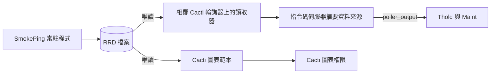

<!-- Source: README.md; SHA256: 17905aa1eac76a7d10dab526734605629fa3d1ada56397642ad4154c5be1feff -->

<!-- translations:start -->
[English](../../../README.md) | [简体中文](../zh-CN/README.md) | [हिन्दी](../hi-IN/README.md) | [Español (España)](../es-ES/README.md) | [Español (Latinoamérica)](../es-419/README.md) | [العربية (السعودية)](../ar-SA/README.md) | [Afrikaans](../af-ZA/README.md) | [አማርኛ](../am-ET/README.md) | [العربية (مصر)](../ar-EG/README.md) | [العربية (المغرب)](../ar-MA/README.md) | [বাংলা](../bn-BD/README.md) | [Bosanski](../bs-BA/README.md) | [Deutsch](../de-DE/README.md) | [فارسی](../fa-IR/README.md) | [Filipino](../fil-PH/README.md) | [Français](../fr-FR/README.md) | [Français (Maroc)](../fr-MA/README.md) | [Français (Sénégal)](../fr-SN/README.md) | [Hausa](../ha-NG/README.md) | [עברית](../he-IL/README.md) | [Hrvatski](../hr-HR/README.md) | [Bahasa Indonesia](../id-ID/README.md) | [Igbo](../ig-NG/README.md) | [Italiano](../it-IT/README.md) | [日本語](../ja-JP/README.md) | [한국어](../ko-KR/README.md) | [Malagasy](../mg-MG/README.md) | [मराठी](../mr-IN/README.md) | [Bahasa Melayu](../ms-MY/README.md) | [Nederlands](../nl-NL/README.md) | [Polski](../pl-PL/README.md) | [Português (Brasil)](../pt-BR/README.md) | [Русский](../ru-RU/README.md) | [Kinyarwanda](../rw-RW/README.md) | [Soomaali](../so-SO/README.md) | [Српски](../sr-RS/README.md) | [Svenska](../sv-SE/README.md) | [Kiswahili](../sw-KE/README.md) | [தமிழ்](../ta-IN/README.md) | [తెలుగు](../te-IN/README.md) | [ไทย](../th-TH/README.md) | [Türkçe](../tr-TR/README.md) | [Українська](../uk-UA/README.md) | [اردو](../ur-PK/README.md) | [Tiếng Việt](../vi-VN/README.md) | [isiXhosa](../xh-ZA/README.md) | [Yorùbá](../yo-NG/README.md) | [繁體中文](README.md) | [isiZulu](../zu-ZA/README.md)
<!-- translations:end -->

  <picture>
    <source media="(prefers-color-scheme: dark)" srcset="../../images/logo_dark.png">
    
  </picture>

# 適用於 Cacti 的 SmokePing 外掛程式

這個 Cacti 1.2 外掛程式將 SmokePing 的延遲與封包遺失測量資料匯入 Cacti，作為一般的裝置、資料來源與圖表。煙霧圖會直接顯示在其所屬裝置旁，受 Cacti 權限控管，且可由 Thold 與 Maint 進行告警與抑制。此為針對 Cacti 的獨立實作，並非 [SmokePing](https://oss.oetiker.ch/smokeping/)（原作者為 Tobias Oetiker 與 Niko Tyni）的一部分，亦未獲得其官方背書。本外掛程式不包含也不會執行 SmokePing 的程式碼：它僅讀取 SmokePing 寫入的設定與 RRD 檔案，其圖表範本則是為了繪製與 SmokePing 自身圖表相同的資料序列而建置。

> **狀態：開發中。觀察模式（第 1 階段）已於 `main` 分支實作，並發布為 1.0.0-rc.1 預發布版本。** 本外掛程式會讀取 SmokePing 的設定與 RRD 檔案、顯示其狀態、為其建立 Cacti 裝置、資料來源與圖表，並將資料提供給 Thold 與 Maint，且不會對 SmokePing 寫入任何內容。託管模式（由外掛程式寫入 SmokePing 設定）與遠端收集器屬於後續階段，尚未開始，亦不包含在此版本中。真實環境的試點部署與更貼近 SmokePing 圖例的樣式仍在里程碑 4 中進行。請參閱 [docs/install.md](../../install.md) 開始使用。

## 存取角色

| 領域（Realm） | 存取權限 |
| --- | --- |
| SmokePing View | 現有的監控頁面。 |
| SmokePing Operator | 監控頁面，外加 Operations 頁面與個人分類確認。 |
| SmokePing Admin | Operator 權限，外加現有的設定與管理操作。 |

複製升級檔案後，請以管理員身分開啟 Plugins 頁面以註冊新領域。請於 **Configuration > Users** 或使用者群組中明確指派 Operator 領域。
升級作業會保留現有的 View 與 Admin 領域 ID 及授權。每次請求時，Admin 權限會繼承 Operator 權限，而 Operator 權限會繼承 View 權限；這不會對使用者或群組新增已儲存的授權。除了 Cacti 的 Settings 權限外，外掛程式設定還需要 SmokePing Admin 權限。

Cacti 的裝置權限仍會限制每位使用者可用的資料列與操作；未對應的物件則需要管理員權限。
憑證、設定、對應關係、刪除及其他管理變更仍保留在管理頁面中。確認狀態僅在目前使用者的工作階段中有效，最長持續一小時，且僅在相同的觀察結果仍為最新時有效。新的或已變更的觀察結果會使其失效。確認操作絕不會將失敗的測量標記為健康或抑制告警。

## 螢幕截圖

從運作中的 SmokePing 2.8.2 網路匯入至 Cacti 1.2.31 的最近 12 小時資料。每個目標的裝置都有一張主節點的煙霧圖，以及各從屬節點（`lon1`、`sgp1`）的煙霧圖，並依其 SmokePing 區段歸檔於圖表樹中。

## 緣起與目的

SmokePing 能精準測量延遲分佈與封包遺失，其煙霧圖也能呈現僅顯示平均值的圖表所隱藏的波動變化。然而與 Cacti 並存運作時，會有三個落差：

- **分離的存取控制。** SmokePing 的 CGI 完全不了解 Cacti 的使用者、群組或裝置權限。
- **缺乏裝置脈絡。** 同一台裝置的延遲資料與介面計數器存在於不同的工具中。
- **無法串接至 Cacti 告警。** Thold 與 Maint 是針對 Cacti 資料來源與裝置運作，因此 SmokePing 告警必須分開設定與抑制。

本外掛程式透過將每個 SmokePing 目標表示為指向 SmokePing 現有 RRD 檔案的 Cacti 物件，並搭配一組精簡的輪詢摘要數值，來彌補這些落差。它直接沿用 Cacti 的圖表繪製、權限管理、Thold 與 Maint，而非另外建置平行系統。對 Cacti 遠端資料收集器的支援預計於第 3 階段提供，尚未包含在此版本中。

## 範圍與狀態

| 階段 | 範圍 | 里程碑 | 狀態 |
|---|---|---|---|
| 0，研究 | 相容性矩陣、上游行為確認、圖表還原度驗證 | [M1](https://github.com/somethingwithproof/plugin_smokeping/milestone/1) | 研究結果位於 `docs/research`；部分研究議題仍為開啟狀態 |
| 1，觀察 | 清單匯入、Cacti 裝置、煙霧圖與摘要圖、Thold 告警、Maint 抑制、健康狀態頁面 | [M2](https://github.com/somethingwithproof/plugin_smokeping/milestone/2)、[M3](https://github.com/somethingwithproof/plugin_smokeping/milestone/3)、[M4](https://github.com/somethingwithproof/plugin_smokeping/milestone/4) | 已發布為 1.0.0-rc.1；試點測試進行中 |
| 2，託管 | 由 Cacti 管理的設定命名空間、ICMP 與 TCP 探測設定檔、修訂版、驗證、重新載入、回復 | [M5](https://github.com/somethingwithproof/plugin_smokeping/milestone/5) | 已規劃，尚未開始 |
| 3，遠端 | Cacti 遠端資料收集器上的 SmokePing，將從屬節點作為測量位置 | [M6](https://github.com/somethingwithproof/plugin_smokeping/milestone/6) | 已規劃，尚未開始 |

不在範圍內的項目：外掛程式自有的告警引擎、報表引擎、自訂常駐程式或網路協定、託管 HTTP/DNS/服務檢查（由 servcheck 負責），以及寫入 SmokePing 的 RRD 檔案。

## 相容性目標

| 元件 | 目標 |
|---|---|
| Cacti | 1.2.x 系列中的 1.2.31 或更新版本，無須修改核心程式 |
| PHP | 8.2 或更新版本；`setup.php` 維持與 8.0 語法相容，使不支援的執行環境能明確拒絕載入，而不致破壞 Cacti UI |
| SmokePing | 2.9.0、2.8.2 與 2.7.3（僅限 Ubuntu 22.04，支援至 2027-06-01） |
| Thold、Maint | 無須任何修改 |
| 序列數 | 單一安裝環境支援 10,000 個序列，20 次 ping 與 300 秒間隔（[效能](../../performance.md#supported-series-count)） |

## 文件

| | |
|---|---|
| [安裝](../../install.md) | 系統需求、SmokePing 資料目錄的唯讀掛載、安裝方式、容器與支援版本 |
| [維運](../../operations.md) | 各狀態的含義與佐證資料、健康檢查、輸入失敗時的行為 |
| [將目標新增至 Cacti](../../provisioning.md) | 單一目標、多台裝置、重新連結、權限 |
| [告警](../../alerting.md) | 摘要數值、Thold 持續時間、過期判斷、延遲資料、與 SmokePing 告警的重疊、Maint |
| [設定格式](../../configuration-format.md) | YAML 與 XML 匯出及匯入 |
| [備份與還原](../../backup-restore.md) | 需備份的項目以及還原後的恢復方式 |
| [效能](../../performance.md) | 本機與發布執行器在 100、1,000 與 10,000 個序列下的測量數據，以及支援序列上限：每個安裝環境 10,000 個 |
| [故障驗證](../../failure-qualification.md) | 故障情境與各項測試方法 |
| [發布流程](../../RELEASING.md) | 發布程序：Pull Request、簽署標籤、工作流程執行的內容與結果驗證方法 |
| [發布封存](../../release.md) | 版本、變更日誌與發布封存檔 |
| [測試](../../testing.md) | 測試套件、CI 執行項目，以及針對真實 SmokePing 的即時測試套件 |

## 設計

- [docs/PLAN.md](../../PLAN.md) 為完整計畫書：包含架構、所依據的上游事實（附來源）、狀態模型、安全性邊界、效能估算、測試與風險。
- [docs/decisions/](../../decisions) 存放已拍板決策的架構決策紀錄。
- [docs/REQUIREMENTS.md](../../REQUIREMENTS.md) 將每個需求 ID 對應至其議題。

## 工作追蹤方式

- **里程碑** 對應計畫書中的各個里程碑。每個里程碑都有一個史詩議題，列出其子議題與完成驗收佐證。
- **議題** 依標籤分類：`type: requirement`、`type: research`、`type: decision`、`type: epic`。需求議題會載明編號、可測試的需求（`REQ-AREA-NNN`）與驗收條件。
- **標籤** 亦包含 `area:`、`phase:`、`priority:` 與 `status:`。請參閱 [CONTRIBUTING.md](../../../CONTRIBUTING.md#labels)。
- [專案看板](https://github.com/users/somethingwithproof/projects/6) 顯示跨里程碑的所有議題。

## 參與貢獻

請閱讀 [CONTRIBUTING.md](../../../CONTRIBUTING.md)。提交須附上 DCO sign-off。設計討論於議題中進行；尚未定案的決策會標記 `type: decision` 標籤。

## 安全性

請私下回報安全漏洞；參閱 [SECURITY.md](../../../SECURITY.md)。

## 授權條款

採用 GNU General Public License v2.0，與 Cacti 及其外掛程式相同。請參閱 [LICENSE](../../../LICENSE)。
