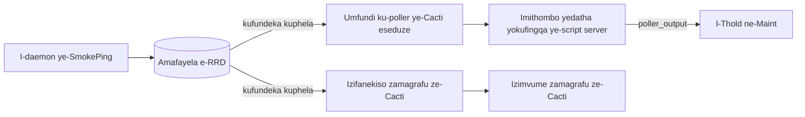

<!-- Source: README.md; SHA256: b41ec705327127cc34ff07d1514a141262752f99c5e2296fdc323d584a777b84 -->

<!-- translations:start -->
[English](../../../README.md) | [简体中文](../zh-CN/README.md) | [हिन्दी](../hi-IN/README.md) | [Español (España)](../es-ES/README.md) | [Español (Latinoamérica)](../es-419/README.md) | [العربية (السعودية)](../ar-SA/README.md) | [Afrikaans](../af-ZA/README.md) | [አማርኛ](../am-ET/README.md) | [العربية (مصر)](../ar-EG/README.md) | [العربية (المغرب)](../ar-MA/README.md) | [বাংলা](../bn-BD/README.md) | [Bosanski](../bs-BA/README.md) | [Deutsch](../de-DE/README.md) | [فارسی](../fa-IR/README.md) | [Filipino](../fil-PH/README.md) | [Français](../fr-FR/README.md) | [Français (Maroc)](../fr-MA/README.md) | [Français (Sénégal)](../fr-SN/README.md) | [Hausa](../ha-NG/README.md) | [עברית](../he-IL/README.md) | [Hrvatski](../hr-HR/README.md) | [Bahasa Indonesia](../id-ID/README.md) | [Igbo](../ig-NG/README.md) | [Italiano](../it-IT/README.md) | [日本語](../ja-JP/README.md) | [한국어](../ko-KR/README.md) | [Malagasy](../mg-MG/README.md) | [मराठी](../mr-IN/README.md) | [Bahasa Melayu](../ms-MY/README.md) | [Nederlands](../nl-NL/README.md) | [Polski](../pl-PL/README.md) | [Português (Brasil)](../pt-BR/README.md) | [Русский](../ru-RU/README.md) | [Kinyarwanda](../rw-RW/README.md) | [Soomaali](../so-SO/README.md) | [Српски](../sr-RS/README.md) | [Svenska](../sv-SE/README.md) | [Kiswahili](../sw-KE/README.md) | [தமிழ்](../ta-IN/README.md) | [తెలుగు](../te-IN/README.md) | [ไทย](../th-TH/README.md) | [Türkçe](../tr-TR/README.md) | [Українська](../uk-UA/README.md) | [اردو](../ur-PK/README.md) | [Tiếng Việt](../vi-VN/README.md) | [isiXhosa](../xh-ZA/README.md) | [Yorùbá](../yo-NG/README.md) | [繁體中文](../zh-TW/README.md) | [isiZulu](README.md)
<!-- translations:end -->

  <picture>
    <source media="(prefers-color-scheme: dark)" srcset="../../images/logo_dark.png">
    
  </picture>

# I-plugin ye-SmokePing ye-Cacti

I-plugin ye-Cacti 1.2 eletha izilinganiso zokubambezeleka nokulahleka kwamaphakethe ze-SmokePing ku-Cacti njengamadivayisi ajwayelekile, imithombo yedatha, namagrafu. Amagrafu e-smoke abe esehlala eduze kwedivayisi okungelayo, ngaphansi kwezimvume ze-Cacti, futhi i-Thold ne-Maint zingathumela izexwayiso noma zizicindezele. Lena yindlela ezimele eyenzelwe i-Cacti futhi ayiyona ingxenye ye-[SmokePing](https://oss.oetiker.ch/smokeping/), noma ayigunyaziwe yiyo, ababhali bayo bokuqala okunguTobias Oetiker noNiko Tyni. Le plugin ayifaki futhi ayisebenzisi ikhodi ye-SmokePing: ifunda ukucushwa namafayela e-RRD abhalwa yi-SmokePing, futhi izifanekiso zayo zamagrafu zakhelwe ukudweba uchungechunge olufanayo nolwamagrafu e-SmokePing uqobo.

> **Isimo: isathuthukiswa. Imodi yokubuka (isigaba 1) isebenzisiwe ku-`main` futhi ikhishwe njengokukhishwa kwangaphambi kwesikhathi kwe-1.0.0-rc.1.** Le plugin ifunda ukucushwa kwe-SmokePing namafayela e-RRD, ibonisa isimo sawo, idale amadivayisi e-Cacti, imithombo yedatha, namagrafu awo, futhi iphakele i-Thold ne-Maint. Ayibhali lutho ku-SmokePing. Imodi ephethwe (lapho i-plugin ibhala khona ukucushwa kwe-SmokePing) nabaqoqi abakude yizigaba zakamuva, azikaqalwa, futhi azikho kulokhu kukhishwa. Ukuhlolwa ekufakweni kwangempela nokufaniswa okuseduze kwezincazelo zamagrafu ze-SmokePing kusavuliwe ku-milestone 4. Bheka i-[docs/install.md](../../install.md) ukuze uqale.

## Izindima zokufinyelela

| Indawo yokulawula | Ukufinyelela |
| --- | --- |
| SmokePing View | Amakhasi okugada akhona. |
| SmokePing Operator | Ukugada kanye nekhasi le-Operations kanye nokwamukelwa kokuhlukaniswa kwesikhashana komuntu siqu. |
| SmokePing Admin | Ukufinyelela kwe-Operator kanye nokucushwa okukhona nezenzo zokuphatha. |

Ngemuva kokukopisha amafayela okuthuthukisa, vula ikhasi le-Plugins njengomlawuli ukuze ubhalise indawo entsha yokulawula. Yabela indawo ye-Operator ngokucacile ngaphansi kwe-**Configuration > Users** noma amaqembu abasebenzisi. Ukuthuthukiswa kugcinela ama-ID ezindawo zokulawula ze-View ne-Admin ezikhona kanye nezimvume zazo. Ukufinyelela kwe-Admin kudla ifa lokufinyelela kwe-Operator, futhi ukufinyelela kwe-Operator kudla ifa lokufinyelela kwe-View esicelweni ngasinye; lokhu akungezi izimvume ezigciniwe kubasebenzisi noma emaqenjini. Izilungiselelo ze-plugin zidinga nokufinyelela kwe-SmokePing Admin ngaphezu kwemvume ye-Settings ye-Cacti.

Izimvume zamadivayisi ze-Cacti zisakhawulela imigqa nezenzo ezitholakalayo kumsebenzisi ngamunye; izinto ezingabalaziwe zidinga umlawuli. Imininingwane yokungena, ukucushwa, ukubalaza, ukususa nezinye izinguquko zokuphatha kuhlala emakhasini okuphatha. Ukwamukela kuhlala kuphela kuseshini yamanje yomsebenzisi, isikhathi esingeqile ehoreni elilodwa kuphela futhi kuphela uma ukubona okufanayo kusasebenza. Ukubona okusha noma okushintshile kuyakuqeda. Akukaze kumake isilinganiso esehlulekile njengesinempilo noma kucindezele izexwayiso.

## Izithombe-skrini

Kungeniswe kusuka kunethiwekhi ebukhoma ye-SmokePing 2.8.2 kuya ku-Cacti 1.2.31, emahoreni angu-12 edlule. Idivayisi yethagethi ngayinye inegrafu ye-smoke ye-master kanye neyodwa ye-slave ngayinye (`lon1`, `sgp1`), efakwe ngaphansi kwesigaba sayo se-SmokePing esihlahleni samagrafu.

## Kungani

I-SmokePing ilinganisa kahle ukusabalala kokubambezeleka nokulahleka kwamaphakethe, futhi amagrafu ayo e-smoke abonisa ukwehluka okufihlwa yigrafu ye-avareji kuphela. Uma isebenzisana ne-Cacti, ishiya izikhala ezintathu:

- **Ukulawulwa kokufinyelela okuhlukene.** I-CGI ye-SmokePing ayazi lutho ngabasebenzisi be-Cacti, amaqembu, noma izimvume zamadivayisi.
- **Akukho mongo wedivayisi.** Ukubambezeleka nezibali zokuxhumana zedivayisi efanayo kuhlala kumathuluzi ahlukene.
- **Ayikho indlela eya ezexwayisweni ze-Cacti.** I-Thold ne-Maint zisebenza emithonjeni yedatha nakumadivayisi e-Cacti, ngakho-ke izexwayiso ze-SmokePing zicushwa futhi zicindezelwe ngokwehlukana.

Le plugin ivala lezi zikhala ngokumela ithagethi ngayinye ye-SmokePing njengezinto ze-Cacti ezikhomba kumafayela e-RRD akhona e-SmokePing, kanye neqoqo elincane lamanani afingqiwe abuzwayo. Isebenzisa kabusha ukudweba amagrafu kwe-Cacti, izimvume, i-Thold, ne-Maint esikhundleni sokwakha izinhlelo zazo ezihambisanayo. Ukusekelwa kwabaqoqi bedatha abakude be-Cacti kuhlelelwe isigaba sesi-3 futhi akukho kulokhu kukhishwa.

## Ububanzi nesimo

| Isigaba | Ububanzi | Ama-milestone | Isimo |
|---|---|---|---|
| 0, ucwaningo | I-matrix yokuhambisana, ukuqinisekiswa kokuziphatha kwemithombo ephezulu, ukuhlolwa kokuthembeka kwegrafu | [M1](https://github.com/somethingwithproof/plugin_smokeping/milestone/1) | Okutholakele ku-`docs/research`; ezinye izinkinga zocwaningo zisavuliwe |
| 1, ukubuka | Ukungeniswa kohlu, amadivayisi e-Cacti, amagrafu e-smoke nawokufingqa, izexwayiso ze-Thold, ukucindezelwa yi-Maint, ikhasi lempilo | [M2](https://github.com/somethingwithproof/plugin_smokeping/milestone/2), [M3](https://github.com/somethingwithproof/plugin_smokeping/milestone/3), [M4](https://github.com/somethingwithproof/plugin_smokeping/milestone/4) | Kukhishwe njenge-1.0.0-rc.1; ukuhlolwa kuvuliwe |
| 2, ukuphethwa | Indawo yamagama yokucushwa ephethwe yi-Cacti, amaphrofayili e-probe ye-ICMP ne-TCP, ukubuyekezwa, ukuqinisekiswa, ukulayisha kabusha, ukubuyisela emuva | [M5](https://github.com/somethingwithproof/plugin_smokeping/milestone/5) | Kuhleliwe, akuqalwanga |
| 3, ukude | I-SmokePing kubaqoqi bedatha abakude be-Cacti, ama-slave njengezindawo zokulinganisa | [M6](https://github.com/somethingwithproof/plugin_smokeping/milestone/6) | Kuhleliwe, akuqalwanga |

Okungaphandle kobubanzi: injini yezexwayiso ephethwe yi-plugin, injini yokubika, i-daemon noma iphrothokholi yenethiwekhi eyenziwe ngokwezifiso, ukuhlolwa okuphathiwe kwe-HTTP/DNS/service (i-servcheck iyakwenza lokhu), nokubhala kumafayela e-RRD e-SmokePing.

## Izinhloso zokuhambisana

| Ingxenye | Inhloso |
|---|---|
| Cacti | 1.2.31 noma ngaphezulu ku-1.2.x, azikho izichibiyelo zomgogodla |
| PHP | 8.2 noma ngaphezulu; i-`setup.php` ihlala ifundeka ku-8.0 ukuze indawo yokusebenza engasekelwe ithole ukwenqatshwa esikhundleni se-UI ye-Cacti ephukile |
| SmokePing | 2.9.0, 2.8.2, kanye ne-2.7.3 (Ubuntu 22.04 kuphela, kuze kube ngu-2027-06-01) |
| Thold, Maint | Azikho izinguquko ezidingekayo |
| Uchungechunge | 10,000 ngokufaka ngakunye ngama-ping angu-20 kanye nesinyathelo sika-300 s ([ukusebenza](../../performance.md#supported-series-count)) |

## Amadokhumenti

| | |
|---|---|
| [Faka](../../install.md) | Izidingo, ukukhweza okufundeka kuphela kwefolda yedatha ye-SmokePing, ukufakwa, ama-container, izinhlobo ezisekelwe |
| [Sebenzisa](../../operations.md) | Lokho okushiwo yisimo ngasinye nobufakazi baso, ukuhlolwa kwempilo, ukuziphatha lapho okokufaka kwehluleka |
| [Engeza izithagethi ku-Cacti](../../provisioning.md) | Ithagethi eyodwa, amadivayisi amaningi, ukuxhumanisa kabusha, izimvume |
| [Izexwayiso](../../alerting.md) | Amanani afingqiwe, ubude besikhathi se-Thold, ukuphelelwa isikhathi, idatha efika sekwedlule isikhathi, ukudibana nezexwayiso ze-SmokePing, i-Maint |
| [Ifomethi yokucushwa](../../configuration-format.md) | Ukuthekelisa nokungenisa kwe-YAML ne-XML |
| [Ukusekelisa nokubuyisela](../../backup-restore.md) | Okumele kusekeliswe nokuthi ukubuyisela kuqhubeka kanjani |
| [Ukusebenza](../../performance.md) | Izilinganiso zasendaweni nezomgijimi wokukhishwa kuchungechunge oluyi-100, 1,000, no-10,000, kanye nenani lochungechunge elisekelwe: 10,000 ngokufaka ngakunye |
| [Ukuhlola ukwehluleka](../../failure-qualification.md) | Izimo zokwehluleka nokuthi ngasinye sihlolwa kanjani |
| [Ukukhishwa](../../RELEASING.md) | Inqubo yokukhishwa: i-pull request, ithegi esayiniwe, okwenziwa yi-workflow, nendlela yokuqinisekisa umphumela |
| [Ingobo yomlando yokukhishwa](../../release.md) | Inguqulo, i-changelog, kanye nengobo yomlando yokukhishwa |
| [Ukuhlola](../../testing.md) | Amaqoqo okuhlola, lokho okwenziwa yi-CI, kanye neqoqo elibukhoma ngokumelene ne-SmokePing yangempela |

## Umklamo

- I-[docs/PLAN.md](../../PLAN.md) iyipulani ephelele: ukwakheka, amaqiniso emithombo ephezulu encike kuwo (nemithombo), imodeli yesimo, imingcele yezokuphepha, izibalo zokusebenza, ukuhlola, nobungozi.
- I-[docs/decisions/](../../decisions) igcina amarekhodi ezinqumo zokwakheka ezithathiwe kakade.
- I-[docs/REQUIREMENTS.md](../../REQUIREMENTS.md) ibalaza yonke i-ID yemfuneko enkingeni yayo.

## Indlela umsebenzi olandelwa ngayo

- **Ama-milestone** alandela ama-milestone epulani. Ngayinye inenkinga eyi-epic ebala izinkinga zayo ezingaphansi nobufakazi bokuphuma.
- **Izinkinga** zihlelwe ngethegi: `type: requirement`, `type: research`, `type: decision`, `type: epic`. Izinkinga zezimfuneko zibeka izimfuneko ezinenombolo ezihlolekayo (`REQ-AREA-NNN`) kanye nemibandela yokwamukelwa.
- **Amalebula** aphinde aphathe `area:`, `phase:`, `priority:`, kanye ne-`status:`. Bheka i-[CONTRIBUTING.md](../../../CONTRIBUTING.md#labels).
- [Ibhodi lephrojekthi](https://github.com/users/somethingwithproof/projects/6) libonisa zonke izinkinga kuwo wonke ama-milestone.

## Ukunikela

Funda i-[CONTRIBUTING.md](../../../CONTRIBUTING.md). Ama-commit adinga i-DCO sign-off. Ingxoxo yomklamo yenzeka ezinkingeni; izinqumo ezivuliwe zithwala ilebula elithi `type: decision`.

## Ezokuphepha

Bika ubungozi ngasese; bheka i-[SECURITY.md](../../../SECURITY.md).

## Ilayisensi

I-GNU General Public License v2.0, ilayisensi efanayo neye-Cacti nama-plugin ayo. Bheka i-[LICENSE](../../../LICENSE).
